## About this lecture

In A1 we saw how a body brings O₂ and food within reach of every cell. Today we
ask **what the cells do with them**. A 25 g mouse eats about 4 g of food
(roughly 55 kJ) every day. A lizard of the same mass, at the same body
temperature, lives on about a tenth of that. **Where does the mouse's food
energy go, and why does it need so much more?**

- **From food to fuel:** ingestion, digestion and absorption, and the enzymes
  and surfaces that do the work.
- **Plant food:** why herbivores need microbes, and where they keep them.
- **Energy accounting:** the energy budget, and energy versus power.
- **Turning fuel into ATP:** aerobic and anaerobic supply, and how we measure
  metabolic rate from O₂ consumption.
- **Temperature:** $Q_{10}$, ectotherms and endotherms, heat exchange and the
  cost of keeping warm.

::: notes
Open with the mouse and the lizard, and come back to them on the last content slide. The lecture follows the food: into the gut, across the epithelium, into the energy budget, into ATP, and finally out as heat. The temperature part explains the tenfold difference in the opening question: the mouse is an endotherm and pays for its heat with food. Link to A1 explicitly: there we built the supply lines (exchange surfaces, bulk flow); here we look at what is delivered and what it is used for. A3 then takes the oxygen side in detail.
:::

## From food to fuel: five processes

:::: {.columns}
::: {.column width="40%"}
- **Ingestion:** taking food into the gut.
- **Digestion:** breaking it into absorbable molecules, mechanically and
  chemically.
- **Absorption:** uptake across the gut epithelium into blood or lymph.
- **Egestion:** eliminating unabsorbed material as **faeces**.
- **Excretion:** eliminating **metabolic wastes** made inside the body, such
  as urea in urine.

Food in the gut lumen is still **outside** the body (A1).
:::
::: {.column width="60%"}

{width="100%" height="360" fig-alt="Food follows a gut lumen; absorption crosses the epithelial boundary into blood or lymph, while unabsorbed material leaves as faeces."}

:::
::::

::: notes
These five words are used precisely for the rest of the course, and exercise 1.1 asks for them. The two that students confuse are egestion and excretion: faeces are mostly material that was never absorbed, so they were never inside the body; urea was made by the body's own metabolism and leaves via the kidney (A4). This distinction matters again in the energy budget, where faecal loss and excretory loss are separate terms. The link to A1 is the gut lumen: a starch grain in the intestine has not yet entered the internal environment.
:::

## Chemical digestion is hydrolysis

| Enzyme | Source | Substrate | Products |
| --- | --- | --- | --- |
| Salivary and pancreatic **amylase** | Salivary glands, pancreas | Starch | Maltose and short oligosaccharides |
| **Pepsin** | Stomach (chief cells), works at pH ~2 | Proteins | Peptides |
| **Trypsin** | Pancreas | Proteins and peptides | Smaller peptides |
| Pancreatic **lipase** | Pancreas | Triglycerides | Fatty acids and monoglycerides |
| Brush-border enzymes (e.g. **maltase**, peptidases) | Small-intestine epithelium | Disaccharides, small peptides | Glucose, amino acids |

- Each reaction splits a bond by adding water: **hydrolysis**.
- **Bile** (from the liver) contains **no enzymes**. Bile salts **emulsify** fat
  into small droplets, increasing the surface area for lipase.

**So what route does one meal take through these enzymes?**

::: notes
This is the table students complete in exercise 1.3. Group it by food class: carbohydrate (amylase, then brush-border disaccharidases), protein (pepsin in the acid stomach, then trypsin, then peptidases at the brush border) and fat (bile plus lipase). Stress that most digestion happens in the small intestine, because the pancreas delivers most of the enzymes there. The bile point is a classic misconception: bile does not digest anything, it is a detergent that does for fat what chewing does for bread, namely increases surface area. Next slide follows one food, starch, all the way to the liver.
:::

## Following a starch meal

:::: {.columns}
::: {.column width="45%"}
1. **Mouth:** salivary amylase starts on starch.
2. **Small intestine:** pancreatic amylase → maltose.
3. **Brush border:** maltase → glucose.
4. **Apical membrane:** glucose enters with Na⁺ (SGLT1).
5. **Basolateral membrane:** glucose leaves to the blood (GLUT2).
6. **Hepatic portal vein:** to the **liver** first.

Steps 4 and 5: **different transporters on the two sides** (A1 polarity).
:::
::: {.column width="55%"}

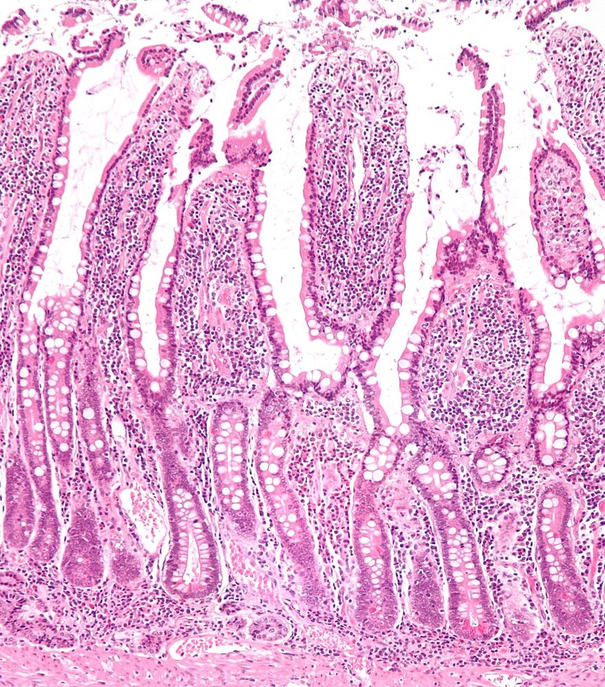{width="100%" height="360" fig-alt="Low-power micrograph of small intestine mucosa: many finger-like villi project into the lumen, each covered by a single layer of columnar epithelial cells."}

[Photo: Nephron, CC BY-SA 3.0, Wikimedia Commons](https://commons.wikimedia.org/wiki/File:Small_intestine_low_mag.jpg){.credit}

:::
::::

**Absorption needs a large surface. How large is it?**

::: notes
Exercise 1.4 asks for this order. The micrograph shows where steps 3 to 5 happen: each finger is a villus, covered by one layer of columnar enterocytes whose brush border faces the lumen. Walk it in space: lumen, brush border, apical membrane, cell, basolateral membrane, capillary, portal vein. The two transporters show why epithelial polarity (A1) matters: the Na⁺-glucose co-transporter on the apical side uses the Na⁺ gradient made by the Na⁺/K⁺-ATPase on the basolateral side, so absorption itself costs ATP. The hepatic portal vein means the liver sees absorbed nutrients first and can store glucose as glycogen before it reaches the rest of the body.
:::

## The absorptive surface

:::: {.columns}
::: {.column width="40%"}
The small intestine multiplies its area at three scales:

1. **Circular folds** of the wall (×3).
2. **Villi**, finger-like projections of the mucosa (×10).
3. **Microvilli** on each epithelial cell, the brush border (×20).

Two exit routes from a villus:

- **Blood capillaries:** glucose, amino acids.
- **Lacteal (lymph):** fats, repackaged as **chylomicrons**, too large for
  capillaries.
:::
::: {.column width="60%"}

{width="100%" height="360" fig-alt="A villus is lined by an epithelial barrier with surface projections; internal capillaries and a lymphatic vessel remove absorbed materials."}

:::
::::

::: notes
This is A1's solution 1, enlarging the surface, applied three times over: roughly 3 × 10 × 20, about 600-fold relative to a smooth tube. Exercise 1.5 asks for the three features from largest to smallest. The exit routes (exercise 1.6): water-soluble products enter the capillaries and go via the portal vein to the liver; fatty acids and monoglycerides are reassembled into triglycerides inside the enterocyte, packed with protein into chylomicrons, and leave into the lacteal. They reach the blood later where the thoracic duct joins a vein. Transition: all of this assumes the animal has the enzymes for its food. A herbivore does not.
:::

## Plant food: the cellulose problem

:::: {.columns}
::: {.column width="50%"}
- Plant cell walls are mostly **cellulose**; **vertebrates make no
  cellulase**.
- **Symbiotic microbes** ferment it in a gut chamber.
- The host absorbs their end products, **short-chain fatty acids** (acetate,
  propionate, butyrate): ~**70 %** of a cow's energy.
- The microbes are also a **protein source** if the host can digest them.
- Fermentation is slow: food is **retained** for hours to days.
:::
::: {.column width="50%"}

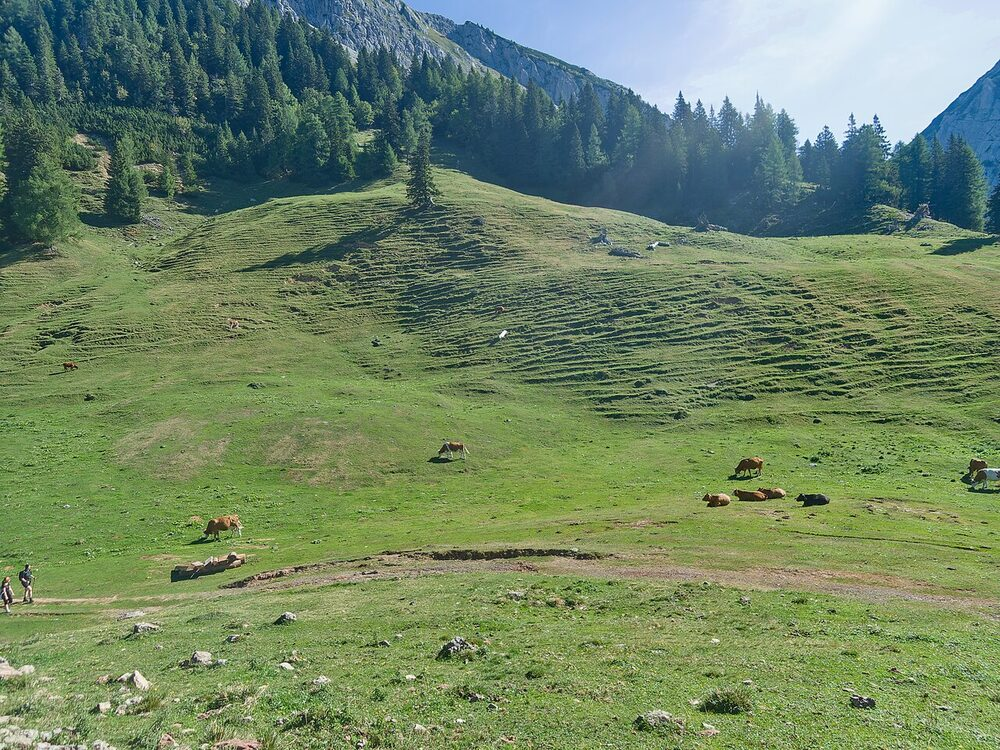{width="100%" height="360" fig-alt="Cows grazing on a mountain pasture."}

[Photo: Ajznponar, CC0, Wikimedia Commons](https://commons.wikimedia.org/wiki/File:Cows_grazing_at_the_Korosica_pasture_04.jpg){.credit}

:::
::::

**So where along the gut should the fermentation chamber be?**

::: notes
Exercise 2.1. The key idea is that the herbivore does not digest grass; its microbes do, and the herbivore lives largely on their waste products (short-chain fatty acids) and on the microbes themselves. Fermentation also produces methane and heat, which are losses for the host. The final bullet sets up the trade-off on the next slide: a fermentation chamber needs retention time, and its position relative to the small intestine decides whether microbial protein can be digested.
:::

## Foregut and hindgut fermenters

:::: {.columns}
::: {.column width="40%"}
**Foregut** (before the small intestine): cow, sheep, deer (ruminants),
kangaroo.

- Ruminant stomach: rumen, reticulum, omasum, abomasum (the true stomach).
- Microbes washed out are **digested in the small intestine**.

**Hindgut** (after the small intestine): horse, rabbit, many rodents.

- Fermentation in the **caecum** and colon.
- Microbial protein is mostly **lost in faeces**.
- Rabbits recover it by **caecotrophy**: eating soft faeces from the caecum.
:::
::: {.column width="60%"}

{width="100%" height="360" fig-alt="Foregut fermentation precedes the small intestine; hindgut fermentation follows it."}

:::
::::

::: notes
Exercises 2.2 and 2.3. The figure makes the logic visible: order matters. In a ruminant, food and microbes flow from the rumen into the abomasum and small intestine, so the host digests microbial protein like any other protein. In a horse or rabbit, the microbes grow downstream of the small intestine, so their protein passes out in the faeces unless the animal eats the caecotrophs. The trade-off: a ruminant extracts more from each mouthful but must hold food for a long time; a horse passes food faster and compensates by eating more. Transition: whatever the gut, we can now ask how much of the eaten energy the animal actually keeps.
:::

## The energy budget

:::: {.columns}
::: {.column width="40%"}
Over one stated interval:

$$E_{\rm ingested}=E_{\rm faeces}+E_{\rm excreted}+E_{\rm metabolic}+E_{\rm retained}$$

- **Faeces:** energy never absorbed (egestion).
- **Excreted:** chemical energy in urine, mainly urea.
- **Metabolic:** energy used and released as heat.
- **Retained:** new tissue, fat stores, offspring.
- **Absorbed** $=E_{\rm ingested}-E_{\rm faeces}$.
:::
::: {.column width="60%"}

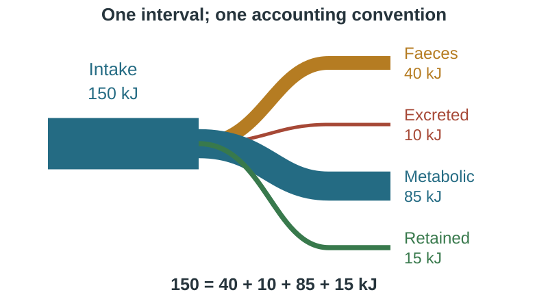{width="100%" height="360" fig-alt="Proportional energy-flow bands partition 150 kilojoules into faecal, excreted, metabolic and retained terms."}

:::
::::

::: notes
This is energy conservation applied to an animal. Every term must be for the same interval (here one day). The egestion/excretion distinction from the first slide appears here as two separate terms. Metabolic expenditure includes all work done inside the body; that work ends up as heat, so heat is not added as an extra term. In the figure, 150 kJ in, 40 kJ in faeces, so 110 kJ absorbed, which is 73 % of intake. Next slide: what retained energy means, and what happens when it is negative.
:::

## Retained energy can be negative

:::: {.columns}
::: {.column width="40%"}
Intake 150 kJ, faeces 40 kJ, excreted 10 kJ:
**100 kJ available** for metabolism and retention.

| Metabolic | Retained |
| ---: | ---: |
| 85 kJ | **+15 kJ** |
| 110 kJ | **−10 kJ** |

- Positive: the animal grows or stores fat.
- Negative: it **draws on stores** (fat, glycogen) and loses body energy.
:::
::: {.column width="60%"}

{width="100%" height="360" fig-alt="After fixed losses, 100 kilojoules remain; spending 85 leaves +15 retained, spending 110 leaves −10."}

:::
::::

**Budgets are in joules per day; metabolic rates are usually in watts. How do they compare?**

::: notes
Work both lines on the board. A negative retained term is normal for short periods: overnight, during migration, in a lactating mother, in a hibernating mammal. It does not mean negative food; it means stored energy is converted to heat and work. Point out that this budget counts only energy: an animal can have a positive energy balance and still fail to grow if, for example, it lacks an essential amino acid. Transition to units.
:::

## Energy is not power

:::: {.columns}
::: {.column width="40%"}
- **Energy** is an amount: joules (J).
- **Power** is a rate: J s⁻¹ = **watts (W)**.
- To compare, convert to the same time unit. 1 day = 86 400 s.

**Example:** a human uses about 8 400 kJ day⁻¹.

$$\frac{8\,400\,000\ \text{J}}{86\,400\ \text{s}} \approx 97\ \text{W}$$

A person is a ~100 W heater, all day.
:::
::: {.column width="60%"}

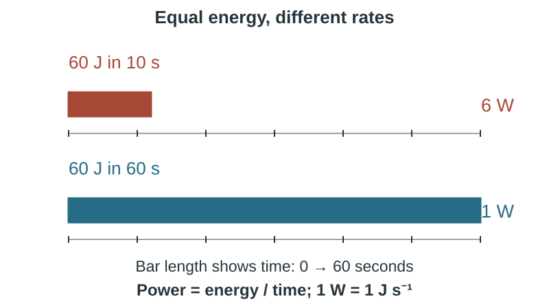{width="100%" height="360" fig-alt="The same 60 joules transferred in 10 seconds gives 6 watts, versus 1 watt over 60 seconds."}

:::
::::

::: notes
Exercises 3.2 and 3.3 test this. The figure shows the same 60 J delivered over different times: same energy, different power. The human example makes the watt tangible: a room of 30 students adds about 3 kW of heat. Emphasise that "2 000 kJ eaten" is an energy and "80 W resting" is a power; they cannot be added or subtracted until one is converted. Transition: the metabolic term is spent inside cells, as ATP. How do cells make it?
:::

## Turning fuel into ATP {.smaller}

:::: {.columns}
::: {.column width="45%"}
| | Anaerobic glycolysis | Aerobic metabolism |
| --- | --- | --- |
| Where | Cytosol | Cytosol, then mitochondria (citric acid cycle, electron transport chain) |
| Needs O₂? | No | Yes: final electron acceptor |
| End products | Lactate | CO₂ + H₂O |
| ATP per glucose | **2** | **~30** |
| Rate | Fast, short-lived | Slower, sustainable |

- Aerobic metabolism gets ~15× more ATP from each glucose.
- Anaerobic glycolysis makes ATP fast, but lactate accumulates.
:::
::: {.column width="55%"}

{width="100%" height="360" fig-alt="Cytosolic glycolysis and oxygen-dependent mitochondrial pathways both contribute ATP."}

:::
::::

**So which does a running animal use?**

::: notes
This is the table of exercise 4.1. Glycolysis happens in the cytosol either way; the difference is what happens to pyruvate. With O₂, pyruvate enters the mitochondrion and is oxidised fully to CO₂, and the electron transport chain uses O₂ as the final electron acceptor, giving about 30 ATP per glucose in total. Without enough O₂, pyruvate is reduced to lactate to regenerate NAD⁺, and the cell gets only the 2 ATP of glycolysis. Fats and proteins also feed the aerobic pathway, which is why fat can be burned only aerobically.
:::

## A sprint uses three ATP sources

:::: {.columns}
::: {.column width="55%"}
| Source | O₂? | Sustains hard work |
| --- | --- | --- |
| **Phosphocreatine** (PCr + ADP → Cr + ATP) | No | ~10 s |
| **Anaerobic glycolysis** → lactate | No | ~1–2 min |
| **Aerobic metabolism** | Yes | Hours |

- A sprint runs mostly on the first two.
- O₂ uptake measures **only aerobic** ATP, so in a sprint it
  **underestimates** ATP use.
- Afterwards O₂ uptake stays high while PCr is rebuilt and lactate cleared
  (**excess post-exercise O₂ consumption**).
:::
::: {.column width="45%"}

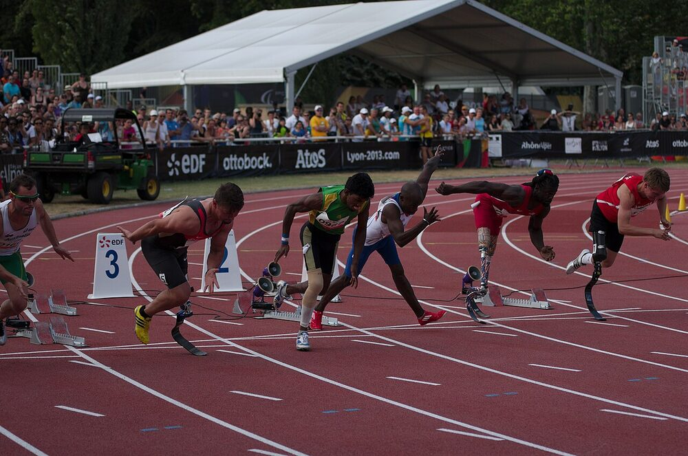{width="100%" height="360" fig-alt="Sprinters pushing off from the starting blocks at the start of a 100 m race."}

[Photo: Clément Bucco-Lechat, CC BY-SA 3.0, Wikimedia Commons](https://commons.wikimedia.org/wiki/File:2013_IPC_Athletics_World_Championships_-_26072013_-_Start_of_the_Men%27s_100m_-_T42.jpg){.credit}

:::
::::

**Even so, O₂ consumption is the standard measure of metabolic rate. How is it measured?**

::: notes
Exercise 4.2. The three systems overlap rather than switch on in sequence, but their capacities differ greatly. A 100 m sprinter runs mostly on phosphocreatine and glycolysis; a marathon runner almost entirely aerobically. Because the anaerobic sources are later repaid aerobically, O₂ consumption averaged over a longer period still tracks total energy use. At rest and during steady activity, nearly all ATP is aerobic, which is why O₂ consumption is used as the measure of metabolic rate: each litre of O₂ consumed corresponds to about 20 kJ of energy released.
:::

## Measuring metabolic rate: respirometry

:::: {.columns}
::: {.column width="45%"}
Closed 0.10 L chamber of water, 10 min:

| Step | Result |
| --- | --- |
| 0.10 L × 0.40 mg L⁻¹ | 0.040 mg |
| ÷ 10 min | 0.0040 mg min⁻¹ |
| − blank 0.0010 | **0.0030 mg min⁻¹** |
| ÷ 1.5 g animal | **0.0020 mg min⁻¹ g⁻¹** |

- **Concentration × volume = amount.**
- The **blank** removes O₂ use that is not the animal's (microbes, drift).
:::
::: {.column width="55%"}

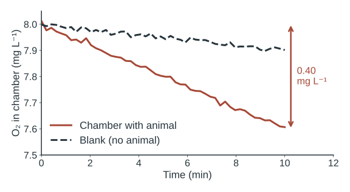{width="100%" height="360" fig-alt="O2 concentration falls by 0.40 mg per litre over 10 minutes in the chamber with an animal, and by 0.10 mg per litre in the blank chamber."}

:::
::::

::: notes
The figure shows the raw data behind the table: the steeper fall with the animal, the shallow fall in the blank. Go through the units at every row; students' usual error is to forget the volume and report mg L⁻¹ as if it were an amount. The blank corrects for microbial respiration and sensor drift; if the blank is given per interval as a concentration change, subtract it before multiplying by volume. Dividing by mass lets animals of different size be compared; mass-specific rate is a fair comparison between similar-sized animals; across large size ranges metabolic rate does not scale in direct proportion to mass, so mass-specific rate falls with size. Transition: one animal gives one number. To compare two temperatures, we need several animals.
:::

## Comparing temperatures: what is a replicate?

Six animals of 1.5 g, each in **its own chamber**, 5 sensor readings each:

| Temperature | Rate of each animal (mg min⁻¹ g⁻¹) | Mean |
| --- | --- | ---: |
| 15 °C | A: 0.0018 · B: 0.0020 · C: 0.0022 | **0.0020** |
| 25 °C | D: 0.0046 · E: 0.0050 · F: 0.0054 | **0.0050** |

- The **independent replicate is the animal**: n = 3 per temperature, not 15.
  Repeated readings from one animal are not new animals.
- Keep other conditions equal: activity, feeding state, time of day,
  acclimation.

**The rate rose 2.5-fold over 10 °C. How do we describe that?**

::: notes
Exercise 4.4 asks the same question for its own data. Pseudoreplication (treating the 15 readings as 15 samples) inflates confidence. Other variables that change metabolic rate must be held constant: a recently fed animal has a higher rate (the cost of digesting), an active one far higher. Acclimation (A1) also matters: animals kept at 25 °C for weeks may differ from animals moved there an hour ago. Transition to Q10.
:::

## Temperature and rate: $Q_{10}$

:::: {.columns}
::: {.column width="40%"}
$Q_{10}$ is the factor by which a rate changes over **10 °C**:

$$Q_{10}=\left(\frac{R_2}{R_1}\right)^{10/(T_2-T_1)}$$

- Previous slide: 0.0020 → 0.0050 over 15 → 25 °C, so $Q_{10}=2.5$.
- Each further 10 °C multiplies the rate again: the curve is **exponential**.
- Most biological rates: $Q_{10}$ of **2–3**.
:::
::: {.column width="60%"}

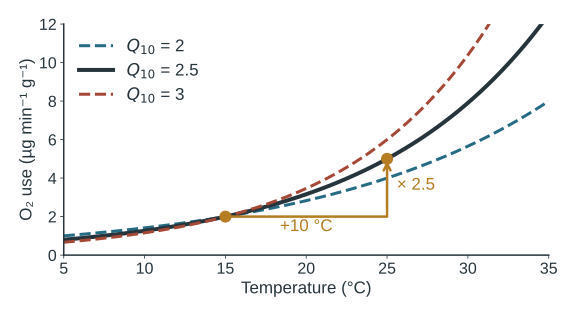{width="100%" height="360" fig-alt="Rate against temperature rises exponentially; curves for Q10 of 2, 2.5 and 3 pass through the same point at 15 degrees, and the measured rise from 15 to 25 degrees is a factor of 2.5."}

:::
::::

::: notes
The figure shows what a constant Q10 means: the same factor for every 10 °C step, so the curve bends upwards. Three curves through the same measured point at 15 °C show how much the prediction depends on the Q10 value at higher temperatures. The gold step is the 15 → 25 °C comparison from the respirometry data.
:::

## Using $Q_{10}$

| Example | Calculation | Result |
| --- | --- | --- |
| Six-animal data, 15 → 25 °C | $(0.0050/0.0020)^{10/10}$ | $Q_{10}=2.5$ |
| Rate 1.5 → 6.0, 5 → 25 °C | $(6.0/1.5)^{10/20}=4^{0.5}$ | $Q_{10}=2.0$ |
| Predict: rate 3.0 at 15 °C, $Q_{10}=2.5$ | $3.0\times2.5$ | 7.5 at 25 °C |

- $Q_{10}$ describes **only the measured range**. At higher temperatures rates
  level off and then fall as proteins and membranes are damaged.

**So does every animal's metabolic rate simply follow the temperature around it?**

::: notes
Exercise 5.1 uses both forms of the calculation. The exponent 10/(T₂ − T₁) converts any interval to a 10 °C interval: over 20 °C the ratio is Q10 squared, so the square root gives Q10. Q10 of 2–3 reflects the temperature dependence of enzyme-catalysed reactions. The limitation in the last bullet is exercise 5.3d: never extrapolate a Q10 beyond the measured range. The transition question: this is true of our resting ectotherm, but not of a mouse.
:::

## Heat source and temperature stability

:::: {.columns}
::: {.column width="60%"}
| | Temp. **varies** (poikilotherm) | Temp. **stable** (homeotherm) |
| --- | --- | --- |
| **External** heat (ectotherm) | Frog, most insects | Deep-sea fish |
| **Metabolic** heat (endotherm) | Hibernating ground squirrel | Mouse, human, birds |

- **Ecto/endotherm:** the **source** of body heat.
- **Poikilo/homeotherm:** how much body temperature **varies**.
- An endotherm's resting rate is **5–10×** an ectotherm's at the same mass and
  body temperature.
:::
::: {.column width="40%"}

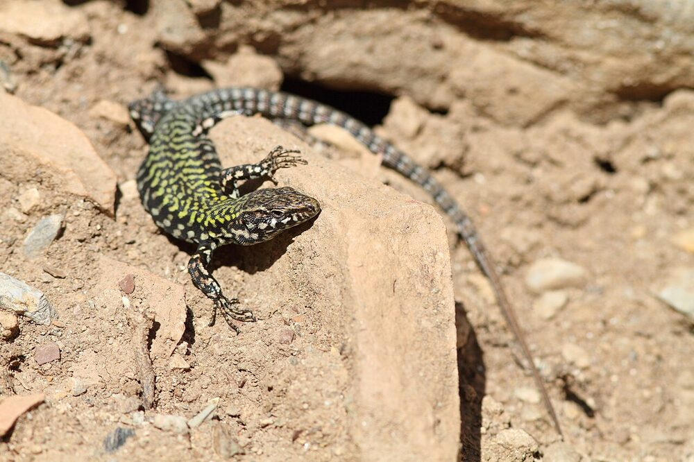{width="100%" height="360" fig-alt="A wall lizard basking flat on a sunlit stone."}

[Photo: Bouke ten Cate, CC BY 4.0, Wikimedia Commons](https://commons.wikimedia.org/wiki/File:Muurhagedis_-_wall_lizard_-_Podarcis_muralis_2.jpg){.credit}

:::
::::

**How does heat enter and leave an animal?**

::: notes
Exercise 5.2. The two pairs of terms answer different questions, so the 2×2 table has an example in every cell. The off-diagonal cells are the ones that break the old "cold-blooded / warm-blooded" labels: a deep-sea fish has a very constant temperature without making heat; a hibernating squirrel is an endotherm that lets its body cool to a few degrees. The 5–10× figure is the answer to the opening question: endothermy is expensive. Exercise 5.3a: ectotherms are not unable to regulate; they regulate by behaviour. The photo shows it: a basking lizard flattens its body and orients it towards the sun to gain heat by radiation and from the warm stone, and moves into shade when it is warm enough, holding about 35 °C during the day.
:::

## Four routes of heat exchange

:::: {.columns}
::: {.column width="40%"}
- **Radiation:** infrared and sunlight; no contact.
- **Conduction:** direct contact, e.g. a warm rock.
- **Convection:** carried by moving air or water.
- **Evaporation:** water to vapour, ~2.4 kJ per g; panting, sweating.

The first three can **add or remove** heat; evaporation only **removes** it.
Body temperature is stable when heat gained equals heat lost.
:::
::: {.column width="60%"}

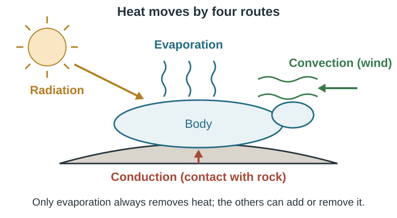{width="100%" height="360" fig-alt="An animal on a rock in the sun: radiation from the sun and conduction from the rock add heat, wind removes heat by convection, and evaporation removes heat from the body surface."}

:::
::::

**For an endotherm, how much heat must metabolism supply?**

::: notes
Exercise 5.5. Radiation and conduction are the ones students mix up: radiation needs no contact, conduction does. Convection is conduction plus a moving fluid, which is why wind chills. Evaporation is the only route that works when the surroundings are hotter than the body, and it costs water (a link to A4). The heat balance sentence is A1's "input equals output" again, now for heat. Transition: the endotherm must make up whatever it loses, so its metabolic rate depends on the ambient temperature.
:::

## The thermoneutral zone

:::: {.columns}
::: {.column width="40%"}
- **Thermoneutral zone (TNZ):** metabolism **minimal and constant**; blood
  flow and posture adjust heat loss.
- **Below the lower critical temperature (LCT):** heat loss ∝
  (body − ambient), so metabolism **rises**.
- **Above the upper critical temperature:** active cooling **costs** energy and
  water.
- Unclothed human: TNZ ~28–32 °C. Arctic fox: LCT ~**−40 °C**.
:::
::: {.column width="60%"}

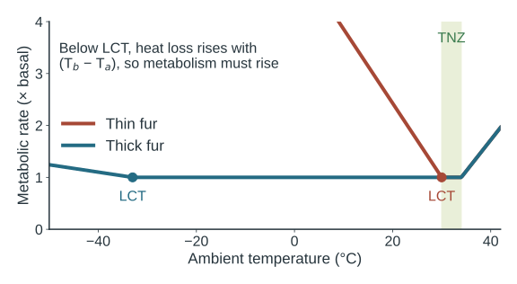{width="100%" height="360" fig-alt="Metabolic rate against ambient temperature: flat in the thermoneutral zone, rising linearly below the lower critical temperature and rising above the upper critical temperature. Thick fur moves the lower critical temperature from 30 to about minus 33 degrees."}

:::
::::

**So what can a mammal do to save heat or make more of it?**

::: notes
Exercise 5.4. The figure is the classic U-shaped curve: flat in the middle, rising on both sides. The two lines below the zone show the effect of insulation: with thick fur the same basal heat production balances losses down to a much lower ambient temperature. Within the zone, the animal controls heat loss cheaply by adjusting skin blood flow, posture and fur; below it, those adjustments are exhausted and only extra heat production remains. The Arctic fox comparison (Scholander's classic data) shows that insulation moves the lower critical temperature: a well-insulated animal pays nothing extra until it is very cold. Exercise 5.3c: metabolic rate is lowest in the thermoneutral zone.
:::

## Try it: mouse versus lizard across temperatures

```{=html}
<link rel="stylesheet" href="../../demos/dist/demo.css">
<div data-demo="a2-thermal"></div>
<script src="../../demos/dist/a2-thermal.js"></script>
```

::: notes
The thermoneutral-zone curve for a 25 g mouse (red) next to a 25 g lizard (blue) whose body follows the air. Drag the gold handle along the temperature axis, or use the presets. At 20 °C the mouse is below its lower critical temperature and spends about 40 kJ a day, roughly 90 times the lizard. Move to 32 °C: the mouse is in its thermoneutral zone and the ratio drops to about 13, close to the 5–10× of the previous slides. Go to 0 °C: the mouse's cost climbs steeply while the lizard's falls. Now add fur ("Thick winter fur"): the lower critical temperature moves down and the cost at 0 °C falls by a factor of four, which is why insulation is the first line of defence (next slide). Tick "Log scale" to see the lizard properly: its Q₁₀ curve becomes a straight line, and the Q₁₀ slider changes its slope. Model: basal rate 0.20 W, heat loss = conductance × (37 − Ta), conductance divided by the insulation factor; lizard rate = basal/8 at 37 °C scaled by Q₁₀.
:::

## Staying warm in the cold

:::: {.columns}
::: {.column width="55%"}
**Reduce heat loss**

- **Insulation:** fur, feathers, fat; **piloerection** traps more air.
- **Vasoconstriction** of skin vessels.
- **Countercurrent heat exchange** in limbs: feet run cold.
- **Posture and huddling:** less exposed surface (A1's $A/V$).

**Increase heat production**

- **Shivering:** contraction without movement; ATP use becomes heat.
- **Brown adipose tissue:** UCP1 lets protons leak back into mitochondria,
  so fuel is oxidised without making ATP: all heat.
:::
::: {.column width="45%"}
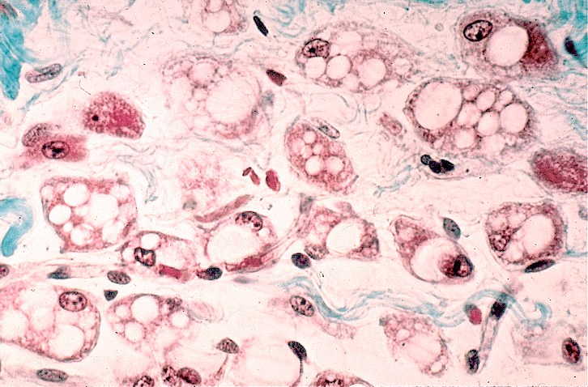{width="100%" height="300" style="object-fit: contain;" fig-alt="Light micrograph of brown adipose tissue: each cell has a central nucleus and many small, pale fat droplets in a pink, granular cytoplasm."}

[Micrograph: unknown author (US government), Public domain, Wikimedia Commons](https://commons.wikimedia.org/wiki/File:Tecido_adiposo_multilocular_brown_adipose_tissue.gif){.credit}
:::
::::

::: notes
Exercise 5.6 asks for four of these. Each one can be mapped to the previous slides: insulation and posture reduce conduction and convection; countercurrent exchange is the same principle we will see for O₂ in fish gills in A3; brown fat reuses the ATP slide, because it short-circuits the electron transport chain. Brown fat is prominent in newborn mammals, small mammals and hibernators arousing from torpor. The micrograph shows brown adipose tissue: each brown adipocyte holds many small fat droplets (multilocular) rather than one large one, with a central nucleus, and its granular cytoplasm is packed with mitochondria, which give the tissue its colour. Compare white fat, where one large droplet pushes the nucleus to the edge. Huddling also uses surface-to-volume: a group of mice behaves like one larger animal.
:::

## Back to the opening problem: mouse versus lizard

:::: {.columns}
::: {.column width="50%"}
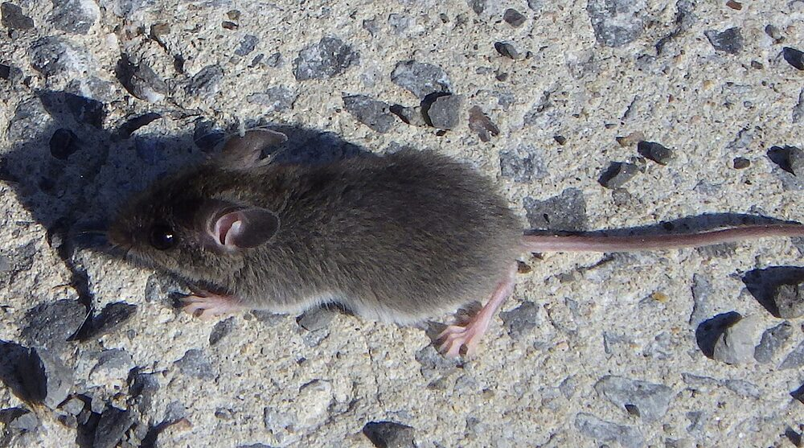{width="100%" height="230" fig-alt="A house mouse on the ground."}

[Photo: Ahunt, CC0, Wikimedia Commons](https://commons.wikimedia.org/wiki/File:House_mouse_(Mus_musculus)_2732.jpg){.credit}

**Mouse (endotherm):** ~37 °C in any weather, active at night and in winter;
pays with ~55 kJ of food a day.
:::
::: {.column width="50%"}
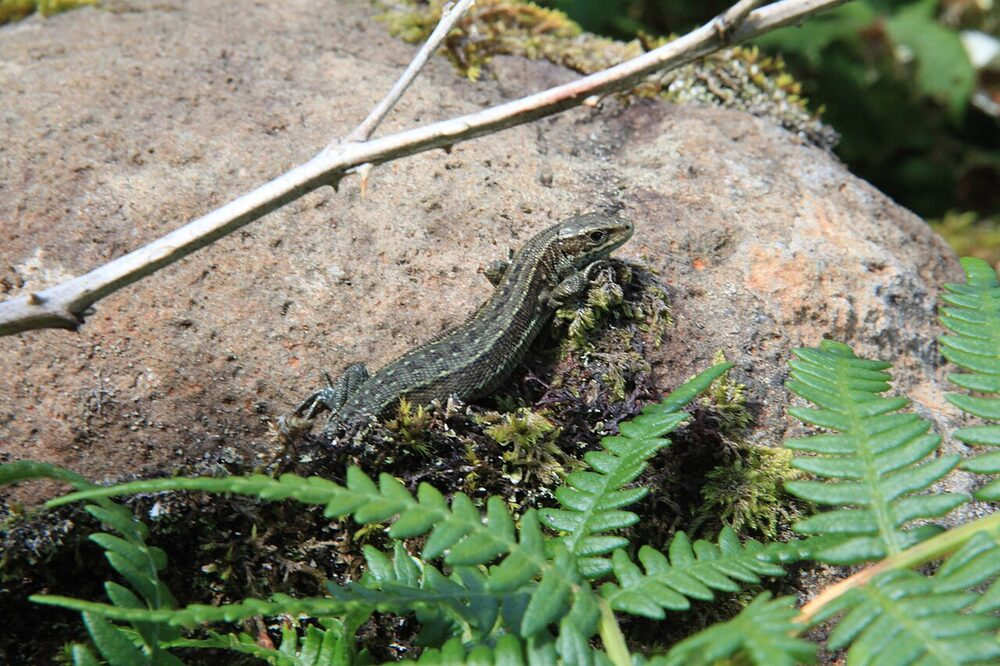{width="100%" height="230" fig-alt="A common lizard basking on a stone wall."}

[Photo: Michael Jagger, CC BY-SA 2.0, Wikimedia Commons](https://commons.wikimedia.org/wiki/File:Common_lizard_basking_on_dry_stone_wall_-_geograph.org.uk_-_2030617.jpg){.credit}

**Lizard (ectotherm):** temperature set by basking and shelter, active only
when warm; needs about a tenth of the food.
:::
::::

Rising O₂ use with temperature change means different things: the **cold
mouse** defends 37 °C; the **warming lizard** speeds up its reactions.

**Both still need O₂ delivered to their mitochondria. That is A3.**

::: notes
Close the loop to the first slide. Neither strategy is better: the mouse buys independence from the weather at a high food cost; the lizard saves food but loses activity time. The final contrast is exercise 5.3b and the last paragraph of the tutorial: an increase in O₂ consumption when temperature changes can mean defence of body temperature (endotherm below its lower critical temperature) or faster reactions in a warming body (ectotherm). Bridge to A3: the respirometer measured O₂ consumption; next we follow that O₂ from the air to the mitochondrion.
:::

## Summary {.smaller}

| Concept | Key fact |
| --- | --- |
| Five processes | ingestion, digestion, absorption, egestion (faeces), excretion (metabolic waste) |
| Digestion | enzymatic hydrolysis; amylase, pepsin, trypsin, lipase; bile emulsifies |
| Absorptive surface | folds, villi, microvilli; sugars and amino acids → blood, fats → lacteals |
| Fermentation | microbes digest cellulose → short-chain fatty acids; foregut (cow) vs hindgut (horse) |
| Energy budget | ingested = faeces + excreted + metabolic + retained, over one interval |
| Energy vs power | J vs W = J s⁻¹; 1 day = 86 400 s |
| ATP supply | anaerobic: 2 ATP/glucose, lactate; aerobic: ~30 ATP/glucose, needs O₂ |
| Respirometry | O₂ use = Δconcentration × volume / time − blank; replicate = animal |
| $Q_{10}$ | $(R_2/R_1)^{10/(T_2-T_1)}$; typically 2–3; valid only in the measured range |
| Thermal terms | ecto/endotherm = heat source; poikilo/homeotherm = temperature variation |
| Thermoneutral zone | minimal metabolism; below lower critical temperature, metabolism rises |

**Next (A3 — Gas exchange and circulation):** follow the O₂ that the
respirometer measured, from the air or water to the mitochondrion: exchange
surfaces, haemoglobin and the heart.

[Tutorial](index.qmd) · [Exercises](exercise.qmd) · [Quiz](quiz.qmd)

::: notes
Read the table in story order: food enters, is digested and absorbed, possibly with microbial help; its energy is partitioned in the budget; the metabolic part is turned into ATP, measured as O₂ consumption; and temperature changes that rate, very differently in ectotherms and endotherms. The A3 preview follows the oxygen side of metabolism.
:::
