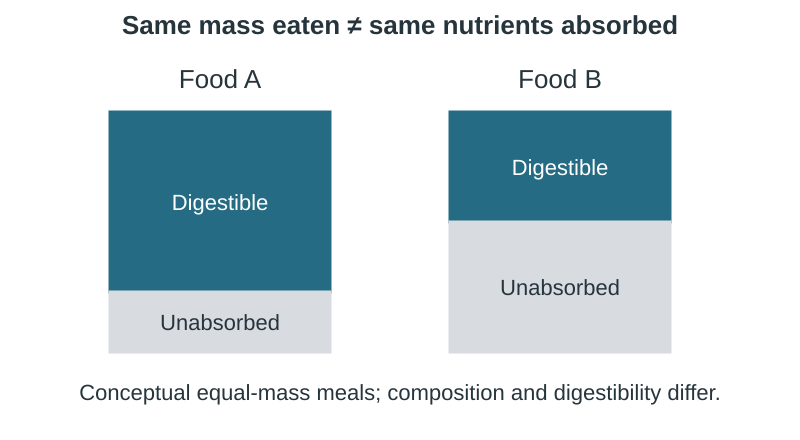
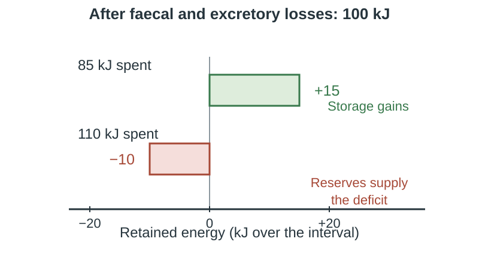
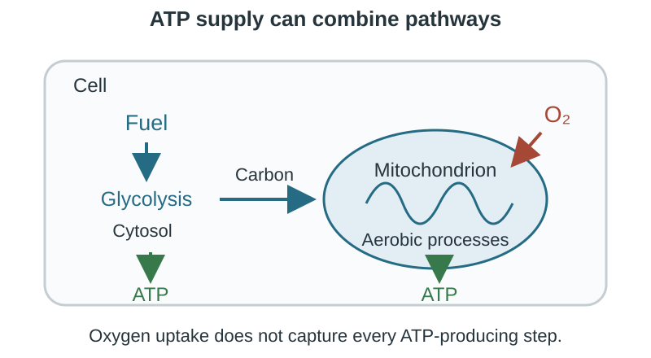

## Equal food mass, unequal outcome?

:::: {.columns}
::: {.column width="42%"}
- Intake differs from absorption.
- Essential nutrients and energy are separate constraints.
- Equal mass need not produce an equal outcome.
:::
::: {.column width="58%"}
{fig-alt="Equal food mass can supply different absorbable fractions." width="100%" height="360"}
:::
::::

## Trace the processes

:::: {.columns}
::: {.column width="42%"}
- Digestion breaks down food.
- Absorption crosses a selective barrier.
- Unabsorbed material remains in the lumen; metabolic wastes follow other routes.
:::
::: {.column width="58%"}
{fig-alt="Food follows a gut lumen; absorption crosses the epithelial boundary into blood or lymph." width="100%" height="360"}
:::
::::

## Absorption depends on structure

:::: {.columns}
::: {.column width="42%"}
- More area supports exchange.
- Transport still requires a selective membrane pathway.
- Removal maintains a transport route.

Schematic, not a tissue image.
:::
::: {.column width="58%"}
{fig-alt="A villus schematic shows epithelial surface, blood capillaries and a lymphatic route." width="100%" height="360"}
:::
::::

## Microbes change the food problem

:::: {.columns}
::: {.column width="42%"}
- Microbes make some food resources accessible.
- Location changes recovery of microbial products and biomass.
- Retention and passage create trade-offs.
:::
::: {.column width="58%"}
{fig-alt="Foregut fermentation precedes the small intestine; hindgut fermentation follows it." width="100%" height="360"}
:::
::::

## Define an energy budget

:::: {.columns}
::: {.column width="42%"}
In this teaching convention:

intake = faeces + excreted + metabolic + retained.

Use one interval and avoid double counting.
:::
::: {.column width="58%"}
{fig-alt="Proportional energy-flow bands partition 150 kilojoules into faecal, excreted, metabolic and retained terms." width="100%" height="360"}
:::
::::

## Calculate the retained balance

:::: {.columns}
::: {.column width="42%"}
150 − 40 − 10 = **100 kJ available**.

- Spend 85 → retain **15 kJ**.
- Spend 110 → retain **−10 kJ**.

A deficit draws on reserves; it does not create negative food.
:::
::: {.column width="58%"}
{fig-alt="A zero-centered balance compares 15 kilojoules retained with a 10-kilojoule deficit." width="100%" height="360"}
:::
::::

## Energy is not power

:::: {.columns}
::: {.column width="42%"}
- Energy is an amount: J.
- Power is a rate: J s⁻¹ = W.
- Convert time units before comparing.

The bars represent elapsed time.
:::
::: {.column width="58%"}
{fig-alt="The same 60 joules transferred in 10 seconds gives 6 watts, versus 1 watt over 60 seconds." width="100%" height="360"}
:::
::::

## Aerobic and anaerobic supply

:::: {.columns}
::: {.column width="42%"}
- Aerobic supply depends on oxygen delivery and fuel.
- Some ATP-producing steps do not directly use oxygen.
- One bout can use both.

Oxygen uptake is not every ATP flux at every instant.
:::
::: {.column width="58%"}
{fig-alt="Cytosolic glycolysis and oxygen-dependent mitochondrial pathways both contribute ATP." width="100%" height="360"}
:::
::::

## A rate needs a measurement model

0.10 L water × 0.40 mg L⁻¹ decline / 10 min = 0.0040 mg min⁻¹.

Subtract an appropriate blank rate of 0.0010 mg min⁻¹:
**0.0030 mg min⁻¹** apparent animal oxygen use.

Supplied arithmetic example, not an animal-handling protocol.

## Comparisons need context

- Temperature, activity, feeding and acclimation can matter.
- Repeated sensor readings are not new animals.
- Dividing by mass does not remove every size effect.
- Identify the independent organism/chamber arrangement.

## Heat source and temperature variation

- Ectothermy/endothermy concern major heat sources.
- Poikilothermy/homeothermy concern temperature variability.
- Ectotherms can regulate behaviourally.
- Endotherms need not have perfectly constant temperature.

## Describe a temperature effect

$$Q_{10}=(R_2/R_1)^{10/(T_2-T_1)}.$$

A rate rising from 2 to 4 between 10 and 20 °C gives $Q_{10}=2$.

This describes the measured interval; it is not a universal extrapolation rule.

## Cold can increase an endotherm's costs

- Heat loss may require greater metabolic heat production.
- Insulation, posture and blood flow alter exchange.
- Cooling in heat can cost water.
- State ambient and body temperature separately.

## Warming can increase an ectotherm's rate

- Body temperature often follows environmental change.
- Rates may rise over a moderate range.
- Performance eventually faces limits.
- A similar oxygen-rate trend need not imply the same mechanism.

## Explain the trade-off

Compare a basking reptile and an insulated mammal in cool conditions.

Where does heat come from? When is activity possible? What are food and water
costs? What observations would test the explanation?

[Tutorial and source links](index.qmd) · [Exercises](exercise.qmd) · [Quiz](quiz.qmd)
