## About this lecture

In A2 we measured metabolic rate as O₂ consumption, and saw that sustained work
needs aerobic ATP. A person at rest uses about 250 mL of O₂ per minute. Start
running, and within a minute that rises more than tenfold, to about 3 L min⁻¹.
**How does the body move ten times more oxygen from the air into working
muscle mitochondria?** We follow one O₂ molecule along the whole route.

- **Physics of exchange:** partial pressure, Fick's law, ventilation and
  perfusion.
- **Exchange organs:** fish gills, mammalian lungs, bird lungs, insect
  tracheae.
- **Oxygen in blood:** haemoglobin, the dissociation curve and its shifts;
  CO₂ transport.
- **The pump and the pipes:** the double circulation, vessels, pressure,
  resistance and flow.
- **Back to the runner:** cardiac output and the Fick principle.

::: notes
The running example is a person starting to run; we return to them on the last content slide with real numbers. Link to A1: the three solutions (large surface, thin barrier, bulk flow) are exactly what we now examine organ by organ. Link to A2: the respirometer measured O₂ disappearing; now we ask how it got to the mitochondria. Mention that A4 will show the cost of this design: a thin, wet, permeable surface exchanges water and ions as well as gases.
:::

## The path of oxygen: bulk flow and diffusion alternate

:::: {.columns}
::: {.column width="40%"}
- **Bulk flow** moves the whole fluid, driven by a **pressure** difference.
  Fast over any distance, but needs a pump.
- **Diffusion** moves molecules down a **partial-pressure** difference.
  Fast only over µm (A1: $t \approx x^2/2D$).
- So diffusion steps cross **thin** barriers; bulk flow covers the long
  distances.
:::
::: {.column width="60%"}

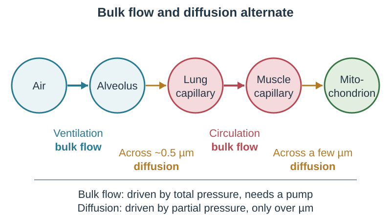{width="100%" height="360" fig-alt="Oxygen moves from air to alveolus by ventilation, diffuses into the lung capillary, is carried by the circulation to a muscle capillary and diffuses into the mitochondrion."}

:::
::::

**What exactly drives the diffusion steps?**

::: notes
Exercise 1.1 asks students to classify these four steps. This is A1's "three solutions" turned into a route. Ventilation and circulation are the two pumps; the alveolar wall and the muscle capillary wall are the two diffusion steps, each less than a few micrometres. Emphasise the different drivers: total pressure for bulk flow, partial pressure for diffusion. The next slide defines partial pressure.
:::

## Partial pressure drives diffusion

**Partial pressure** = the share of the total pressure due to one gas
(Dalton's law): $P_{\rm O_2} = F_{\rm O_2} \times P_{\rm total}$

:::: {.columns}
::: {.column width="40%"}
Dry air at sea level:
$0.209 \times 101.3 = 21.2$ kPa (159 mmHg).

- O₂ moves **down this cascade** at every diffusion step.
- In a liquid, $P_{\rm O_2}$ refers to the **dissolved** O₂ only.
- 1 kPa = 7.5 mmHg.
:::
::: {.column width="60%"}

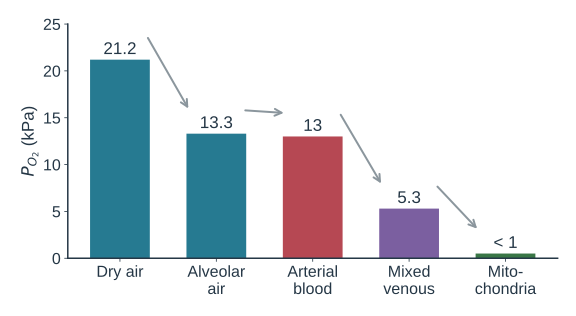{width="100%" height="360" fig-alt="Bar chart of PO2: dry air 21.2 kPa, alveolar air 13.3, arterial blood 13, mixed venous blood 5.3, mitochondria below 1."}

:::
::::

**How fast does it cross each barrier?**

::: notes
Exercise 1.2 is the Dalton calculation. Alveolar P_O2 is lower than in air because inspired air is humidified and mixes with air already in the lungs, and O₂ is constantly removed. The mitochondria act as the sink that keeps the whole cascade going. Point out that diffusion follows partial pressure, not concentration: this matters later when blood with haemoglobin holds far more O₂ than water at the same P_O2.
:::

## Fick's law of diffusion

$$\dot M \propto \frac{A\,\Delta P}{L}$$

| Change | Effect on transfer rate |
| --- | --- |
| Double the area $A$ | ×2 |
| Double the partial-pressure difference $\Delta P$ | ×2 |
| Double the barrier thickness $L$ | ×½ |

- Human lung: about **100 m²** of alveolar surface, an air–blood barrier about
  **0.5 µm** thick.
- Lung disease shows the law at work: **emphysema** destroys alveolar walls
  (smaller $A$); **pulmonary oedema** thickens the barrier (larger $L$).
- The cost: a large, thin, moist surface is fragile and **loses water**.

**Diffusion uses up the gradient. What keeps $\Delta P$ high?**

::: notes
Exercise 1.3 combines several changes: multiply the factors (for example, twice the area, twice the thickness and half the ΔP give 2 × ½ / 2 = ½). The diffusion coefficient and solubility of the gas are held constant in the proportionality. The last bullet links forward to A4: a surface built to let O₂ through also lets water and ions through. Transition: as O₂ diffuses into the blood, the gas side would lose O₂ and the blood side would fill up, and the gradient would vanish without bulk flow on both sides.
:::

## Ventilation and perfusion keep the gradient

| | Ventilation | Perfusion |
| --- | --- | --- |
| What moves | Air or water over the surface | Blood through the surface |
| Effect | Replaces O₂-depleted medium | Removes O₂-loaded blood, brings O₂-poor blood |
| Keeps... | **External** $P_{\rm O_2}$ high | **Internal** $P_{\rm O_2}$ low |

- Both are **bulk flow**, both need a **pump** (breathing muscles, heart).
- Exchange is limited by whichever is lower: ventilating an unperfused alveolus
  achieves nothing.

**Air and water are very different media to ventilate. How different?**

::: notes
Exercise 1.4. A respiratory surface has two sides and each needs renewing. Without ventilation, alveolar P_O2 would fall towards venous P_O2 within seconds; without perfusion, the blood in the capillary would equilibrate with alveolar air and no further uptake would occur. The matching of ventilation and perfusion is regulated locally in the lung. Transition to the comparison of media, which explains why fish and mammals have such different organs.
:::

## Breathing water versus breathing air

| Property | Air | Water (15 °C) | Consequence for a water breather |
| --- | ---: | ---: | --- |
| O₂ content | ~209 mL L⁻¹ | ~7 mL L⁻¹ | ~30× more medium to move per mL O₂ |
| O₂ diffusion coefficient | ×1 | ~10 000× lower | Diffusion distances must be very short |
| Density | ×1 | ~800× higher | Moving it is costly |
| Viscosity | ×1 | ~50× higher | Moving it is costly |

- A fish must pump a dense, viscous medium that holds little O₂.
- So it moves water **in one direction** over the gills, rather than in and
  out, and extracts as much O₂ as possible from each litre.
- Air breathers can afford **tidal** ventilation: the medium is light and rich
  in O₂.

**How does a gill extract so much from so little?**

::: notes
This slide explains the design differences on the next four slides from first principles. Water at the same P_O2 as air carries about thirty times less O₂ because O₂ is poorly soluble. Ventilating water costs a fish a substantial share of its resting metabolism; for a resting mammal, breathing costs only a few per cent. Unidirectional flow avoids having to stop and reverse a heavy column of water. A1's diffusion numbers also return: diffusion in water is slow, so gill lamellae are extremely thin.
:::

## Fish gills: a one-way flow over thin lamellae

:::: {.columns}
::: {.column width="40%"}
- Gill arches → filaments → **secondary lamellae**, the exchange surface.
- Water flows **one way**: mouth → gills → operculum.
- Blood in the lamellae flows **opposite** to the water.
- Fish extract up to **80 %** of the O₂ in the water; a mammal removes ~25 %
  of the O₂ in each breath.
:::
::: {.column width="60%"}

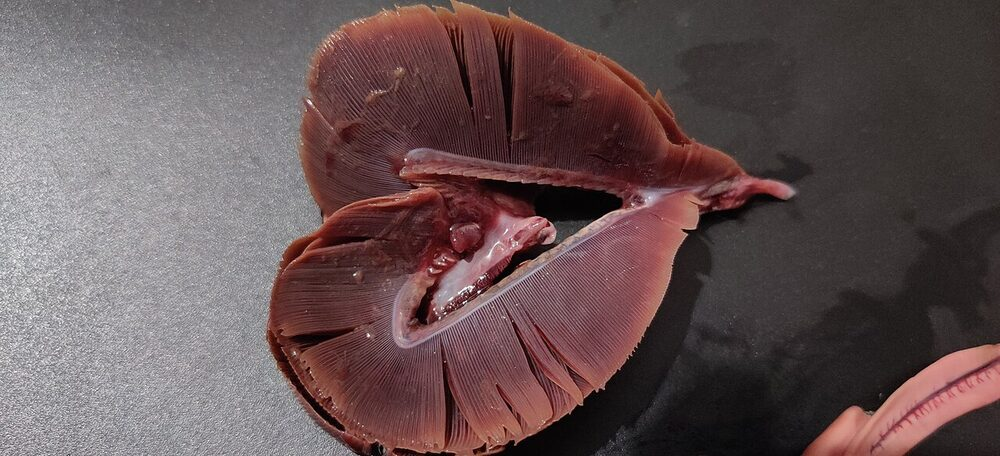{width="100%" height="360" fig-alt="Two gill arches dissected from a fish, each carrying rows of dark red, comb-like gill filaments."}

[Photo: Krishna satya 333, CC BY-SA 4.0, Wikimedia Commons](https://commons.wikimedia.org/wiki/File:Fish_gills.jpg){.credit}

:::
::::

::: notes
Exercise 2.1a: the exchange structure is the secondary lamella. In the photo the red, feathery structures are the filaments on each gill arch; their colour comes from the blood running just below a very thin surface. Each filament carries hundreds of tiny plate-like secondary lamellae, too small to see here, and it is in those that blood flows against the water. Ask why fish gills collapse and stop working in air: without water to hold them apart the filaments stick together and the surface area is lost.
:::

## Countercurrent exchange

:::: {.columns}
::: {.column width="40%"}
Water flows 1 → 4; blood flows 4 → 1:

| Position | 1 | 2 | 3 | 4 |
| --- | ---: | ---: | ---: | ---: |
| Water (kPa) | 20 | 15 | 10 | 5 |
| Blood (kPa) | 17 | 12 | 7 | 2 |
| Difference | 3 | 3 | 3 | 3 |

- At every position O₂ diffuses **from water to blood**: nothing moves uphill.
- The gradient lasts **along the whole lamella**, so blood leaves (17 kPa)
  richer than the water leaving (5 kPa).
:::
::: {.column width="60%"}

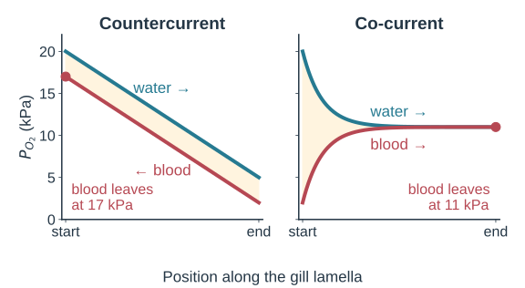{width="100%" height="360" fig-alt="Two panels of PO2 along the lamella. Countercurrent: water falls from 20 to 5 kPa and blood, flowing the other way, rises from 2 to 17 kPa with a constant 3 kPa gap. Co-current: both approach 11 kPa and the gap vanishes."}

:::
::::

**Would flowing the same direction work as well?**

::: notes
Exercise 2.2 has a table of this form; students must read the inlet and outlet of each stream correctly. Water enters at position 1, blood enters at position 4. The key observation is the constant local difference: wherever we look, water is slightly richer than the blood beside it. The figure plots the same numbers as continuous profiles (left) and, for comparison, the co-current arrangement with the same exchanger (right); the next slide puts numbers on that alternative.
:::

## Countercurrent versus co-current

Same inlets (water 20 kPa, blood 2 kPa), both flowing 1 → 4:

| Position | 1 | 2 | 3 | 4 |
| --- | ---: | ---: | ---: | ---: |
| Water $P_{\rm O_2}$ (kPa) | 20 | 14 | 12 | 11 |
| Blood $P_{\rm O_2}$ (kPa) | 2 | 8 | 10 | 11 |
| Difference | 18 | 6 | 2 | 0 |

| | Co-current | Countercurrent |
| --- | --- | --- |
| Gradient along the surface | large at the start, **zero** at the end | **constant** |
| Best possible blood outlet | equal to the water **outlet** (here 11 kPa) | close to the water **inlet** (here 17 kPa) |

The same principle conserves heat in a bird's or mammal's leg (A2) and
concentrates urine in the kidney (A4).

**Air breathers do not need this. How does a mammalian lung work?**

::: notes
In co-current flow, the two streams approach a common P_O2 and exchange stops; the blood can at most reach the P_O2 of the water leaving (exercise 2.2d). Countercurrent flow keeps the two streams out of equilibrium along the entire length. Connect to A2's countercurrent heat exchange in limbs, and preview A4's loop of Henle, which uses a related arrangement. Transition to the lung.
:::

## Try it: countercurrent versus co-current

```{=html}
<link rel="stylesheet" href="../../demos/dist/demo.css">
<div data-demo="a3-countercurrent"></div>
<script src="../../demos/dist/a3-countercurrent.js"></script>
```

::: notes
A model gill lamella. The two bands at the top are the water and blood streams coloured by PO₂ (red = rich, slate = poor); the plot shows the same along the lamella, with the other arrangement dashed. Start with countercurrent at the defaults: blood leaves at 17 kPa, the table from two slides back. Click Co-current: blood can now only reach 11 kPa, the same as the water leaving, and the gold gap closes early on, so the second half of the lamella is wasted. Then drag "Exchanger size" up in both modes: co-current never gets past the mixed value, countercurrent keeps improving towards 20 kPa. Finally move "Blood ÷ water flow": in countercurrent, when blood flow is low the blood comes close to the inlet water; when it is high the water is stripped of O₂ instead. Fish adjust both ventilation and perfusion of the lamellae. Teaching simplification: blood O₂ content is treated as proportional to PO₂ (no haemoglobin curve).
:::

## Mammalian lungs: tidal ventilation

:::: {.columns}
::: {.column width="45%"}
- Trachea → bronchi → bronchioles → **alveoli**: 300–500 million, ~100 m².
- **Tidal:** air flows in and out through the **same** airways.
- Conducting airways are **dead space**, ~150 mL.
- Breaths of 500 mL, 12 min⁻¹:
  $(500-150) \times 12 = 4.2$ L min⁻¹ reaches the alveoli.
- Fresh air mixes with stale air, so alveolar $P_{\rm O_2}$ (13.3 kPa) stays
  below air (21.2 kPa).
:::
::: {.column width="55%"}

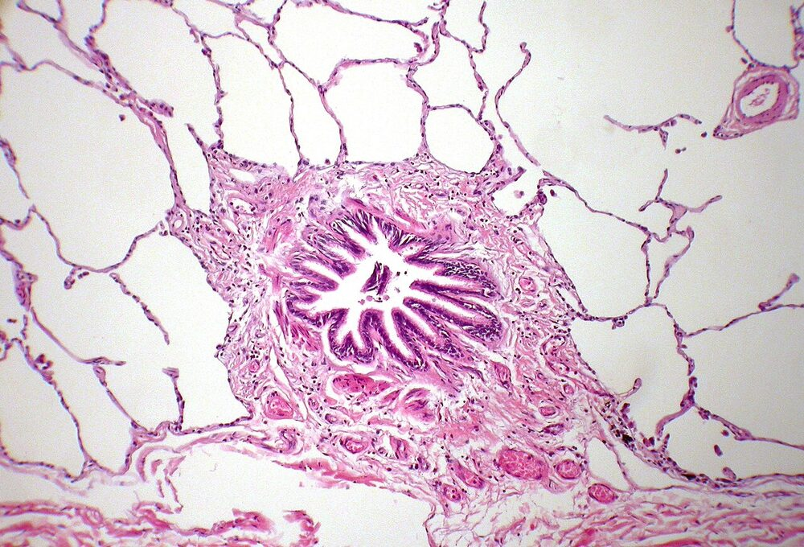{width="100%" height="360" fig-alt="Micrograph of normal lung: a bronchiole with surrounding alveoli, thin-walled air spaces separated by delicate septa."}

[Photo: Yale Rosen from USA, CC BY-SA 2.0, Wikimedia Commons](https://commons.wikimedia.org/wiki/File:Normal_lung_(5414785258).jpg){.credit}

:::
::::

**Is tidal flow the only way to ventilate a lung?**

::: notes
Exercise 2.3a and 2.3d. In the micrograph, the bronchiole is a conducting airway (dead space); the lace-like air spaces around it are alveoli, whose walls are so thin that they are barely visible at this magnification: that is Fick's large A and small L made visible. Each breath, the last 150 mL inhaled stays in the airways and is breathed out unchanged. That is why slow deep breathing ventilates the alveoli more effectively than fast shallow breathing at the same total ventilation: 250 mL breaths at 24 per minute give only (250 − 150) × 24 = 2.4 L min⁻¹. Exercise 2.1b: exchange occurs in the alveoli. Tidal ventilation is the weakness the bird lung avoids.
:::

## Bird lungs: one-way flow

:::: {.columns}
::: {.column width="40%"}
- Small, rigid lungs with **parabronchi**; exchange in **air capillaries**
  (3–10 µm).
- **Air sacs** are bellows: they ventilate but do **not** exchange gas.
- Air passes the parabronchi in **one direction** during both inspiration and
  expiration.
- No dead space in the exchange region; blood crosses the air stream
  (**cross-current**).
:::
::: {.column width="60%"}

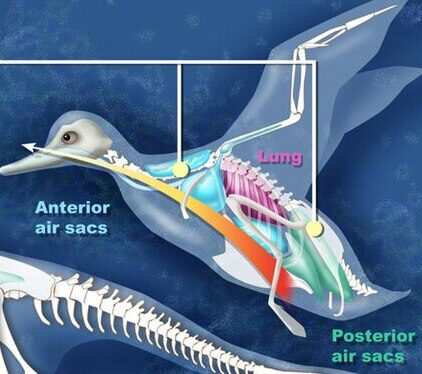{width="100%" height="360" fig-alt="Illustration of a bird skeleton in flight showing the small lung with anterior air sacs in front of it and posterior air sacs behind it."}

[Photo: Zina Deretsky, National Science Foundation, Public domain, Wikimedia Commons](https://commons.wikimedia.org/wiki/File:Dino_bird_h.jpg){.credit}

:::
::::

::: notes
Exercise 2.1c and 2.3b. The illustration (cropped from an NSF comparison with a theropod dinosaur, whose bones show the same air-sac connections) shows how much of a bird's body is taken up by air sacs; the lung itself is small and does not change volume. Air takes two breath cycles to pass through: inspiration 1 fills the posterior sacs, expiration 1 pushes that air through the lung, inspiration 2 moves it into the anterior sacs and expiration 2 sends it out. The result is that the lung always receives fresh air flowing one way, which is part of why birds can fly at altitudes where mammals struggle.
:::

## Insects: air piped to the cells

:::: {.columns}
::: {.column width="40%"}
- **Spiracles** → **tracheae** → **tracheoles** (< 1 µm), within a few µm of
  mitochondria.
- O₂ travels in **air** almost to the cell: ~10 000× faster diffusion than in
  water.
- Active insects pump the abdomen.
- **Haemolymph carries little O₂.**
- Spiracles close to limit water loss.
:::
::: {.column width="60%"}

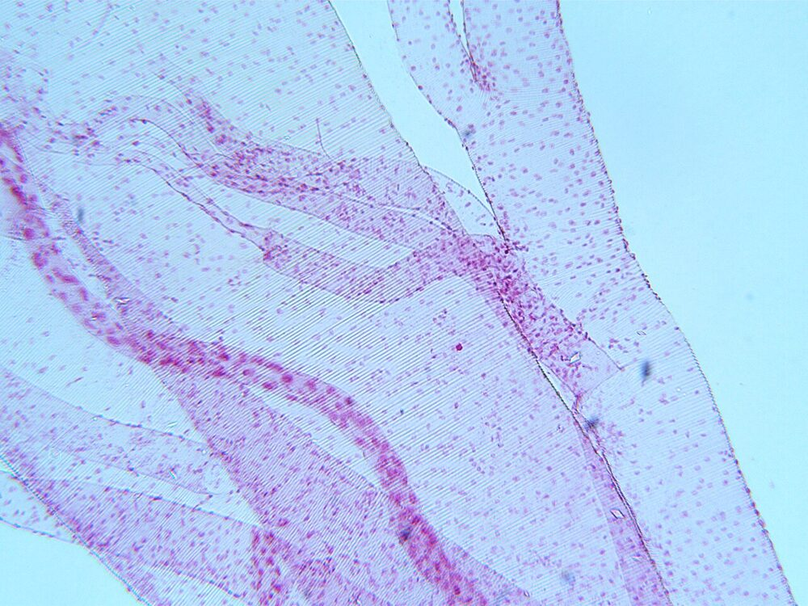{width="100%" height="360" fig-alt="Light micrograph of an insect trachea teased out on a slide: a branching tube stiffened by fine spiral rings."}

[Photo: Tgru001, CC0, Wikimedia Commons](https://commons.wikimedia.org/wiki/File:Insect_trachea_100x.jpg){.credit}

:::
::::

**In vertebrates, blood carries the O₂. But O₂ dissolves poorly in water. How
does blood hold enough?**

::: notes
Exercise 2.1d and 2.3c. The micrograph shows a trachea teased out of an insect: the fine spiral rings (taenidia) of cuticle keep the tube open, like the cartilage rings of our own trachea. The insect is A1's other solution: skip the blood and bring air to the tissue. The limit is the diffusion distance along the tracheae, which is one reason insects stay small. Transition back to vertebrates and the problem of carrying O₂ in a watery fluid.
:::

## Haemoglobin: pressure, saturation and content {.smaller}

:::: {.columns}
::: {.column width="62%"}
Plasma dissolves only ~3 mL O₂ L⁻¹; haemoglobin raises this ~65-fold.

- $P_{\rm O_2}$: pressure of the **dissolved**, unbound O₂ (kPa).
- **Saturation:** % of Hb binding sites occupied.
- **O₂ content:** total O₂ per litre of blood (mL O₂ L⁻¹).

Content = [Hb] × 1.34 mL O₂ g⁻¹ × saturation:

| Blood | [Hb] (g L⁻¹) | Saturation | Content (mL O₂ L⁻¹) |
| --- | ---: | ---: | ---: |
| Normal, fully saturated | 150 | 100 % | 201 |
| Normal, mixed venous | 150 | 75 % | 151 |
| Anaemia, arterial | 100 | 98 % | 131 |

**Anaemia:** same $P_{\rm O_2}$ and saturation, **less content**.
:::
::: {.column width="38%"}

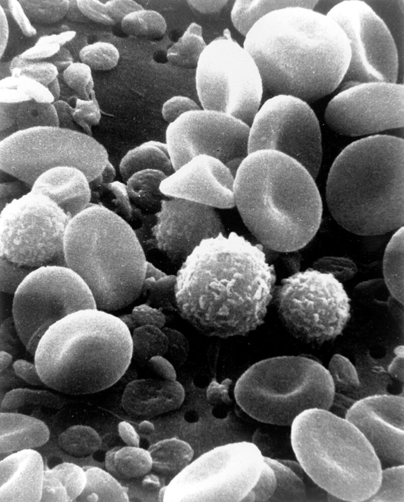{width="100%" height="400" fig-alt="Scanning electron micrograph of human blood: many biconcave disc-shaped red blood cells, with a few white blood cells and platelets."}

[Photo: Bruce Wetzel (photographer). Harry Schaefer (photographer), Public domain, Wikimedia Commons](https://commons.wikimedia.org/wiki/File:SEM_blood_cells.jpg){.credit}

:::
::::

::: notes
Exercises 3.1 and 3.2. The three quantities are the most common source of confusion in this unit. P_O2 is set by the gas the blood equilibrated with; saturation is set by P_O2 through the dissociation curve; content then depends on how much haemoglobin there is. The anaemic patient has normal arterial P_O2 and saturation, because their lungs work, but each litre of blood carries a third less O₂. The 1.34 mL per gram is the maximum binding capacity. The micrograph shows where the haemoglobin is: packed inside biconcave red cells, about 7 µm across, whose shape gives a large surface and a short diffusion distance to every haemoglobin molecule. Transition: how does saturation depend on P_O2?
:::

## The dissociation curve is sigmoid

:::: {.columns}
::: {.column width="40%"}
- **Why S-shaped?** Four subunits bind O₂ **cooperatively**: each bound O₂
  raises the affinity of the others.
- **Flat top:** still ~90 % saturated at 8 kPa, e.g. at moderate altitude.
- **Steep middle:** a small fall in tissue $P_{\rm O_2}$ releases much O₂.
- At rest only ~25 % is unloaded: a **reserve** for exercise.
:::
::: {.column width="60%"}

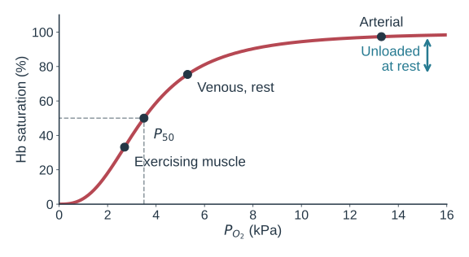{width="100%" height="360" fig-alt="Sigmoid O2-haemoglobin dissociation curve. Arterial blood at 13.3 kPa is about 97 percent saturated, venous blood at rest at 5.3 kPa about 75 percent, P50 is 3.5 kPa and venous blood from exercising muscle at 2.7 kPa about 33 percent."}

:::
::::

**Can the curve itself move to help the working muscle?**

::: notes
The curve is the Hill equation with n = 2.7 and P50 = 3.5 kPa, drawn through the standard reference points: 98 % at 13.3 kPa (arterial), 75 % at 5.3 kPa (mixed venous at rest), 50 % at 3.5 kPa and about 35 % at 2.7 kPa (exercising muscle). Exercise 3.3 asks why it is sigmoid: cooperative binding among four subunits. Myoglobin, with one subunit, gives a hyperbolic curve that lies to the left, so it takes O₂ from haemoglobin in muscle. The reserve is important for the runner: from 75 % saturation at rest, venous blood from hard-working muscle falls to about 35 %, so each litre of blood delivers more than twice as much O₂.
:::

## Shifting the curve

:::: {.columns}
::: {.column width="40%"}
**Right shift** (lower affinity, more unloading): ↑ $P_{\rm CO_2}$,
↓ pH (**Bohr effect**), ↑ temperature, ↑ 2,3-BPG. The opposite shifts left.

- Working muscle is warm, acidic and high in CO₂: **three of the four push
  right** exactly where O₂ is needed.
- Loading in the lung, on the flat top, hardly changes.
- Left-shifted: fetal Hb, myoglobin.
:::
::: {.column width="60%"}

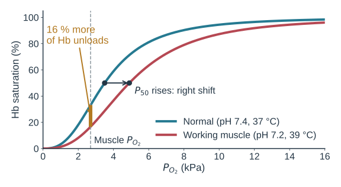{width="100%" height="360" fig-alt="Two dissociation curves: normal, and right-shifted for working muscle at pH 7.2 and 39 degrees with P50 4.9 kPa. At a muscle PO2 of 2.7 kPa saturation is 33 percent on the normal curve and 20 percent on the shifted curve."}

:::
::::

**Working muscle makes CO₂. How does the blood carry it away?**

::: notes
Exercise 3.4. In the figure, the working-muscle curve uses pH 7.2 and 39 °C (P50 rises from 3.5 to about 4.9 kPa). At the same muscle PO2 of 2.7 kPa, an extra 16 % of the haemoglobin gives up its O2, yet at the lung's 13.3 kPa both curves are near the top: the O2 goes to the tissue, it is not lost. Teach the rule as "the conditions in an active tissue shift the curve to the right", which removes the need to memorise four separate facts. P50 rises with a right shift. Fetal haemoglobin binds 2,3-BPG poorly, so it sits to the left of maternal haemoglobin and O₂ moves from mother to fetus across the placenta. 2,3-BPG in red cells rises over days at high altitude, an example of A1's acclimatisation. Transition: the CO₂ that shifts the curve has to be removed.
:::

## Try it: loading in the lung, unloading in the muscle

```{=html}
<link rel="stylesheet" href="../../demos/dist/demo.css">
<div data-demo="a3-dissociation"></div>
<script src="../../demos/dist/a3-dissociation.js"></script>
```

::: notes
Blue is the curve under lung conditions, where the blood loads at the arterial PO₂ (blue point). Red is the curve under the tissue's own pH and temperature, where it unloads at the tissue PO₂ (red point, draggable). The gold bar is the share of haemoglobin that gives up its O₂, and the bottom line converts it to mL O₂ per litre of blood. Start at Rest: about 25 % unloaded, about 50 mL per litre, matching the a–v difference on the Fick slide. Press "Exercise, no shift": muscle PO₂ falls to 2.7 kPa on the normal curve. Then "Exercise": now the muscle is at pH 7.2 and 39 °C, the red curve moves right and each litre of blood delivers about 30 mL more. Ask the room which of the three changes did the most. "Altitude" lowers arterial PO₂ to 6.5 kPa: loading falls off the flat top. "Anaemia": the percentages are unchanged but the mL delivered fall by a third, the content point from the haemoglobin slide. Model: Hill equation, n = 2.7, P50 = 3.5 kPa at pH 7.4 and 37 °C; log P50 changes by −0.48 per pH unit and +0.024 per °C.
:::

## Carbon dioxide transport

:::: {.columns}
::: {.column width="40%"}
| Form | Share |
| --- | ---: |
| **Bicarbonate** (HCO₃⁻) | ~70 % |
| **Carbamino**-Hb | ~20 % |
| **Dissolved** CO₂ | ~10 % |

- **Carbonic anhydrase** in red cells:
  CO₂ + H₂O ⇌ H⁺ + HCO₃⁻.
- HCO₃⁻ out, Cl⁻ in (**chloride shift**); H⁺ on Hb helps release O₂.
- Reversed in the lung, so **ventilation sets blood pH**.
:::
::: {.column width="60%"}

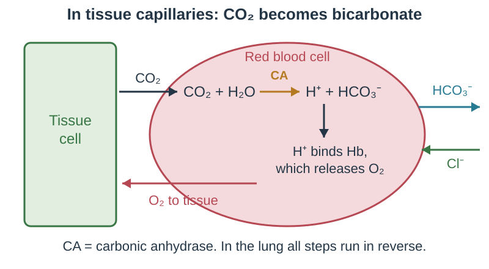{width="100%" height="360" fig-alt="CO2 from a tissue cell enters a red blood cell, where carbonic anhydrase converts it with water to H+ and bicarbonate; bicarbonate leaves in exchange for chloride, and H+ binding to haemoglobin releases O2 to the tissue."}

:::
::::

**Gases are loaded and unloaded. Now: what moves the blood?**

::: notes
Exercise 3.5. The full reaction is CO₂ + H₂O ⇌ H₂CO₃ ⇌ H⁺ + HCO₃⁻; carbonic anhydrase speeds the first step. Breathing faster lowers P_CO2 and raises pH. Carbonic anhydrase is one of the fastest enzymes known; without it the hydration of CO₂ would be far too slow for the short time blood spends in a capillary. The reaction links gas transport to acid–base balance: CO₂ is an acid that the lungs can remove within minutes, while the kidney adjusts bicarbonate over hours to days (A4). Transition from the gases to the pump and the circuit.
:::

## The mammalian double circulation

:::: {.columns}
::: {.column width="40%"}
- **Arteries** carry blood **away** from the heart, **veins** towards it. The
  **pulmonary arteries carry O₂-poor blood**.
- **Valves** prevent backflow: tricuspid, mitral; pulmonary, aortic.
- Systemic ~120/80 mmHg, pulmonary ~25/8 mmHg: the left ventricle makes ~5×
  the pressure of the right.
:::
::: {.column width="60%"}

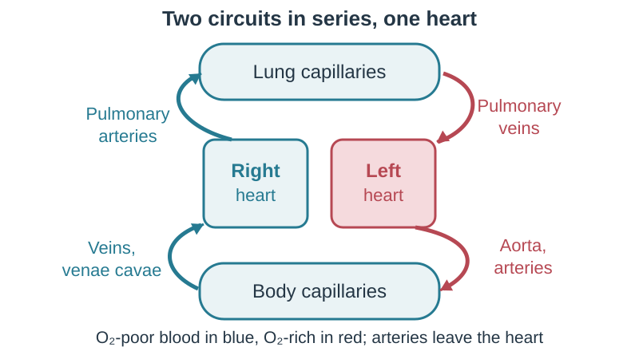{width="100%" height="360" fig-alt="The right heart pumps O2-poor blood through the pulmonary arteries to the lung capillaries; pulmonary veins return O2-rich blood to the left heart, which pumps it through the aorta to the body capillaries, and veins return it to the right heart."}

:::
::::

**Is this the only way to build a circulation?**

::: notes
Exercise 4.1 is the order of this loop, and 4.2a and 4.2b are the artery definition and valves. Each side of the heart pumps the same volume per minute, but the left side generates about five times the pressure, because the systemic circuit is long and has high resistance while the lung circuit is short and must keep pressure low to avoid fluid leaking into the alveoli. Transition: compare with fish and with invertebrates.
:::

## Comparing circulations

| Animal | Circuit | Heart |
| --- | --- | --- |
| Fish | **Single:** heart → gills → body → heart | 1 atrium, 1 ventricle |
| Amphibian | Double, partly mixed | 2 atria, 1 ventricle |
| Mammal, bird | **Double**, fully separated | 2 atria, 2 ventricles |

| **Open** circulation | **Closed** circulation |
| --- | --- |
| Haemolymph leaves vessels and flows through body spaces (**sinuses**) | Blood stays in vessels; exchange across capillaries |
| Arthropods (grasshopper), most molluscs (mussel) | Annelids (earthworm), cephalopods (octopus), vertebrates (frog) |

- "Open" does **not** mean motionless: the heart pumps haemolymph, which
  returns through openings (ostia).

**In a closed circulation, how do the vessels differ along the circuit?**

::: notes
Exercises 4.2c, 4.2d and 4.3. In a fish, blood passes through the heart once per circuit, and much of the pressure is lost in the gill capillaries, so blood reaches the body at low pressure. The double circulation solves the fish's problem: blood returns to the heart after the lungs and is re-pressurised before going to the body. Cephalopods are the instructive exception among molluscs: active predators with a closed system and extra hearts for the gills. The open system works for insects partly because their O₂ does not depend on the blood (previous slides). Transition to vessel structure.
:::

## Arteries, capillaries and veins

| | Artery | Capillary | Vein |
| --- | --- | --- | --- |
| Direction | Away from the heart | Between arterioles and venules | Towards the heart |
| Wall | Thick: elastic tissue and smooth muscle | **Endothelium only**, one cell thick, 5–10 µm wide | Thin, little muscle; **valves** in limb veins |
| Pressure | High, pulsatile (aorta ~95 mmHg mean) | ~35 → 15 mmHg | Lowest (< 10 mmHg) |
| Function | Carry blood under pressure | **Exchange** with tissues | Return blood; hold ~65 % of blood volume |

- Elastic arteries stretch in systole and recoil in diastole, smoothing flow.
- Venous return is helped by valves and by the **skeletal muscle pump**.

::: notes
Exercise 4.4 is this table. Relate each wall to its job and its tissue types from A1: elastic connective tissue and smooth muscle in the artery, a single squamous endothelium in the capillary (A1's thin barrier), thin walls and large lumens in veins, which act as a reservoir. The capillary is where the diffusion step of the O₂ route happens. Transition to the flow equation.
:::

## An artery and a vein in section

:::: {.columns}
::: {.column width="40%"}
- **Artery:** thick muscular wall, round, small lumen.
- **Vein:** thin wall, wide or collapsed lumen; it can look like a slit.
- Identify vessels by **wall layers**, not outline (A1).

**Pressure drops along the circuit. What sets how much flows where?**
:::
::: {.column width="60%"}

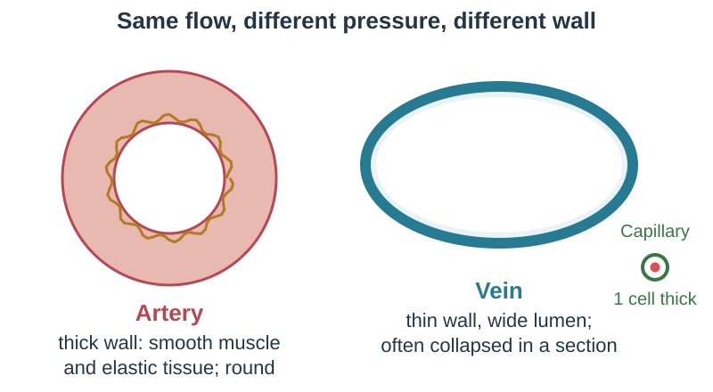{width="100%" height="360" fig-alt="An artery and a vein drawn side by side in cross-section, with a small capillary: the artery has a thick, round wall of elastic tissue and smooth muscle; the vein has a thin wall and a wider, flattened lumen; the capillary wall is a single endothelial cell."}

:::
::::

::: notes
This is the comparison students make in the histology practical, where artery and vein usually lie side by side in the same bundle. The artery has the thick wall of smooth muscle and elastic tissue and a round lumen. The vein beside it carries the same flow back at a much lower pressure, so it needs only a thin wall; its lumen is wider and often collapsed or irregular in a fixed section. The capillary, shown as a small inset, is a single endothelial cell around a lumen barely wide enough for one red cell. Transition: in this circuit, pressure falls from the aorta to the veins; what decides how much blood each organ receives?
:::

## Pressure, resistance and flow

$$Q = \frac{\Delta P}{R} \qquad\qquad R \propto \frac{1}{r^4}$$

:::: {.columns}
::: {.column width="40%"}
- Flow $Q$ is driven by $\Delta P$ and opposed by resistance $R$, like
  current in Ohm's law.
- Poiseuille: halve $r$ → $16R$, $Q/16$; widen by 19 % → $R/2$, $2Q$.
- **Arterioles** have smooth muscle, so they decide **which tissues get the
  blood**.
- Exercise: muscle arterioles dilate, gut arterioles constrict.
:::
::: {.column width="60%"}

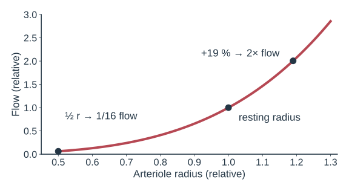{width="100%" height="320" fig-alt="Flow at constant pressure rises with the fourth power of arteriole radius: half the radius gives one sixteenth of the flow, and 19 percent wider gives twice the flow."}

:::
::::

**So how much blood does the heart deliver, and how much O₂ does it bring?**

::: notes
Exercise 4.5. Doubling resistance at constant pressure halves flow. Because resistance goes as 1/r⁴, a small change in arteriole radius has a large effect: a 19 % dilation doubles flow. This is why arterioles, not the heart, distribute blood among organs. Capillaries are individually narrow, but there are billions in parallel, so their combined resistance is lower than that of the arterioles. Transition to cardiac output.
:::

## Cardiac output and the Fick principle

**Cardiac output** = heart rate × stroke volume

**O₂ use** = cardiac output × (arterial − venous O₂ content)

| | Rest | Running |
| --- | ---: | ---: |
| Heart rate (min⁻¹) | 70 | 170 |
| Stroke volume (L) | 0.070 | 0.110 |
| **Cardiac output** (L min⁻¹) | 4.9 | 18.7 |
| a − v O₂ (mL L⁻¹) | 200 − 150 = 50 | 200 − 50 = 150 |
| **O₂ use** (mL min⁻¹) | 245 | 2 805 |

The Fick principle uses **content**, not $P_{\rm O_2}$.

**How does the body produce that elevenfold increase?**

::: notes
Exercise 4.6 is the same calculation with other numbers. The product is a mass balance: every litre of blood passing through the tissues gives up the difference between arterial and venous content, so total uptake is flow times that difference. At rest this matches the 250 mL min⁻¹ from the opening slide. Ask students which factors increased: cardiac output nearly fourfold and extraction threefold. The next slide puts all the mechanisms from today together.
:::

## Back to the runner

:::: {.columns}
::: {.column width="62%"}
| Step | Change during running |
| --- | --- |
| Ventilation | ~6 → ~100 L min⁻¹ |
| Lung diffusion | more capillaries perfused: larger area |
| Arterial blood | stays ~98 % saturated (flat top) |
| Heart | 70 → 170 beats min⁻¹: output ~4× |
| Distribution | muscle arterioles dilate, gut constrict |
| Unloading | right shift; venous saturation ~35 % |

**Result:** O₂ use rises ~11× with the same haemoglobin.
:::
::: {.column width="38%"}

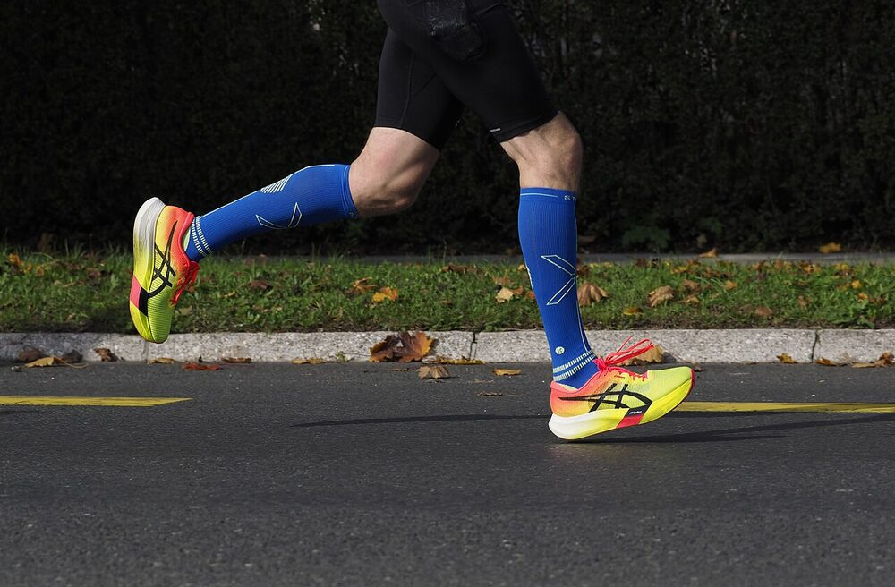{width="100%" height="360" fig-alt="Legs of a marathon runner in mid-stride on a road."}

[Photo: Petar Milošević, CC BY-SA 4.0, Wikimedia Commons](https://commons.wikimedia.org/wiki/File:Human_running_gait_-_terminal_swing_to_heel_strike_(runner_with_Asics_Metaspeed_Edge_Paris_-_2024_Ljubljana_Marathon).jpg){.credit}

:::
::::

**The thin, wet surfaces that let O₂ in also let water and ions in and out. That is A4.**

::: notes
Close the loop to the opening question. Each row is one of today's slides, so this is also a revision map. The two biggest contributions are cardiac output and extraction; ventilation rises much more than needed for O₂ and is driven largely by CO₂ and pH. Bridge to A4: the gill and lung surfaces we built today are large, thin and permeable, so a fish in fresh water gains water and loses ions across them, and a mammal loses water with every breath.
:::

## Summary {.smaller}

| Concept | Key fact |
| --- | --- |
| O₂ route | bulk flow (ventilation) → diffusion → bulk flow (circulation) → diffusion |
| Partial pressure | $P_{\rm O_2}=F_{\rm O_2}\times P_{\rm total}$; air 21.2 kPa, alveoli 13.3 kPa |
| Fick's law | $\dot M\propto A\,\Delta P/L$ |
| Ventilation, perfusion | keep external $P_{\rm O_2}$ high and internal $P_{\rm O_2}$ low |
| Exchange organs | fish: lamellae (countercurrent); mammal: alveoli (tidal); bird: parabronchi (one-way); insect: tracheoles |
| Blood O₂ | content = [Hb] × 1.34 × saturation; differs from $P_{\rm O_2}$ |
| Dissociation curve | sigmoid (cooperative binding); right shift with ↑CO₂, ↓pH, ↑T, ↑2,3-BPG |
| CO₂ transport | ~70 % HCO₃⁻, ~20 % carbamino, ~10 % dissolved; carbonic anhydrase |
| Circulation | artery = away from heart; double (mammal) vs single (fish); open vs closed |
| Flow | $Q=\Delta P/R$, $R\propto 1/r^4$; arterioles distribute flow |
| Fick principle | O₂ use = HR × SV × (arterial − venous O₂ content) |

**Next (A4 — Water, ions and excretion):** why a fish surrounded by water must
still regulate its water, how kidneys filter and reabsorb, and how animals get
rid of nitrogen.

[Tutorial](index.qmd) · [Exercises](exercise.qmd) · [Quiz](quiz.qmd)

::: notes
Read the table in the order of the O₂ route: physics of exchange, the organs, the blood, the pump and pipes, and the whole-body balance. The preview of A4 picks up the cost of permeable exchange surfaces: osmotic water movement, ion transport in gills and kidneys, and nitrogen excretion.
:::
