## About this lecture

A doctor taps the tendon below your knee and your leg kicks about 30 ms later,
before you have decided anything. In A1 every feedback loop had a **sensor**,
a **control centre** and an **effector**, and in A4 the messenger of the water
loop was a hormone, ADH. **Who are the sensors, controllers and messengers,
and how does a signal turn into movement?** Nerves carry fast, targeted
messages; hormones carry slower messages through the blood.

- **The electrical signal:** ion gradients, the resting potential and the
  action potential.
- **Passing it on:** conduction, synapses and the knee-jerk reflex.
- **The effector:** how a nerve impulse makes a muscle contract, and how force
  is graded.
- **The other messenger:** nervous systems across animals, hormones and the
  endocrine glands.
- **Reproduction:** the hypothalamic–pituitary–gonadal axis, where feedback
  changes sign.

::: notes
The running example for the first two thirds of the lecture is the knee-jerk reflex: a stretch receptor, a sensory neuron, one synapse in the spinal cord, a motor neuron and a muscle. Every slide up to the muscle section explains one link of that chain. Then we turn to the slower messenger system, hormones, using examples students already know (insulin from A2, ADH from A4), and finish with reproduction, which shows both negative and positive feedback in one system. This is the last animal unit, so the summary also pulls A1 to A5 together.
:::

## Ion gradients and equilibrium potentials

The **Na⁺/K⁺-ATPase** (3 Na⁺ out, 2 K⁺ in per ATP) keeps the gradients:

| Ion | Outside (mmol L⁻¹) | Inside (mmol L⁻¹) | Equilibrium potential |
| --- | ---: | ---: | ---: |
| K⁺ | 5 | 140 | **−89 mV** |
| Na⁺ | 145 | 15 | **+61 mV** |
| Cl⁻ | 110 | 10 | **−64 mV** |

**Nernst equation** (37 °C): the voltage at which an ion's electrical force
exactly balances its concentration gradient.

$$E_\text{ion} = \frac{61.5\ \text{mV}}{z}\,\log_{10}\frac{[\text{ion}]_\text{out}}{[\text{ion}]_\text{in}}$$

Worked example: $E_\text{K} = 61.5 \times \log_{10}(5/140) = 61.5 \times (-1.45) \approx -89$ mV.
For Cl⁻, $z = -1$, so the sign flips.

**The membrane potential at rest is −70 mV. Why that value?**

::: notes
Start with the gradients, because every electrical signal in the body uses them. The pump builds them; channels let ions run down them. The Nernst equation tells us, for one ion, the voltage at which there is no net movement. K⁺ is high inside, so the inside must be negative to hold it in: E_K is negative. Na⁺ is high outside, so E_Na is positive. Work the K⁺ case on the board and let students check Na⁺; exercise 1.1 asks for all three. Remind them that log10 of a ratio below 1 is negative.
:::

## The resting potential and driving forces

:::: {.columns}
::: {.column width="40%"}
- At rest the membrane is ~**25× more permeable to K⁺** than to Na⁺
  (K⁺ leak channels), so $V_m$ = −70 mV lies **close to $E_\text{K}$**.
- **Driving force** = $V_m - E_\text{ion}$:
  Na⁺ −131 mV, large, **inward**; K⁺ +19 mV, small, **outward**.
- The small leaks are balanced by the pump. Only a thin layer of charge lines
  the membrane; the cytoplasm is neutral.
- Outside K⁺ 20 mmol L⁻¹: $E_\text{K}$ ≈ −52 mV and the cell
  **depolarises**: why high plasma K⁺ disturbs the heart.
:::
::: {.column width="60%"}

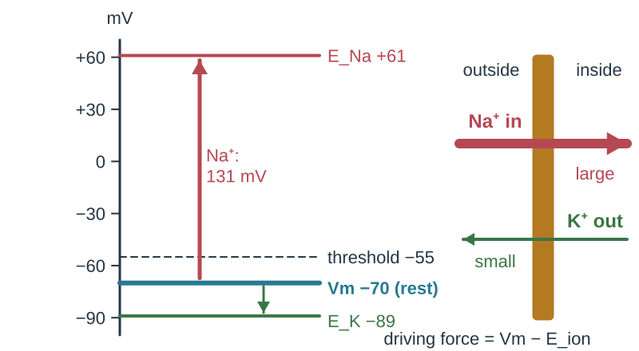{width="100%" height="360" fig-alt="Voltage scale with E_Na at +61, threshold at -55, the resting potential at -70 and E_K at -89 mV; a long arrow shows the large inward driving force on Na+ and a short one the small outward force on K+."}

:::
::::

**So what happens when Na⁺ channels suddenly open?**

::: notes
The resting potential is a weighted compromise between the equilibrium potentials, weighted by permeability; because K⁺ permeability dominates, the result is near E_K. The driving-force convention: a negative value for a cation means inward movement. Na⁺ is the ion "waiting to get in", with both concentration and voltage pushing it inward; that stored driving force is what the action potential uses. The high-K⁺ example shows that the resting potential depends on extracellular K⁺; exercise 1.3 uses the same idea with a smaller change.
:::

## Try it: ions, permeability and the membrane potential

```{=html}
<link rel="stylesheet" href="../../demos/dist/demo.css">
<div data-demo="a5-membrane" data-preset="rest"></div>
<script src="../../demos/dist/a5-membrane.js"></script>
```

::: notes
The left panel shows the ions (one dot per 5 mmol/L; K+ green, Na+ red), with the width of the two channels in the membrane showing the relative permeability. The right panel places E_K, E_Na (Nernst) and the membrane potential (Goldman equation) on one voltage scale. Start at Rest: -69 mV, close to E_K, because the K+ channel is wide. Click "K+ channels only": Vm drops onto E_K exactly, which is the Nernst case. Click "K+ out = 20" and ask the class to predict first: E_K rises to about -52 and the cell depolarises (the hyperkalaemia example). Then "Na+ channels open" (P_Na/P_K = 20): Vm jumps to about +50, towards E_Na, which is what happens at the peak of an action potential. Drag P_Na/P_K slowly from 0.04 to 20 to show that Vm is a weighted compromise between the two equilibrium potentials. Point out that the dots hardly change: the potential flips without any change in concentration, which sets up "very few ions move" on the next slide.
:::

## The action potential

:::: {.columns}
::: {.column width="40%"}
1. A stimulus depolarises the membrane to **threshold** (~−55 mV).
2. **Rising phase:** voltage-gated **Na⁺ channels open**; Na⁺ enters and opens
   more channels (**positive feedback**, A1), up to ~+30 mV.
3. **Peak:** Na⁺ channels **inactivate**.
4. **Repolarisation:** voltage-gated **K⁺ channels open**; K⁺ leaves.
5. **Undershoot** (~−80 mV) while K⁺ channels stay open; then rest.

The spike lasts **1–2 ms**. Very few ions move (squid axon: Na⁺ inside rises
< 0.001 %); the pump is not needed for any single spike.
:::
::: {.column width="60%"}

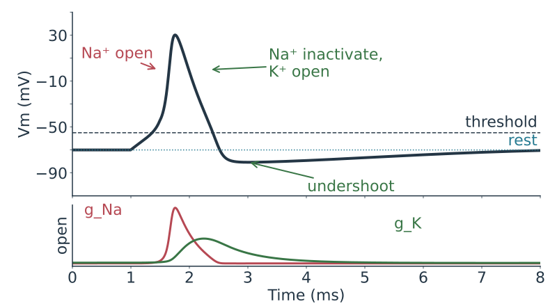{width="100%" height="360" fig-alt="An action potential from rest at -70 mV through threshold to a peak near +30 mV, back down to an undershoot near -80 mV, with Na+ conductance rising and falling first and K+ conductance rising later and lasting longer."}

:::
::::

**If every spike looks the same, how does a neuron signal "stronger"?**

::: notes
The trace is computed from the Hodgkin–Huxley model (rest set to −70 mV); the lower panel shows the two conductances. Go through the numbered list as a sequence of channel events; exercise 2.1 asks for this order. The positive-feedback loop (depolarisation opens Na⁺ channels, which depolarises further) is the example promised in A1; inactivation is its built-in end point. The peak does not reach E_Na because Na⁺ channels inactivate and K⁺ channels open. Correct two common errors: the pump does not produce the rising phase (channels do), and concentrations hardly change during one spike.
:::

## All-or-none: refractory periods and coding

:::: {.columns}
::: {.column width="40%"}
- **Absolute refractory period** (~1–2 ms): no stimulus fires a second
  spike; Na⁺ channels are **inactivated**.
- **Relative refractory period** (a few ms): a **stronger** stimulus is needed;
  some Na⁺ channels still inactivated, K⁺ channels still open.
- So the spike travels **one way**, and firing rate has a ceiling of a few
  hundred per second.
- Spikes are **all-or-none**. A stronger stimulus raises the **frequency** of
  spikes and the **number of neurons** recruited.
:::
::: {.column width="60%"}

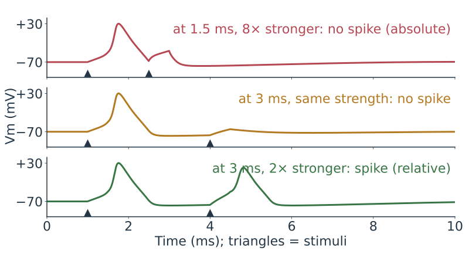{width="100%" height="360" fig-alt="Three voltage traces with two stimuli: a second stimulus 1.5 ms after a spike fails even when eight times stronger; at 3 ms a stimulus of the same strength fails; at 3 ms a stimulus twice as strong fires a second spike."}

:::
::::

**How fast does the spike travel to the end of the axon?**

::: notes
The figure uses the same model as the previous slide: a second stimulus 1.5 ms after a spike fails whatever its strength; at 3 ms it needs to be about twice as strong. The refractory period follows directly from the channel events on the previous slide; exercise 2.2 asks for both definitions and their causes. Coding: a light touch might give 10 spikes per second in one sensory fibre, a firm press 100 per second in that fibre plus activity in its neighbours. The sensory receptor itself produces a graded receptor potential; it is converted to spike frequency at the first point where voltage-gated Na⁺ channels are found.
:::

## Try it: threshold and refractory period

```{=html}
<link rel="stylesheet" href="../../demos/dist/demo.css">
<div data-demo="a5-spike" data-a1="40" data-a2="40" data-gap="3"></div>
<script src="../../demos/dist/a5-spike.js"></script>
```

::: notes
A Hodgkin–Huxley axon (the same model as the two figures) receives two brief current pulses, S1 and S2. The lower panel shows the fraction of Na+ channels that are not inactivated (green) and the K+ channels that are open (gold). First threshold: click "Too weak", then drag S1 strength up from 12; between about 15 and 20 the response jumps from a small bump to a full spike, and above that the spike does not get any bigger (all-or-none). Then refractory periods: "2nd at 1.5 ms, 8×" fails even at the largest S2, and the readout says absolute refractory; point at the green trace, almost no Na+ channels are available. "2nd at 3 ms" fails at the same strength, and the readout gives the strength needed (about 60): relative refractory. "3 ms, 2× stronger" fires a second, slightly smaller spike. Then drag the S1 → S2 interval from 2 to 10 ms with S2 = 40 and ask the class to call out when the second spike returns. The model is the squid axon with its rates sped up threefold, so the time course is close to that of a mammalian axon.
:::

## Conduction velocity: diameter and myelin

:::: {.columns}
::: {.column width="55%"}
- **Larger diameter** → lower internal resistance → current spreads further
  ahead → faster.
- **Myelin** (Schwann cells; oligodendrocytes in the CNS) insulates the axon.
  Spikes regenerate only at **nodes of Ranvier** ~1 mm apart and jump between
  them: **saltatory conduction**.

| Axon | Diameter | Velocity |
| --- | ---: | ---: |
| Unmyelinated pain fibre | ~1 µm | ~1 m s⁻¹ |
| Squid giant axon | ~500 µm | ~25 m s⁻¹ |
| Myelinated motor axon | ~15 µm | 60–120 m s⁻¹ |

1.0 m in 15 ms: 1.0 ÷ 0.015 ≈ **67 m s⁻¹**.
:::
::: {.column width="45%"}
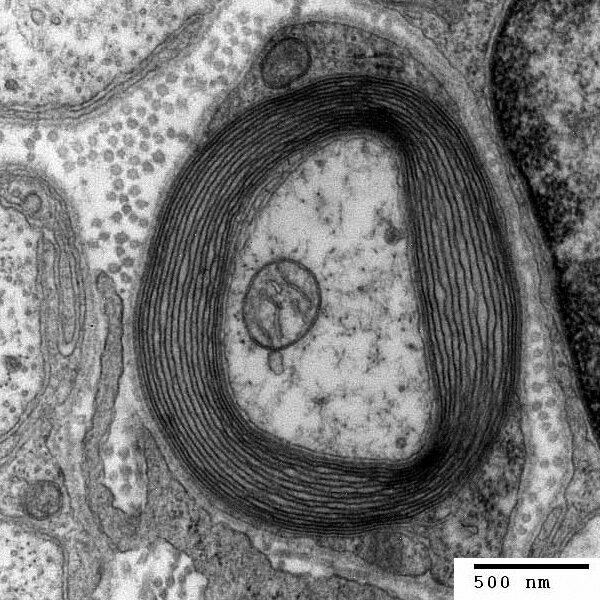{width="100%" height="330" style="object-fit: contain;" fig-alt="Transmission electron micrograph of a myelinated axon in cross-section: a pale axon with a mitochondrion, wrapped in a thick dark ring of many tightly packed membrane layers."}

[Micrograph: Roadnottaken, CC BY-SA 3.0, Wikimedia Commons](https://commons.wikimedia.org/wiki/File:Myelinated_neuron.jpg){.credit}
:::
::::

**At the end of the axon the electrical signal reaches a gap. How does it cross?**

::: notes
The micrograph shows a myelinated axon in cross-section: each dark line in the ring is a layer of glial membrane wrapped around the axon (scale bar 500 nm). Two ways to go fast: get bigger or get insulated. The table makes the comparison concrete: a human myelinated axon 15 µm wide outruns a squid axon 30 times wider. In multiple sclerosis, loss of CNS myelin slows or blocks conduction. Exercise 2.4 asks for the two properties and a velocity calculation. Transition: the knee-jerk signal now reaches the spinal cord, where it must pass a synapse.
:::

## The chemical synapse

:::: {.columns}
::: {.column width="40%"}
1. A spike reaches the terminal.
2. Voltage-gated **Ca²⁺ channels** open.
3. **Ca²⁺ enters** (outside ~2, inside ~0.0001 mmol L⁻¹).
4. Vesicles fuse: **exocytosis**.
5. Transmitter crosses the 20–40 nm cleft and binds **receptors**.
6. Ion channels open: the postsynaptic potential changes.
7. Removal: **acetylcholinesterase** breaks down ACh; serotonin and
   noradrenaline are taken back up (**reuptake**).
:::
::: {.column width="60%"}

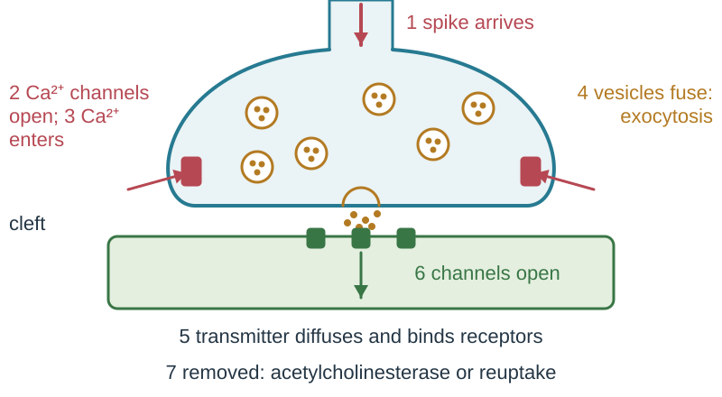{width="100%" height="360" fig-alt="A presynaptic terminal with vesicles above a postsynaptic membrane, with the seven numbered steps: spike arrives, Ca2+ channels open and Ca2+ enters, vesicles fuse, transmitter binds receptors, channels open, transmitter is removed."}

:::
::::

**Ca²⁺ is the trigger.** Delay ~0.5 ms. One-way: vesicles only before, receptors
only after the cleft. **Does the transmitter excite or inhibit the next cell?**

::: notes
Walk through the seven steps; exercise 3.1 asks for this order. The essential idea is conversion: electrical signal → chemical signal → electrical signal. Ca²⁺ has an enormous inward gradient (about 20,000-fold), so opening a few channels raises local Ca²⁺ sharply. Drugs and toxins act at nearly every step: botulinum toxin blocks vesicle release; nerve agents block acetylcholinesterase; antidepressants such as SSRIs block serotonin reuptake.
:::

## Excitatory or inhibitory: the receptor decides {.smaller}

:::: {.columns}
::: {.column width="64%"}
**EPSP** moves $V_m$ **towards** threshold; **IPSP** moves it **away**, or holds it below.

| Transmitter | Receptor and channel | Effect |
| --- | --- | --- |
| Acetylcholine | Nicotinic: cation channel (Na⁺ in), skeletal muscle | **Excitatory** |
| Acetylcholine | Muscarinic: opens K⁺ channels, cardiac pacemaker | **Inhibitory** |
| Glutamate | Channels for Na⁺ and K⁺ | **Excitatory** |
| GABA | Cl⁻ channels: $V_m$ → $E_\text{Cl}$ (≈ −70), below threshold | **Inhibitory** |

- The **same transmitter** can excite or inhibit: the **receptor** decides.
- EPSPs and IPSPs **summate**; the neuron fires only if the **axon hillock**
  reaches threshold.
:::
::: {.column width="36%"}
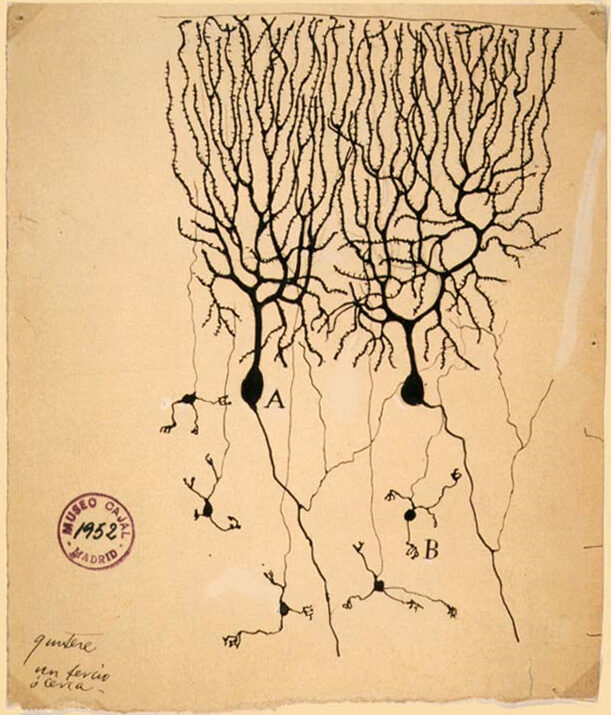{width="100%" height="380" style="object-fit: contain;" fig-alt="Ramón y Cajal's ink drawing of two Purkinje cells from the cerebellum, each with a cell body and a huge, densely branched dendritic tree, and smaller granule cells below."}

[Drawing: Santiago Ramón y Cajal, Public domain, Wikimedia Commons](https://commons.wikimedia.org/wiki/File:PurkinjeCell.jpg){.credit}
:::
::::

**Now we can trace a complete pathway: the knee-jerk reflex.**

::: notes
Exercise 3.2 asks for these four cases. The GABA case needs the driving-force idea: the effect of opening a channel depends on where the membrane potential will move, which is towards that ion's equilibrium potential. If E_Cl is below threshold, opening Cl⁻ channels holds the cell below threshold. Summation at the axon hillock is the neuron's "control centre" in miniature: it weighs excitatory against inhibitory input. Cajal's drawing of cerebellar Purkinje cells shows the scale of the problem: each dendritic tree receives synapses from roughly 100,000 or more inputs, and one axon carries the verdict.
:::

## The knee-jerk reflex: a complete loop

:::: {.columns}
::: {.column width="40%"}
- **Receptor:** muscle spindle in the quadriceps.
- **Afferent:** sensory neuron into the dorsal spinal cord.
- **Integrating centre:** spinal cord, **one synapse**.
- **Efferent:** motor neuron.
- **Effector:** quadriceps contracts; the leg kicks.

The contraction **opposes** the stretch: negative feedback for muscle length
(A1). An **inhibitory interneuron** relaxes the hamstrings. No brain needed:
~30 ms.
:::
::: {.column width="60%"}

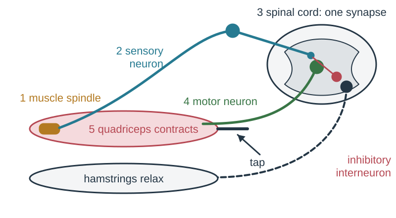{width="100%" height="360" fig-alt="Reflex arc: a tap stretches the quadriceps, its muscle spindle excites a sensory neuron that synapses once in the spinal cord on a motor neuron back to the quadriceps; an inhibitory interneuron acts on the motor neuron to the hamstrings."}

:::
::::

**The motor neuron has fired. How does its spike make the muscle contract?**

::: notes
This brings the first half of the lecture together in one real loop: receptor potential, action potential, conduction along a fast myelinated axon, a single excitatory synapse, and an effector. Map the components onto the A1 feedback vocabulary. Exercise 3.3 asks for the five components, which are listed on the left and numbered on the figure. Signals also travel up the cord, which is why you feel the tap. The reciprocal inhibition shows an IPSP doing useful work. Transition: the remaining link, from motor neuron to force, is the subject of the next four slides.
:::

## The neuromuscular junction

:::: {.columns}
::: {.column width="40%"}
1. An action potential arrives at the motor-neuron terminal.
2. **Acetylcholine** is released: a chemical synapse, as before.
3. ACh opens nicotinic channels: an **end-plate potential** depolarises the
   muscle fibre to threshold, **every time**.

- Each fibre has one junction; one motor neuron branches to many fibres.
- The large safety margin means one motor-neuron spike = one muscle spike.
:::
::: {.column width="60%"}
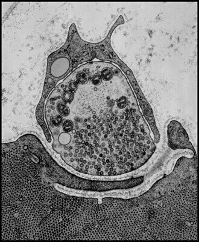{width="100%" height="330" style="object-fit: contain;" fig-alt="Electron micrograph of a neuromuscular junction: a nerve terminal packed with round synaptic vesicles lies against the folded membrane of a muscle fibre."}

[Micrograph: Jgheuser, Public domain, Wikimedia Commons](https://commons.wikimedia.org/wiki/File:HeuserNeuro.jpg){.credit}
:::
::::

**How does a spike on the surface reach myofibrils deep inside the fibre?**

::: notes
The neuromuscular junction is the synapse students already know from two slides back, with the muscle fibre as the postsynaptic cell. In the micrograph, the nerve terminal is full of synaptic vesicles containing acetylcholine, and the muscle membrane opposite is folded, which increases the area for ACh receptors. Unlike a synapse between neurons, where one EPSP is small and must summate, the end-plate potential is large enough to fire the muscle fibre every time: a large safety margin. Curare blocks the nicotinic receptors here; nerve agents block acetylcholinesterase, so ACh accumulates and the muscles cannot relax.
:::

## Excitation–contraction coupling

:::: {.columns}
::: {.column width="55%"}
4. A muscle action potential spreads along the sarcolemma and down the
   **T tubules**.
5. **Voltage-sensing (dihydropyridine) receptors** in the T-tubule membrane
   open the **ryanodine receptors** of the sarcoplasmic reticulum (SR).
6. **Ca²⁺ is released** from the SR.
7. Ca²⁺ binds **troponin**.
8. **Tropomyosin moves** and exposes the myosin-binding sites on actin.
9. Myosin heads bind actin and perform **power strokes**.
:::
::: {.column width="45%"}
**Relaxation**

- Acetylcholinesterase breaks down ACh.
- An ATP-driven **Ca²⁺ pump** (SERCA) returns Ca²⁺ to the SR.
- Troponin releases Ca²⁺; tropomyosin covers the binding sites again.

**Ca²⁺ is the switch** that couples the electrical event (excitation) to the
mechanical event (contraction).
:::
::::

**What exactly do the myosin heads pull on, and where does ATP come in?**

::: notes
This continues the numbering from the junction slide; exercise 4.1 asks for all nine steps in order. Split it into three stages: at the junction (steps 1–3, previous slide), in the membrane system (4–6) and in the filaments (7–9). The T tubules carry the signal deep into a fibre up to 100 µm wide, so Ca²⁺ is released close to every myofibril at once.
:::

## The sarcomere

:::: {.columns}
::: {.column width="40%"}
- A myofibril is a chain of **sarcomeres**, Z disc to Z disc (~2.5 µm at rest).
- **Thick filaments:** myosin (~1.6 µm long).
- **Thin filaments:** actin with troponin and tropomyosin, anchored at the
  Z discs.
- Dark **A bands** (thick filaments) and light **I bands** (thin only)
  alternate: the **striations** of skeletal and cardiac muscle.
:::
::: {.column width="60%"}
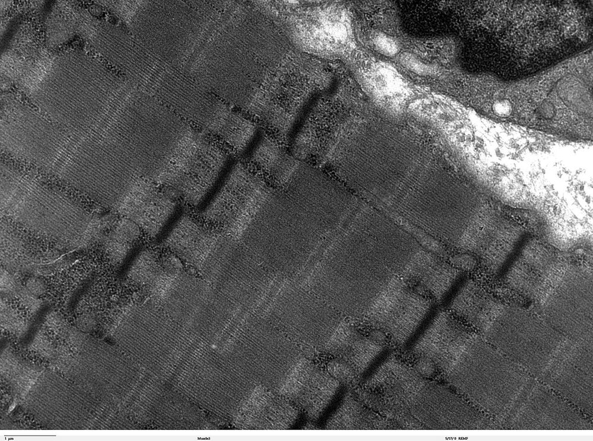{width="100%" height="360" style="object-fit: contain;" fig-alt="Transmission electron micrograph of human skeletal muscle, myofibrils running diagonally: thin dark Z lines cross each myofibril at regular intervals, flanked by light I bands, with the darker A band between them."}

[Micrograph: Louisa Howard, Public domain, Wikimedia Commons](https://commons.wikimedia.org/wiki/File:Human_skeletal_muscle_tissue_2_-_TEM.jpg){.credit}
:::
::::

**When a muscle shortens, which of these bands change?**

::: notes
Read the electron micrograph with the class before introducing the model: find a Z line (thin and dark), then the dark A band between two Z lines and the light I band either side of each Z line. One sarcomere runs from one Z line to the next (scale bar 1 µm); the myofibrils run diagonally across the image, and a capillary and nucleus are at the top right. The bands are the visible result of the filament arrangement on the next slide, and they are why skeletal and cardiac muscle are called striated.
:::

## Sliding filaments: which bands shorten {.smaller}

:::: {.columns}
::: {.column width="45%"}
| Band | Contains | When the sarcomere shortens |
| --- | --- | --- |
| **A band** | Full length of thick filaments | Unchanged |
| **I band** | Thin filaments only | Shorter |
| **H zone** | Thick filaments only | Shorter |
| **Z to Z** | One sarcomere | Shorter |
| Thick and thin filaments | | Unchanged |

**Sliding-filament model:** myosin pulls the thin filaments towards the centre.
**No filament changes length.**
:::
::: {.column width="55%"}

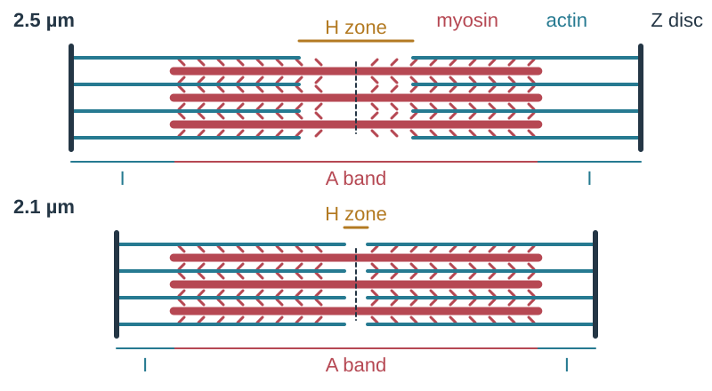{width="100%" height="360" fig-alt="One sarcomere at 2.5 and at 2.1 micrometres: thick myosin filaments in the middle, thin actin filaments from the Z discs; when it shortens the A band stays the same while the I bands and H zone shrink."}

:::
::::

**What makes the myosin heads pull, and let go?**

::: notes
The test of understanding is the right-hand column (exercise 4.3): a band shortens only if it is defined by the gap or overlap between filaments. The A band equals the length of the myosin filament, so it cannot change; the I band and H zone are the non-overlapping regions, so they shrink as overlap increases. Striations visible in skeletal and cardiac muscle are these bands.
:::

## The cross-bridge cycle: what ATP does

:::: {.columns}
::: {.column width="40%"}
- **ATP binding** makes myosin **detach** from actin (step 1).
- **ATP hydrolysis** re-cocks the head (step 2).
- **Pᵢ release** drives the **power stroke** (step 4): ~10 nm per cycle.
- ATP also powers **relaxation**: the SR Ca²⁺ pump.
- **Rigor mortis:** after death ATP runs out, myosin cannot detach, and
  muscles lock rigid.
:::
::: {.column width="60%"}

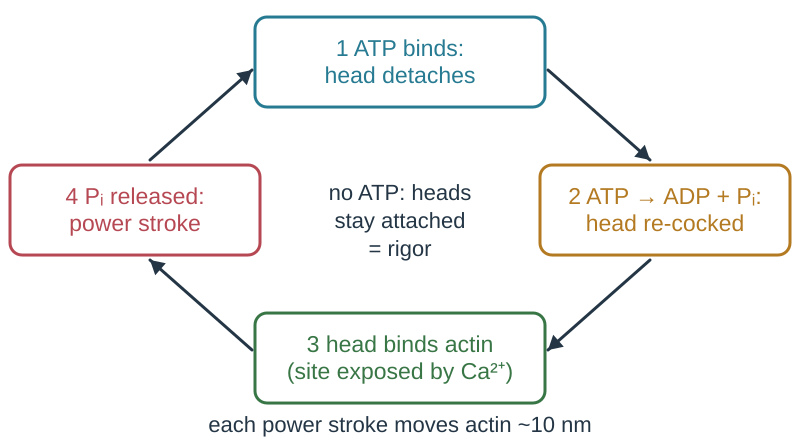{width="100%" height="360" fig-alt="The cross-bridge cycle as four boxes in a loop: ATP binds and the head detaches; ATP is hydrolysed and the head is re-cocked; the head binds actin where Ca2+ has exposed the site; phosphate is released and the power stroke occurs. Without ATP the heads stay attached."}

:::
::::

**One cycle moves a filament 10 nm. How does a whole muscle produce a weak
or a strong pull?**

::: notes
The surprising point for students is that ATP binding causes release, not contraction; the power stroke is triggered by phosphate release. Rigor mortis is the proof: without ATP, heads stay attached. Exercise 4.2 asks for the role of each ATP step. Repeated cycles by many asynchronous heads give smooth sliding, like a team pulling a rope hand over hand.
:::

## Grading force: motor units and summation

:::: {.columns}
::: {.column width="40%"}
- A **motor unit** = one motor neuron + all its muscle fibres: ~10 fibres in
  eye muscles (fine control), ~2,000 in the calf (large force).
- **Recruitment:** activate more motor units, small ones first.
- **Summation:** a twitch lasts ~100 ms, a spike ~2 ms. Spikes at high
  frequency add twitches up to a smooth **tetanus**, 3–4× the twitch force.
- Force is **never** graded by larger action potentials: they are all-or-none.
:::
::: {.column width="60%"}

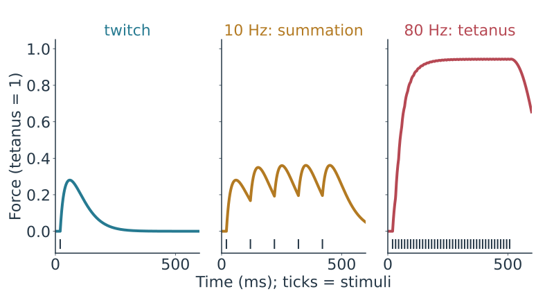{width="100%" height="360" fig-alt="Force traces: a single stimulus gives a twitch; stimuli at 10 Hz give summed twitches that do not fully relax; stimuli at 80 Hz give a smooth fused tetanus about 3.5 times the twitch force."}

:::
::::

**More force costs more ATP. Does it always produce more work?**

::: notes
The same two rules as in sensory coding (number of neurons, frequency of spikes) apply on the output side. Recruiting small units first gives fine control at low force and large increments at high force (the size principle). Summation works because Ca²⁺ is released again before the previous release has been pumped away. Exercise 4.5 tests exactly these four statements. The traces come from the same simple model as the demo on the next slide.
:::

## Try it: summation, tetanus and recruitment

```{=html}
<link rel="stylesheet" href="../../demos/dist/demo.css">
<div data-demo="a5-twitch" data-hz="0" data-units="4"></div>
<script src="../../demos/dist/a5-twitch.js"></script>
```

::: notes
The plot shows the force of a muscle of four motor units (sizes 1 to 4, stacked colours) during 500 ms of motor-neuron firing; red ticks below are the spikes. It opens on a single twitch. Click 5 Hz: separate twitches, each relaxing before the next. 15 Hz: the twitches ride on each other (summation, unfused tetanus); ask why, and get the answer that Ca2+ is released again before the previous release has been pumped back. 30 Hz and 80 Hz: a smooth fused tetanus at about 3.5 times the twitch force (readout). Then the second rule: drag Motor units from 4 down to 1 at 80 Hz to show recruitment, smallest first, giving small steps at low force and large steps at high force. Finish with the point from the slide: at no time did any spike get bigger. The model is schematic (each spike adds a fixed twitch-shaped activation that saturates), but the twitch and tetanus ratio match real fast muscle.
:::

## Work, power and the cost of holding still

- **Work** $W = F \times d$ (force in the direction of movement × displacement).
- **Power** $P = W / t$.

Example: a muscle lifts a load with 30 N through 0.20 m in 0.50 s.

| | Calculation | Result |
| --- | --- | ---: |
| Work while lifting | 30 N × 0.20 m | **6.0 J** |
| Mean power while lifting | 6.0 J ÷ 0.50 s | **12 W** |
| Work while holding the load still | 30 N × 0 m | **0 J** |

- Holding still is an **isometric** contraction: force without shortening.
  Cross-bridges keep cycling and Ca²⁺ is continuously pumped, so **ATP is
  used** and turned into heat.
- Muscle converts at most ~25 % of the chemical energy into work. Lifting 6 J
  costs about 24 J of metabolic energy.

**Skeletal muscle is switched by troponin. Do the heart and the gut wall use
the same switch?**

::: notes
The calculation is simple; the conceptual trap is the holding phase. External mechanical work is zero, but metabolic cost is not: this is why holding a heavy bag is tiring. The efficiency figure connects back to A2: most of the energy of muscle work appears as heat, which is why exercise warms the body. Exercise 4.4 has the same calculation with different numbers.
:::

## Three muscle types, three Ca²⁺ switches {.smaller}

| | Skeletal | Cardiac | Smooth |
| --- | --- | --- | --- |
| Activated by | Motor neuron (ACh) | Own pacemaker cells; spreads via gap junctions | Autonomic nerves, hormones, stretch |
| Source of Ca²⁺ | SR, opened by T-tubule voltage sensors | Ca²⁺ entry triggers SR release (Ca²⁺-induced Ca²⁺ release) | Extracellular fluid and SR |
| Ca²⁺ sensor | **Troponin** on the thin filament | **Troponin** | **Calmodulin** |
| How myosin is switched on | Tropomyosin moves off actin | Tropomyosin moves off actin | Ca²⁺–calmodulin activates **myosin light-chain kinase (MLCK)**, which phosphorylates myosin |
| Tetanus possible | Yes | No (long refractory period, ~250 ms) | Slow, sustained tone |

- All three use actin and myosin and the cross-bridge cycle.
- Smooth muscle relaxes when **myosin light-chain phosphatase** removes the phosphate.

**All of these are controlled by nervous systems. How are nervous systems
organised across animals?**

::: notes
In A1 we compared the three types by appearance; here we compare them by control. The key difference for exercise 4.6 is that smooth muscle regulates the thick filament (myosin phosphorylation), whereas striated muscle regulates the thin filament (troponin–tropomyosin). The cardiac long refractory period prevents tetanus, which would stop the heart from refilling between beats.
:::

## Nervous systems across animals

:::: {.columns}
::: {.column width="40%"}
- ***Hydra*** (cnidarian): **diffuse nerve net**, no brain, radial body.
- **Earthworm:** **cerebral ganglia** plus a **ventral nerve cord** with a
  ganglion in each segment. Insects: same plan, ganglia fused.
- **Mammal:** **brain + dorsal, hollow spinal cord** (CNS) and a peripheral
  nervous system (somatic, autonomic).
- **Cephalisation:** animals that move forwards concentrate sense organs and
  neurons at the front.
:::
::: {.column width="60%"}

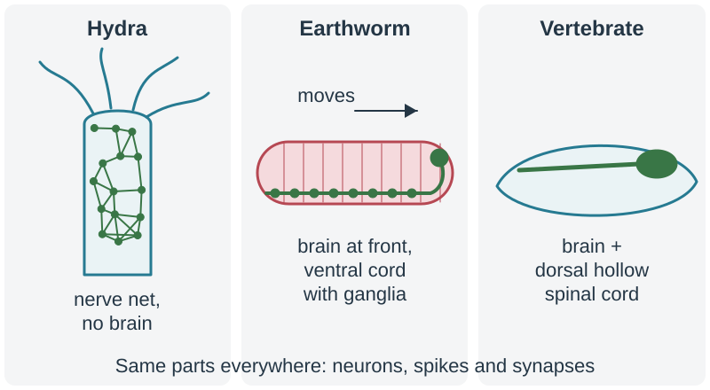{width="100%" height="360" fig-alt="Three body plans: Hydra with a nerve net and no brain; an earthworm with a brain at the front and a ventral nerve cord with ganglia; a vertebrate with a brain and a dorsal spinal cord."}

:::
::::

**Nerves are fast and point-to-point. What about messages that must reach the
whole body for hours?**

::: notes
Exercise 5.1 asks students to match these three types. The ventral versus dorsal nerve cord is a classic difference between annelids and arthropods on one side and vertebrates on the other. Emphasise that there is no single ladder of complexity: each organisation fits the animal's symmetry and way of moving. Transition to hormones: the second messenger system of the body.
:::

## Hormones: two chemical classes

A **hormone** is secreted into the blood and reaches every cell (A3), but only
cells with the matching **receptor** respond.

| | Peptide hormones | Steroid hormones |
| --- | --- | --- |
| Made from | Amino acids | Cholesterol |
| Solubility | Water-soluble | Lipid-soluble |
| Transport in blood | Dissolved in plasma | Mostly bound to carrier proteins |
| Receptor | **Cell surface** (plasma membrane) | **Inside the cell** (cytoplasm or nucleus) |
| Mechanism | **Second messengers** (e.g. cAMP) change the activity of existing proteins | Hormone–receptor complex **binds DNA** and changes gene transcription |
| Typical speed | Seconds to minutes | Hours |
| Examples | Insulin, ADH, LH, FSH, oxytocin | Cortisol, aldosterone, testosterone, oestradiol, progesterone |

- ADH in A4 is the peptide route: V2 receptor → cAMP → aquaporin-2 inserted
  within minutes.

**Which glands make these hormones, and who controls the glands?**

::: notes
Exercise 5.2 asks for this table. The chemistry explains everything else: a water-soluble peptide cannot cross the membrane, so it needs a surface receptor and a second messenger; a lipid-soluble steroid crosses the membrane and acts on genes, which takes longer. Compared with nerves: nerves give milliseconds and one target; hormones give seconds to days and every cell carrying the receptor. The same hormone concentration can therefore affect one tissue and not another.
:::

## The endocrine glands {.smaller}

| Gland or cells | Hormone | Main effect |
| --- | --- | --- |
| **Hypothalamus** | GnRH (and other releasing hormones) | Controls the anterior pituitary |
| **Posterior pituitary** (made by hypothalamic neurons) | ADH, oxytocin | Water reabsorption (A4); uterine contraction, milk ejection |
| **Anterior pituitary** | LH, FSH (also TSH, ACTH, growth hormone, prolactin) | Control other glands |
| Pancreatic islets, **β cells** | Insulin | Lowers blood glucose (A2) |
| **Adrenal medulla** | Adrenaline | Fight or flight: heart rate, glucose release |
| **Adrenal cortex** | Cortisol; aldosterone | Stress and glucose; Na⁺ reabsorption (A4) |
| **Testis**, Leydig cells | Testosterone | Male development, spermatogenesis |
| **Ovary**: follicle; corpus luteum | Oestradiol; progesterone | Female cycle; prepares the uterus |

- The **hypothalamus–pituitary** link is where the nervous and endocrine
  systems meet: neurons that secrete hormones (**neuroendocrine cells**).

**Reproduction shows how this hierarchy is controlled by feedback.**

::: notes
Exercise 5.3 asks for the source of eight hormones; all are in this table. Point out the hierarchy: hypothalamus → anterior pituitary → peripheral gland. The posterior pituitary is a special case: it is an extension of the brain, and ADH and oxytocin are made in hypothalamic neurons and released from their terminals into the blood. The cross-references to A2 and A4 show that earlier units already used this system.
:::

## The hypothalamic–pituitary–gonadal axis {.smaller}

:::: {.columns}
::: {.column width="48%"}

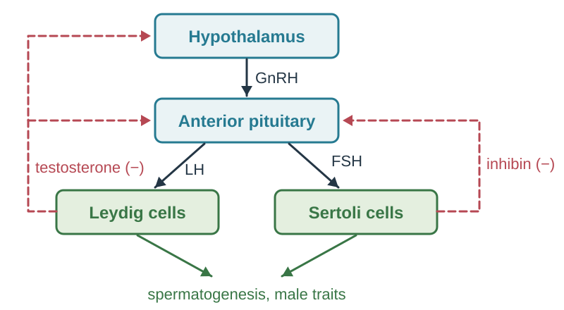{width="100%" height="330" fig-alt="Hypothalamus releases GnRH to the anterior pituitary, which releases LH to Leydig cells and FSH to Sertoli cells; testosterone feeds back negatively on hypothalamus and pituitary, and inhibin on the pituitary."}

:::
::: {.column width="52%"}
| Hormone | Target cells | Main effect |
| --- | --- | --- |
| GnRH | Anterior pituitary | LH and FSH secretion |
| LH (male) | Leydig cells | Testosterone secretion |
| FSH (male) | Sertoli cells | Supports spermatogenesis |
| FSH (female) | Granulosa cells | Follicle growth, oestradiol |
| LH surge (female) | Mature follicle | Ovulation, corpus luteum |
| Inhibin | Anterior pituitary | Inhibits FSH secretion |
:::
::::

In the male the axis runs on **negative feedback**: testosterone inhibits GnRH
and LH; inhibin inhibits FSH.

**In the female the same axis produces a monthly cycle. How?**

::: notes
Use the male axis as the clean negative-feedback example: three levels, two feedback signals, a stable output. Exercise 6.1 asks for the target-cell table and exercise 6.2 for the sign of each feedback. GnRH reaches the pituitary through a short portal blood system, so very little is needed. The same three-level structure with feedback controls the thyroid and the adrenal cortex.
:::

## The ovary: follicles and the corpus luteum

:::: {.columns}
::: {.column width="40%"}
- **FSH** makes several **follicles** grow; one becomes dominant (the
  Graafian follicle). Its granulosa cells secrete **oestradiol**.
- The **LH surge** triggers **ovulation**: the oocyte leaves the follicle.
- The empty follicle becomes the **corpus luteum**, which secretes
  **progesterone** and oestradiol.
- No pregnancy: it regresses after ~12 days. Pregnancy: **hCG** from the
  embryo keeps it alive.
:::
::: {.column width="60%"}
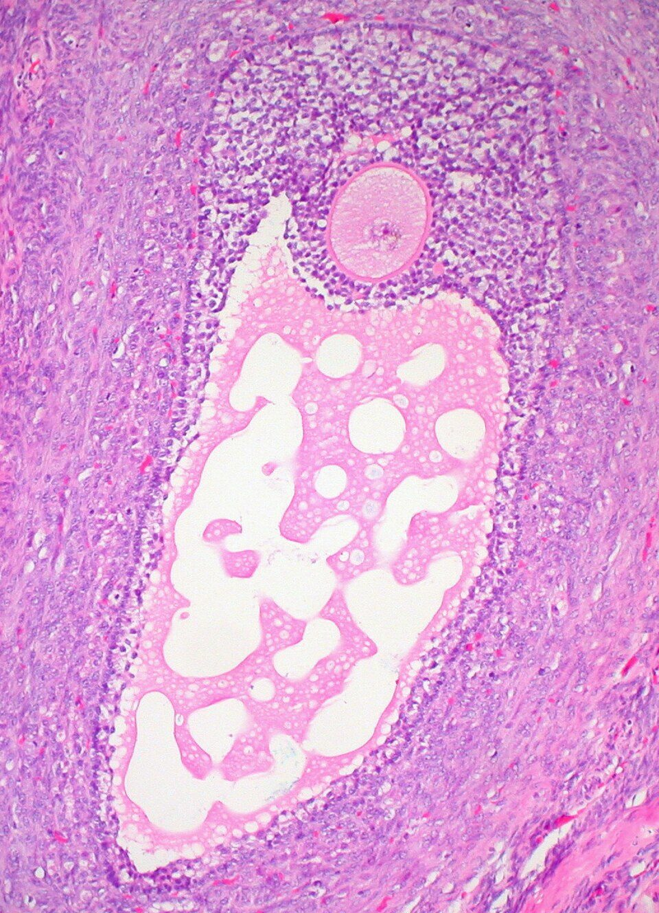{width="100%" height="360" style="object-fit: contain;" fig-alt="Light micrograph of a mature (Graafian) follicle in a human ovary: a large pink fluid-filled antrum lined by purple granulosa cells, with the round oocyte on a mound of granulosa cells at the top."}

[Micrograph: Ed Uthman, CC BY 2.0, Wikimedia Commons](https://commons.wikimedia.org/wiki/File:Graafian_Follicle,_Human_Ovary_(3595817584).jpg){.credit}
:::
::::

**How do the hormones time these events?**

::: notes
Start with the structure, because the hormone curves on the next slide only make sense once students can picture a follicle. In the micrograph, the large cavity (antrum) is filled with follicular fluid; the granulosa cells lining it make oestradiol under FSH stimulation; the oocyte sits on a mound of granulosa cells (cumulus) at one side. After ovulation the same granulosa and theca cells become the corpus luteum. hCG, the hormone detected by pregnancy tests, acts like LH on the corpus luteum.
:::

## The ovarian cycle: feedback changes sign {.smaller}

:::: {.columns}
::: {.column width="40%"}
- **Days 1–12:** oestradiol rises: **negative** feedback on FSH and LH.
- **Days 12–13:** oestradiol **high for ~2 days**: **positive** feedback,
  the **LH surge**.
- **Day ~14:** **ovulation**; the surge ends.
- **Days 15–26:** corpus luteum: progesterone and oestradiol, **negative**
  feedback.
- **Days 27–28:** it regresses; FSH rises; next cycle.

The positive feedback has a clear **end point**: ovulation (as in A1).
:::
::: {.column width="60%"}

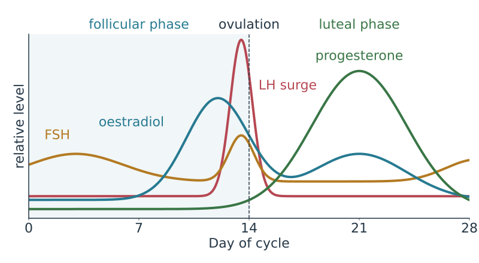{width="100%" height="360" fig-alt="Hormone levels over a 28-day cycle: FSH modest with a small mid-cycle peak, oestradiol rising to a peak just before day 14, a sharp LH surge at ovulation, and progesterone high in the luteal phase."}

:::
::::

**The cycle combines everything in this lecture: sensing, hormonal messengers,
target receptors and feedback.**

::: notes
Exercise 6.3 asks for this order. The curves are schematic shapes, not measured values. The key idea is that the sign of the feedback depends on the level and duration of the oestradiol signal: low or moderate oestradiol inhibits, sustained high oestradiol stimulates. It is not a failure of regulation but a timer that ends in one event. Link back to A1, where positive feedback was introduced with oxytocin and birth; here is a second example with a clear stopping point.
:::

## Summary {.smaller}

| Concept | Key fact |
| --- | --- |
| Equilibrium potential | Nernst: $E = (61.5/z)\log_{10}(\text{out}/\text{in})$; $E_\text{K}$ ≈ −89, $E_\text{Na}$ ≈ +61 mV |
| Resting potential | −70 mV, close to $E_\text{K}$ because K⁺ permeability dominates |
| Action potential | Na⁺ channels open (positive feedback), inactivate; K⁺ channels repolarise |
| Coding and conduction | all-or-none; intensity by frequency and recruitment; faster with diameter and myelin |
| Synapse | Ca²⁺ entry → transmitter release; the receptor decides excitation or inhibition |
| Muscle | ACh → muscle AP → T tubule → SR Ca²⁺ → troponin; ATP detaches myosin |
| Force | graded by recruitment and summation; isometric holding does no work but uses ATP |
| Hormones | peptides: surface receptors, second messengers; steroids: intracellular receptors, genes |
| Reproduction | HPG axis: negative feedback, switching to positive before ovulation |

**The animal half:** a body too large for diffusion (A1) fuels its cells (A2),
supplies O₂ by bulk flow (A3), keeps their fluid stable (A4) and coordinates it
all by feedback through nerves, muscles and hormones (A5).

**Next (P1 — Building a functioning plant):** a plant faces the
same problems of exchange, transport and control, but cannot run, pump blood or
send nerve impulses.

[Tutorial](index.qmd) · [Exercises](exercise.qmd) · [Quiz](quiz.qmd)

::: notes
Read the table as the path of one signal: from ion gradients to a spike, along an axon, across a synapse, into a muscle, then the slower hormonal route and the reproductive axis. Then step back to the whole animal half: each unit answered one part of the A1 question of how to keep every cell supplied and its surroundings stable. The plant half asks the same questions about an organism with no muscles, no nerves and no heart, which makes the comparison sharper.
:::
