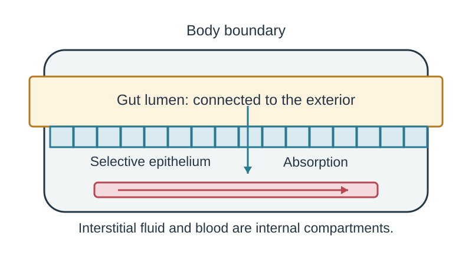
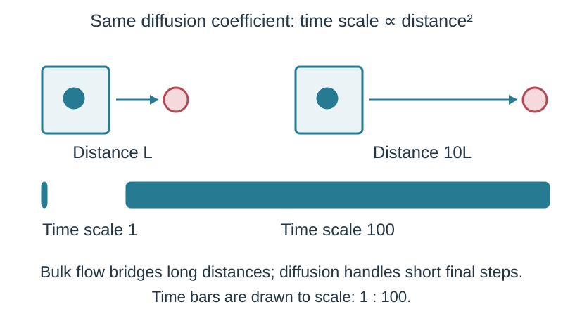
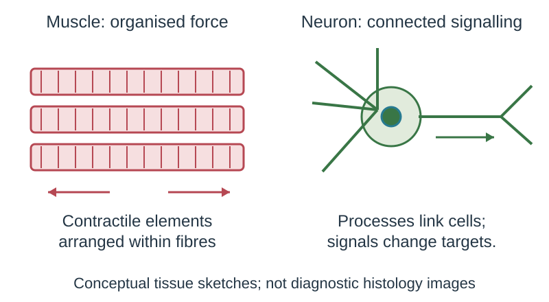
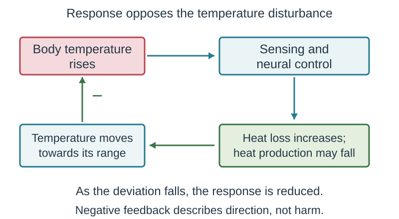

## One need, several solutions

- Every living cell needs suitable supplies and conditions.
- Compare an aquatic invertebrate, an insect and a mammal.
- Explain a transport path rather than listing organs.

## Levels are connected

:::: {.columns}
::: {.column width="40%"}
- Cell → tissue → organ → interacting systems → organism.
- An intestine contains epithelium, connective tissue, muscle and nerves.
- A tissue category does not identify an entire organ.
:::
::: {.column width="60%"}

{width="100%" height="360" fig-alt="Cells form epithelium, one layer of an intestinal wall within an organism."}

:::
::::

## Where is the internal environment?

:::: {.columns}
::: {.column width="40%"}
- Gut lumen is continuous with the exterior.
- Absorption crosses a selective epithelial barrier.
- Most cells exchange with interstitial fluid.
- Circulation connects distant exchange regions and tissues.
:::
::: {.column width="60%"}

{width="100%" height="360" fig-alt="Absorption crosses the gut lining from the externally connected lumen into internal fluids."}

:::
::::

## Size changes the geometry

:::: {.columns}
::: {.column width="40%"}
For a cube: area $=6L^2$; volume $=L^3$; ratio $=6/L$.

- Double length: area ×4, volume ×8.
- Ratios need units: mm⁻¹, for example.
- Larger bodies can fold surfaces and move fluids.
:::
::: {.column width="60%"}

{width="100%" height="360" fig-alt="Doubling cube length multiplies area by four and volume by eight, halving the area-to-volume ratio."}

:::
::::

## Distance is costly

:::: {.columns}
::: {.column width="40%"}
- Simple diffusion time scale grows with distance squared.
- Tenfold distance → roughly hundredfold time scale.
- Bulk flow covers long distances; diffusion crosses final barriers.
:::
::: {.column width="60%"}

{width="100%" height="360" fig-alt="A tenfold diffusion distance has a hundredfold characteristic time at the same diffusion coefficient."}

:::
::::

## Epithelium: a boundary with two sides

:::: {.columns}
::: {.column width="40%"}
- Closely associated cells form sheets.
- Apical and basal domains can differ.
- Thin exchange barriers and layered protective barriers solve different tasks.
- Identify lumen, layers and shape before guessing an organ.
:::
::: {.column width="60%"}

{width="100%" height="360" fig-alt="A thin exchange lining and a layered protective lining show different epithelial arrangements."}

:::
::::

## Connective tissue: examine the matrix

- Cells occur within extracellular material.
- Matrix can be fibrous, flexible, mineralised or fluid.
- Tendon and blood belong to this broad category.
- Pale regions in a section are not automatically empty.

## Muscle and nervous tissue

:::: {.columns}
::: {.column width="40%"}
- Muscle produces force; its arrangement affects function.
- Skeletal, cardiac and smooth muscle differ.
- Neurons receive, integrate and transmit signals.
- Glial cells support neural function.
:::
::: {.column width="60%"}

{width="100%" height="360" fig-alt="Parallel contractile fibres contrast with the branching processes of a neuron."}

:::
::::

## A histology claim needs evidence

:::: {.columns}
::: {.column width="40%"}
Record scale, section orientation, cell features, layers, matrix and lumens.

Then propose identity and alternatives.

A ring can be a cut tube. Text descriptions prepare for, but do not replace,
the actual slide collection.
:::
::: {.column width="60%"}

{width="100%" height="360" fig-alt="A tube appears as a ring in cross-section and as two walls in longitudinal section."}

:::
::::

## Stability can require continual work

- Homeostasis maintains suitable internal conditions.
- Constant values do not imply zero flux or inactivity.
- Different variables can vary on different time scales.

## Explain negative feedback

:::: {.columns}
::: {.column width="40%"}
Disturbance → sensed deviation → control → effector → opposing consequence.

For rising body temperature: identify how heat loss/production changes and
how that reduces the deviation.
:::
::: {.column width="60%"}

{width="100%" height="360" fig-alt="A temperature disturbance activates responses that oppose the initial rise."}

:::
::::

## Avoid two feedback errors

- “Negative” describes loop direction, not a harmful effect.
- An effector response is not necessarily the regulated variable.
- Positive feedback amplifies a change and needs termination.

## Responses and evolutionary change

- Acute response: minutes or less in the example.
- Acclimation: adjustment within an individual's lifetime.
- Evolutionary adaptation: heritable population change across generations.
- A useful function alone does not establish evolutionary origin.

## Compare without a ladder

:::: {.columns}
::: {.column width="40%"}
- Insect: branching tracheal transport brings gases near tissues.
- Mammal: lung exchange plus blood oxygen transport.
- Both need gradients and short final diffusion paths.
- Ask about trade-offs and environment, not which animal is “more advanced”.
:::
::: {.column width="60%"}

{width="100%" height="360" fig-alt="Insect tracheae bring gases near cells; mammalian lungs exchange with blood that supplies tissues."}

:::
::::

## Next

[Tutorial and source links](index.qmd) · [Exercises](exercise.qmd) · [Quiz](quiz.qmd)
