## About this lecture

An amoeba takes oxygen straight from the pond water around it. A mitochondrion
deep in a mouse's thigh muscle is millimetres from the nearest air. **How does
an animal body get oxygen and food to every cell, and keep conditions around
those cells stable?** That question runs through the whole animal half of the
course, and today we set up the tools to answer it.

- **Organisation:** cells → tissues → organs → organ systems, and the
  *internal environment* that cells actually live in.
- **The physical problem:** surface area, volume and diffusion distance.
  These explain why large animals need special exchange surfaces and transport.
- **The building materials:** the four primary tissue types, and how to
  recognise them in a section.
- **Keeping it stable:** homeostasis and feedback control.
- **Many solutions:** response, acclimation and adaptation, with an insect and
  a mammal compared.

::: notes
The single picture for today: one cell, deep inside a body, that needs oxygen and nutrients and needs stable surroundings. Everything in the lecture is a step towards explaining how a body achieves that. Organisation tells us where the cell sits; geometry tells us why that is a problem; tissues are the materials for the solution; feedback keeps the solution working; and comparison shows that animals have solved it in more than one way. The following units (A2–A5) each take one part of this problem: energy, gas exchange and circulation, water and ions, and control.
:::

## The problem: one cell versus a whole animal

:::: {.columns}
::: {.column width="40%"}
- **Amoeba** (~0.5 mm): O₂ diffuses a few µm from the pond water to its
  mitochondria.
- **Mouse** (~80 mm): O₂ travels ventilation → lungs → blood → tissue, up to
  several mm; cells sit in interstitial fluid.
- Every cell needs **O₂ and fuel in, CO₂ and wastes out**, and suitable
  temperature and ions.
- **Most mouse cells never touch the outside world.**
:::
::: {.column width="60%"}

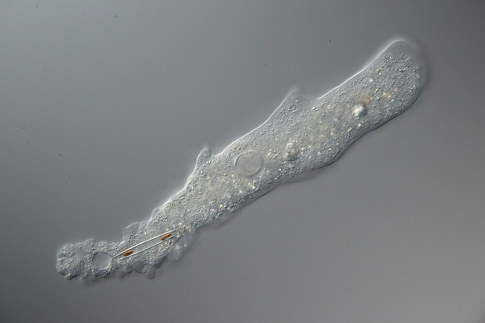{width="100%" height="360" fig-alt="Light micrograph of Amoeba proteus, a single elongated cell with granular cytoplasm and pseudopodia."}

[Photo: SmallRex, CC BY-SA 4.0, Wikimedia Commons](https://commons.wikimedia.org/wiki/File:Amoeba_proteus_locomotive_form.jpg){.credit}

:::
::::

**So what does a mouse body consist of, and where do its cells actually live?**

::: notes
Start with the contrast rather than with definitions. The amoeba is a single cell in direct contact with its environment; diffusion over a few micrometres is fast enough. The mouse is a hundred times longer, and its muscle cells are far from air. This raises two questions that the rest of the lecture answers: how is the body organised (next slides), and why does size create a problem (geometry slides).
:::

## Levels of organisation

:::: {.columns}
::: {.column width="40%"}
- **Cell:** the smallest living unit.
- **Tissue:** similar cells plus extracellular material, with one function.
- **Organ:** several tissues working together, e.g. the intestine.
- **Organ system:** organs with a shared task, e.g. the digestive system.
- **Organism.**

Each level has properties that the level below lacks: a single muscle cell
cannot pump blood, but cardiac muscle in a heart can.
:::
::: {.column width="60%"}

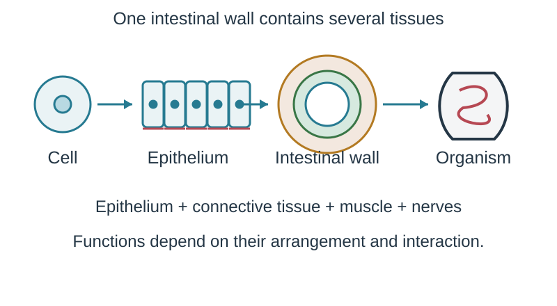{width="100%" height="360" fig-alt="Cells form epithelium, one layer of an intestinal wall within an organism."}

:::
::::

::: notes
Walk through the figure from the cell outwards using the intestine as the example, because we return to it later in the lecture when we look at tissues. Emphasise that the organ-system boundaries are a convenience: digestion depends on circulation and nerves too. The point for the story: the mouse solves its problem by building specialised tissues and organs. Next question: where are the cells, relative to the outside?
:::

## The internal environment

:::: {.columns}
::: {.column width="40%"}
- Body cells are bathed in **interstitial fluid**, not in the outside world.
- **Blood plasma** exchanges with interstitial fluid across capillary walls.
- The **gut lumen** is continuous with the exterior: food in the gut is still
  *outside* the body.
- To enter the body, a substance must cross an **epithelium**.

Claude Bernard (1865): the *milieu intérieur*.
:::
::: {.column width="60%"}

{width="100%" height="360" fig-alt="Absorption crosses the gut lining from the externally connected lumen into internal fluids."}

:::
::::

**The internal environment must be supplied from outside, across exchange surfaces.**

::: notes
This is the key reframing: cells live in interstitial fluid, and that fluid is what the body has to keep supplied and stable. A glucose molecule in the gut lumen has not yet been absorbed; it must cross the intestinal epithelium, enter the blood, leave the capillary and cross the muscle cell membrane. Students practise this route in exercise 1.4. The next question is: why can't the outer surface of the body simply do all the exchange, as in the amoeba?
:::

## Why size is a problem: surface area and volume

:::: {.columns}
::: {.column width="45%"}
For a cube with side $L$:

$$A = 6L^2, \qquad V = L^3, \qquad \frac{A}{V} = \frac{6}{L}$$

| $L$ | $A$ | $V$ | $A/V$ |
| ---: | ---: | ---: | ---: |
| 1 mm | 6 mm² | 1 mm³ | 6 mm⁻¹ |
| 2 mm | 24 mm² | 8 mm³ | 3 mm⁻¹ |
| 4 mm | 96 mm² | 64 mm³ | 1.5 mm⁻¹ |

- **Demand** (metabolism) scales roughly with volume.
- **Supply** across the body surface scales with area.
- Double the size: 4× the area must serve 8× the volume.
:::
::: {.column width="55%"}

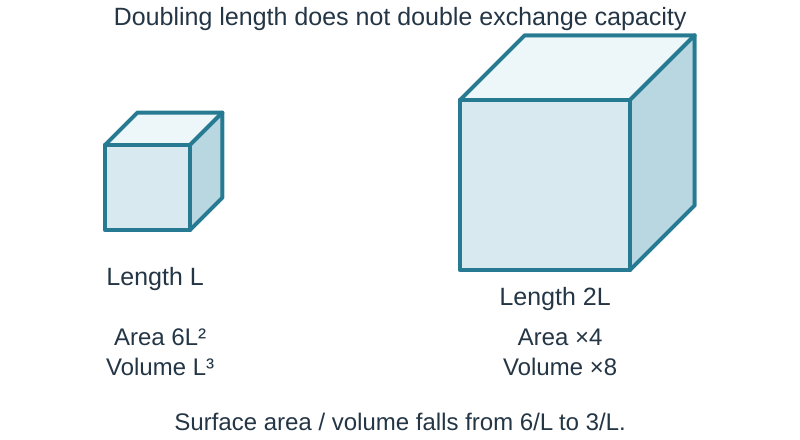{width="100%" height="360" fig-alt="Doubling cube length multiplies area by four and volume by eight, halving the area-to-volume ratio."}

:::
::::

::: notes
Work the table on the board. The cube is a toy, but it makes the scaling argument exact: area goes as length squared, volume as length cubed, so the ratio falls as 1/L. Metabolic demand comes from the volume of living tissue; supply through the surface comes from area. A larger animal therefore has less surface per unit of tissue to supply. That is half the problem. The other half is distance.
:::

## Why size is a problem: diffusion distance

:::: {.columns}
::: {.column width="45%"}
Time to diffuse a distance $x$: $\quad t \approx \dfrac{x^2}{2D}$

For O₂ in water, $D \approx 2 \times 10^{-9}$ m² s⁻¹:

| Distance | Time |
| ---: | ---: |
| 10 µm (one cell) | ~0.03 s |
| 1 mm | ~4 min |
| 1 cm | ~7 h |

- **10× the distance → 100× the time.**
- Diffusion is fast enough within a cell, and far too slow across a body.
:::
::: {.column width="55%"}

{width="100%" height="360" fig-alt="A tenfold diffusion distance has a hundredfold characteristic time at the same diffusion coefficient."}

:::
::::

**So how does a large animal get O₂ to a cell that is centimetres from the air?**

::: notes
This is the decisive number. Diffusion over a cell width takes a few hundredths of a second; over a centimetre it takes hours. The squared dependence is what matters: students can check 10 µm versus 1 mm (100× the distance, 10 000× the time). This is why no animal more than about a millimetre thick relies on diffusion through its body surface alone. Pose the question at the bottom and let them suggest answers before the next slide.
:::

## Try it: how big can diffusion alone go?

```{=html}
<link rel="stylesheet" href="../../demos/dist/demo.css">
<div data-demo="a1-scaling"></div>
<script src="../../demos/dist/a1-scaling.js"></script>
```

::: notes
Live version of the last two slides. The animal is a ball of tissue in air-saturated water that gets O₂ only by diffusion from its surface; colour shows the O₂ level, dark means none. Start at Reset (0.5 mm radius): every cell gets O₂ and the centre still has about 80 %. Drag the radius up slowly and ask the room to call out when the centre runs out; at about 1.1 mm an anoxic core appears, and the "5 mm ball" preset is mostly anoxic. Point to the readouts: A/V falls as 3/r and the diffusion time to the centre grows as r², exactly as on the previous slides. Then press "Mouse tissue": the same 0.5 mm ball with a mammalian metabolic rate already has a dead core, because the largest size scales as 1/√(rate). "Flatworm" shows the way out by shape: a thin sheet stays supplied whatever its length and width. Use this to ask: what else could the animal do? That leads into the three solutions on the next slide. Numbers: D = 2 × 10⁻⁹ m² s⁻¹, surface O₂ 0.27 mM, uniform O₂ use; the largest radius is √(6DC/M).
:::

## Three solutions

:::: {.columns}
::: {.column width="40%"}
1. **Enlarge the exchange surface:** alveoli (~100 m² in a human lung), gill
   lamellae, intestinal villi.
2. **Make the barrier thin:** the air–blood barrier in a lung is < 1 µm.
3. **Use bulk flow** over long distances. Ventilation moves air or water to the
   surface; circulation moves blood around the body.

Diffusion still covers the **last few µm**, capillary to cell.
:::
::: {.column width="60%"}

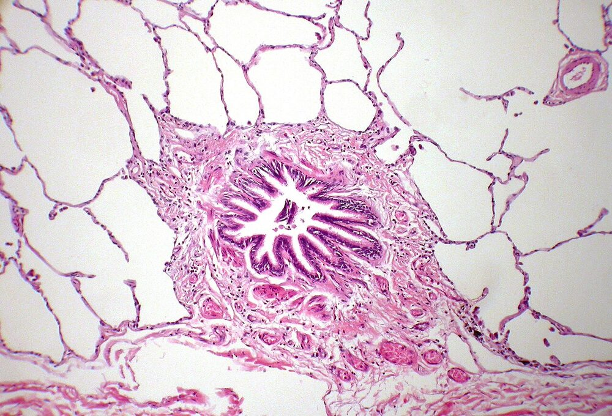{width="100%" height="360" fig-alt="Light micrograph of lung tissue: a bronchiole surrounded by many thin-walled air spaces, the alveoli."}

[Photo: Yale Rosen from USA, CC BY-SA 2.0, Wikimedia Commons](https://commons.wikimedia.org/wiki/File:Normal_lung_(5414785258).jpg){.credit}

:::
::::

**Building these solutions needs specialised materials: the tissues.**

::: notes
Every exchange organ students will meet in A2–A4 and P2 is a combination of these three solutions. Make the link explicit: the lung is (1) and (2), the circulation is (3), and the capillary bed brings bulk flow to within diffusion range of every cell. Transition: to build a thin, folded surface, a pump and a set of tubes, the body uses four kinds of tissue.
:::

## The four primary tissue types

| Tissue | Defining feature | Main functions | Example |
| --- | --- | --- | --- |
| **Epithelial** | Sheets of tightly joined cells; little matrix | Boundaries, exchange, secretion, protection | Lining of gut, alveoli, skin |
| **Connective** | Cells scattered in abundant extracellular matrix | Support, binding, transport | Tendon, bone, cartilage, blood |
| **Muscle** | Elongated cells with contractile proteins | Force and movement | Skeletal muscle, heart, gut wall |
| **Nervous** | Neurons with long processes, plus glia | Signalling and integration | Brain, nerves |

Every organ is built from these four. We now take them one at a time.

::: notes
This overview slide is the map for the next four slides. Students should be able to reproduce the "defining feature" column, because that is what they use to recognise tissue in a section: is it a sheet of cells, cells in matrix, elongated contractile cells, or cells with long processes?
:::

## Epithelium: the exchange surface and the barrier

:::: {.columns}
::: {.column width="40%"}
- **Simple squamous** (one thin layer): short diffusion distance, so suited
  for **exchange** (alveoli, capillaries).
- **Stratified squamous** (many layers): suited for **protection** (skin, oesophagus).
- **Simple columnar** (tall cells): suited for **absorption and secretion** (intestine).
- Each cell has an **apical** side (facing the lumen) and a **basal** side
  (on the basement membrane). Different transport proteins on each side make
  directional transport possible.
:::
::: {.column width="60%"}

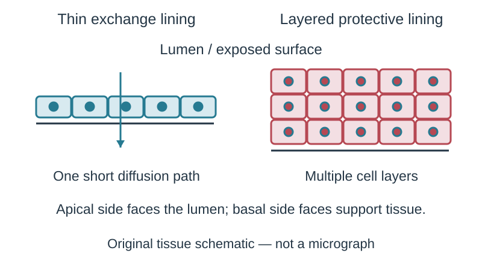{width="100%" height="360" fig-alt="A thin exchange lining and a layered protective lining show different epithelial arrangements."}

:::
::::

::: notes
Connect back to "three solutions": the thin barrier of solution 2 is a simple squamous epithelium. Apical/basal polarity is the basis of every absorbing and secreting epithelium in the course: the gut in A2, the gill and kidney in A4, and plant epidermis by analogy in P1. Shape plus number of layers is the naming system.
:::

## Epithelia in the microscope

:::: {.columns}
::: {.column width="50%"}
**Simple squamous**, seen from above: one layer of flat, polygonal cells.

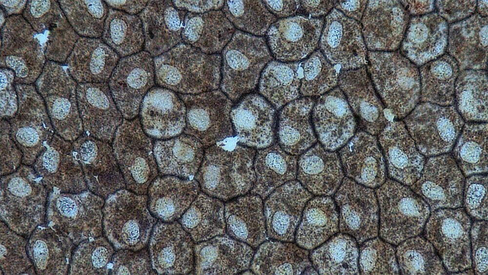{width="100%" height="330" fig-alt="Surface view of simple squamous epithelium: a mosaic of flat polygonal cells, each with a central nucleus."}

[Photo: Berkshire Community College Bioscience Image Library, CC0, Wikimedia Commons](https://commons.wikimedia.org/wiki/File:Epithelial_Tissues_Simple_Squamous_Epithelium_(41722161301).jpg){.credit}
:::
::: {.column width="50%"}
**Stratified squamous**, oesophagus in section: many layers, flattening upwards.

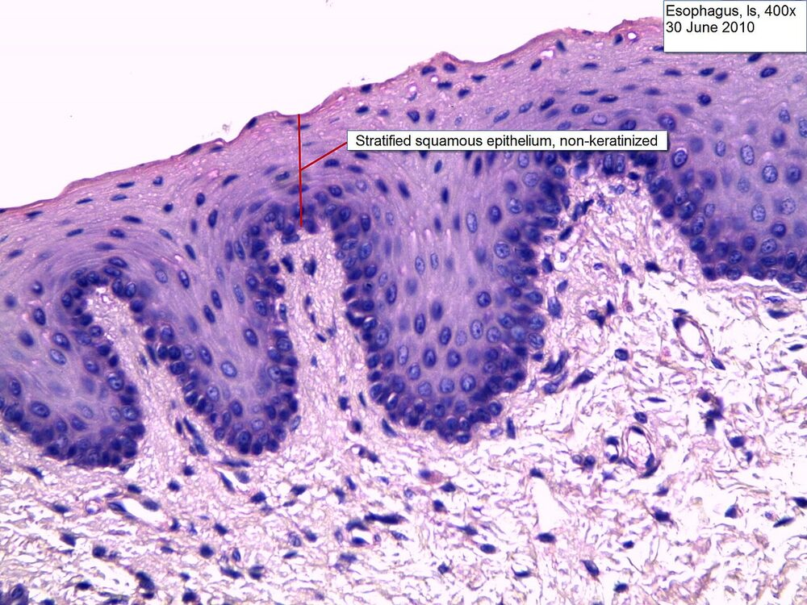{width="100%" height="330" fig-alt="Section of oesophagus lining: many layers of cells, rounded at the base and flattened towards the surface, above pale connective tissue."}

[Photo: Nva1991, CC BY-SA 3.0, Wikimedia Commons](https://commons.wikimedia.org/wiki/File:Thuc_quan.jpg){.credit}
:::
::::

::: notes
These are the two extremes from the previous slide, as students will see them in the histology practical. The left image is a whole mount seen from above, so the single layer appears as a mosaic of flat cells with their nuclei; in a section it would be a thin line of cells with flattened nuclei, as in the alveolar wall. The right image is a section through the oesophagus: count the cell layers, notice that the basal cells are cuboidal and crowded and that cells flatten as they move up towards the lumen. The pale tissue underneath is connective tissue, which carries the blood vessels; the epithelium itself has none. Ask: which of these would you expect in an alveolus, and which on the inside of the mouth?
:::

## Connective tissue: defined by its matrix

:::: {.columns}
::: {.column width="45%"}
- Cells are **scattered** in an **extracellular matrix**; the matrix sets the
  properties.

| Tissue | Matrix → property |
| --- | --- |
| Tendon | parallel collagen → tensile strength |
| Cartilage | collagen in a firm gel → resilience |
| Bone | mineralised collagen → rigidity |
| Blood | fluid plasma → transport |

- It also carries the **blood vessels** that supply epithelia.
:::
::: {.column width="55%"}

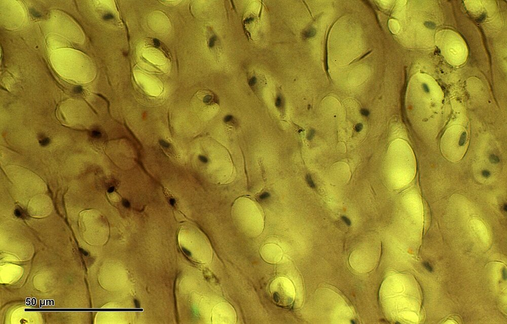{width="100%" height="360" fig-alt="Hyaline cartilage in section: scattered cells sitting in small cavities within a large amount of smooth, firm matrix."}

[Photo: Doc. RNDr. Josef Reischig, CSc., CC BY-SA 3.0, Wikimedia Commons](https://commons.wikimedia.org/wiki/File:Hyaline_cartilage_(254_01)_Mammal;_section.jpg){.credit}

:::
::::

::: notes
In the cartilage image, point out how little of the area is cells: each chondrocyte sits in a small cavity (lacuna) surrounded by matrix, the opposite of an epithelium. Blood surprises students as a connective tissue; use it to make the point that the category is defined by cells-in-matrix, not by being solid. Blood is also the transport medium of solution 3, so the tissue types are already mapping onto the exchange problem. Epithelia themselves have no blood vessels and depend on the connective tissue beneath them.
:::

## Muscle and nervous tissue

:::: {.columns}
::: {.column width="45%"}
| | Skeletal | Cardiac | Smooth |
| --- | --- | --- | --- |
| Striated | yes | yes | no |
| Cells | long fibres | branched | spindle |
| Nuclei | many | one | one |
| Control | voluntary | involuntary | involuntary |

- Muscle provides the **pumps** of bulk flow: the heart, the breathing muscles,
  the gut wall.
- **Neurons** receive, integrate and transmit signals; **glia** support them.
:::
::: {.column width="55%"}

{width="100%" height="360" fig-alt="Parallel contractile fibres contrast with the branching processes of a neuron."}

:::
::::

::: notes
The muscle table is exam material and appears in the exercises (3.2). Link function to the story: bulk flow needs a pump, and all animal pumps are muscle. Nervous tissue appears briefly here and returns in A5; for today its role is to sense and control, which is exactly what the feedback slides need.
:::

## Three muscle types in the microscope

:::: {.columns}
::: {.column width="33%"}
**Skeletal:** long, parallel fibres with cross-striations

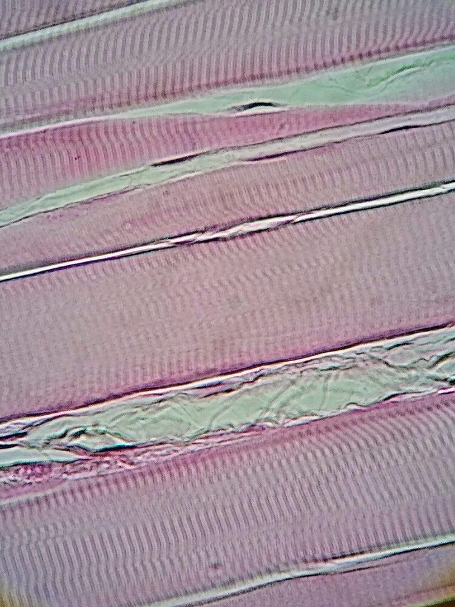{width="100%" height="340" fig-alt="Skeletal muscle in longitudinal section: broad parallel fibres with fine regular cross-striations."}

[Photo: Alexander G. Cheroske, CC BY-SA 4.0, Wikimedia Commons](https://commons.wikimedia.org/wiki/File:Skeletal_muscle_400x.jpg){.credit}
:::
::: {.column width="33%"}
**Cardiac:** branched cells, one central nucleus each

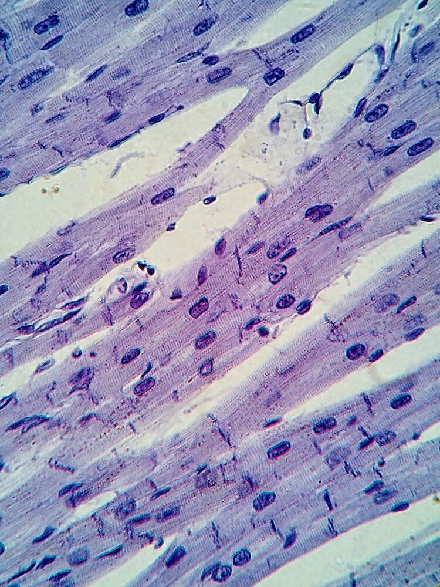{width="100%" height="340" fig-alt="Cardiac muscle: branching cells with single oval nuclei, joined end to end."}

[Photo: Alexander G. Cheroske, CC BY-SA 4.0, Wikimedia Commons](https://commons.wikimedia.org/wiki/File:Cardiac_muscle_histology_400x.jpg){.credit}
:::
::: {.column width="33%"}
**Smooth:** spindle cells, no striations

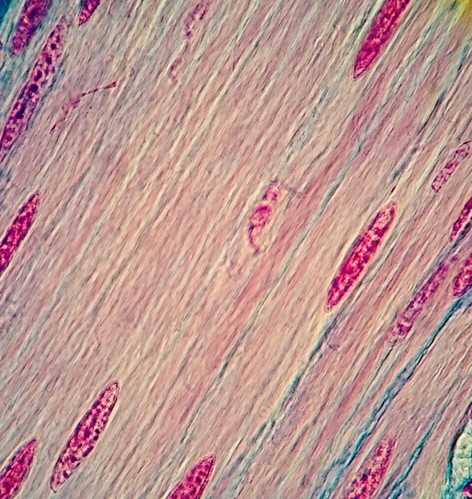{width="100%" height="340" fig-alt="Smooth muscle: tightly packed spindle-shaped cells with elongated nuclei and no striations."}

[Photo: Alexander G. Cheroske, CC BY-SA 4.0, Wikimedia Commons](https://commons.wikimedia.org/wiki/File:Smooth_muscle_400x.jpg){.credit}
:::
::::

::: notes
All three images are at the same magnification (400×), so the sizes are comparable. Ask students to use the table on the previous slide to name each one before revealing the labels: striations or not, branching or not, one nucleus or many. In the skeletal image the fibres are so long that no ends are visible and the striations are very regular; the cardiac cells branch and join, and the dark lines across them in good preparations are intercalated discs; smooth muscle cells taper at both ends and pack together like a bundle of spindles. These are the pumps for bulk flow: heart, breathing muscles and gut wall.
:::

## Reading a tissue section

:::: {.columns}
::: {.column width="40%"}
A section is a thin 2-D slice through a 3-D structure.

- A tube cut **across** gives a **ring**.
- A tube cut **lengthwise** gives two parallel walls.
- A tube cut **obliquely** gives an oval.

So identify a structure from its **tissue layers, cell shapes and scale**, not
from the outline alone.
:::
::: {.column width="60%"}

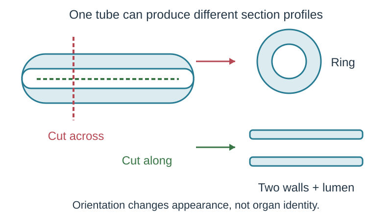{width="100%" height="360" fig-alt="A tube appears as a ring in cross-section and as two walls in longitudinal section."}

:::
::::

::: notes
This prepares students for the histology practical. The classic error is to see a ring and call it a blood vessel; a duct, gland or gut can look the same. The procedure: check the scale, look at the lining (which epithelium?), the layers outside it (connective tissue, muscle) and then name the organ.
:::

## Putting the tissues together: the intestinal wall

:::: {.columns}
::: {.column width="45%"}
| Layer | Tissue → role |
| --- | --- |
| Mucosa | columnar **epithelium** → large, thin absorbing surface |
| Submucosa | **connective tissue**, vessels → carries nutrients away |
| Muscularis | **smooth muscle** → mixes and moves contents |
| Throughout | **nervous tissue** → coordinates |

**One organ, four tissues, all three exchange solutions.**
:::
::: {.column width="55%"}

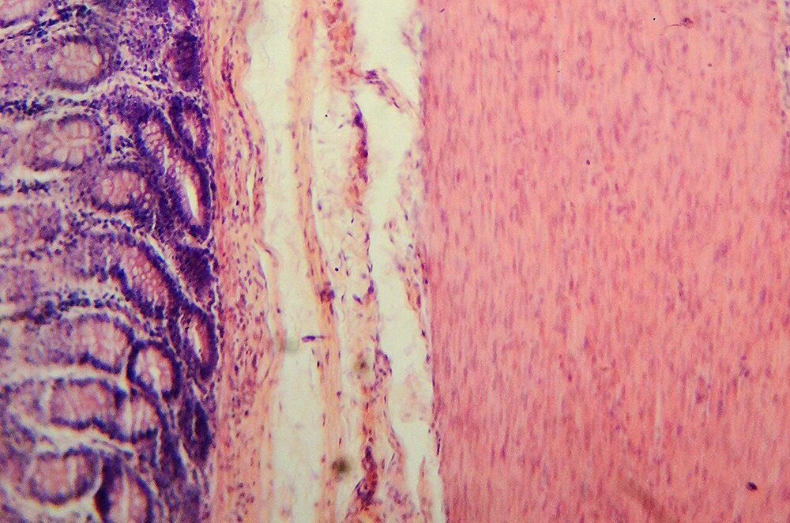{width="100%" height="360" fig-alt="Section of small intestine wall: purple glandular mucosa on the left, pale loose submucosa in the middle, and a thick pink band of smooth muscle on the right."}

[Photo: Juan Carlos Fonseca Mata, CC BY-SA 4.0, Wikimedia Commons](https://commons.wikimedia.org/wiki/File:Tissue_layers_of_the_small_intestine_(mucosa,_submucosa_%26_muscularis).jpg){.credit}

:::
::::

::: notes
This slide closes the first half of the lecture by returning to the intestine from the levels slide. In the micrograph the lumen is off to the left: purple mucosa with its glands, then the pale, loose submucosa where the blood vessels run, then the thick pink band of smooth muscle. Each tissue maps onto one of the three solutions. But an organ like this only works if its surroundings stay within narrow limits. Transition: building the machinery is not enough; temperature, pH, ion concentrations and glucose around the cells have to be held within limits while the animal eats, runs and the environment changes. That is homeostasis.
:::

## Homeostasis: stability by continual work

- **Homeostasis:** maintaining internal conditions within a range compatible
  with life, despite disturbances.
- Regulated variables include body temperature, blood glucose, blood pH,
  plasma osmolarity, and blood O₂ and CO₂.
- Stable does **not** mean static. Blood glucose stays near 5 mM while glucose
  is continuously absorbed and consumed. **Input = output** is a dynamic balance.
- Maintaining it costs energy: ion pumps alone use a large share of resting
  metabolism.

**How does the body detect and correct a deviation?**

::: notes
Emphasise the dynamic nature: a constant concentration is a balance of fluxes, like a bath with the tap running and the plug out. This idea returns in A2 (energy budget), A4 (water and salt balance) and P2 (plant water balance). The bridge to the next slide is the mechanism: negative feedback.
:::

## Negative feedback

:::: {.columns}
::: {.column width="40%"}
1. **Regulated variable:** body temperature.
2. **Disturbance:** exercise raises it.
3. **Sensor:** thermoreceptors.
4. **Control centre:** hypothalamus, which compares with the set point.
5. **Effectors:** sweat glands and skin blood vessels.
6. **Response:** more heat loss, so temperature falls back.

The response **opposes** the deviation. This is **negative feedback**.
:::
::: {.column width="60%"}

{width="100%" height="360" fig-alt="A temperature disturbance activates responses that oppose the initial rise."}

:::
::::

::: notes
Go round the loop component by component; the exercises (4.2) ask students to assign these roles. Point out that the effector (skin blood flow) is not the regulated variable: blood flow changes widely in order to keep temperature constant. Other examples to mention briefly: blood glucose and insulin (A2), blood pressure and the baroreceptor reflex (A3), plasma osmolarity and ADH (A4).
:::

## Positive feedback and two common errors

**Positive feedback** amplifies the change. It needs an end point.

- Oxytocin and uterine contractions during birth (ends at delivery).
- Blood clotting cascade (ends when the wound is sealed).
- Na⁺ channel opening during an action potential (ends with channel inactivation, A5).

**Common errors:**

- "Negative" and "positive" describe the **direction** of the loop, not
  whether it is good or bad.
- The **effector** (e.g. sweating) is not the **regulated variable** (temperature).

::: notes
Positive feedback is not a failure of regulation: it is used for fast, all-or-none events that must run to completion. Each example has a clear terminating step. The two errors are the ones students make most often in exams, so state them explicitly. Transition: feedback acts within minutes; animals also change over weeks and over generations.
:::

## Try it: a temperature control loop

```{=html}
<link rel="stylesheet" href="../../demos/dist/demo.css">
<div data-demo="a1-feedback"></div>
<script src="../../demos/dist/a1-feedback.js"></script>
```

::: notes
The negative-feedback loop from two slides back, run as a simulation. Exercise adds heat from minute 10 to minute 40 (shaded); the blue trace below shows what the effector (sweating, skin blood flow) is doing. Start at Reset: temperature rises a little and levels off about 0.5 °C above the set point, then returns when exercise stops. Ask: why does it not come all the way back during exercise? Because the response is driven by the deviation itself, so some deviation must remain to keep the sweat glands working. Raise the gain: the remaining error shrinks ("Strong, fast"). Press "None": nothing opposes the heat load and temperature drifts several degrees. Press "Positive feedback": the response amplifies the change and runs away, which is why positive feedback needs an end point. Finally "Strong, slow": the same strong gain with a 1.5 min delay overshoots, and each swing is larger than the last until temperature leaves the survivable range, a reminder that sensing and responding take time. "Cold" shows the same loop working the other way: the effector switches to heat production.
:::

## Three time scales of change

| Time scale | Name | Example | Heritable? |
| --- | --- | --- | --- |
| Seconds–minutes | **Acute response** | Ventilation rises when running starts | No |
| Days–weeks | **Acclimation** (lab) / **acclimatisation** (field) | Fish adjusts its enzymes after weeks in warmer water | No |
| Generations | **Evolutionary adaptation** | A population in hypoxic water evolves larger gills | Yes |

- Acute responses and acclimation are changes **within an individual**.
- Adaptation is a change in a **population**, by natural selection.
- That a trait is useful does not by itself show how it evolved.

::: notes
Students confuse acclimation and adaptation constantly. The test is heritability and the unit: an individual acclimates, a population adapts. Exercise 5.1 practises the classification. The last bullet guards against "just-so stories". Transition: evolution has produced several different answers to the oxygen problem we started with.
:::

## Back to the opening problem: insect versus mammal

:::: {.columns}
::: {.column width="40%"}
Both breathe air, and both need O₂ within diffusion range of every mitochondrion.

- **Insect:** air-filled **tracheae** branch directly to the tissues. The
  blood plays little part in O₂ transport.
- **Mammal:** lungs exchange O₂ into the **blood**; the heart pumps it to
  capillaries near every cell.

Different solutions to the same physics. Neither is more advanced than the other.
:::
::: {.column width="60%"}

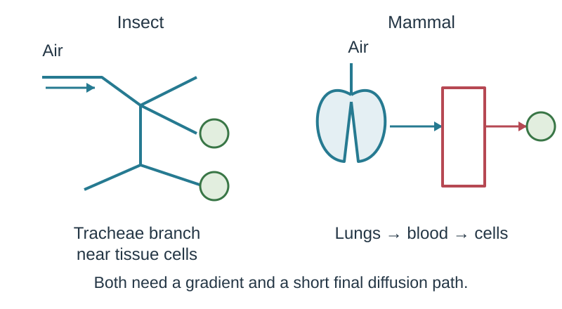{width="100%" height="360" fig-alt="Insect tracheae bring gases near cells; mammalian lungs exchange with blood that supplies tissues."}

:::
::::

::: notes
Close the loop to the first slide. The insect uses bulk flow and diffusion of air all the way to the cells; diffusion in air is about 10 000 times faster than in water, which is what makes this work. The mammal uses a thin, enlarged surface plus a blood pump. Each has trade-offs: tracheal diffusion limits insect body size; the mammalian system needs a heart and haemoglobin. A3 compares gas exchange across animals in detail.
:::

## Summary {.smaller}

| Concept | Key fact |
| --- | --- |
| Levels of organisation | cell → tissue → organ → organ system → organism |
| Internal environment | cells live in interstitial fluid; the gut lumen is outside the body |
| Surface area : volume | $A/V = 6/L$ for a cube; falls as size increases |
| Diffusion time | $t \approx x^2/2D$; 10× distance → 100× time |
| Three solutions | enlarged surface, thin barrier, bulk flow |
| Four tissues | epithelial, connective, muscle, nervous |
| Homeostasis | dynamic maintenance of internal conditions |
| Negative feedback | response opposes the deviation (sensor → control → effector) |
| Positive feedback | response amplifies the change; needs an end point |
| Time scales | acute response, acclimation (individual), adaptation (population) |

**Next (A2 — Nutrition, energy and temperature):** the cells now receive O₂
and food. What do they do with them, how much energy does an animal use, and
how does temperature change that?

[Tutorial](index.qmd) · [Exercises](exercise.qmd) · [Quiz](quiz.qmd)

::: notes
Read the table as the story in order: where cells live, why size makes supply hard, how bodies solve it with tissues, how feedback keeps it stable, and how animals differ. The preview of A2 follows the oxygen and food into the cell: metabolism, energy budgets and temperature.
:::
