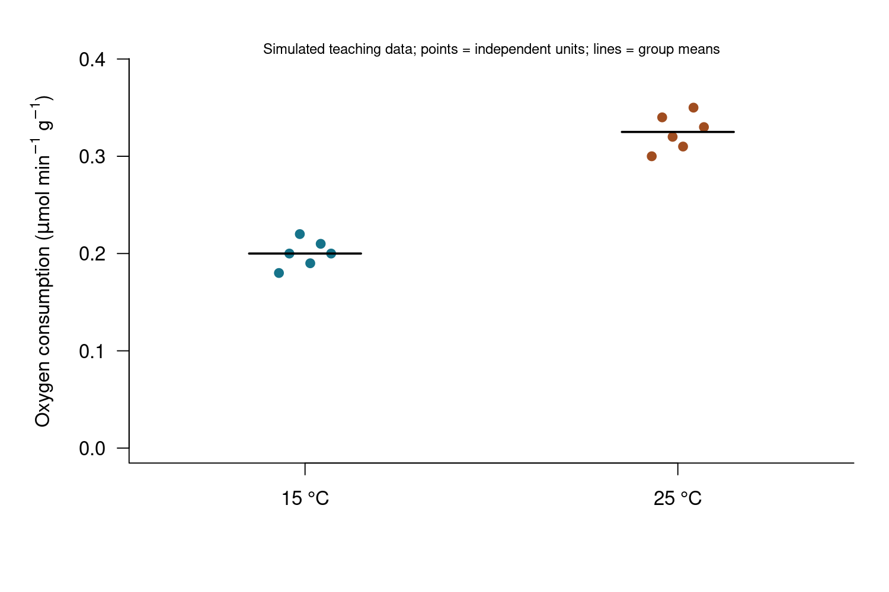
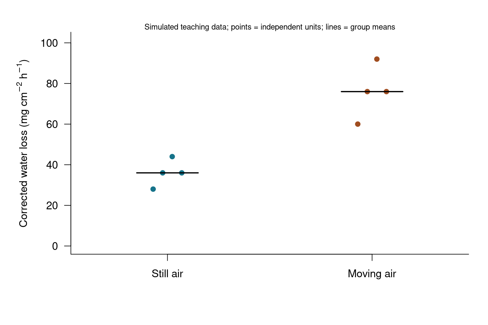
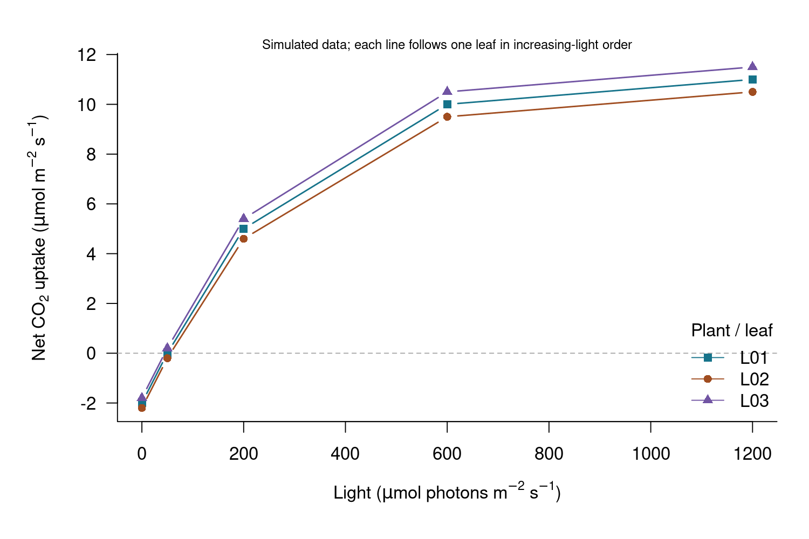
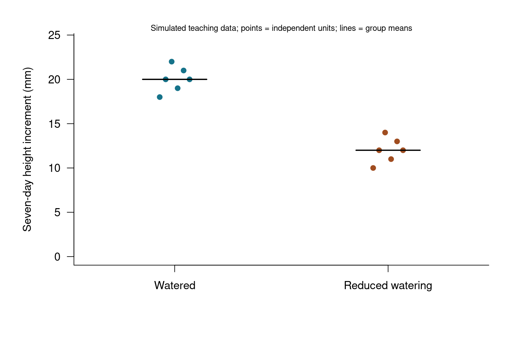

Use this gallery after attempting a practical figure yourself. The examples
show the supplied simulated data, not measured species responses. All axes
give the quantity and units. The raw data and design definitions are in the
[downloads](downloads.qmd).

## Animal measurements

The plotted rate includes volume, blank correction, time and body mass.
Its units differ from the sensor's original concentration units. Describe
the observed difference in this design before discussing an ectotherm's
temperature response. See the [animal practical](practicals/animal-measurements.qmd).

## Plant water loss

The balance measures whole-setup mass change. Background correction and the
assumptions in the [water practical](practicals/plant-water.qmd) connect it to
water loss attributed to the plant. The graph alone does not measure stomatal
aperture or establish drought tolerance.

## Photosynthesis

There are three plant traces, not fifteen independent plants. Joining each
leaf's points shows the repeated-measurement structure; it does not fit a
mechanistic model. Increasing-light order is a design limitation. Negative
dark net exchange represents release under the sign convention. Review the
[photosynthesis activity](practicals/photosynthesis.qmd) before estimating
gross photosynthesis from a net measurement.

## Growth and stress

The outcome is final height minus initial height. A shorter increment does
not by itself establish mortality, lower biomass, lower photosynthesis or
lower yield. The [development/stress activity](practicals/development-stress.qmd)
asks which further measurements would support those different claims.

## Figure choices to explain

For each plot, name what a point represents, identify any repeated observations,
check the calculation and state one supported conclusion and one unsupported
claim. These examples use no hypothesis tests; explanatory clarity does not
depend on adding one. The figures were generated from the committed CSVs using
base R; students need no software installation to view or interpret them.
