## About this lecture

At noon a sunlit leaf takes up CO₂ and exports sugar. At midnight the same
leaf gives off CO₂. Its roots never see light, yet they grow, take up ions and
feed fungal partners day and night. **How does a leaf turn light into sugar,
and how does that sugar pay for the whole plant?** In P2 we opened the
stomata and paid ~500 water molecules for every CO₂ molecule fixed. Today we
follow that CO₂ into the chloroplast and out to the roots.

- **Light reactions:** light, water and electron transport make ATP, NADPH
  and O₂.
- **Calvin–Benson cycle:** ATP and NADPH fix CO₂ into sugar, and what it costs.
- **Rubisco's flaw:** photorespiration, and the C4 and CAM solutions.
- **Measuring photosynthesis:** light-response curves and units.
- **Transport:** sources, sinks and pressure flow in the phloem.
- **Using the sugar:** respiration, fermentation and nitrogen assimilation.

::: notes
The running example is one CO₂ molecule entering a leaf through an open stoma (P2) and ending up in a root, either respired or built into an amino acid. The lecture follows it in order: energy capture, fixation, the problems of fixation in hot dry conditions, measurement, transport, and use. The opening observation (a leaf releasing CO₂ at night) is explained by the light-response curve.
:::

## One equation, two stages

$$6\,\text{CO}_2 + 12\,\text{H}_2\text{O} \xrightarrow{\text{light}} \text{C}_6\text{H}_{12}\text{O}_6 + 6\,\text{O}_2 + 6\,\text{H}_2\text{O}$$

:::: {.columns}
::: {.column width="55%"}
| | Light reactions | Calvin–Benson cycle |
| --- | --- | --- |
| Where | **thylakoid membranes** | **stroma** |
| Inputs | light, H₂O, ADP + Pᵢ, NADP⁺ | CO₂, ATP, NADPH |
| Outputs | O₂, ATP, NADPH | triose phosphate, ADP + Pᵢ, NADP⁺ |

- Linked by **ATP and NADPH**: one stage makes them, the other spends them.
:::
::: {.column width="45%"}

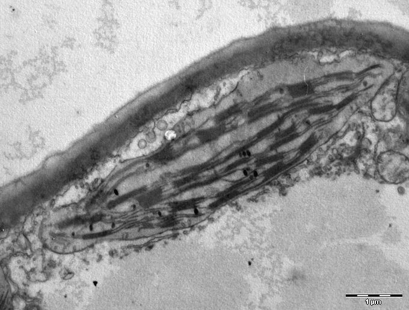{width="100%" height="330" fig-alt="Electron micrograph of a chloroplast: stacks of thylakoid membranes (grana) lie in the paler stroma, inside a double envelope."}

[Photo: and3k and caper437, CC BY-SA 3.0, Wikimedia Commons](https://commons.wikimedia.org/wiki/File:Chloroplast_in_leaf_of_Anemone_sp_TEM_12000x.png){.credit}
:::
::::

**Start with the light reactions: where does the O₂ come from?**

::: notes
Exercise 1.1 is this table. The overall equation hides two separate machines, one in the membrane and one in the soluble stroma, joined by an energy currency. Point to the micrograph: the dark stacked lines are the thylakoid membranes (grana), where the light reactions run; the paler background is the stroma, where the Calvin–Benson cycle runs. The jobs: the light reactions convert light energy to chemical energy, the cycle uses that energy to reduce CO₂. The extra water on both sides of the equation is deliberate: it shows that all 12 O atoms of the released O₂ come from water, which is the next slide.
:::

## Capturing light and splitting water

:::: {.columns}
::: {.column width="45%"}
- **Chlorophyll** absorbs blue (~430 nm) and red (~660 nm) and reflects green.
- An **antenna** of hundreds of pigments funnels energy to a **reaction centre**:
  P680 (photosystem II), P700 (photosystem I).
- At **photosystem II**, water is split:

$$2\,\text{H}_2\text{O} \rightarrow \text{O}_2 + 4\,\text{H}^+ + 4\,e^-$$

- **The O₂ comes from water**, not CO₂ (¹⁸O-labelled water, Ruben and Kamen, 1941).
:::
::: {.column width="55%"}

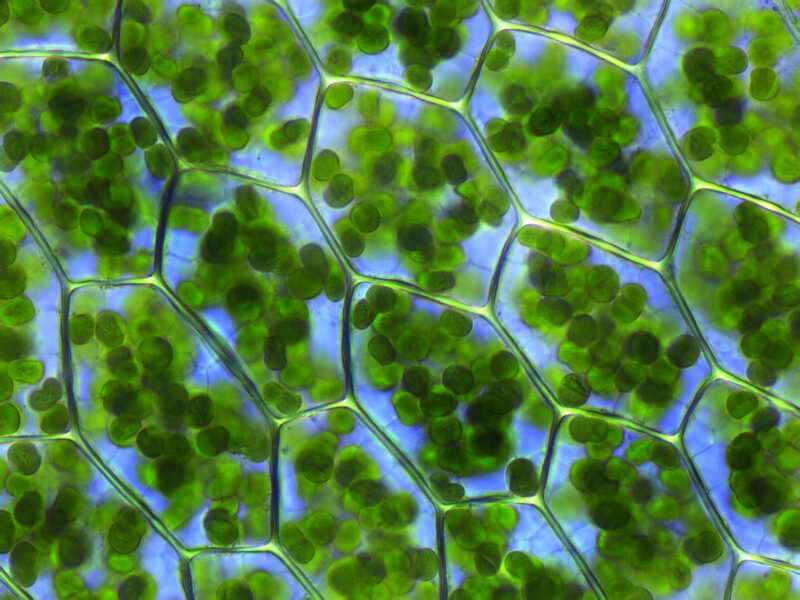{width="100%" height="340" fig-alt="Light micrograph of moss leaf cells, each packed with many green disc-shaped chloroplasts."}

[Photo: Kristian Peters -- Fabelfroh, CC BY-SA 3.0, Wikimedia Commons](https://commons.wikimedia.org/wiki/File:Plagiomnium_affine_laminazellen.jpeg){.credit}
:::
::::

**Where do the electrons from water go?**

::: notes
Exercise 1.2. The photo shows living leaf cells of a moss, one cell layer thick, so the chloroplasts are visible without sectioning: each green disc is one chloroplast, and each holds the thylakoid membranes of the previous slide. The classic error is that O₂ comes from CO₂. The isotope experiment settles it: label the water and the O₂ is labelled; label the CO₂ and it is not. CO₂ supplies the carbon of the sugar. The electrons replace those lost by P680, and the H⁺ is released into the thylakoid lumen. Full sunlight is about 2000 µmol photons m⁻² s⁻¹, the x-axis unit of the light-response curve later in the lecture.
:::

## Linear electron flow

:::: {.columns}
::: {.column width="40%"}
- Light lifts electrons **twice**: at photosystem II and at photosystem I (the
  "Z-scheme").
- Between them, electrons flow downhill: plastoquinone (PQ) → cytochrome
  *b*₆*f* → plastocyanin (PC).
- *b*₆*f* **pumps H⁺ into the lumen**.
- Ferredoxin (Fd) and FNR reduce NADP⁺ to **NADPH**.
:::
::: {.column width="60%"}

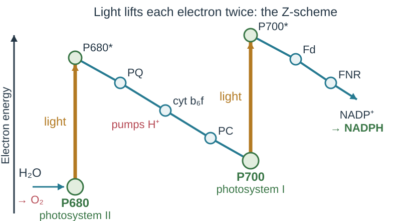{width="100%" height="360" fig-alt="Z-scheme: light raises electrons from P680 to a high energy, they fall through PQ, cytochrome b6f and PC to P700, light raises them again, and they pass through ferredoxin and FNR to NADPH."}

:::
::::

**Result: O₂, NADPH and a proton gradient. How does the gradient make ATP?**

::: notes
Exercise 1.3 asks for this order: H₂O → PSII → PQ → cyt b₆f → PC → PSI → Fd → NADP⁺. Students do not need redox potentials, but should know the sequence and that two photosystems act in series; the vertical axis of the figure is electron energy, not a measured scale. Point out the two sources of lumen protons: water splitting at PSII and the cytochrome b₆f complex. The chain is structurally similar to the mitochondrial electron transport chain students know from A2.
:::

## ATP synthase and cyclic electron flow

:::: {.columns}
::: {.column width="42%"}
- Lumen pH ~5, stroma pH ~8: a **1000-fold** H⁺ gradient.
- **ATP synthase**: H⁺ flows lumen → stroma; ATP is made **in the stroma**.
- Linear flow gives ~1.3 ATP per NADPH; the cycle needs **1.5**.

| | Linear | Cyclic |
| --- | --- | --- |
| PSII, O₂ | yes | no |
| NADPH | yes | no |
| ATP | yes | yes |
:::
::: {.column width="58%"}

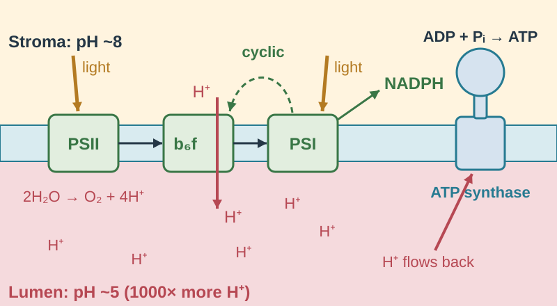{width="100%" height="360" fig-alt="Thylakoid membrane between the stroma at pH 8 and the lumen at pH 5. PSII, cytochrome b6f and PSI fill the lumen with protons; protons flow back through ATP synthase to make ATP in the stroma; cyclic flow returns electrons from PSI to b6f."}

:::
::::

**The stroma now holds ATP and NADPH. What does the Calvin–Benson cycle do with them?**

::: notes
Exercises 1.4 and 1.5. The mechanism is the same chemiosmotic principle as in mitochondria (A2), with the membrane orientation reversed: protons are pumped into the lumen and flow out into the stroma. Cyclic flow (PSI → ferredoxin → back to the cytochrome b₆f complex, dashed arrow) pumps protons without passing electrons to NADP⁺, so it adds ATP without making NADPH or O₂. That fixes the ATP:NADPH mismatch; the 1.5 ratio is derived on the next-but-one slide.
:::

## The Calvin–Benson cycle: three phases

:::: {.columns}
::: {.column width="40%"}
1. **Carboxylation:** **Rubisco** adds CO₂ to ribulose 1,5-bisphosphate
   (RuBP), giving two 3-phosphoglycerate (3-PGA).
2. **Reduction:** ATP and NADPH reduce 3-PGA to **triose phosphate**.
3. **Regeneration:** five of every six triose phosphates rebuild three RuBP.
:::
::: {.column width="60%"}

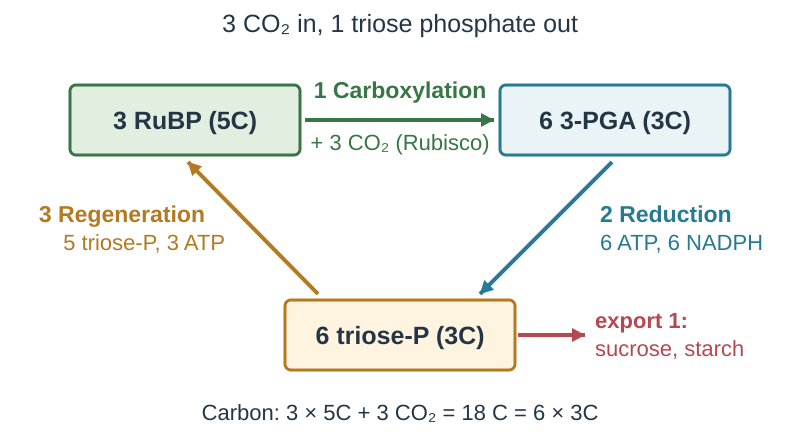{width="100%" height="360" fig-alt="Calvin-Benson cycle: 3 RuBP plus 3 CO2 give 6 3-PGA (carboxylation by Rubisco); 6 ATP and 6 NADPH reduce them to 6 triose phosphates; 5 regenerate 3 RuBP using 3 ATP, and 1 is exported for sucrose and starch."}

:::
::::

**Count the cost: how much ATP and NADPH does one sugar take?**

::: notes
Exercise 2.1 asks for the phases in order and the enzyme. Walk around the figure with three CO₂ so the carbon balances: 3 × 5 C + 3 C = 18 C in six triose phosphates; 15 C regenerate RuBP and 3 C leave as one net triose phosphate. Rubisco is the enzyme from P1 encoded by two genomes, and the most abundant protein on Earth.
:::

## The cost of one sugar, and why it needs light

:::: {.columns}
::: {.column width="50%"}
| CO₂ fixed | ATP | NADPH | Product |
| ---: | ---: | ---: | --- |
| 3 | 9 | 6 | 1 triose phosphate |
| 6 | **18** | **12** | 1 hexose |

- ATP : NADPH = 9 : 6 = **3 : 2** (1.5).
- Per CO₂: 3 ATP and 2 NADPH.
:::
::: {.column width="50%"}
**Not a "dark reaction"**

- The cycle needs ATP and NADPH from the light reactions.
- Several of its enzymes (including Rubisco, via Rubisco activase) are
  **switched on by light** and off in darkness.
- In the dark, the cycle **stops within minutes**.
:::
::::

**Rubisco has a second problem: it does not only react with CO₂.**

::: notes
Exercise 2.2 (18 ATP and 12 NADPH, ratio 3:2) and 2.3a. The name "dark reactions" means only that the cycle does not absorb photons itself; it runs in the light and stops in darkness because its substrates run out and its enzymes are deactivated. This explains the opening observation in part: at night the leaf fixes no CO₂ and only respiration remains.
:::

## Rubisco's flaw: photorespiration

:::: {.columns}
::: {.column width="40%"}
- Rubisco is **slow** (~3 reactions s⁻¹) and can use **O₂ instead of CO₂**,
  giving **2-phosphoglycolate**, which the cycle cannot use.
- Salvage runs through **chloroplast → peroxisome → mitochondrion**, and
  **releases CO₂** already fixed.
- 25 °C, air: ~**1 oxygenation per 3 carboxylations**; ~**25 %** less C3
  photosynthesis.
- **Photorespiration ≠ respiration.**
:::
::: {.column width="60%"}

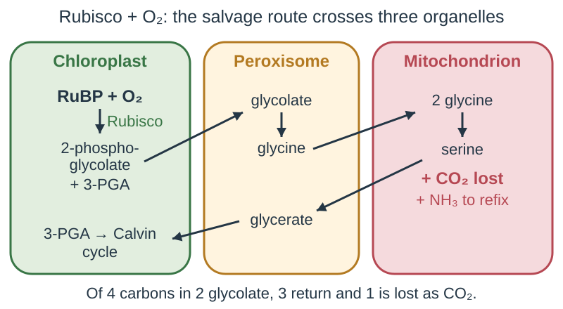{width="100%" height="360" fig-alt="Photorespiration: in the chloroplast Rubisco oxygenates RuBP to 2-phosphoglycolate; glycolate becomes glycine in the peroxisome; in the mitochondrion two glycines give serine, CO2 and NH3; serine returns as glycerate and re-enters the cycle as 3-PGA."}

:::
::::

**When does Rubisco make this mistake more often?**

::: notes
Exercises 2.3b–d and 2.4. Rubisco evolved when the atmosphere had almost no O₂, so discrimination against O₂ was not needed. Photorespiration is a salvage pathway: it recovers three of every four carbons in 2-phosphoglycolate but loses one as CO₂, releases NH₃ that must be refixed, and costs ATP and NADPH. Leaves contain so much Rubisco (up to half of their soluble protein) because it is slow. Stress the distinction from mitochondrial respiration, which is a common exam error: photorespiration starts with Rubisco and recycles 2-phosphoglycolate; respiration oxidises sugar to make ATP.
:::

## What increases photorespiration?

| Change in a C3 leaf | Photorespiration relative to carboxylation | Why |
| --- | --- | --- |
| Higher leaf temperature | **increases** | CO₂ solubility falls more than O₂ solubility; Rubisco's CO₂ specificity falls |
| Stomatal closure in drought | **increases** | CO₂ inside the leaf falls while O₂ stays at 21 % |
| Higher atmospheric CO₂ | **decreases** | more CO₂ competes with O₂ at the active site |

- The problem is worst in **hot, dry, bright** conditions: exactly when P2's
  stomata close to save water.

**Some plants have evolved a fix: raise the CO₂ concentration at Rubisco.**

::: notes
Exercise 2.5. Connect directly to P2: ABA closes stomata in drought, the CO₂ inside the leaf is used up, and Rubisco increasingly fixes O₂. So the water-saving response worsens the carbon problem. Greenhouse growers raise CO₂ to about 1000 ppm partly for this reason. Transition to the CO₂-concentrating mechanisms.
:::

## C4: separating fixation in space

:::: {.columns}
::: {.column width="42%"}
1. **Mesophyll:** **PEP carboxylase** fixes HCO₃⁻ into oxaloacetate (4C),
   then malate. It ignores O₂.
2. Malate moves to the **bundle sheath** and releases CO₂ next to **Rubisco**
   at ~10× the air concentration.
3. Regenerating PEP costs **2 ATP per CO₂**: 5 instead of 3.

- **Kranz anatomy**; maize, sugarcane, sorghum.
:::
::: {.column width="58%"}

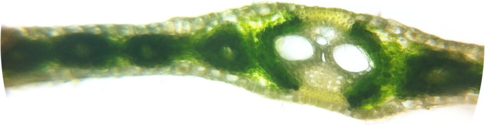{width="100%" height="200" fig-alt="Light micrograph of a maize leaf cross-section, rotated to lie flat: each vein is ringed by a dark green wreath of bundle-sheath cells, with paler mesophyll between the veins; one large vein shows two wide xylem vessels."}

[Photo: Kelvinsong, CC BY 3.0, Wikimedia Commons](https://commons.wikimedia.org/wiki/File:Zea_mays_leaf_Kranz_anatomy_1_200%C3%97.png){.credit}
:::
::::

**Desert succulents use the same enzymes but separate the steps in time.**

::: notes
Exercises 3.4 (advantage and cost) and part of 3.1. Kranz is German for wreath: in the section, find a vein and the ring of large bundle-sheath cells around it, with mesophyll cells outside. C4 is a pump that concentrates CO₂ at Rubisco, paid for in ATP. Advantage: almost no photorespiration, so higher photosynthesis and water-use efficiency in warm, bright conditions. Cost: 5 ATP per CO₂ instead of 3, so C4 is no better in cool or shaded conditions. C4 plants are only about 3 % of species but carry out about a quarter of land photosynthesis, mostly tropical grasses. The Calvin–Benson cycle and Rubisco are still there; C4 only changes how CO₂ is delivered.
:::

## CAM: separating fixation in time

:::: {.columns}
::: {.column width="45%"}
**Night, stomata open:** PEP carboxylase fixes CO₂ → **malate**, stored as
malic acid in the **vacuole**. Acidity **rises**.

**Day, stomata closed:** malate is decarboxylated and **Rubisco** fixes the
CO₂ using light energy. Acidity **falls**.

- Cool night air: **very little water lost** per CO₂.
- Slow growth: the vacuole limits storage.
- Fingerprint: **acid at dawn, not at dusk**.
:::
::: {.column width="55%"}

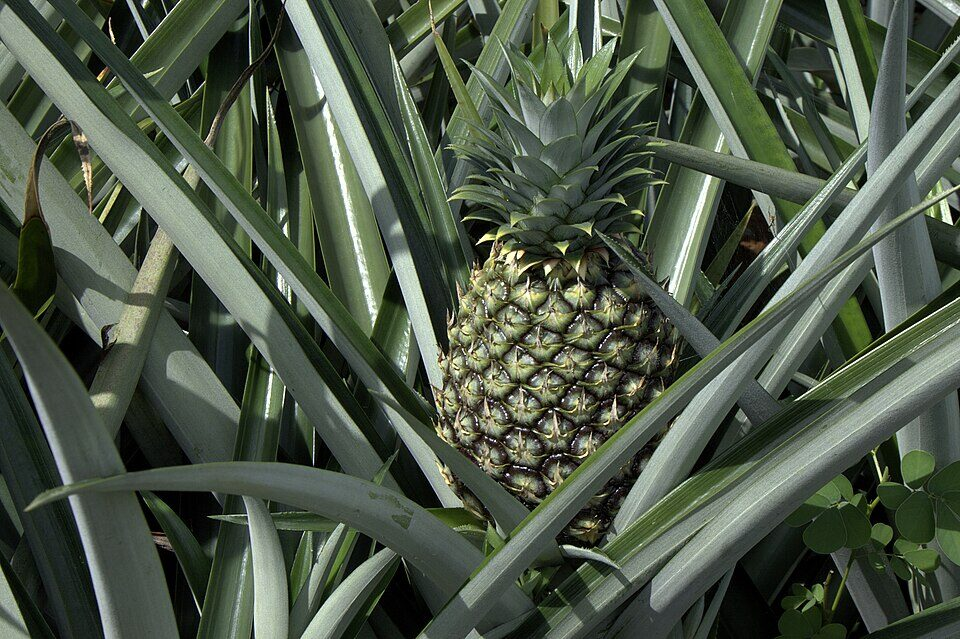{width="100%" height="340" fig-alt="A pineapple plant: a rosette of stiff, thick leaves with a fruit in the centre."}

[Photo: Markus Leupold-Löwenthal, CC BY-SA 3.0, Wikimedia Commons](https://commons.wikimedia.org/wiki/File:AnanasComosusOnPlant.jpg){.credit}
:::
::::

**Side by side: C4 separates the two steps in space, CAM in time.**

::: notes
Exercise 3.3: the acidity rhythm is the CAM fingerprint; Kranz anatomy is the C4 fingerprint. CAM solves the water problem from P2 by opening stomata only when evaporation is low. The cost is capacity: the night's CO₂ store sets the day's photosynthesis. Pineapple is the main CAM crop; others are prickly pear (Opuntia), Agave and many orchids. Again, Rubisco is still present and does the final fixation.
:::

## C4 and CAM: space versus time

:::: {.columns}
::: {.column width="38%"}
- Both use **PEP carboxylase** first, to make malate, and **Rubisco** last.
- **C4:** two cell types, both steps by day.
- **CAM:** one cell, steps at night and by day.
- Both raise CO₂ at Rubisco, so **photorespiration stays low**.
:::
::: {.column width="62%"}

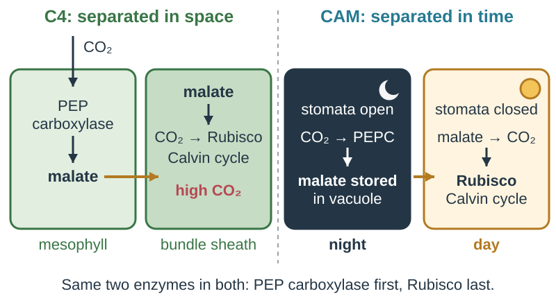{width="100%" height="360" fig-alt="Left: in C4, mesophyll cells fix CO2 with PEP carboxylase into malate, which moves to bundle-sheath cells where CO2 is released to Rubisco. Right: in CAM, malate is made and stored in the vacuole at night with stomata open, and releases CO2 to Rubisco by day with stomata closed."}

:::
::::

::: notes
This figure is the one-sentence summary of the last two slides: the same two enzymes, separated either between cells (C4) or between night and day (CAM). Ask students where the stomata are open in each case and why that matters for water loss; the next slide puts numbers on it.
:::

## C3, C4 and CAM compared

| | C3 | C4 | CAM |
| --- | --- | --- | --- |
| Enzyme of initial CO₂ fixation | Rubisco | PEP carboxylase | PEP carboxylase |
| First stable product | 3-PGA (3C) | oxaloacetate (4C) | oxaloacetate (4C), stored as malate |
| Separation of initial fixation and Calvin cycle | none | **space**: mesophyll / bundle sheath | **time**: night / day |
| Stomata open mainly | day | day | **night** |
| Photorespiration | high in warm conditions | low | low |
| Water lost per CO₂ fixed (molecules) | ~500 | ~250 | ~50 |
| Examples | wheat, rice, most trees | maize, sugarcane | pineapple, *Opuntia* |

- In all three, CO₂ is **finally fixed by Rubisco** in the Calvin–Benson cycle.

**How do we measure how fast a leaf is fixing carbon?**

::: notes
Exercises 3.1 and 3.2. The water row links the three pathways back to P2's transpiration ratio. Students should classify the six crops in 3.2 from this table. Transition from mechanism to measurement: a gas-exchange instrument measures the net CO₂ flux of a leaf.
:::

## The light-response curve

:::: {.columns}
::: {.column width="40%"}
| Light | Net CO₂ |
| ---: | ---: |
| 0 | −2 |
| 50 | 0 |
| 200 | 6 |
| 800 | 9 |

- **Dark respiration:** 2 µmol m⁻² s⁻¹.
- **Compensation point:** 50 µmol photons m⁻² s⁻¹.
- **Gross** at 200 = 6 + 2 = **8**.
:::
::: {.column width="60%"}

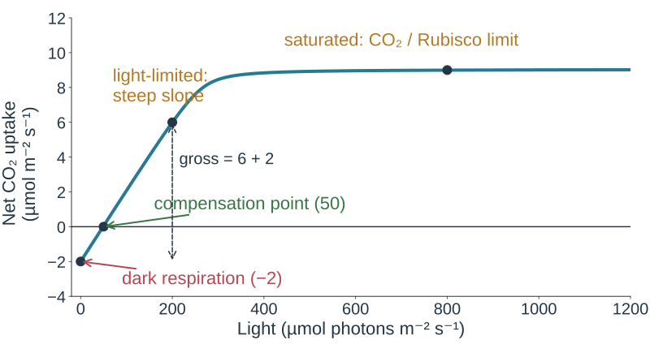{width="100%" height="360" fig-alt="Light-response curve through the four measured points: net CO2 uptake is minus 2 in darkness, crosses zero at the compensation point of 50, rises steeply to 6 at 200 and saturates near 9 at high light."}

:::
::::

**Net = gross − respiration. Below compensation the leaf loses carbon: midnight.**

::: notes
Exercise 4.1. Units: light in µmol photons m⁻² s⁻¹, net CO₂ in µmol m⁻² s⁻¹ (positive = net uptake). Slopes: 50 → 200 is 6/150 = 0.04 CO₂ per photon; 200 → 800 is 3/600 = 0.005, so the curve saturates. The curve answers the opening observation: in darkness only respiration remains, so net exchange is negative. At low light, rate is limited by light; at high light, by CO₂ supply and Rubisco capacity, so extra photons add little. Shade leaves have lower compensation points and lower respiration than sun leaves. Assume respiration is unchanged in light to get gross photosynthesis. The plotted curve is a smooth fit through the four table points.
:::

## Try it: a leaf under changing light, CO₂ and heat

```{=html}
<link rel="stylesheet" href="../../demos/dist/demo.css">
<div data-demo="p3-lightcurve" data-pathway="C3" data-co2="420" data-temp="25" data-light="600"></div>
<script src="../../demos/dist/p3-lightcurve.js"></script>
```

::: notes
Live version of the light-response curve, for a sun leaf (a standard leaf photosynthesis model, so the numbers are larger than the shade-leaf table on the previous slide). Drag the round handle along the curve or use the Light slider; the readout gives net and gross photosynthesis, dark respiration, the CO₂ released by photorespiration and what limits the rate. Suggested sequence, about 5 minutes. (1) Tick "Zoom in on low light": find the compensation point and the respiration line, then untick. (2) Press "Keep this curve", then "Hot, dry": the curve drops, photorespiration rises (more O₂ per CO₂) and respiration doubles; this is P2's closed stomata meeting Rubisco's flaw. (3) Press "1000 ppm" (greenhouse): photorespiration falls and the plateau rises. (4) Switch to "C4 leaf (maize)" and repeat "Hot, dry": C4 keeps most of its rate because PEP carboxylase concentrates CO₂. (5) Press "Cool, 12 °C" for both C3 and C4: now C3 wins, because C4 pays 2 extra ATP per CO₂ and its enzymes are cold-sensitive. Ask the room to predict each change before you press. Reset restores the start. The figure on the previous slide is the static fallback for PDF.
:::

## From a rate to an amount

:::: {.columns}
::: {.column width="70%"}
A leaf of **0.02 m²** takes up CO₂ at **6 µmol m⁻² s⁻¹** for **10 min**:

$$6\ \frac{\mu\text{mol}}{\text{m}^2\,\text{s}} \times 0.02\ \text{m}^2 \times 600\ \text{s} = 72\ \mu\text{mol CO}_2$$

$$72\times10^{-6}\ \text{mol} \times 44\ \text{g mol}^{-1} = 3.2\times10^{-3}\ \text{g} = 3.2\ \text{mg CO}_2$$

- Multiply by **area** and by **time in seconds**; the m⁻² and s⁻¹ cancel.
- Carry the units through every step; most errors are in minutes → seconds.
:::
::: {.column width="30%"}

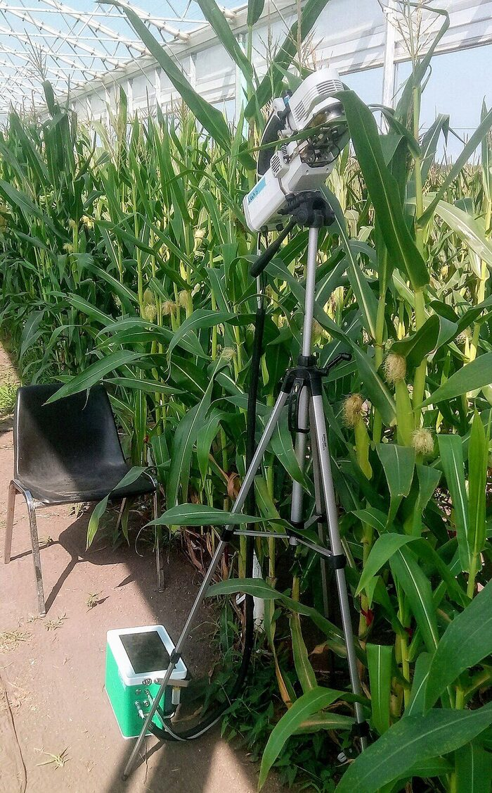{width="100%" height="450" fig-alt="A portable photosynthesis system in a maize plot: a leaf chamber on a tripod clamps a maize leaf, connected by a cable to a green control console on the ground."}

[Photo: Viséan, CC BY-SA 4.0, Wikimedia Commons](https://commons.wikimedia.org/wiki/File:Photosynthesis_System_analysing_a_maize_leaf.jpg){.credit}
:::
::::

**That carbon is made in the leaf. How does it reach a root or a fruit?**

::: notes
The photo shows where such numbers come from: a portable gas-exchange system (LI-6800) clamped onto a maize leaf in a field trial. The chamber encloses a known leaf area, sets light and CO₂, and measures the CO₂ and water-vapour difference between incoming and outgoing air, so it reports net photosynthesis directly in µmol CO₂ m⁻² s⁻¹; the light-response curve on the previous slides is made with such an instrument. Exercise 4.2. This is the same unit logic as the transpiration calculation in P2. Show the cancellation of units explicitly. Transition to transport: carbon fixed in a leaf is exported as sucrose through the phloem from P1.
:::

## Sources and sinks

:::: {.columns}
::: {.column width="45%"}
- **Source:** exports sugar. **Sink:** imports it.
- The phloem carries mainly **sucrose**.
- Roles **change** with development.

| Organ | Role |
| --- | --- |
| Mature, illuminated leaf | **source** |
| Developing fruit, root tip | sink |
| Young, expanding leaf | sink |
| Tuber sprouting in spring | **source** |
:::
::: {.column width="55%"}

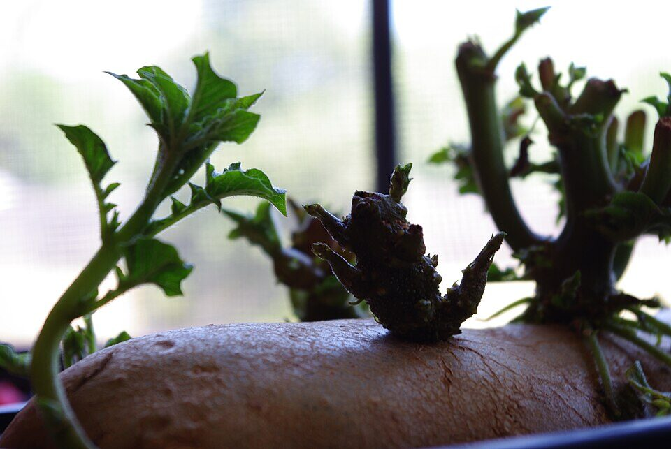{width="100%" height="340" fig-alt="A potato tuber with green leafy shoots growing from its eyes."}

[Photo: Bmerva, CC BY-SA 3.0, Wikimedia Commons](https://commons.wikimedia.org/wiki/File:Lateral_View_of_sprouting_potato.JPG){.credit}
:::
::::

**What pushes sap from a source to a sink?**

::: notes
Exercises 5.1 and 5.3. The sprouting tuber in the photo is the important case: a storage organ that was a sink last summer becomes a source when its starch is mobilised for the new shoots. Source and sink describe current carbon flow, not organ type. A young leaf is a sink until it is roughly half expanded, then becomes a source. Chloroplasts store starch during the day and break it down at night to keep sucrose export going.
:::

## Pressure flow in the phloem

:::: {.columns}
::: {.column width="40%"}
1. Sucrose is **loaded** into sieve tubes (often H⁺-coupled).
2. Ψs falls; **water enters** from the xylem.
3. **Pressure rises** at the source (~1 MPa).
4. Sap moves by **bulk flow**, ~1 m h⁻¹.
5. Sucrose is **unloaded** at the sink; water leaves.
:::
::: {.column width="60%"}

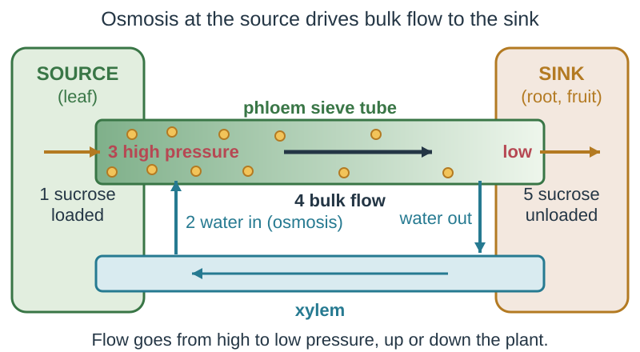{width="100%" height="360" fig-alt="Pressure-flow model: at the source sucrose is loaded into the sieve tube and water follows from the xylem, giving high pressure; sap flows in bulk to the sink, where sucrose is unloaded and water returns to the xylem."}

:::
::::

**Water potential (P2) running a second transport system.**

::: notes
Exercise 5.2 asks for this order. This is the Münch pressure-flow model. It reuses every idea from P2: Ψs = −cRT drives water entry, Ψp builds up, and flow goes from high to low pressure. Loading uses the proton gradient from P2. Direction is set by where sources and sinks are, so phloem can move sap up or down, unlike xylem. Next: how do we know the sap is under pressure?
:::

## Evidence: aphids tap the sieve tubes

:::: {.columns}
::: {.column width="42%"}
- An aphid's mouthparts (**stylet**) enter **one sieve element**.
- Cut the stylet: sap **keeps flowing out for hours**, pushed by the
  pressure inside.
- The sap is mostly **sucrose**, often 0.3–1 M.
- Aphids excrete surplus sugar as **honeydew** drops.
:::
::: {.column width="58%"}

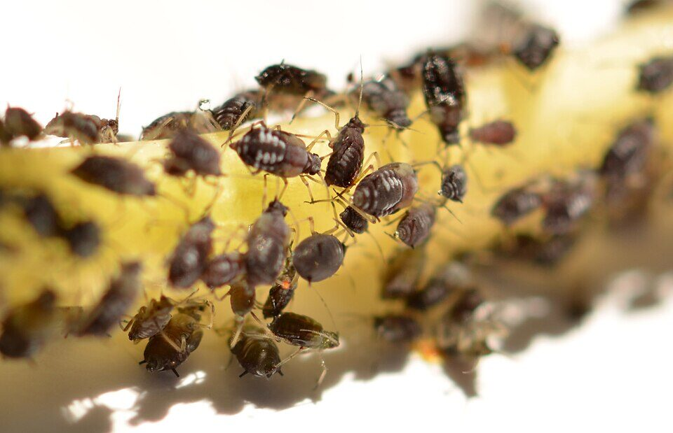{width="100%" height="340" fig-alt="A dense colony of dark aphids feeding on a nasturtium stem."}

[Photo: Lamiot, CC BY-SA 3.0, Wikimedia Commons](https://commons.wikimedia.org/wiki/File:Aphids_on_nasturtium_stem_1730b.JPG){.credit}
:::
::::

**Then what does the sink do with the sugar?**

::: notes
The aphid stylet technique is the classic evidence for the pressure-flow model: the aphid does not pump, the sap is forced into its gut by the sieve-tube pressure, and a severed stylet bleeds pure phloem sap that can be collected and analysed. The sap is a concentrated sucrose solution with amino acids and ions, so aphids take in far more sugar than they need and excrete the rest as honeydew, which ants collect. The photo shows a colony on a nasturtium stem: every aphid has its stylet in a sieve element. Transition: the sink uses the sugar, either in respiration or as carbon skeletons.
:::

## Using the sugar: respiration

:::: {.columns}
::: {.column width="55%"}
| Stage | Location | Main products |
| --- | --- | --- |
| Glycolysis | cytosol (and plastids) | pyruvate, ATP, NADH |
| TCA (citric acid) cycle | mitochondrial matrix | CO₂, NADH, FADH₂, ATP |
| Electron transport and oxidative phosphorylation | inner mitochondrial membrane | ATP, H₂O (O₂ is the final acceptor) |

Aerobic: **~30 ATP per glucose**.
:::
::: {.column width="45%"}
**Flooded roots: fermentation**

- No O₂ → electron transport stops → NADH accumulates.
- Fermentation regenerates **NAD⁺** so glycolysis can continue.
- Products in roots: **ethanol and CO₂** (some lactate).
- Only **2 ATP per glucose**: ~15× less.
:::
::::

- Every living cell respires, in light and in darkness: roots for ion uptake
  (P2), growth and maintenance.

**Respiration also supplies the carbon skeletons that turn nitrate into
amino acids.**

::: notes
Exercises 6.1 and 6.2. This links to P2's waterlogging chain: without O₂, the root's ATP supply drops about fifteen-fold, so the H⁺-ATPase and ion uptake fail. Ethanol accumulation is also toxic. Respiration is not just the reverse of photosynthesis: it provides ATP and the intermediates used to build amino acids and other compounds.
:::

## Nitrogen assimilation: carbon meets nitrogen

| Step | Reaction | Enzyme | Location |
| ---: | --- | --- | --- |
| 1 | nitrate → nitrite | **nitrate reductase** (NADH) | cytosol |
| 2 | nitrite → ammonium | **nitrite reductase** (ferredoxin) | plastid |
| 3 | ammonium + glutamate → glutamine | **glutamine synthetase** (GS, ATP) | plastid / cytosol |
| 4 | glutamine + 2-oxoglutarate → 2 glutamate | **glutamate synthase** (GOGAT) | plastid |

- Reducing nitrate to ammonium takes **8 electrons**: from photosynthesis
  (ferredoxin) or respiration (NADH).
- **2-oxoglutarate** is a TCA-cycle intermediate: the carbon skeleton of
  every amino acid nitrogen enters.
- So nitrogen uptake (P2) depends on carbon metabolism, and photosynthesis
  depends on nitrogen in Rubisco and chlorophyll.

**Back to the leaf and the root we started with.**

::: notes
Exercise 6.3 asks for the order and the enzymes. The GS/GOGAT cycle is how almost all inorganic nitrogen enters organic molecules in plants, including ammonium from photorespiration and from rhizobia (P2). Emphasise the two-way dependence: carbon pays for nitrogen assimilation, and nitrogen builds the photosynthetic machinery.
:::

## The whole-plant carbon budget

| Process | Where | Carbon |
| --- | --- | --- |
| Light reactions | thylakoids of leaf cells | none fixed; make ATP, NADPH, O₂ |
| Calvin–Benson cycle | stroma, in the light | CO₂ → triose phosphate → sucrose, starch |
| Photorespiration | chloroplast, peroxisome, mitochondrion | loses fixed carbon as CO₂ |
| Phloem transport | sieve tubes, source → sink | moves sucrose |
| Respiration | every living cell, day and night | releases CO₂, makes ATP |
| N assimilation, symbionts | roots and leaves | consumes carbon skeletons and ATP |

- Growth = carbon fixed − carbon respired, photorespired and given to
  partners.
- At midnight the leaf only respires; the root is supplied by the phloem
  from sucrose and starch made in the light.

::: notes
Close the loop on the opening questions: the leaf releases CO₂ at night because only respiration runs; the root grows on sucrose delivered by pressure flow from starch reserves and current photosynthesis. Every row is a slide from today. P4 asks how the plant decides where to put this carbon: which organs grow, when it flowers, and how signals coordinate it.
:::

## Summary {.smaller}

| Concept | Key fact |
| --- | --- |
| Light reactions | thylakoids; H₂O → O₂ at PSII; make ATP and NADPH |
| Linear electron flow | H₂O → PSII → PQ → cyt *b*₆*f* → PC → PSI → Fd → NADP⁺ |
| ATP synthase | H⁺ flow lumen → stroma; cyclic flow adds ATP only |
| Calvin–Benson cycle | stroma; carboxylation, reduction, regeneration; 3 CO₂ + 9 ATP + 6 NADPH → 1 triose-P |
| Photorespiration | Rubisco + O₂; chloroplast, peroxisome, mitochondrion; worse when hot and dry |
| C4 / CAM | PEP carboxylase concentrates CO₂; separated in space / in time |
| Light-response curve | net = gross − respiration; compensation where net = 0; saturates |
| Sources and sinks | source exports, sink imports; roles change with development |
| Pressure flow | loading → water in → high pressure → bulk flow → unloading |
| Respiration | ~30 ATP per glucose aerobically, 2 by fermentation |
| N assimilation | nitrate → nitrite → NH₄⁺ → GS/GOGAT; needs carbon skeletons |

**Next (P4 — Signals, growth and reproduction):** the plant now has water, minerals
and carbon. How does it sense light, gravity and season, and use hormones to
decide where to grow, when to germinate and when to flower?

[Tutorial](index.qmd) · [Exercises](exercise.qmd) · [Quiz](quiz.qmd)

::: notes
Read the table as the path of one CO₂ molecule: captured by the light reactions' products in the Calvin–Benson cycle, sometimes lost to photorespiration, concentrated by C4 and CAM, measured as a net rate, exported through the phloem, and used in respiration and nitrogen assimilation. P4 moves from supply to control: the signals that direct growth and development.
:::
