## About this lecture

By the end of P3 our plant has water, minerals and sugar. But a plant cannot
move. It must decide **when** to germinate, **which way** to grow, **whether**
to branch, **when** to flower and **when** to let a leaf die, using only what
it can sense where it stands. **How does a plant turn light, gravity and
season into these decisions?** Today we follow one plant from seed to
senescence and ask, at each stage, which signal is in charge.

- **Signals:** the chain from cue to response, and the main plant hormones.
- **Seed:** dormancy, germination and the ABA : gibberellin balance.
- **Light as information:** photoreceptors, and phytochrome as a red/far-red switch.
- **Growing the right way:** phototropism, gravitropism and apical dominance.
- **Flowering:** day length, night breaks, florigen and vernalisation.
- **The end of the cycle:** double fertilisation and senescence.

::: notes
Frame the lecture as a life cycle: seed, seedling, shoot, flower, seed again, and finally an ageing leaf. At each stage the plant makes a decision, and the question is always the same: what does it sense, what carries the signal, and what does the signal change? Link back to P3: carbon and nutrients are the raw material; today is about the control of how that material is used. P5 then uses the same signalling machinery for stress and defence.
:::

## From cue to response

:::: {.columns}
::: {.column width="42%"}
**Cue → receptor → signal transduction → response**

- Every response needs a **receptor**: a cue the plant cannot perceive has no effect.
- **Fast** (seconds to minutes): existing proteins change. A touched *Mimosa*
  leaf folds.
- **Slow** (hours to weeks): gene expression changes. A flower forms.
- The same signal can give different responses in different tissues.
:::
::: {.column width="58%"}

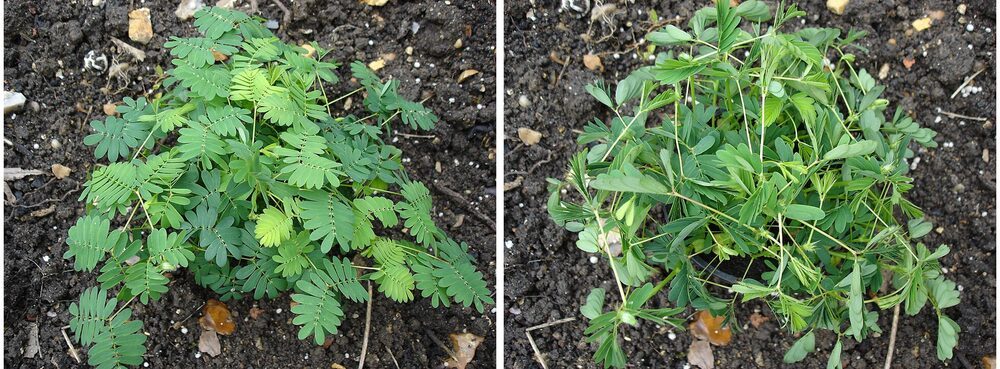{width="100%" height="330" fig-alt="Two photos of the same Mimosa pudica plant: left, leaflets spread open; right, seconds after touch, leaflets folded and leaves drooping."}

[Photos: Bluemoose, CC BY-SA 3.0, Wikimedia Commons: open](https://commons.wikimedia.org/wiki/File:Mimosa_pudica_open.JPG){.credit} [and touched](https://commons.wikimedia.org/wiki/File:Mimosa_pudica_closed.JPG){.credit}
:::
::::

**Many of the signals inside the plant are hormones. Which ones?**

::: notes
This is the framework for every example in the lecture: whenever we meet a response, ask what the cue is (light, gravity, temperature, a hormone), what the receptor is, and whether the change is in existing proteins (ion fluxes, protein activity) or in gene expression. The photo is the fast case: touch triggers ion fluxes and water loss from motor cells in the pulvinus at the leaflet base, and the leaflets fold within seconds; no genes are involved. Stomatal closing is the other fast example. Point out the last bullet: auxin promotes elongation in shoots but inhibits it in roots at the same concentration, so the response depends on the responding cell, not only on the signal. The next slide lists the hormones.
:::

## The plant hormones

| Hormone | Made in / moves by | Main effects | Example |
| --- | --- | --- | --- |
| **Auxin** (IAA) | Shoot apex, young leaves; **polar transport** downwards | Cell elongation, tropisms, apical dominance, root initiation | Rooting powder for cuttings |
| **Cytokinin** | Mainly roots; xylem | Cell division, bud outgrowth, **delays senescence** | Leaf discs stay green |
| **Gibberellin** (GA) | Young tissues, embryo | Stem elongation, bolting, **breaks seed dormancy** | Tall vs dwarf pea (Mendel) |
| **Abscisic acid** (ABA) | Leaves and roots under water deficit | **Stomatal closure**, seed **dormancy** | Seeds stay dormant in the fruit |
| **Ethylene** | Most tissues; a **gas** | **Climacteric fruit ripening**, abscission, triple response | One ripe banana ripens the rest |
| **Brassinosteroids** | Most tissues | Cell expansion | Mutants are dark-green dwarfs |
| **Strigolactones** | Roots | Inhibit bud outgrowth | Mutants are bushy |

Jasmonic acid and salicylic acid control defence; we meet them in P5.

::: notes
Students must be able to match hormone and effect (exercise 1.1). Go through the example column, because concrete cases are easier to recall than lists: rooting powder is synthetic auxin; ethylene from one ripe fruit triggers ripening in its neighbours in climacteric fruits such as banana, tomato and apple, but not in non-climacteric fruits such as citrus or grape. Strigolactones are included because they appear on the apical dominance slide. Transition: how do we find out what a hormone does? Mostly from mutants.
:::

## Reading a hormone mutant

:::: {.columns}
::: {.column width="52%"}
**Spray gibberellin on two dwarf pea mutants:**

| Mutant | + GA | Defect |
| --- | --- | --- |
| A | normal height | **biosynthesis** (Mendel's *le*) |
| B | stays dwarf | **perception or signalling** |

**Triple response:** dark-grown seedlings + ethylene give a short, thick
hypocotyl and an exaggerated hook. *etr1* (receptor mutant) + ethylene stays
long and thin.

**Rule:** rescued by the hormone → defect in making it.
:::
::: {.column width="48%"}

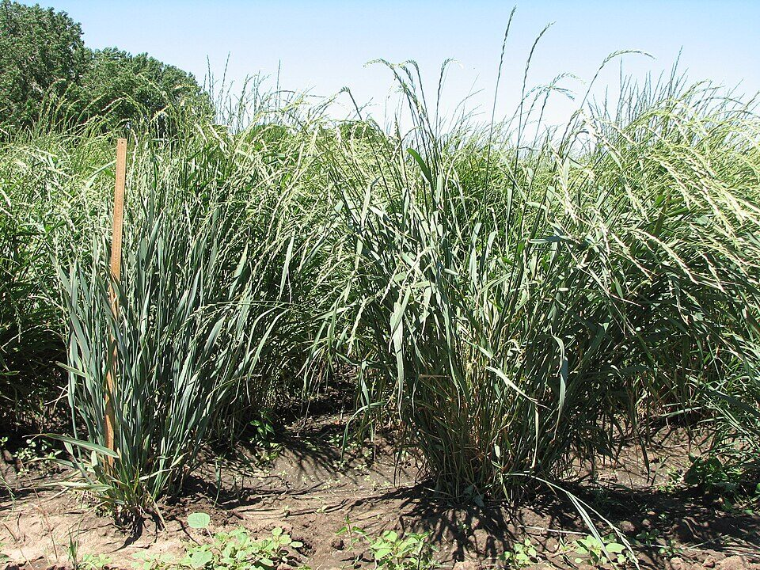{width="100%" height="330" fig-alt="A short dwarf mutant grass plant next to a much taller wild-type plant of the same species."}

[Photo: Dehaan, CC BY 3.0, Wikimedia Commons](https://commons.wikimedia.org/wiki/File:Dwarf_and_Wild_Thinopyrum_intermedium.JPG){.credit}
:::
::::

::: notes
This is the logic of hormone genetics and appears in exercises 1.4 and 1.5. The photo shows the kind of phenotype we start from: a dwarf mutant beside wild type (here intermediate wheatgrass; the photo alone does not tell us which hormone is involved, which is exactly why we do the spraying experiment). A biosynthesis mutant is rescued by the hormone; a receptor or signalling mutant is not. The Green Revolution semi-dwarf wheats (Rht genes) are GA-insensitive, which is the second class. The triple response screen found the ethylene receptor ETR1: mutants that ignore ethylene look like untreated seedlings; the hormone is present but the receptor cannot pass on the signal. Transition: we start the life cycle with the seed, where two of these hormones are in direct opposition.
:::

## The seed: dormant or just waiting?

| | **Quiescent** | **Dormant** |
| --- | --- | --- |
| Definition | Will germinate as soon as conditions allow | Will not germinate even in water, O₂ and warmth |
| Example | Dry seeds in a packet; seeds in dry soil | Fresh seeds that need months of dry storage |
| Released by | Water | **After-ripening** (dry storage), **stratification** (moist cold), light |

- Dormancy stops a seed germinating in the wrong season, for example in autumn
  just before winter.
- Stratification is why many temperate seeds germinate in spring.

**What holds a dormant seed back?**

::: notes
Dormancy is an internal block; quiescence is only a lack of water or warmth. Stratification is why many temperate seeds germinate in spring after a winter in moist soil, not in autumn. Transition: the block is set by a balance between two hormones.
:::

## ABA versus gibberellin: the balance decides

:::: {.columns}
::: {.column width="55%"}
- **ABA maintains dormancy; gibberellin promotes germination.**
- ABA-deficient maize mutants show **vivipary**: seeds germinate on the cob.
- GA-deficient mutants do not germinate unless GA is supplied.
- Germination (radicle emergence) is scored at a stated time: 12 of 20 seeds by
  day 5 = **60%**.
:::
::: {.column width="45%"}

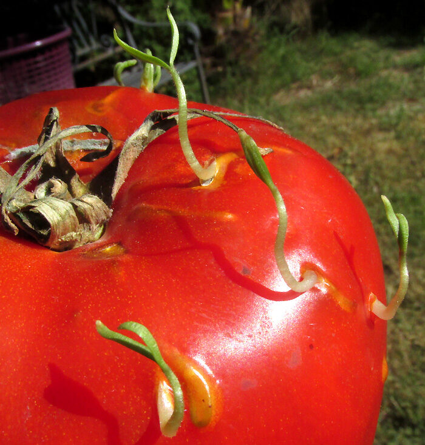{width="100%" height="380" fig-alt="A ripe red tomato with several green seedlings growing out through its skin: the seeds have germinated inside the fruit."}

[Photo: Gaiacoyote, CC0, Wikimedia Commons](https://commons.wikimedia.org/wiki/File:Vivipary_in_tomato_2.jpg){.credit}
:::
::::

::: notes
The two mutant phenotypes show the ABA : GA balance from both sides (exercise 4.2). The photo shows vivipary in an overripe tomato: the seeds have germinated inside the fruit and the seedlings push out through the skin. Normally ABA in the seeds and the osmotic pull of the fruit flesh keep them dormant; when that block fails, as in ABA-deficient or ABA-insensitive mutants, the seeds germinate where they sit. The germination percentage needs a denominator and a time point (exercise 4.3); non-germinated seeds may be dormant, slow or dead. Transition: once germination starts, what does gibberellin actually do in the seed?
:::

## Germination: gibberellin mobilises the reserves

:::: {.columns}
::: {.column width="40%"}
- The starchy **endosperm is dead**. The living **aleurone layer** around it
  makes the enzymes.
- Embryo signals with **GA**; aleurone **transcribes** α-amylase.
- **ABA blocks** this, so a dormant grain keeps its reserves.
- Malting: barley germinated with added GA, for brewing sugar.
:::
::: {.column width="60%"}

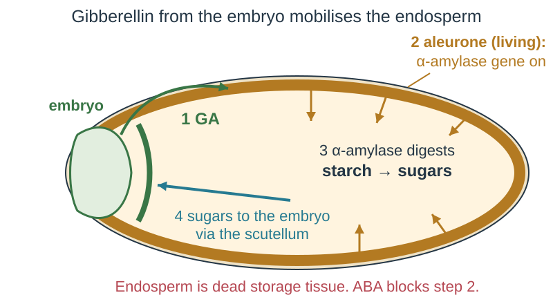{width="100%" height="360" fig-alt="Barley grain: the embryo releases gibberellin, the aleurone layer switches on alpha-amylase and secretes it into the starchy endosperm, starch becomes sugar, and the sugar returns to the embryo through the scutellum."}

:::
::::

**But many small seeds also check something outside: is there light?**

::: notes
This is the best-understood hormone response in a seed and is the order asked in exercise 1.3: GA from embryo, induction in the aleurone, secretion, hydrolysis, uptake via the scutellum. Follow the numbers in the figure. It is also a clear example of a slow, gene-expression response from the first slide. ABA antagonism ties back to the ABA : GA balance. Transition: small seeds such as lettuce have few reserves and should only germinate near the surface, which they detect with light.
:::

## Light is information as well as energy

| Photoreceptor | Light absorbed | Example responses |
| --- | --- | --- |
| **Phytochrome** | Red / far-red | Seed germination, shade avoidance, photoperiod |
| **Cryptochrome** | Blue / UV-A | Inhibits hypocotyl elongation; entrains the circadian clock |
| **Phototropin** | Blue / UV-A | **Phototropism**, chloroplast movement, stomatal opening |
| **UVR8** | UV-B | UV-protective responses (e.g. flavonoid sunscreens) |

- A seedling responds to a light flash far too dim to support photosynthesis.
  These receptors read the **colour, direction and timing** of light.

**What does a seedling do when it has no light at all?**

::: notes
Distinguish light as energy (P3) from light as a signal. The match between photoreceptor, wavelength and response is exercise 3.4. Phytochrome gets three slides because it underlies germination, shade avoidance and the night-break experiments in flowering.
:::

## Etiolation: growing in the dark

:::: {.columns}
::: {.column width="40%"}
- In darkness a seedling is **etiolated**: long, pale, hooked, small leaves.
- All reserves go into **elongation** until the shoot reaches light.
- Light triggers **de-etiolation**: the hook opens, leaves expand,
  chlorophyll forms, elongation slows.
:::
::: {.column width="60%"}

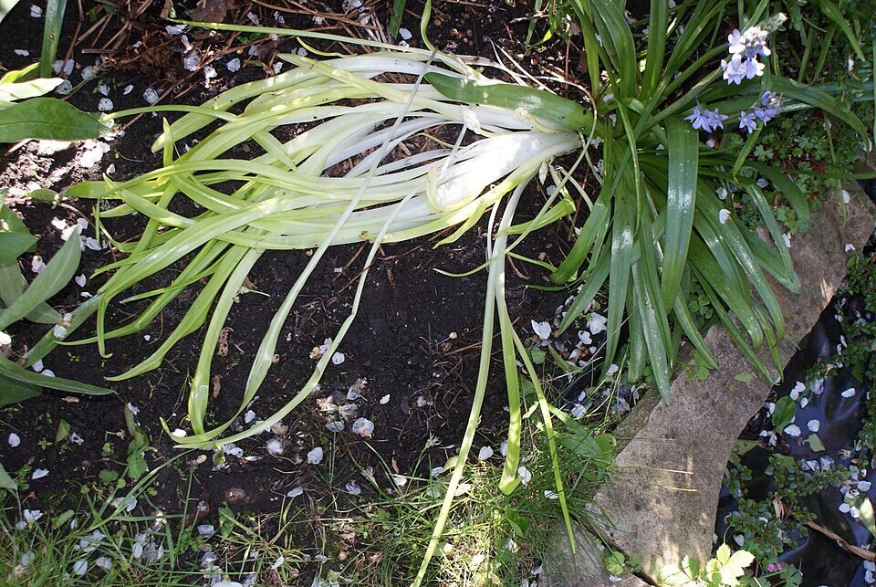{width="100%" height="350" fig-alt="Bluebell leaves that grew under an opaque cover are long, thin and pale; uncovered plants beside them are green and flowering."}

[Photo: Chiswick Chap, CC BY-SA 3.0, Wikimedia Commons](https://commons.wikimedia.org/wiki/File:Etiolated_Spanish_Bluebells_Hyacinthoides_hispanica.JPG){.credit}
:::
::::

**The red/far-red receptor is the key to germination and to flowering. How does it work?**

::: notes
Etiolation is a strategy: a buried seedling cannot photosynthesise, so it spends its reserves on getting to the light. The photo compares bluebell shoots that grew under an opaque cover (long, yellow) with uncovered ones (short, green): same plants, same soil, only light differs. Phytochromes and cryptochromes both drive de-etiolation; that is the red- and blue-light inhibition of hypocotyl elongation in the table on the previous slide.
:::

## Phytochrome: a red/far-red switch

:::: {.columns}
::: {.column width="42%"}
| | **Pr** | **Pfr** |
| --- | --- | --- |
| Absorbs | red, ~660 nm | far-red, ~730 nm |
| Light converts it to | Pfr | Pr |
| Active? | no | **yes** |
| Made as? | **yes** | no |

- The **last** light decides the state.
- Pfr enters the **nucleus** and changes gene expression.
- In darkness Pfr slowly reverts or is degraded.
:::
::: {.column width="58%"}

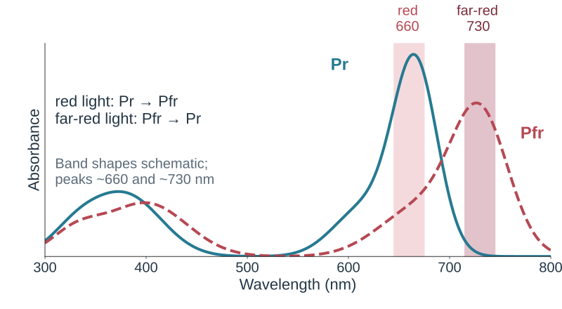{width="100%" height="360" fig-alt="Absorption spectra: Pr absorbs most strongly in red light near 660 nm, Pfr in far-red light near 730 nm. Red light converts Pr to Pfr and far-red converts Pfr back to Pr."}

:::
::::

::: notes
Students should be able to fill this table from memory (exercise 3.1). The key idea is a switch with two stable states, each converted to the other by the light it absorbs. The spectra show why red light never gives 100 % Pfr: Pfr also absorbs a little at 660 nm, so continuous red reaches about 85 % Pfr, while far-red, which Pr hardly absorbs, leaves only a few per cent. Phytochrome is made as inactive Pr, which is why a seed in darkness has no active phytochrome. The last bullet matters for photoperiod: the plant can use the decline in Pfr during the night. The next slide shows the classic experiment that proved photoreversibility.
:::

## The lettuce seed experiment

:::: {.columns}
::: {.column width="58%"}
Imbibed lettuce seeds, brief light flashes, then darkness:

| Flash sequence | Last flash | Phytochrome | Germinate? |
| --- | --- | --- | --- |
| Dark only | none | Pr | No |
| R | R | Pfr | **Yes** |
| R → FR | FR | Pr | No |
| R → FR → R | R | Pfr | **Yes** |
| R → FR → R → FR | FR | Pr | No |
:::
::: {.column width="42%"}

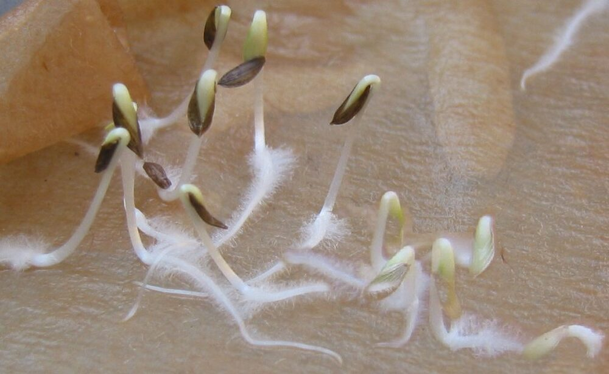{width="100%" height="260" fig-alt="Germinating lettuce seeds on moist paper: each has a white radicle covered in fine root hairs, and some still carry the dark seed coat on their pale cotyledons."}

[Photo: Rasbak, CC BY-SA 3.0, Wikimedia Commons](https://commons.wikimedia.org/wiki/File:Sla-kiemend.jpg){.credit}
:::
::::

- **The last flash decides.** This photoreversibility identified phytochrome
  (Borthwick and Hendricks, 1950s).
- Why it matters: a buried seed sees no light and stays dormant until the soil is disturbed.

**Light under a canopy has a different colour. What does phytochrome tell the plant there?**

::: notes
The photo shows what "germinate" means in this experiment: lettuce seeds on moist paper with the radicle out and covered in root hairs; the seed coat is still on some of the cotyledons. Work the sequence column by column; exercise 3.2 extends it to five flashes. The ecological meaning: small-seeded weeds germinate after ploughing because the soil is turned and seeds get a flash of light. Transition to shade: phytochrome does not just detect light versus dark, it detects the ratio of red to far-red.
:::

## Try it: flash the lettuce seeds

```{=html}
<link rel="stylesheet" href="../../demos/dist/demo.css">
<div data-demo="p4-phytochrome"></div>
<script src="../../demos/dist/p4-phytochrome.js"></script>
```

::: notes
Live version of the lettuce-seed table. The buttons give a brief, saturating red or far-red flash; the chart shows the fraction of phytochrome as active Pfr after each flash (about 85 % after red, about 3 % after far-red), and "Incubate 2 days in darkness" shows how many of 20 seeds germinate. Start with "dark" and incubate: almost none germinate, because phytochrome is made as Pr. Then let the room choose sequences, for example R FR R FR R FR R: ask them to predict before you incubate. Points to draw out: only the last flash matters; Pfr never reaches 100 % because Pfr also absorbs some red light; the result is all-or-nothing per seed but the dish gives a percentage, as in exercise 4.3. The buttons under "Lecture sequences" load the rows of the table. The seed pattern is fixed, so a rerun looks the same. Reset clears the flashes.
:::

## Shade avoidance

:::: {.columns}
::: {.column width="64%"}
- Chlorophyll **absorbs red** light but **transmits and reflects far-red**.
- Under a canopy, the **red : far-red ratio falls** (sunlight ~1.2; deep shade ~0.2).
- Less red → **less Pfr**. The plant reads this as "neighbours above me".

| Shade-avoidance response | Benefit |
| --- | --- |
| Faster stem and petiole elongation | Leaves reach light before the competitor's |
| Leaves angled upwards | Less self-shading |
| Less branching | Resources go into height |
| Earlier flowering | Seeds are set before resources run out |

- The cost: thin, weak stems and less root growth. Dense crops lose yield to this.
:::
::: {.column width="36%"}

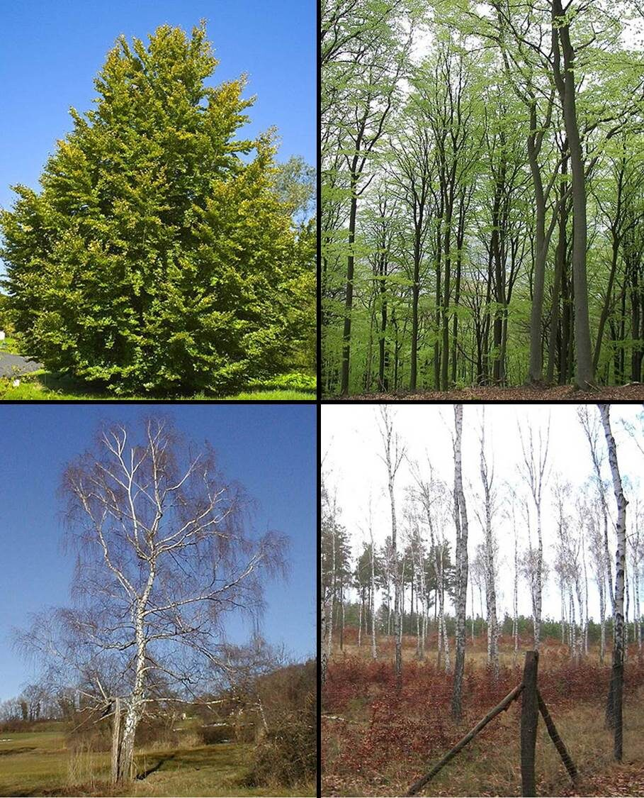{width="100%" height="470" fig-alt="Four photos: a solitary beech with a broad crown branching to the ground beside tall, slender, unbranched beech trunks in a dense wood; below, the same contrast for a solitary birch and birches in a dense stand."}

[Photo: Jugrü, CC BY-SA 3.0, Wikimedia Commons](https://commons.wikimedia.org/wiki/File:Schattenflucht_B%C3%A4ume.jpg){.credit}
:::
::::

::: notes
The photo compares trees of the same species growing alone (left: broad, low-branched crowns) and in a dense stand (right: tall, slender, unbranched trunks with the leaves only at the top); beech above, birch below. The stand trees show the shade-avoidance syndrome from the table at the scale of a whole forest. Exercise 3.3. Emphasise that the plant responds to reflected far-red from neighbours even before it is actually shaded, which is an early warning. The cost row connects to agriculture: crop breeders have selected plants with weaker shade avoidance to allow dense planting. Transition: phytochrome reads colour; the direction of light is read by a different receptor and causes the shoot to bend.
:::

## Phototropism: bending towards light

:::: {.columns}
::: {.column width="45%"}
| Coleoptile, lit from one side | Bends? |
| --- | --- |
| Untreated | **yes** |
| Tip removed, or opaque cap | no |
| Tip in a transparent cap | **yes** |
| Opaque collar below the tip | **yes** |
| Tip replaced on a gelatin block | **yes** |

- **Light is perceived at the tip**; a diffusible signal moves down.
:::
::: {.column width="55%"}

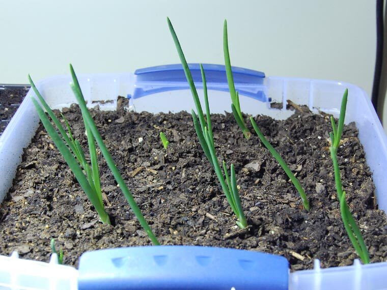{width="100%" height="340" fig-alt="Young onion shoots in a tray of soil, all leaning the same way, towards the light from a window."}

[Photo: Dennis Brown, CC BY-SA 3.0, Wikimedia Commons](https://commons.wikimedia.org/wiki/File:Onions_reach_for_light.jpg){.credit}
:::
::::

**What is the signal, and why does the shoot bend?**

::: notes
The table summarises Darwin (1880, caps and collars) and Boysen-Jensen (1913, gelatin block); Went (1928) then collected the signal in agar blocks and named it auxin. Each row asks: where is light perceived, and can the signal pass through gelatin? This is exercises 2.1 and 2.2. The photo shows the everyday version: onion seedlings grown indoors all lean towards the window.
:::

## The Cholodny–Went model

:::: {.columns}
::: {.column width="40%"}
- **Phototropin** at the tip senses **blue light** from one side.
- **Auxin** is moved to the **shaded side**, then down to the growing zone.
- Shaded cells **elongate faster**: the shoot bends **towards** the light.
:::
::: {.column width="60%"}

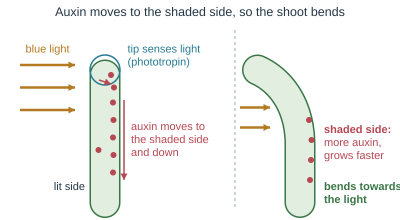{width="100%" height="360" fig-alt="Left: blue light from one side reaches a coleoptile tip; auxin is moved to the shaded side and down. Right: the shaded side has more auxin, grows faster, and the coleoptile bends towards the light."}

:::
::::

**The same auxin redistribution explains a response to gravity.**

::: notes
Exercise 2.2. The model has two parts: lateral redistribution at the tip, then basipetal (downward) polar transport to the elongation zone. The lit side does not lose auxin by destruction; auxin is moved across by PIN efflux carriers. Transition: in gravitropism auxin also moves to one side, but in roots it has the opposite effect.
:::

## Gravitropism: the root grows down

:::: {.columns}
::: {.column width="40%"}
**Root turned horizontal:**

1. **Columella cells** of the root cap sense gravity: starch-filled
   **amyloplasts** (statoliths) sediment to the lower side.
2. Auxin is redirected to the **lower side**.
3. In roots, high auxin **inhibits** elongation: the root bends **down**.

**Shoot:** auxin also goes to the lower side but **promotes** elongation: the
shoot bends **up**.
:::
::: {.column width="60%"}

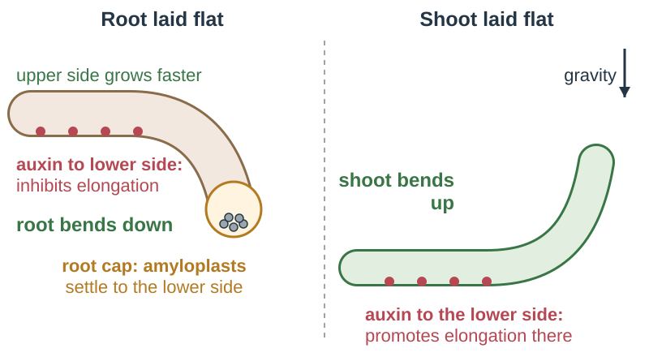{width="100%" height="360" fig-alt="Left: a root laid flat; amyloplasts in the root cap settle downwards, auxin collects on the lower side and inhibits elongation, so the root bends down. Right: a shoot laid flat; auxin on the lower side promotes elongation, so the shoot bends up."}

:::
::::

**Same signal, same redistribution, opposite outcome: the response depends on the tissue.**

::: notes
Exercise 2.3. The root cap is the sensor: remove it and the root still grows but no longer bends. The contrast between root and shoot is the clearest demonstration of the first slide's point that the response depends on the responding tissue's sensitivity to auxin. The next slide shows the shoot half in a real plant.
:::

## Gravitropism in a shoot

:::: {.columns}
::: {.column width="38%"}
- These *Kalanchoe* stems fell over under their own weight.
- Each tip has turned **upwards** again.
- Auxin on the **lower** side made the lower flank grow faster.
- The old, horizontal part of the stem has stopped growing, so it stays bent:
  only the **growing zone** responds.
:::
::: {.column width="62%"}

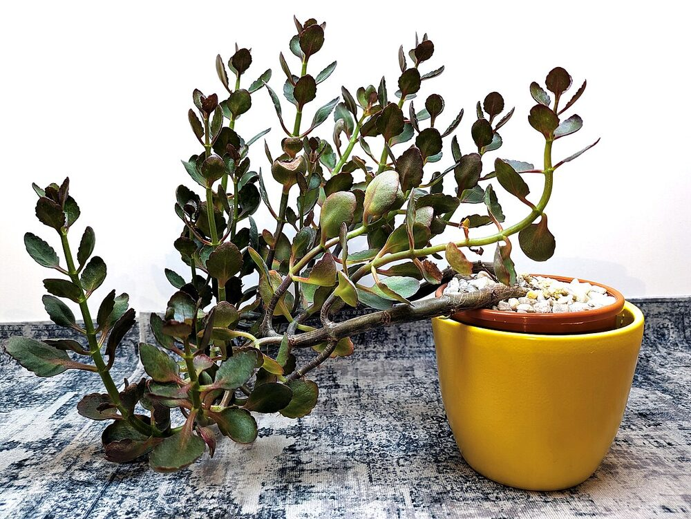{width="100%" height="380" fig-alt="A potted Kalanchoe whose stems have flopped over the rim and lie almost horizontal; every branch tip curves upwards again."}

[Photo: Trio3D, CC BY-SA 4.0, Wikimedia Commons](https://commons.wikimedia.org/wiki/File:Gravitropism_in_Kalanchoe_blossfeldiana.jpg){.credit}
:::
::::

::: notes
The photo shows shoot gravitropism in an ordinary house plant: Kalanchoe blossfeldiana stems bent over the rim of the pot under their own weight, and each growing tip has curved back up. The bend is confined to the young part near each tip; the older stem does not straighten, because mature cells can no longer elongate. Ask the room which side of each bend has more auxin (the lower side) and whether the same auxin level would make a root bend up or down (down). Transition: auxin flowing down the shoot also decides whether side branches grow.
:::

## Apical dominance: should the plant branch?

| Pea shoot treatment | Lateral buds |
| --- | --- |
| Intact | Inhibited |
| Apex removed | **Grow out** |
| Apex removed + auxin paste on stump | Inhibited |
| Apex removed + plain lanolin on stump | **Grow out** |
| Intact + cytokinin on a bud | **Grows out** |

- Auxin from the apex **replaces the apex** (Thimann and Skoog, 1934).
- Auxin does **not enter the bud**. It acts indirectly: it lowers **cytokinin**
  supply to the bud and raises **strigolactone** synthesis.
- Gardeners use this: pinching out the tip makes a bushier plant.

**The shoot is now built. When does it stop making leaves and make flowers?**

::: notes
Exercise 1.2. The lanolin-only control is essential: it shows that the paste itself does nothing, so the effect is due to auxin. The indirect mechanism is the modern view; the old idea that auxin enters the bud and inhibits it directly does not fit the transport data. Transition to flowering: the biggest developmental decision of an annual plant.
:::

## Flowering: measuring the night

:::: {.columns}
::: {.column width="45%"}
- **Short-day plants (SDP)** flower when the night is **longer** than a
  critical night length (chrysanthemum, soybean, poinsettia).
- **Long-day plants (LDP)** flower when it is **shorter** (*Arabidopsis*,
  spinach, wheat).
- The plant measures the **uninterrupted dark period**: an hour of darkness
  in the day changes nothing.
:::
::: {.column width="55%"}

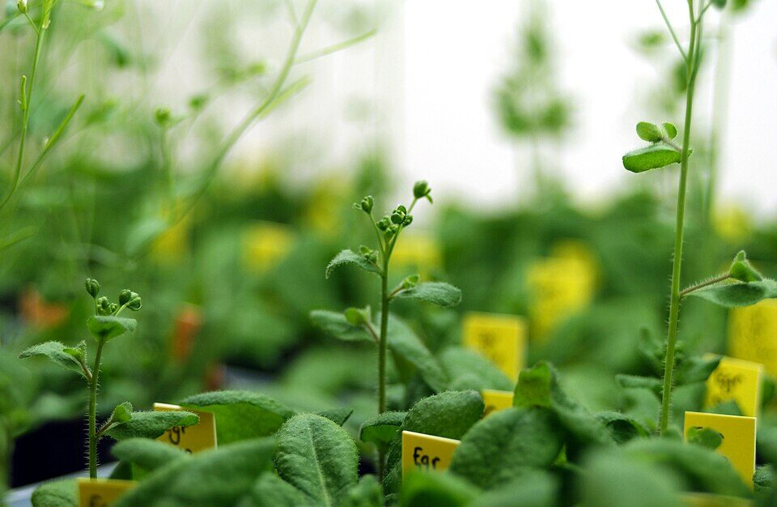{width="100%" height="340" fig-alt="Arabidopsis thaliana plants in a growth cabinet: leaf rosettes with tall stems carrying flower buds."}

[Photo: Carl Davies, CSIRO, CC BY 3.0, Wikimedia Commons](https://commons.wikimedia.org/wiki/File:CSIRO_ScienceImage_3176_Arabidopsis_in_growth_cabinet_at_the_CSIRO_Discovery_Centre_labs_Black_Mountain_ACT.jpg){.credit}
:::
::::

**What happens if we interrupt the night instead of the day?**

::: notes
The names are historical: they refer to day length, but experiments showed that night length is what is measured. With a critical night length of 11 h, 16 h light / 8 h dark makes LDP flower; 8 h light / 16 h dark makes SDP flower; and 8 h light with 1 h dark in the middle plus a 16 h night still makes SDP flower, because the night is unchanged (exercise 5.1). Arabidopsis in the photo is the model long-day plant: grown in long days in a growth cabinet it flowers within a few weeks. Transition: a brief light flash in the middle of the night has a large effect, and the colour of that flash tells us which receptor reads the night.
:::

## Night breaks reveal phytochrome

:::: {.columns}
::: {.column width="40%"}
8 h light / 16 h dark, brief flash mid-night:

- **Red** makes Pfr and **splits** the long night into two short ones: SDP
  stop, LDP flower.
- **Far-red** right after **reverses** it: phytochrome is the receptor.
- Growers light chrysanthemums at night to delay flowering.
:::
::: {.column width="60%"}

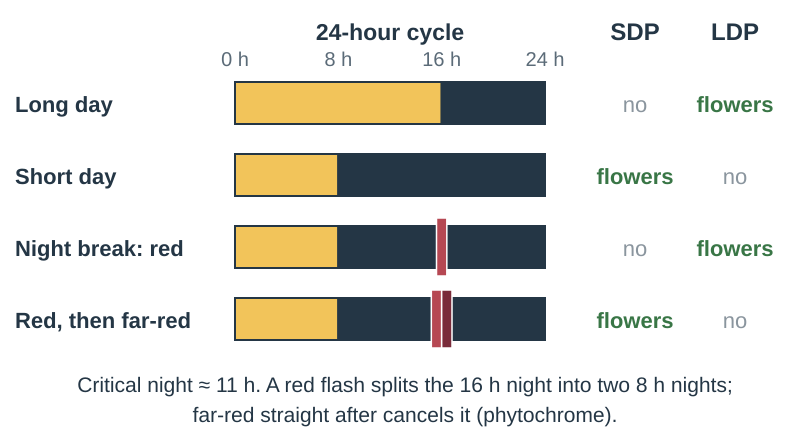{width="100%" height="360" fig-alt="Bar diagrams of 24-hour cycles. Long day: LDP flower. Short day: SDP flower. Short day with a red flash in mid-night: LDP flower, SDP do not. Red then far-red: SDP flower, LDP do not."}

:::
::::

**The flash is sensed in the leaves. How does the message reach the apex?**

::: notes
Exercise 5.1 c and d. Connect to the lettuce seed slide: the same last-flash rule, applied to a night instead of a seed. Students often think the red flash adds "day"; stress that it only matters because it breaks the dark period. Read the figure row by row and ask for the longest uninterrupted dark period each time: 8, 16, 8 and 16 h.
:::

## Try it: the photoperiod clock

```{=html}
<link rel="stylesheet" href="../../demos/dist/demo.css">
<div data-demo="p4-photoperiod" data-day="8" data-critical="11"></div>
<script src="../../demos/dist/p4-photoperiod.js"></script>
```

::: notes
Live version of the photoperiod table and figure. The clock shows one 24-hour cycle with noon at the top; the bar below shows the night as the plant measures it, with the critical night length (11 h, as in the lecture) as a dashed line. The two plants show whether a short-day and a long-day plant flower. Run through the "Lecture cases" buttons in order and ask the room to predict each one first: 16 L / 8 D, 8 L / 16 D, + red break, + red, far-red, + dark in day. Then slide the day length slowly from 8 to 16 h: both plants switch at 13 h of light (an 11 h night). Then add a red break and move "Flash at" towards dusk: once one fragment of the night is longer than 11 h again, the SDP flowers despite the break; this is why growers place the night break near the middle. Far-red alone has no effect, because phytochrome is already Pr at night. Reset restores the start.
:::

## Florigen: a protein from leaf to apex

:::: {.columns}
::: {.column width="40%"}
- Grafting (1930s): an induced leaf sends a signal, named **florigen**.
- In *Arabidopsis* florigen is the protein **FLOWERING LOCUS T (FT)**:
  FT–GFP made in leaves is found at the apex (Corbesier et al., 2007).
- The **leaf perceives**, the **phloem transports**, the **apex responds**.
:::
::: {.column width="60%"}

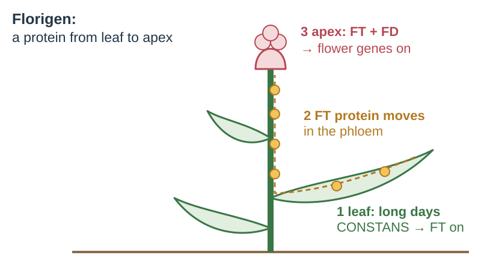{width="100%" height="360" fig-alt="A plant: in a leaf under long days CONSTANS switches on FT; FT protein travels in the phloem up the stem to the shoot apex, where FT and FD switch on flower genes."}

:::
::::

**Some plants need a second condition before they can respond to day length.**

::: notes
Exercise 5.2. CONSTANS protein accumulates in the leaf phloem companion cells only when long days give light at the end of the day, which is how day length is converted into a molecular signal. FT is small enough to move through plasmodesmata into sieve tubes and travels with the assimilate flow from P3. At the apex it pairs with the transcription factor FD to switch on floral identity genes such as APETALA1. Transition: some plants need a winter before they can respond to day length.
:::

## Vernalisation: remembering winter

:::: {.columns}
::: {.column width="58%"}
- **Vernalisation:** prolonged cold (weeks at ~0–10 °C) gives the
  **competence** to flower. Examples: winter wheat, winter-annual Arabidopsis.
- The plant does **not** flower in the cold. It flowers later, in warm, long days.
- The cold is perceived by the **shoot apex**.
- In Arabidopsis, cold **represses *FLC***, a repressor of flowering. *FLC* stays
  off through later cell divisions: an epigenetic memory of winter.
- The memory is **reset** in each generation: seeds need cold again.
:::
::: {.column width="42%"}

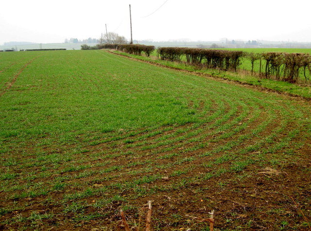{width="100%" height="320" fig-alt="A field in late winter covered in rows of short green winter wheat seedlings, sown the previous autumn."}

[Photo: Nigel Mykura, CC BY-SA 2.0, Wikimedia Commons](https://commons.wikimedia.org/wiki/File:Sprouting_Winter_Wheat_-_geograph.org.uk_-_2837235.jpg){.credit}
:::
::::

| Plant | Cold received | Outcome in spring long days |
| --- | --- | --- |
| Winter wheat sown in autumn | Yes | Flowers, sets grain |
| Winter wheat sown in spring | No | Stays vegetative |

::: notes
Exercise 5.3 is a true/false set on these bullets; the common misconceptions are that cold triggers flowering directly and that the vernalised state is inherited. The photo shows winter wheat in an English field in winter: sown in autumn, it overwinters as a short leafy seedling, receives its weeks of cold in the field, and only flowers in the long days of the following summer. The point of vernalisation is to prevent flowering in autumn, when days are short in the run-up to winter; flowering waits for the spring after a winter has passed. Transition: once the flower opens and is pollinated, the next generation begins.
:::

## Double fertilisation: building the seed

:::: {.columns}
::: {.column width="48%"}
| Structure | From | Ploidy |
| --- | --- | --- |
| **Embryo** | sperm 1 + egg | 2n |
| **Endosperm** | sperm 2 + central cell | 3n |
| **Seed coat** | integuments (maternal) | 2n |
| **Fruit wall** | ovary wall (maternal) | 2n |

- The endosperm is the food store of the barley grain.
- Developing seeds are strong **sinks** (P3).
:::
::: {.column width="52%"}

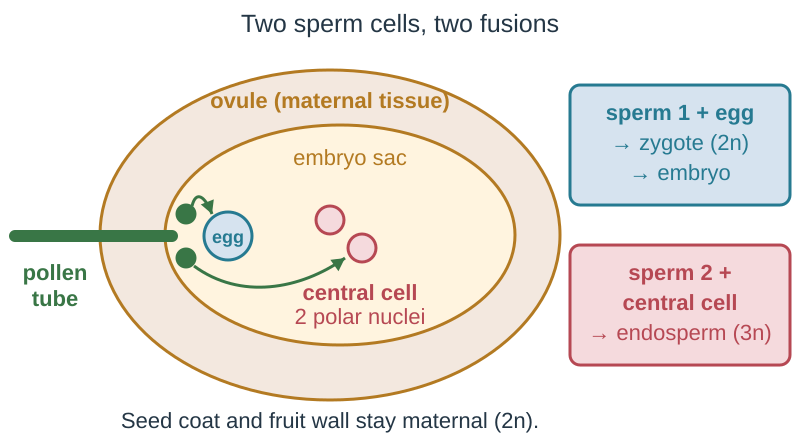{width="100%" height="340" fig-alt="An ovule with its embryo sac. The pollen tube delivers two sperm cells: one fuses with the egg to give a diploid zygote, the other with the central cell and its two polar nuclei to give triploid endosperm."}

:::
::::

**Where do those nutrients come from at the end of the season?**

::: notes
Exercise 5.4. The pollen tube delivers two sperm cells and both fertilise: double fertilisation. The central cell has two polar nuclei, which is why the endosperm is triploid. Close the loop to the start of the lecture: the endosperm made here is the starch store mobilised by gibberellin in the next generation. The seed coat and fruit are maternal tissue, not the next generation. The ploidy column is the usual exam check. The sink bullet links back to phloem transport in P3 and leads into senescence: the old leaves become the nutrient source for the seeds.
:::

## Senescence: recycling the leaf

:::: {.columns}
::: {.column width="66%"}
- **Senescence** is a regulated, programmed process, not passive decay.
- Chlorophyll and proteins (including Rubisco) are broken down first, so the leaf yellows.
- Nutrients are **remobilised** through the **phloem** to seeds and young leaves.
- **N, P and K** are phloem-mobile and are exported. **Ca** is phloem-immobile
  and stays in the leaf.

| Hormone | Effect on senescence |
| --- | --- |
| **Cytokinin** | **Delays** it |
| Ethylene, ABA, jasmonic acid | **Promote** it |

- Tobacco expressing a cytokinin-synthesis gene from a senescence promoter keeps
  its leaves green much longer (Gan and Amasino, 1995).
:::
::: {.column width="34%"}

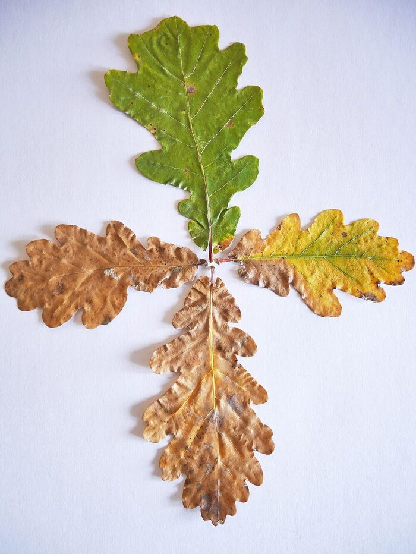{width="100%" height="460" fig-alt="Four oak leaves from one young tree at different stages of autumn senescence: green, yellow with green veins, and two brown."}

[Photo: Stanature, CC0, Wikimedia Commons](https://commons.wikimedia.org/wiki/File:Oak_leaves_with_autumn_coloration.jpg){.credit}
:::
::::

::: notes
Exercise 6.1. The photo shows four leaves from one young oak tree in autumn, in order of senescence: green (chlorophyll intact), yellow (chlorophyll broken down, revealing the carotenoids, with the last green along the veins), and two brown leaves whose cells have died after the nutrients were exported. The phloem-mobility rule comes from P2: calcium moves in the xylem only, so it cannot be exported from an old leaf, and calcium deficiency appears in young tissue. A yellow leaf alone does not show senescence; deficiency or stress also yields yellowing, so tissue age and growth conditions must be known. The Gan and Amasino experiment is a neat feedback loop: senescence switches on cytokinin production, which delays senescence. It also introduces the idea of a stage-specific promoter, which returns in P5.
:::

## Summary {.smaller}

| Concept | Key fact |
| --- | --- |
| Signal chain | cue → receptor → transduction → fast (protein) or slow (gene expression) response |
| Hormones | auxin, cytokinin, GA, ABA, ethylene, brassinosteroids, strigolactones |
| Hormone mutants | rescued by the hormone → biosynthesis defect; not rescued → perception/signalling |
| Dormancy | ABA maintains it; GA breaks it; quiescence is only lack of water or warmth |
| Barley aleurone | GA → α-amylase → starch to sugar; ABA blocks |
| Phytochrome | Pr (660 nm) ⇄ Pfr (730 nm); Pfr active; last flash decides |
| Shade avoidance | low R:FR → less Pfr → elongation, earlier flowering |
| Tropisms | auxin to the shaded / lower side; promotes shoot, inhibits root elongation |
| Apical dominance | apical auxin lowers cytokinin, raises strigolactone at buds |
| Photoperiod | plants measure the uninterrupted night; a red night break splits it |
| Florigen | FT protein: leaf → phloem → apex |
| Vernalisation | cold represses *FLC*; competence, not flowering; reset each generation |
| Senescence | cytokinin delays; N, P, K remobilised via phloem; Ca stays |

**Next (P5 — Stress, defence and biotechnology):** the same signals, ABA,
jasmonic acid and salicylic acid among them, let a plant survive drought,
salt and attack. And knowing the genes lets us change them.

[Tutorial](index.qmd) · [Exercises](exercise.qmd) · [Quiz](quiz.qmd)

::: notes
Read the table as the life cycle: signal framework and hormones, then seed, seedling, growth direction, branching, flowering, the next seed and the ageing leaf. P5 reuses three ideas from today: ABA as a water-stress signal, hormone pathways as switches that can be turned on by an attacker, and promoters that express a gene in one tissue or condition.
:::
