## About this lecture

A thirsty mouse walks to water, a hungry one finds food, and a frightened one
runs. A maize seedling can do none of this. It stays where its seed landed,
yet in three months it grows from a 0.3 g seed into a 2 m plant. **How does an
organism that cannot move get carbon, water and minerals to every cell, and
hold itself up?** In A1 we asked the same question of an animal; today we
start the plant half and see the plant's answers.

- **The contrast:** what changes when an organism cannot move, makes its own
  food and has walls around its cells.
- **The plant cell:** wall, vacuole and turgor, plastids and mitochondria.
- **Growth:** how a walled cell enlarges, and how cells stay connected.
- **Tissues and organs:** three tissue systems, xylem and phloem, the leaf and
  the root.
- **Meristems:** where new cells are made, and more cells versus longer cells.
- **Three genomes:** nucleus, plastid and mitochondrion working together.

::: notes
Open with the contrast to the animal half, which students have just finished. The plant faces the same physics as the mouse in A1 (surface area, diffusion distance, the need for bulk flow), but under three constraints: it cannot move, it builds its own organic carbon from CO₂ and light, and every cell is enclosed in a wall. Each section of the lecture follows from one of these constraints. P2 and P3 then take the two big supply problems in turn: water and minerals, and carbon.
:::

## The problem: a mouse versus a maize plant

| | Mouse | Maize plant |
| --- | --- | --- |
| Carbon and energy | eats organic food | makes sugar from CO₂, water and light |
| Water and minerals | drinks and eats them | takes them up from the soil through roots |
| Escaping danger, finding resources | moves | cannot move; grows towards resources |
| Body plan | fixed in the embryo; adult form complete | keeps adding leaves, roots and branches all its life |
| Support | skeleton and muscle | turgor and thickened cell walls |
| Cell boundary | plasma membrane | plasma membrane **plus a cell wall** |

- A plant must collect light and CO₂ **above ground** and water and minerals
  **below ground**, at the same time and in the same place.
- It responds to its surroundings by **growing**, not by moving.

**So how do the A1 rules about surfaces and distances apply to a plant?**

::: notes
Each row of the table is a constraint that shapes plant structure. The two that matter most today are the body plan (growth from meristems, later in the lecture) and the wall (which affects support, growth and transport). The point of the bullet about above and below ground: the plant is spread between two environments, so it needs long-distance transport between them, which we meet as xylem and phloem.
:::

## The A1 physics, solved by a plant

| A1 solution | In an animal | In a plant |
| --- | --- | --- |
| **Enlarge the exchange surface** | alveoli, ~100 m² in a human lung | leaves for light and CO₂; roots and root hairs for water |
| **Make the barrier thin** | air–blood barrier < 1 µm | leaf ~0.2 mm thick; every mesophyll cell faces an air space |
| **Use bulk flow** | blood pumped by the heart | xylem (water, roots → shoot) and phloem (sugar, sources → sinks), with no heart |

- One rye plant grown for four months had **~600 km of roots** and
  **~10 000 km of root hairs**, a root surface of ~640 m².
- Diffusion is still used over short distances: CO₂ inside the leaf, ions
  in the soil next to a root hair.

**These surfaces and tubes are built from cells. What does a plant cell have
that an animal cell lacks?**

::: notes
This slide reuses the three solutions from A1 so students see the plant as a new answer to a known problem. The rye figures (Dittmer 1937) make the point that the root system is an enormous exchange surface, far larger than the shoot. Stress that the plant has bulk flow without a pump: P2 shows that evaporation drives xylem flow and P3 that osmotic pressure drives phloem flow. Transition into the cell.
:::

## The plant cell: compartments and boundaries

:::: {.columns}
::: {.column width="40%"}
| Structure | Main function |
| --- | --- |
| **Plasma membrane** | selects what enters and leaves |
| **Primary wall** | resists pressure; sets the direction of growth |
| **Tonoplast** | membrane around the vacuole |
| **Central vacuole** | solutes and turgor; up to ~90 % of cell volume |
| **Chloroplast** | photosynthesis |
| **Mitochondrion** | aerobic respiration |
:::
::: {.column width="60%"}

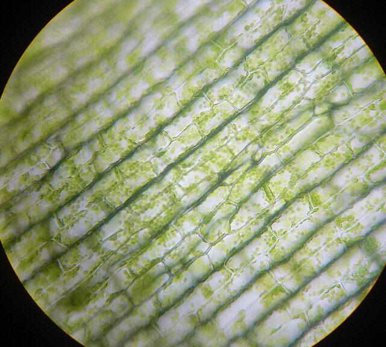{width="100%" height="360" fig-alt="Elodea leaf cells under the light microscope: box-shaped cells outlined by their walls, with green chloroplasts pressed to the edges around a large clear central vacuole."}

[Photo: Cimice50, CC BY-SA 4.0, Wikimedia Commons](https://commons.wikimedia.org/wiki/File:Cloroplasti_Elodea.jpg){.credit}

:::
::::

- The wall is **porous**: water and small solutes pass freely. **Selection
  happens at the plasma membrane**, as in an animal cell. Three boundaries:
  wall, plasma membrane, tonoplast.

**Why does a plant cell need a huge vacuole and a strong wall?**

::: notes
In the Elodea leaf the walls outline each cell; the chloroplasts sit in a thin layer of cytoplasm pressed against the wall, because the clear central vacuole fills most of the cell (in live cells you can watch them stream around it). Exercise 1.1 asks students to match these structures and functions. The common error, tested in 1.4c, is to think the wall is selectively permeable. It is not: the wall resists pressure, the membrane selects. Keep the three boundaries distinct, because P2 asks which boundary water or an ion crosses at each step of uptake. The vacuole and wall work together, which is the next slide.
:::

## Vacuole and turgor: a hydraulic skeleton

:::: {.columns}
::: {.column width="40%"}
- The vacuole accumulates **solutes** (K⁺, sugars, organic acids); water
  follows by osmosis.
- The protoplast presses on the wall and the wall pushes back: **turgor
  pressure**, typically **0.3–1 MPa** (a car tyre is ~0.2 MPa).
- Turgid cells pressing on each other make a stem or leaf **rigid**.
- The vacuole also stores pigments and defence compounds, buffers
  cytoplasmic pH, breaks down cell material, and makes a large cell from
  little cytoplasm.
:::
::: {.column width="60%"}

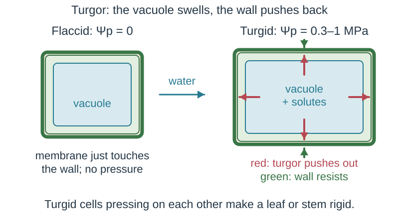{width="100%" height="360" fig-alt="A flaccid cell takes up water into its solute-rich vacuole and becomes turgid: the protoplast pushes out on the wall and the wall resists."}

:::
::::

**When turgor falls, a non-woody shoot wilts. Its cells are still alive and
recover when water returns.**

::: notes
Turgor is the plant's hydraulic skeleton: it replaces the muscle-and-bone support of an animal in non-woody tissues. The numbers make it concrete: several times the pressure in a car tyre, held by a wall a fraction of a micrometre thick. Exercise 1.2 asks for the definition and the effect of falling turgor; 1.3 asks for three vacuole functions. In P2 we quantify turgor as the pressure potential Ψp. The last vacuole function links to growth: a cell can become large mostly by filling its vacuole with water.
:::

## Plastids and mitochondria

:::: {.columns}
::: {.column width="40%"}
| Plastid | Role; where |
| --- | --- |
| **Proplastid** | precursor; meristems |
| **Chloroplast** | photosynthesis; green tissue |
| **Amyloplast** | starch; tubers, seeds, root cap |
| **Chromoplast** | pigments; petals, fruits |

All develop from proplastids: a chloroplast is **one type** of plastid.
:::
::: {.column width="60%"}

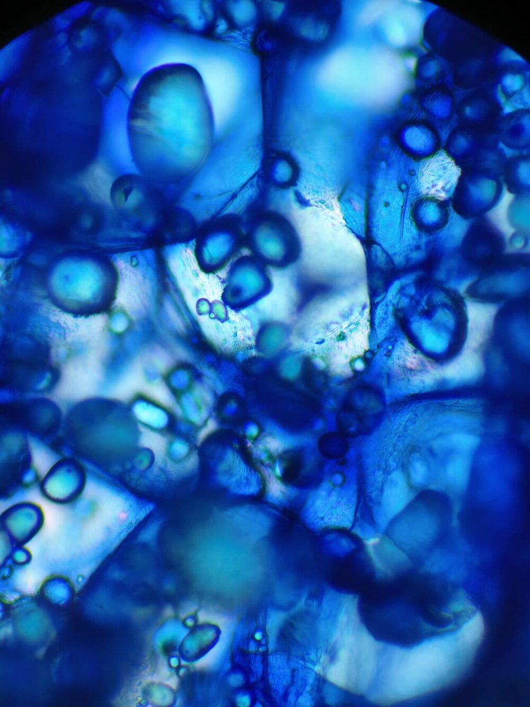{width="100%" height="360" fig-alt="Potato tuber cells stained with iodine: many dark blue-black starch-filled amyloplasts inside each cell."}

[Photo: Aleromjar1403, CC0, Wikimedia Commons](https://commons.wikimedia.org/wiki/File:Potato_amyloplasts_stained_with_Lugol%E2%80%99s_solution.jpg){.credit}

:::
::::

- Most root cells have **no** functioning chloroplasts.
- **Every living plant cell respires**, in light and dark: a leaf both fixes
  CO₂ (chloroplast) and releases it (mitochondrion).

**So the cell has the parts. How does a cell enclosed in a wall manage to grow?**

::: notes
The photo is a potato tuber, an organ with no chloroplasts at all: iodine stains the starch in its amyloplasts blue-black. Exercise 1.4 tests three misconceptions: all plastids are chloroplasts; leaves respire only at night; roots photosynthesise. The point that a green leaf both fixes and releases CO₂ returns in P3, where the light-response curve has a negative value in darkness and the compensation point is where the two balance. Transition to the wall and growth.
:::

## The cell wall

:::: {.columns}
::: {.column width="40%"}
**Primary wall** (growing cells, ~0.1–1 µm)

- **Cellulose microfibrils**, a few nm wide, carry the load, in a matrix of
  **hemicelluloses, pectins** and proteins.
- Microfibrils wound **transversely**, like hoops around a barrel, let the
  cell lengthen but not widen.

**Secondary wall** (after growth stops)

- Laid down **inside** the primary wall; thicker, often with **lignin**.
- Rigid support; stops xylem conduits collapsing under tension. Wood is
  mostly secondary wall.
:::
::: {.column width="60%"}

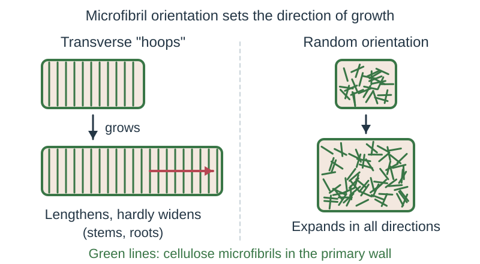{width="100%" height="360" fig-alt="Under turgor, a cell with transverse cellulose hoops lengthens but hardly widens, while a cell with randomly oriented microfibrils expands in all directions."}

:::
::::

**But a wall strong enough to hold 0.5 MPa of turgor should also stop the
cell from growing. How does it grow?**

::: notes
Exercise 2.1 asks for cellulose as the load-bearing component and lignin as the reinforcing polymer of xylem secondary walls. The hoop analogy explains why cells in a root or stem elongate in one direction: the orientation of microfibrils sets the direction in which the wall can yield. The secondary wall is for cells that have stopped growing, such as fibres and xylem conduits; P2 explains why xylem walls must resist collapse (the water inside is under tension).
:::

## How a walled cell grows

:::: {.columns}
::: {.column width="40%"}
1. **Turgor** supplies the force: water uptake pushes on the wall.
2. The wall is **loosened**: H⁺ pumped into the wall lowers its pH and
   activates **expansins**; tethers slip and the wall **yields**
   irreversibly.
3. **New material** is added: cellulose made at the plasma membrane, matrix
   from the Golgi, and **new plasma membrane**.

Turgor without loosening gives a turgid cell that **does not grow**. Most
of the volume gained is **vacuole**.
:::
::: {.column width="60%"}

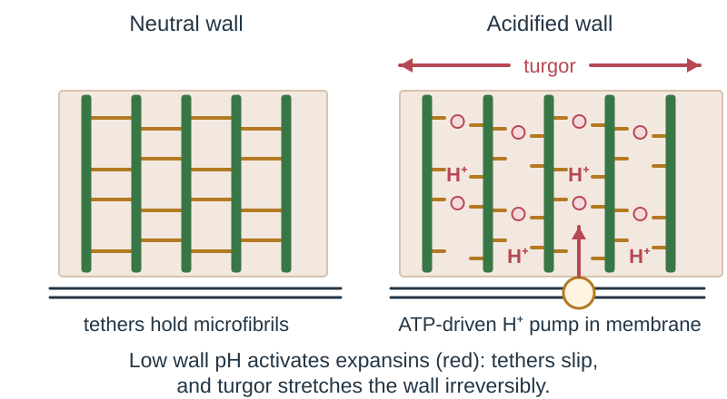{width="100%" height="360" fig-alt="In a neutral wall, matrix tethers hold the cellulose microfibrils together. Pumping H+ into the wall activates expansins, the tethers slip, and turgor pulls the microfibrils apart."}

:::
::::

**Cells are now walled boxes. How do neighbouring cells exchange material?**

::: notes
This is the answer to the previous slide and to exercise 2.2: the wall property that must change is extensibility (loosening), and the materials to supply are new wall and new membrane. The figure is acid growth: a plasma-membrane H⁺-ATPase acidifies the wall, expansins become active at the lower pH and let the load-bearing microfibrils slide apart, and turgor then does the stretching. Auxin works this way in P4. Stress that growth is mostly water uptake into the vacuole: a root cell can lengthen more than 10-fold with little increase in cytoplasm, which is why expansion is fast and cheap compared with making new cytoplasm. The next slide lets students play with the two ingredients.
:::

## Try it: turgor and wall loosening

```{=html}
<link rel="stylesheet" href="../../demos/dist/demo.css">
<div data-demo="p1-cellgrowth"></div>
<script src="../../demos/dist/p1-cellgrowth.js"></script>
```

::: notes
A single elongating cell, using the Lockhart growth equation: the relative growth rate is r = φ(P − Y), where P is turgor, Y the yield threshold of the wall and φ its extensibility. Below the threshold the wall behaves elastically and the cell does not grow at all. Press "Grow for 8 h" on the default: P = 0.6, Y = 0.3, φ = 1, so the cell grows at 0.3 per hour and doubles every 2.3 h, from 20 µm to about 220 µm. Then "Stiff wall: P < Y": the same turgor, but no growth, which is the turgid-but-not-growing cell from the slide. "Low turgor": P only just above Y, so growth crawls, which is what happens in a mildly water-stressed root. "Acid growth (auxin)" lowers Y and raises φ: the same turgor now gives twice the rate. Best trick: start a run on "Growing" and halfway through drag φ up; the curve bends upwards at that moment, as when auxin is added to a coleoptile segment and growth speeds up within minutes. Ask: which two things must the cell control to grow? (Turgor via solutes and water uptake, and wall extensibility via H⁺ pumping and expansins.) The model holds turgor constant, i.e. it assumes water uptake keeps pace with expansion.
:::

## Apoplast and symplast: two routes between cells

:::: {.columns}
::: {.column width="40%"}
- **Apoplast:** the continuous system of cell walls, intercellular spaces
  and dead xylem conduits, **outside** the plasma membranes.
- **Symplast:** the cytoplasm of all cells connected by plasmodesmata.
- **Plasmodesma:** a membrane-lined channel through the wall, ~50 nm wide,
  joining the cytoplasm of neighbouring cells. Thousands per cell.
:::
::: {.column width="60%"}

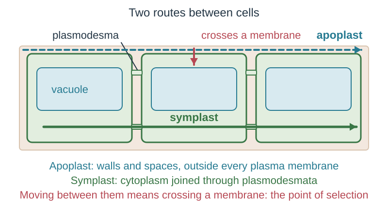{width="100%" height="360" fig-alt="Three cells share walls. A dashed route runs through the walls (apoplast), a solid route runs through cytoplasm and plasmodesmata (symplast), and a red arrow shows that moving from wall to cytoplasm crosses a plasma membrane."}

:::
::::

**To move from the apoplast into the symplast, a substance must cross a plasma
membrane.** This is where the plant selects what it takes up (P2).

::: notes
Exercise 2.3 asks for the three definitions and 2.4 for the boundary crossed. Plasmodesmata are the plant's equivalent of gap junctions, but larger and lined by the plasma membrane, so the symplast is one continuous cytoplasm across many cells. These are routes, not tissues. In P2 the root endodermis blocks the apoplastic route and forces water and ions through a membrane. Transition: from cells to tissues.
:::

## Three tissue systems

:::: {.columns}
::: {.column width="40%"}
- **Dermal:** protection and exchange; epidermis with cuticle, guard
  cells, root hairs.
- **Ground:** photosynthesis, storage, support; mesophyll, cortex, pith.
- **Vascular:** long-distance transport and support; xylem, phloem.
- Every organ contains all three, continuous through the whole plant.
- Compare A1: epithelium ↔ dermal; connective ↔ ground; vascular ↔ blood
  vessels.
:::
::: {.column width="60%"}

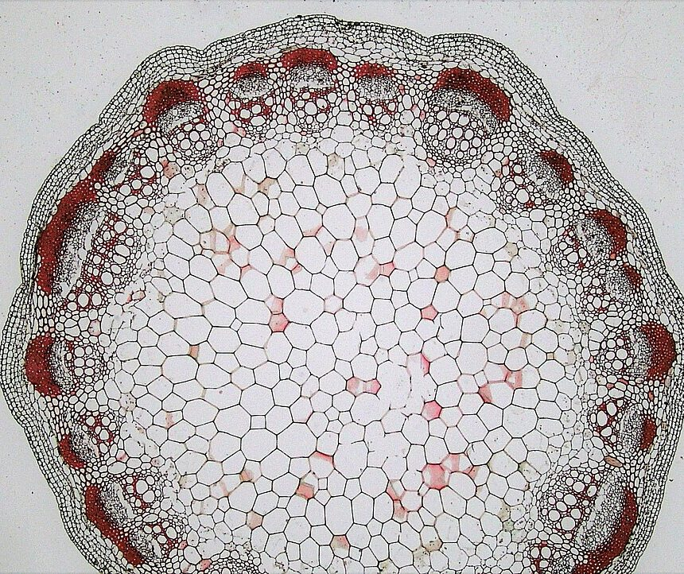{width="100%" height="360" fig-alt="Cross-section of a young sunflower stem: a thin epidermis outside, a narrow cortex, a ring of vascular bundles with red-stained fibre caps, and a large central pith."}

[Photo: Berkshire Community College Bioscience Image Library, CC0, Wikimedia Commons](https://commons.wikimedia.org/wiki/File:Herbaceous_Dicot_Stem_Young_Helianthus_%2834731656652%29.jpg){.credit}

:::
::::

**The ground tissue is built from three cell types with very different walls.**

::: notes
Find the three systems in the section: the epidermis is the outermost single layer, the vascular bundles form a ring (xylem towards the centre, phloem towards the outside), and everything else is ground tissue (cortex outside the ring, pith inside). This is the plant counterpart of the four animal tissue types in A1, and it is the map for the next slides. The analogy to animal tissues is useful but loose: the vascular tissue transports and also supports. Exercise 3.1 asks for this table with one example per system.
:::

## Ground tissue: three cell types

| | Parenchyma | Collenchyma | Sclerenchyma |
| --- | --- | --- | --- |
| Living at maturity? | **yes** | **yes** | usually **no** |
| Wall | thin primary wall | unevenly thickened primary wall, thick at the corners | thick, **lignified secondary wall** |
| Main function | metabolism, photosynthesis, storage | **flexible** support of growing organs | **rigid** support |
| Example | leaf mesophyll, potato tuber | celery "strings" | fibres (flax, hemp), sclereids (grit in pears) |

- The wall predicts the function: thin wall → metabolism; thick but
  stretchable wall → support while growing; lignified wall → support after
  growth stops.

**The vascular tissue also contains dead cells with lignified walls: the xylem
conduits.**

::: notes
Exercise 3.2 is this table. Teach recognition from the wall: students should be able to identify a cell type in a section from wall thickness, the presence of contents, and position. Collenchyma is living and can still stretch, so it supports young stems and petioles; sclerenchyma is dead and rigid. The bridge: xylem conduits are like sclerenchyma (dead, lignified), while phloem conducting cells must stay alive.
:::

## Xylem and phloem

| | Xylem | Phloem |
| --- | --- | --- |
| Transports | water and mineral ions | sugars (mainly sucrose), amino acids, signals |
| Conducting cells | **tracheids** and **vessel elements** | **sieve-tube elements** |
| Living at maturity? | **no**: hollow tubes of lignified wall | **yes**, but without a nucleus |
| Helper cells | xylem parenchyma (living) | **companion cells** (nucleated, linked by plasmodesmata) |
| End walls | vessel elements have **perforation plates** | sieve elements are joined by **sieve plates** |
| Direction | roots → shoot | sources → sinks, up or down |

- Xylem as a tissue contains living parenchyma: only its **conducting cells**
  are dead.
- A dead, empty conduit offers little resistance to flow; a living sieve
  element can load and unload sugar.

**Where does the leaf use these supplies?**

::: notes
Exercises 3.3 and 3.4 use this table. Students should be able to name cells A–C in 3.3 from the descriptions: vessel element, sieve-tube element, companion cell. The functional logic: water moving under tension needs a rigid, empty pipe; sugar transport needs living membranes to load and unload, so the sieve element stays alive and depends on its companion cell, which carries the nucleus. Direction in phloem depends on where sugar is made and used, which is the topic of P3.
:::

## The leaf: gas exchange and its cost

:::: {.columns}
::: {.column width="40%"}
- A waxy **cuticle** makes the epidermis nearly impermeable to water and
  gases.
- Gas exchange goes through **stomata**: pores between two **guard cells**,
  ~100–300 per mm², ~1–2 % of the leaf area when open.
- Mesophyll cells face a large internal air space: their surface is 10–40×
  the leaf area.

CO₂ route: pore → air space → water film of the wall → plasma membrane →
cytosol → chloroplast stroma.
:::
::: {.column width="60%"}

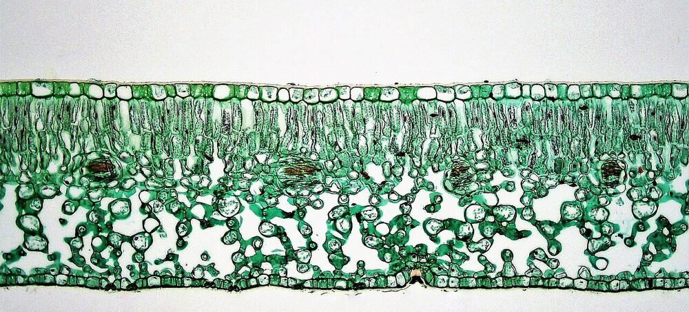{width="100%" height="360" fig-alt="Cross-section of a privet leaf: upper epidermis, a layer of column-shaped palisade cells, loosely packed spongy mesophyll with large air spaces, small veins, and the lower epidermis."}

[Photo: Berkshire Community College Bioscience Image Library, CC0, Wikimedia Commons](https://commons.wikimedia.org/wiki/File:Angiosperm_Morphology_Mesophyll_Arrangement_in_Ligustrum_%2836198182664%29.jpg){.credit}

:::
::::

**CO₂ diffuses in and water vapour diffuses out through the same pore. Opening
a stoma raises both.**

::: notes
Exercise 3.5 asks for this route and 3.6 for the reason opening increases both fluxes. The leaf is the plant's lung: a large internal surface behind a small, regulated opening. Because the cuticle blocks both gases, the plant cannot take up CO₂ without losing water; this trade-off runs through P2 (stomatal regulation, transpiration) and P3 (C4 and CAM). The water film step matters: CO₂ dissolves before crossing the membrane.
:::

## The root: surface and a selective barrier

:::: {.columns}
::: {.column width="40%"}
From the outside in:

1. **Epidermis** with **root hairs**: extensions of single epidermal cells
   that multiply the absorbing surface.
2. **Cortex**: parenchyma with air spaces; often colonised by mycorrhizal
   fungi.
3. **Endodermis**: one cell layer with the **Casparian strip**, a band of
   suberin in its walls that **blocks the apoplast**.
4. **Stele**: xylem and phloem.
:::
::: {.column width="60%"}

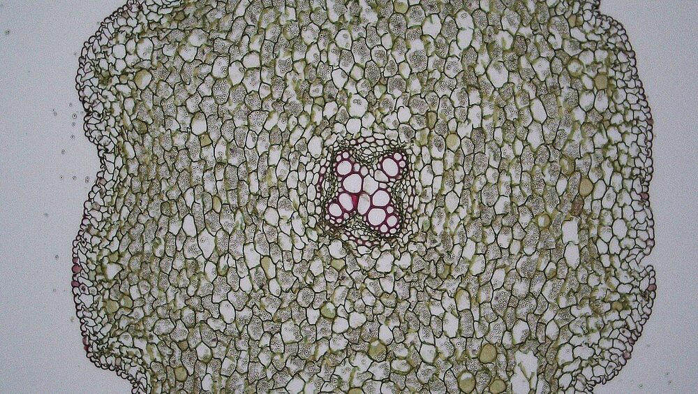{width="100%" height="360" fig-alt="Cross-section of a buttercup root: a wide cortex of round parenchyma cells around a small central stele with xylem."}

[Photo: Berkshire Community College Bioscience Image Library, CC0, Wikimedia Commons](https://commons.wikimedia.org/wiki/File:Herbaceous_Dicot_root_Ranunculus_%2834727536412%29.jpg){.credit}

:::
::::

The endodermis is to the root what the plasma membrane is to a cell: the
point of selection.

**Leaves and roots have to keep extending into new space. Where do the new
cells come from?**

::: notes
In the buttercup section most of the root is cortex, a storage tissue; the stele is the small cylinder in the centre, ringed by the endodermis. Exercise 3.3 asks students to name root hairs and the endodermis from descriptions. This slide sets up P2, where we follow water from the soil across these layers into the xylem. The key idea is that the apoplast is open up to the endodermis and closed there, so the plant controls entry at one cell layer. Transition to growth: a plant that cannot move finds new soil and light by growing.
:::

## Meristems: growth throughout life

| Meristem | Location | Produces |
| --- | --- | --- |
| **Shoot apical** | shoot tip | stem, leaves, flowers (primary growth in length) |
| **Root apical** | root tip, under the root cap | root length (primary growth) |
| **Vascular cambium** | cylinder in stem and root | **secondary xylem** inward, **secondary phloem** outward |
| **Cork cambium** | outer stem and root | periderm (cork, bark) |
| **Intercalary** | base of grass leaves and internodes | regrowth after the tip is cut or grazed |

- **Primary growth** (length) comes from apical meristems; **secondary growth**
  (girth) from the lateral meristems: vascular and cork cambium.
- An animal's body plan is complete early; a plant keeps making new organs.

::: notes
Exercise 4.1 asks for the meristem in each case. This is the plant answer to "it cannot move": it keeps building new roots into new soil and new leaves into new light. Intercalary meristems explain why a lawn survives mowing and grasses survive grazing: the growing region is at the base, below the cut. Transition: how a root tip actually gets longer.
:::

## The root tip: three zones

:::: {.columns}
::: {.column width="40%"}
Behind the protective **root cap**, three overlapping zones:

1. **Division zone:** small cells dividing (within ~1 mm of the tip).
2. **Elongation zone:** cells stop dividing and lengthen many-fold.
3. **Maturation zone:** cells differentiate; root hairs appear.

A root gets longer by **division**, **expansion**, or both.
:::
::: {.column width="60%"}

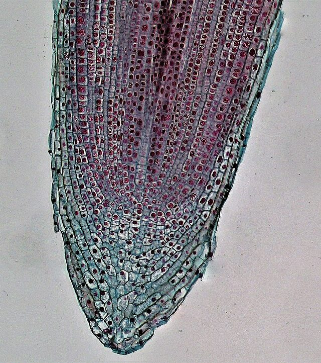{width="100%" height="360" fig-alt="Longitudinal section of an onion root tip: the cone-shaped root cap at the tip and, behind it, files of small, densely packed dividing cells of the meristem."}

[Photo: Berkshire Community College Bioscience Image Library, CC0, Wikimedia Commons](https://commons.wikimedia.org/wiki/File:Apical_Meristem_in_Onion_Root_Tip_%2834886438470%29.jpg){.credit}

:::
::::

**Which of the two processes made a root longer?**

::: notes
Point out the zones on the section: the cap at the very tip (pale blue-green, loosely arranged cells), and the meristem as files of small, densely stained cells just behind it. The elongation zone starts beyond the top edge of the photo, about 1 mm from the tip. The zones grade into each other. The root cap protects the meristem as the root pushes through soil and senses gravity (P4). Cells are displaced backwards from the meristem: a cell never moves relative to its neighbours, but its distance from the tip increases as cells in front of it divide and lengthen.
:::

## More cells or longer cells?

A file of 100 cells, end to end:

| Cells | Mean cell length | Segment length |
| ---: | ---: | ---: |
| 100 | 40 µm | 4 mm |
| 100 | 70 µm | **7 mm** (expansion only) |
| 175 | 40 µm | **7 mm** (division only) |

- Same final length, two different mechanisms.
- **Length alone does not identify the process.** Count cells and measure
  their length.
- At steady state, root growth rate = **cell production rate × final cell
  length**.

::: notes
Exercise 4.2 is this calculation. Work it on the board: 100 × 40 µm = 4000 µm = 4 mm; 100 × 70 µm = 7 mm; 7000 / 40 = 175 cells. The general point is experimental: a mutant or treatment with a shorter root might divide less, expand less, or both, and only measuring cell number and cell length distinguishes them. The last bullet is the kinematic rule used in root biology: each cell leaving the meristem eventually adds its final length to the root.
:::

## Try it: two root tips

```{=html}
<link rel="stylesheet" href="../../demos/dist/demo.css">
<div data-demo="p1-roottip"></div>
<script src="../../demos/dist/p1-roottip.js"></script>
```

**Cells leaving the meristem become epidermis, xylem or cortex, yet all carry
the same DNA. How?**

::: notes
Two root tips with the tip held still on the right, as if we were riding on it. The dark green block is the meristem; each new cell leaves it at 10 µm, elongates (light green) to its final length and then matures (pale, with root hairs); grey is older root. The red bracket shows how far the tip has moved through the soil. Press "Grow for 8 h" on the slide example: root A makes 2.2 cells per hour that end at 40 µm, root B only 1.25 cells per hour but they end at 70 µm. Both tips move 0.70 mm in 8 hours: A has 17 new cells, B 10. Ask: if you only had a ruler, could you tell these roots apart? No; you have to count cells and measure them. Then drag one slider: halve A's production, as a treatment that blocks division would, and A falls behind; or raise B's final length, as an auxin-insensitive or wall mutant might change it. "Identical roots" gives two equal roots to start from. The rule shown in the readout: growth rate = production rate × final cell length.
:::

## Differentiation: same genome, different genes

:::: {.columns}
::: {.column width="40%"}
- A leaf mesophyll cell and a root cortex cell have the **same nuclear
  genome**; they **express different sets of genes**.
- Differentiation changes gene expression and cell structure, **not the DNA
  sequence**.
- Some mature cells can resume division: wound healing, rooting cuttings,
  regeneration from tissue culture.
- Regeneration is **not** guaranteed: it depends on genotype, cell type,
  developmental state and hormones.
:::
::: {.column width="60%"}

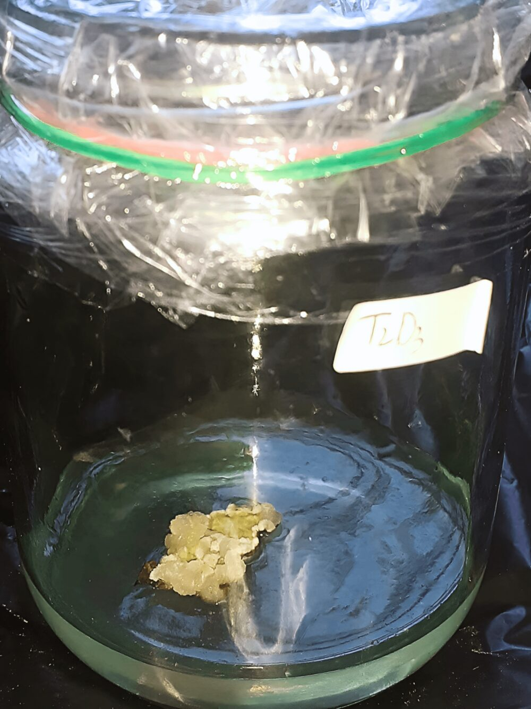{width="100%" height="360" fig-alt="Pale clumps of callus, undifferentiated dividing plant cells, growing on a gel nutrient medium in a culture vessel."}

[Photo: Iripseudocorus, CC BY-SA 4.0, Wikimedia Commons](https://commons.wikimedia.org/wiki/File:Callus_in_MS-Media.png){.credit}

:::
::::

**A plant cell has not one genome but three.**

::: notes
The photo is callus: a mass of dividing, undifferentiated cells grown from pieces of a differentiated plant on a medium with auxin and cytokinin; changing the hormone balance can make it form shoots or roots. Exercises 4.3 and 5.3 test these statements. Contrast with animals: many plant cells keep the ability to dedifferentiate and divide, which is the basis of propagation by cuttings and of plant biotechnology (P5). But "every cell can make a plant" is false as a general rule. Hormonal control of regeneration returns in P4.
:::

## Three genomes in one cell

:::: {.columns}
::: {.column width="40%"}
| Genome | Arabidopsis |
| --- | --- |
| **Nuclear** | ~135 Mb, ~27 000 genes |
| **Plastid** | ~154 kb, ~130 genes |
| **Mitochondrial** | ~370 kb, ~60 genes |

- A chloroplast contains ~3000 different proteins; its own genome encodes
  about 100. The rest are **encoded in the nucleus**, made in the cytosol
  and **imported**.
:::
::: {.column width="60%"}

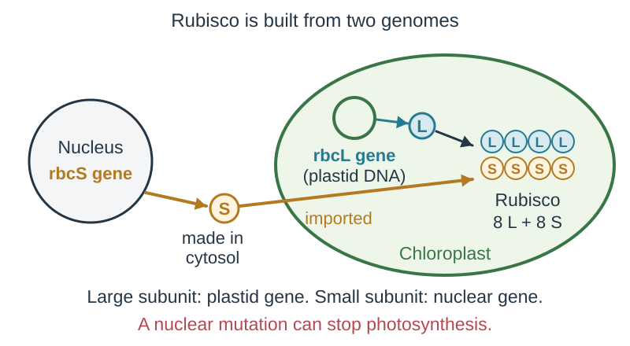{width="100%" height="360" fig-alt="The Rubisco small subunit gene is in the nucleus; the protein is made in the cytosol and imported into the chloroplast, where it assembles with large subunits made from the plastid rbcL gene."}

:::
::::

**Rubisco**, the CO₂-fixing enzyme, needs both genomes: a **nuclear**
mutation can block photosynthesis while chloroplast DNA is unchanged.

::: notes
Exercises 5.1 and 5.2 use these facts. Rubisco is the ideal example because it is assembled from products of two genomes, and it is the enzyme at the centre of P3. Point out that the location of a protein does not tell you where its gene is. Plastid and mitochondrial genomes are inherited mostly from the mother in many species, but not all.
:::

## Back to the seedling

:::: {.columns}
::: {.column width="40%"}
The maize seedling solved the A1 problem without moving:

| Need | Plant solution |
| --- | --- |
| Surface for light, CO₂ | thin leaves, air spaces, stomata |
| Surface for water, minerals | roots, root hairs |
| Long-distance transport | xylem and phloem |
| Support | turgor; lignified walls |
| New resources | growth from meristems |
:::
::: {.column width="60%"}

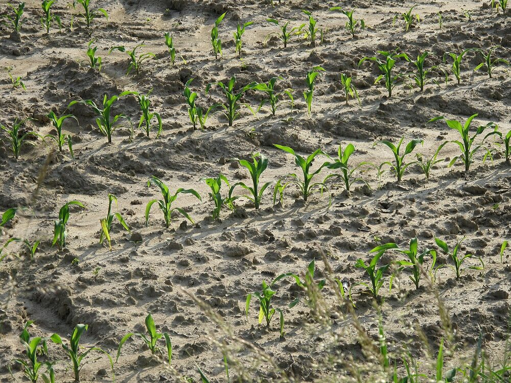{width="100%" height="360" fig-alt="Young maize seedlings with a few leaves each, growing in rows in a field of bare soil."}

[Photo: Tangopaso, public domain, Wikimedia Commons](https://commons.wikimedia.org/wiki/File:Maize_seedlings_in_Arbigny_%28close-up%29.jpg){.credit}

:::
::::

**Two open questions: how does water get from the soil to the top of the
plant (P2), and how is light turned into sugar for the whole plant (P3)?**

::: notes
Close the loop to the opening slide. Each row is a structure from today matched to the need it serves. The two transport questions are the next two lectures: P2 follows water and minerals from soil to air, P3 follows carbon from the air into sugar and out to the roots.
:::

## Summary {.smaller}

| Concept | Key fact |
| --- | --- |
| Plant versus animal | cannot move, makes its own food, cells have walls, grows all its life |
| Boundaries | wall (mechanical, porous), plasma membrane (selective), tonoplast (vacuole) |
| Turgor | pressure of protoplast against wall, ~0.3–1 MPa; loss → wilting |
| Plastids | chloroplast, amyloplast, chromoplast, all from proplastids |
| Cell growth | turgor + wall loosening + new wall and membrane |
| Apoplast / symplast | walls and spaces / cytoplasm linked by plasmodesmata |
| Tissue systems | dermal, ground (parenchyma, collenchyma, sclerenchyma), vascular |
| Xylem / phloem | dead tracheids and vessels / living sieve tubes with companion cells |
| Meristems | apical (length), vascular and cork cambium (girth), intercalary |
| Three genomes | nuclear, plastid, mitochondrial; most organelle proteins are nuclear-encoded |

**Next (P2 — Water, minerals and transport):** water moves from soil to air through a
plant with no pump. What drives it, why can salty wet soil still dry a plant
out, and how do stomata and roots control the flow?

[Tutorial](index.qmd) · [Exercises](exercise.qmd) · [Quiz](quiz.qmd)

::: notes
Read the table as the story: the plant's constraints, the cell that meets them, how cells grow and connect, the tissues they form, where growth happens, and the genomes behind it. P2 takes the water half of the supply problem, using turgor (as pressure potential), the apoplast and symplast, the endodermis, xylem and stomata from today.
:::
