## About this lecture

A maize field in a dry summer: the soil dries out, the irrigation water is
slightly salty, the afternoons reach 38 °C, a fungus spreads on the leaves and
corn borer caterpillars tunnel into the stems. The plant cannot move away from
any of it. **How does a plant survive stress and attack, and how can we use
that knowledge to build a better crop?** In P4 we saw signals regulate
development. Today the same signalling, ABA, jasmonic acid and salicylic acid
among them, is used to cope with a hostile environment.

- **Abiotic stress:** drought, salinity, heat and freezing, and how cells are protected.
- **Biotic stress:** constitutive and induced defence, the hypersensitive
  response, SAR, the SA and JA pathways, and defensive chemicals.
- **From mechanism to crop:** Arabidopsis, *Agrobacterium*, tissue culture,
  promoters and reporters.
- **GM crops:** Bt maize, herbicide tolerance, Golden Rice, CRISPR, and how
  to separate evidence from values.

::: notes
The running example is a maize field, and the lecture follows it in three steps: what the environment does to the plant, what attackers do to it, and how a gene can be put into the plant to help. The final slides return to the field with Bt maize. This is the last lecture of the course, so the summary also draws the plant half together and points to the animal half.
:::

## What stress does to a plant

:::: {.columns}
::: {.column width="55%"}
**Stress:** a condition that pushes a plant's function outside its normal range.

| Stress | Main problem |
| --- | --- |
| **Drought** | Low soil ψ: less uptake, loss of turgor |
| **Salinity** | Osmotic effect **plus** Na⁺ and Cl⁻ toxicity |
| **Heat** | Proteins denature; membranes too fluid |
| **Freezing** | Ice between cells draws water out |

Stress can reduce **survival**, **growth** or **seed yield**: different outcomes.
:::
::: {.column width="45%"}

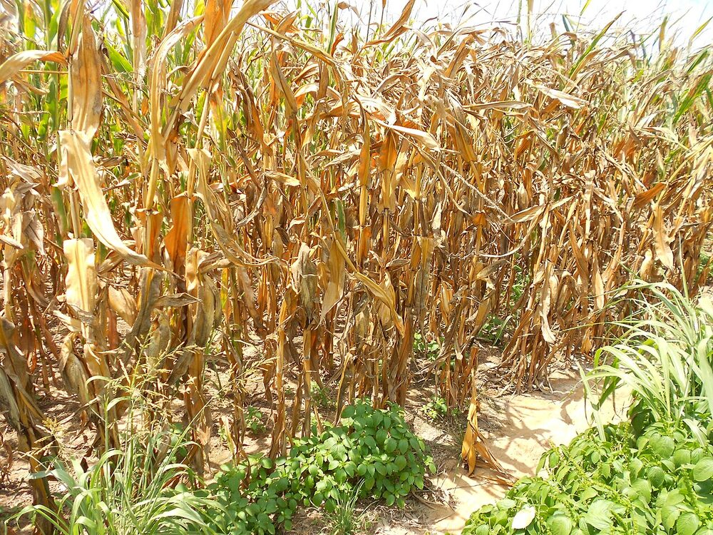{width="100%" height="360" fig-alt="Drought-stressed maize field with rolled, greyish leaves."}

[Photo: CraneStation, CC BY 2.0, Wikimedia Commons](https://commons.wikimedia.org/wiki/File:Drought-stressed_corn,_western_Tennessee-Kentucky_border.jpg){.credit}

:::
::::

**The commonest stress in our field is drought. What does the plant do first?**

::: notes
Exercise 1.1. Note that drought and salinity share the osmotic problem from P2: water flows to lower water potential, and a salty or dry soil has a low one. Freezing is effectively a drought inside the tissue, because extracellular ice has a lower water potential than the cell sap. Transition: the first response to drought is fast, hormonal and happens in the guard cells.
:::

## Drought: ABA closes the stomata

:::: {.columns}
::: {.column width="40%"}
1. Soil dries; **ABA** is made in roots and leaves.
2. ABA binds receptors in the **guard cells**.
3. Ion channels open: K⁺ and anions leave.
4. Water follows, turgor falls, the **stoma closes**.

- Within minutes, transpiration falls.
- **Cost:** less **CO₂ uptake**, and less evaporative cooling, so the leaf warms.
:::
::: {.column width="60%"}

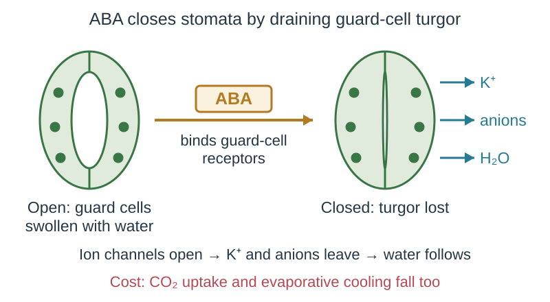{width="100%" height="360" fig-alt="ABA makes guard cells lose K+, anions and water, so the stoma closes; CO2 uptake and cooling fall too."}

:::
::::

**How large is that cost? Try it.**

::: notes
Exercises 1.2 and 1.3. This is the fast branch of the signal chain from P4: no new genes are needed for the guard cells to close, just ion channels. The trade-off links P2 (transpiration) and P3 (CO₂ uptake): a plant under drought must choose between water and carbon. The heat cost matters on a hot afternoon in our maize field. Transition: the slower, longer-term response is to change the water potential inside the cells.
:::

## Try it: water saved versus carbon lost

```{=html}
<link rel="stylesheet" href="../../demos/dist/demo.css">
<div data-demo="p5-stomata" data-aba="0" data-vpd="2"></div>
<script src="../../demos/dist/p5-stomata.js"></script>
```

::: notes
Start at "well watered" and read out water loss, CO₂ uptake and leaf temperature. Then click "mild drought": water loss roughly halves but CO₂ uptake falls by only about a fifth, so CO₂ gained per water lost rises. Ask why: CO₂ uptake is limited by both the stomata and the chloroplast, so partial closure costs less carbon than water. Then click "severe drought": CO₂ uptake collapses and the leaf ends up about 8 °C warmer than the air. Finally raise the air-dryness slider at fixed ABA to show that dry air raises water loss without changing the stomata. This connects P2 (transpiration), P3 (CO₂ uptake) and the heat stress on the previous slide.
:::

## Osmotic adjustment and salt

:::: {.columns}
::: {.column width="45%"}
**Compatible solutes** (proline, glycine betaine, sucrose, mannitol) lower ψ<sub>s</sub>
without inhibiting enzymes, so water still flows **into** the root.

**Salinity** harms a plant twice:

1. **Osmotic:** salty soil water has a low ψ, so uptake is hard, as in drought.
2. **Ionic:** Na⁺ that does get in is toxic to enzymes in the cytoplasm.
:::
::: {.column width="55%"}

{width="100%" height="360" fig-alt="Bare, white, salt-crusted ground with an eroded channel, dead tree trunks and no living plants, with a line of trees in the distance."}

[Photo: Willem van Aken, CSIRO, CC BY 3.0, Wikimedia Commons](https://commons.wikimedia.org/wiki/File:CSIRO_ScienceImage_4467_Saline_area_in_the_Western_Australian_wheat_belt_near_Bannister_WA_1981.jpg){.credit}
:::
::::

**How does a cell keep Na⁺ out of its cytoplasm?**

::: notes
Exercise 1.4. Recall from P2 that water potential = solute potential + pressure potential: accumulating solutes makes the cell's water potential more negative than the soil's, so uptake continues. "Compatible" means the solute can reach high concentrations without disrupting protein function, unlike Na⁺. The photo shows the extreme case: land in the Western Australian wheat belt (1981) where clearing of deep-rooted native vegetation let saline groundwater rise; salt has crusted the surface and killed the trees, and no crop can establish. Salt tolerance therefore has two parts: the osmotic part, shared with drought, and the ion part, on the next slide.
:::

## Salt: keeping Na⁺ out of the cytoplasm

:::: {.columns}
::: {.column width="40%"}
- **SOS1** pumps Na⁺ back out of root cells.
- **NHX** stores Na⁺ in the **vacuole**, where it helps lower ψ<sub>s</sub>.
- The cytoplasm keeps a high **K⁺ : Na⁺** ratio.
:::
::: {.column width="60%"}

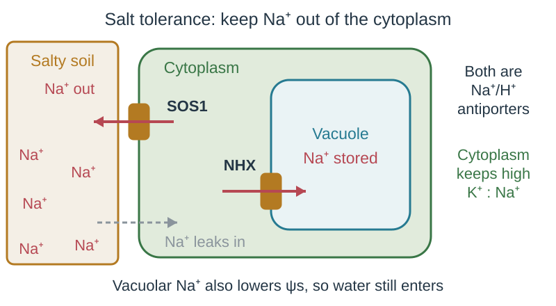{width="100%" height="360" fig-alt="Na+ is pumped out of the cell by SOS1 and into the vacuole by NHX, keeping the cytoplasm low in Na+."}

:::
::::

::: notes
Exercise 1.4. The ion part of salt tolerance is solved by exclusion and vacuolar storage: SOS1 is a Na⁺/H⁺ antiporter in the plasma membrane and NHX one in the tonoplast, both driven by the proton gradients from P2. Na⁺ stored in the vacuole is not wasted: it lowers the vacuole's ψs and so contributes to osmotic adjustment. Transition: whatever the stress, proteins and membranes need protection.
:::

## Protecting the cell, and acclimating

| Protective molecule | What it does |
| --- | --- |
| **Heat shock proteins** (chaperones) | Refold or stabilise damaged proteins |
| **Dehydrins / LEA proteins** | Protect proteins and membranes during dehydration |
| **Antioxidant enzymes** (superoxide dismutase, catalase) | Remove reactive oxygen species |

- **Reactive oxygen species (ROS)** such as H₂O₂ damage lipids, proteins and
  DNA. But ROS are also **signals**: in stomatal closure, stress signalling and defence.
- **Acclimation:** an individual becomes more tolerant over days. Example:
  plants gain freezing tolerance after two weeks at 4 °C (cold acclimation).
- **Adaptation:** a population differs heritably. Example: a coastal population
  is more salt-tolerant than an inland one **when both are grown in the same conditions**.

**So far the threats were physical. What if the threat is alive?**

::: notes
Exercises 1.5 to 1.7. LEA stands for late embryogenesis abundant: the same proteins protect the dry seed from P4. The dual role of ROS is important: a plant does not simply minimise them, it uses them as a signal, and we meet them again in the hypersensitive response. The acclimation versus adaptation distinction repeats the time scales from A1; the "same conditions" clause is what separates heritable differences from acclimation. Transition: the fungus and the caterpillar in our field.
:::

## Defence: always on, or switched on?

:::: {.columns}
::: {.column width="58%"}
| | **Constitutive** | **Induced** |
| --- | --- | --- |
| Physical | Cuticle, walls, thorns, trichomes | **Callose** plugs |
| Chemical | Stored metabolites | **Phytoalexins**, **proteinase inhibitors** |
| Cellular | — | **Hypersensitive response** |

**Three kinds of attacker:** **biotrophs** feed on living cells (rusts, mildews);
**necrotrophs** kill cells first (*Botrytis*); **herbivores** remove tissue.
:::
::: {.column width="42%"}

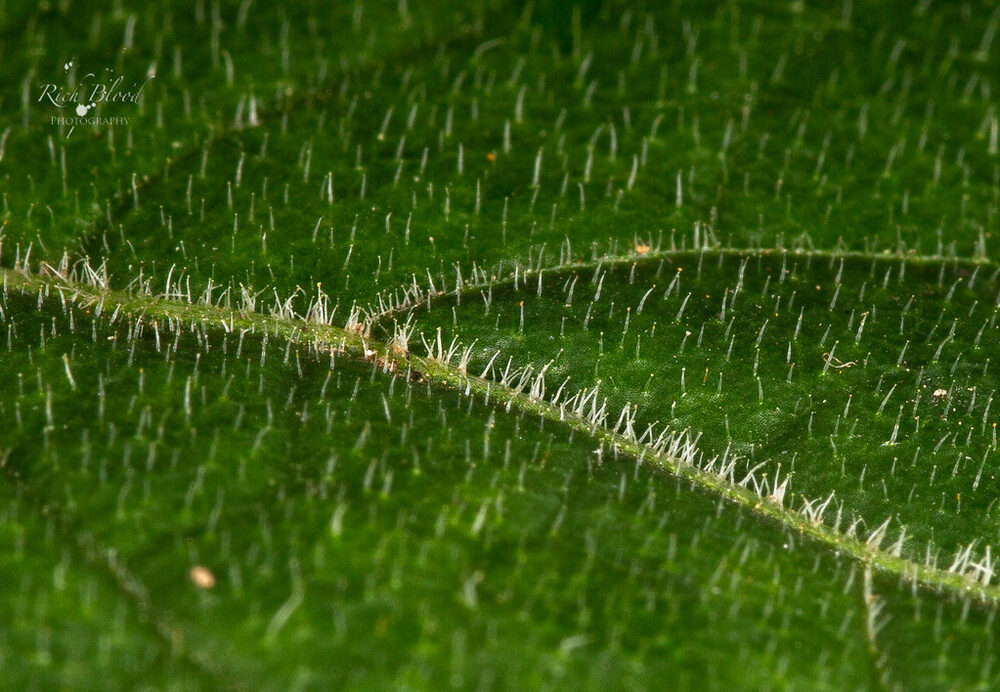{width="100%" height="360" fig-alt="Leaf surface covered in hairs (trichomes), some with glandular heads."}

[Photo: Richard Blood, CC BY 4.0, Wikimedia Commons](https://commons.wikimedia.org/wiki/File:Capsicum_eshbaughii_glandular_trichomes.jpg){.credit}

:::
::::

**To induce a defence, the plant must first detect the attacker. How?**

::: notes
Exercise 2.1. Constitutive defences cost resources even when there is no attack; induced defences save that cost but take time to switch on. The attacker classes matter because a defence that works against one can help another: killing infected cells starves a biotroph but feeds a necrotroph. Proteinase inhibitors, induced by wounding in tomato, block the caterpillar's digestive enzymes. Transition: recognition and the hypersensitive response.
:::

## Detecting the pathogen: the hypersensitive response

:::: {.columns}
::: {.column width="40%"}
- Receptors recognise conserved microbial molecules (e.g. bacterial flagellin);
  **R proteins** recognise specific pathogen effectors.
- Recognition triggers a **ROS burst** and a rise in **salicylic acid**.
- **Hypersensitive response (HR):** rapid death of the cells at the infection
  site. A **biotroph** needs living cells, so it is starved and cannot spread.
:::
::: {.column width="60%"}

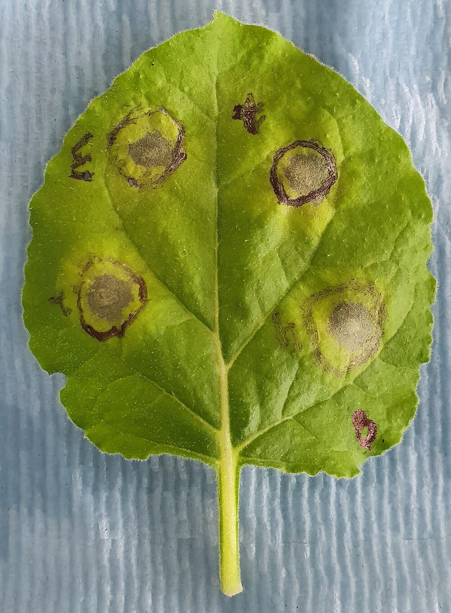{width="100%" height="360" fig-alt="Leaf with small dead brown spots where infected cells have died."}

[Photo: DanieliusKa, CC BY-SA 4.0, Wikimedia Commons](https://commons.wikimedia.org/wiki/File:Plant_hypersensitive_response_lesions.jpg){.credit}

:::
::::

**Does the rest of the plant benefit?**

::: notes
Exercise 2.3. The HR is a striking case of cells sacrificed to protect the whole, comparable to programmed cell death in development (P4 senescence). The brown spots in the photo are the dead cells; the pathogen is trapped inside them. Transition: the infection also sends a signal to the rest of the plant.
:::

## Systemic acquired resistance

:::: {.columns}
::: {.column width="40%"}
- **SAR:** long-lasting, broad-spectrum resistance in **uninfected** leaves
  after a local infection.
- A signal moves through the phloem from the infected leaf.
- SAR **requires salicylic acid** and induces pathogenesis-related (**PR**) proteins.
- Plants that cannot accumulate SA (expressing the bacterial enzyme NahG)
  develop no SAR.
:::
::: {.column width="60%"}

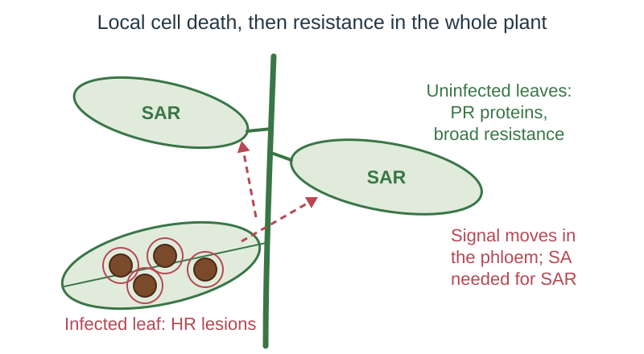{width="100%" height="360" fig-alt="An infected leaf with HR lesions sends a signal through the phloem; uninfected leaves develop SAR."}

:::
::::

::: notes
Exercise 2.4. SAR is the plant's closest analogue to immunological memory, but it is not specific to one pathogen. The NahG experiment is the classic test that SA is required. Transition: SA is one of two main defence hormones; the other is jasmonic acid.
:::

## SA versus JA: matching the defence to the attacker

:::: {.columns}
::: {.column width="48%"}
| Attacker | Pathway |
| --- | --- |
| **Biotrophic** pathogen | **SA**: HR, SAR, PR proteins |
| **Necrotrophic** pathogen | **JA** + ethylene |
| **Chewing** insect | **JA**: proteinase inhibitors |

- SA and JA often act **antagonistically**.
- Tomato: wounding releases the peptide **systemin** → JA → proteinase
  inhibitors in unwounded leaves.
- **JAZ** repressors hold JA signalling off; JA causes their degradation.
:::
::: {.column width="52%"}

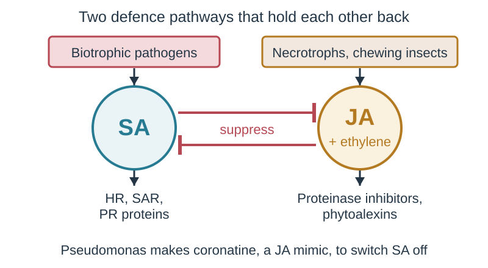{width="100%" height="360" fig-alt="SA and JA pathways suppress each other; SA acts against biotrophs, JA against necrotrophs and chewing insects."}

:::
::::

**What are the chemical weapons these pathways produce?**

::: notes
Exercise 2.2. The logic is the HR again: cell death is useful against biotrophs but would feed a necrotroph, so the plant uses a different pathway for each. Antagonism means that some pathogens manipulate the balance; for example, *Pseudomonas syringae* makes coronatine, a JA mimic, to suppress SA defence. The JAZ repressors return on the growth–defence slide. Transition: the outputs of these pathways are often specialised metabolites.
:::

## Chemical defence: specialised metabolites

:::: {.columns}
::: {.column width="58%"}
| Class | Examples |
| --- | --- |
| **Terpenoids** | Pyrethrins, menthol |
| **Phenolics** | Flavonoids, tannins, lignin |
| **N-containing** | Alkaloids (**nicotine**, caffeine), cyanogenic glycosides |

- Often stored as **inactive precursors**, apart from the activating enzyme:
  glucosinolates + myrosinase; cyanogenic glycosides → HCN.
- Damage mixes them, so the toxin forms **only at the site of attack**.
- "Natural" does not mean harmless: nicotine, ricin, cyanide.
:::
::: {.column width="42%"}

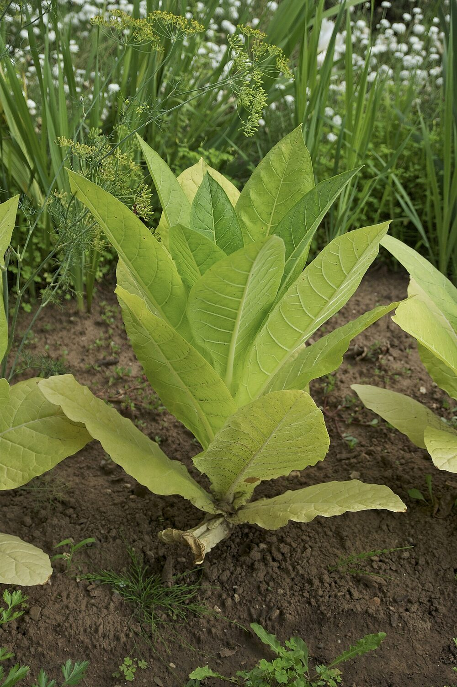{width="100%" height="360" fig-alt="Flowering tobacco plant, Nicotiana tabacum, the source of nicotine."}

[Photo: Jebulon, CC0, Wikimedia Commons](https://commons.wikimedia.org/wiki/File:Plant_nicotiana_tabacum.jpg){.credit}

:::
::::

::: notes
Exercises 2.5 to 2.7c. The three classes are defined by biosynthetic origin, and students should give one example of each. Compartmentation is the key idea: the plant keeps its own toxin safe by storing the parts separately, often in different cells or in the vacuole versus the cytoplasm. Pyrethrins from chrysanthemum flowers are the basis of common insecticides. Transition: if defence is so useful, why not keep it switched on all the time?
:::

## The growth–defence trade-off

:::: {.columns}
::: {.column width="40%"}
- Defence uses **carbon, nitrogen and energy** that could go into growth.
- An Arabidopsis mutant lacking ten JAZ repressors has **constitutive JA
  signalling**: strong insect resistance, but **much smaller plants** and
  fewer seeds (Guo et al., 2018).
- A plant with defence always on loses without attack and wins under heavy attack.
- So **induced** defence is common: pay only when attacked.
:::
::: {.column width="60%"}

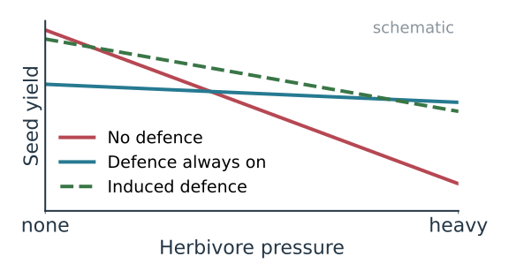{width="100%" height="360" fig-alt="Schematic of seed yield against herbivore pressure: induced defence does well across the range."}

:::
::::

**To test ideas like these we need genes, mutants and a model plant.**

::: notes
Exercise 2.7 a and b. The JAZ decuple mutant is a direct test of the trade-off: removing the brakes on JA signalling buys defence at a growth cost. Stress the table: whether a defence is worth it depends on the environment, which is also why a crop bred for a pest-free greenhouse can fail in the field. Transition: almost everything on the previous slides was discovered in one small plant.
:::

## *Arabidopsis thaliana*: the model plant

:::: {.columns}
::: {.column width="58%"}
| Property | Why it helps |
| --- | --- |
| Life cycle 6–8 weeks | Many generations per year |
| Small genome (~135 Mb), sequenced 2000 | Every gene has an ID, e.g. *FT* = AT1G65730 |
| Self-pollinating, many seeds | Mutants breed true |
| Floral-dip transformation | No tissue culture needed |
| Large mutant collections | A knockout for almost every gene |

Gene records are collected in **TAIR**. A mechanism found here must be **tested again** in a crop.
:::
::: {.column width="42%"}

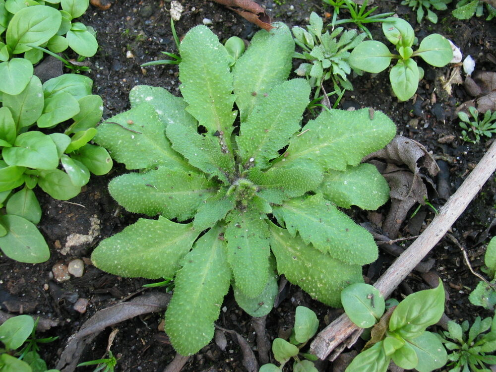{width="100%" height="360" fig-alt="Small flowering Arabidopsis thaliana plant with a leaf rosette."}

[Photo: Quentin Groom, public domain, Wikimedia Commons](https://commons.wikimedia.org/wiki/File:Arabidopsisthaliana.JPG){.credit}

:::
::::

**How do we put a new gene into a plant?**

::: notes
Exercise 3.1. The stable identifier (AGI code) matters because gene names and aliases change; AT1G65730 means chromosome 1, gene 65730. Floral dip means the inflorescence is dipped in an Agrobacterium suspension and some of the seeds are transformed, so Arabidopsis avoids the tissue culture step that most crops need. The last bullet is the bridge to crops: FT from P4 exists in rice and tomato, but its regulation differs. Transition: Agrobacterium is the natural genetic engineer that made plant transformation possible.
:::

## *Agrobacterium*: nature's genetic engineer

:::: {.columns}
::: {.column width="40%"}
- *Agrobacterium tumefaciens* causes **crown gall** tumours.
- It transfers part of its **Ti plasmid**, the **T-DNA**, into the plant genome.
- The T-DNA lies between **left and right borders**; the bacterium's **vir
  genes** cut it out and transfer it.
- Wild T-DNA carries **auxin and cytokinin** synthesis genes: the infected
  cells overproduce both hormones and grow into a tumour.
:::
::: {.column width="60%"}

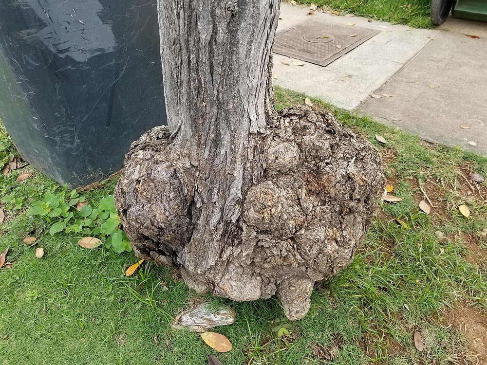{width="100%" height="360" fig-alt="Crown gall: a rough tumour on a plant stem caused by Agrobacterium."}

[Photo: Scot Nelson, CC0, Wikimedia Commons](https://commons.wikimedia.org/wiki/File:Crown_gall_(26473724818).jpg){.credit}

:::
::::

**Anything between the borders is transferred. Can we swap in our own gene?**

::: notes
The natural system links to P4: the bacterium makes the plant cells overproduce auxin and cytokinin, the same hormones we use in tissue culture later in this lecture. Transition: the binary vector.
:::

## The binary vector

:::: {.columns}
::: {.column width="40%"}
- A **binary vector** carries a T-DNA in which the tumour genes are replaced by
  **our gene** plus a **selectable marker**. A disarmed Ti plasmid supplies the vir genes.
- **Stable transformation:** T-DNA integrated and **inherited**.
- **Transient expression:** not integrated, lost within days; used for fast tests in leaves.
- Without *Agrobacterium*: **particle bombardment**, or PEG / electroporation of **protoplasts**.
:::
::: {.column width="60%"}

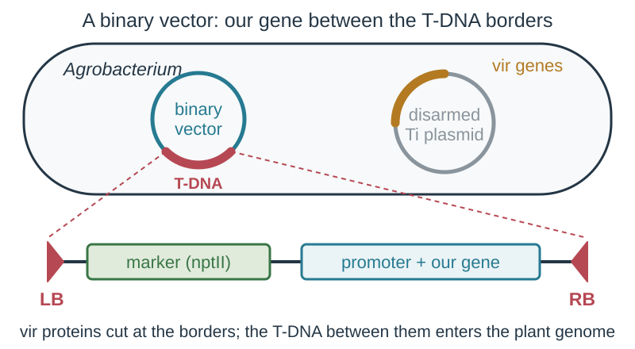{width="100%" height="360" fig-alt="Agrobacterium carries a binary vector whose T-DNA, between left and right borders, holds a marker and our gene."}

:::
::::

::: notes
Exercises 4.3 and 4.4. Splitting the system into two plasmids makes the small binary vector easy to handle in E. coli. Particle bombardment was important for cereals, which were initially hard to transform with Agrobacterium. Transition: the full workflow.
:::

## From construct to transgenic plant

:::: {.columns}
::: {.column width="40%"}
Only a few cells are transformed. A **selectable marker** in the same T-DNA lets only those survive:

| Marker gene | Resistance to |
| --- | --- |
| *nptII* | Kanamycin |
| *hpt* | Hygromycin |
| *bar* | Glufosinate (herbicide) |

Confirm the insert by PCR and its expression by RT-PCR or a protein assay.
:::
::: {.column width="60%"}

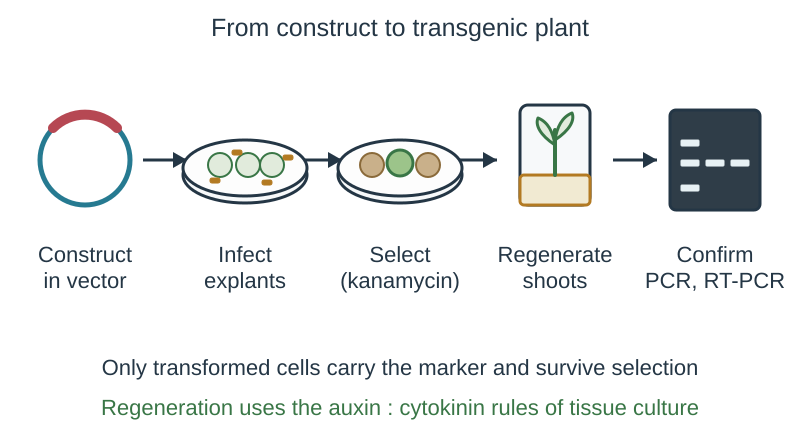{width="100%" height="360" fig-alt="Construct, infect explants, select on kanamycin, regenerate shoots, confirm by PCR."}

:::
::::

::: notes
Exercises 4.1 and 4.2. The order is the one students must reproduce: construct, co-cultivation, selection, regeneration, confirmation (by PCR for the insert and RT-PCR or a protein assay for expression). The marker and the gene of interest sit in the same T-DNA, so surviving cells usually carry both. Transition: regeneration relies on a property of plant cells that animal cells mostly lack.
:::

## Tissue culture: totipotency

:::: {.columns}
::: {.column width="40%"}
- **Totipotency:** many differentiated plant cells can dedifferentiate and
  regenerate a **whole plant**.
- A single transformed cell can therefore become a transgenic plant.
- Typical sequence: explant → callus → shoots → roots → plantlet in soil.
:::
::: {.column width="60%"}

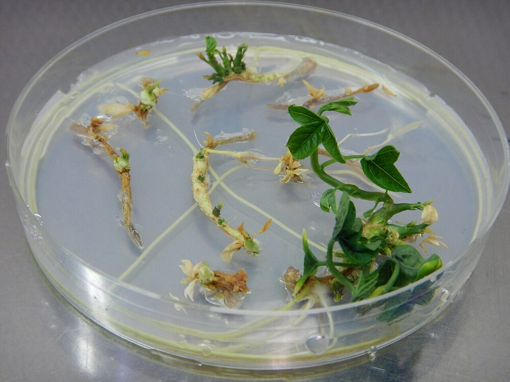{width="100%" height="360" fig-alt="Shoots regenerating from explants on culture medium in a dish."}

[Photo: Annalisa Giovannini, CC BY 4.0, Wikimedia Commons](https://commons.wikimedia.org/wiki/File:Passiflora_in_vitro_plant_regeneration_Annalisa_Giovannini_DSCN0544.jpg){.credit}

:::
::::

**What decides whether the culture makes roots, shoots or callus?**

::: notes
Exercise 4.5. Most animal cells lose this capacity during differentiation; plant cells keep it, which is what makes transformation followed by regeneration possible. Transition: hormone ratios.
:::

## Tissue culture: the auxin : cytokinin ratio

:::: {.columns}
::: {.column width="40%"}
Skoog and Miller (1957), tobacco:

| Auxin : cytokinin | Explant forms |
| --- | --- |
| **High** | Roots |
| Intermediate | **Callus** |
| **Low** (high cytokinin) | Shoots |

Exact concentrations depend on species, genotype and tissue.
:::
::: {.column width="60%"}

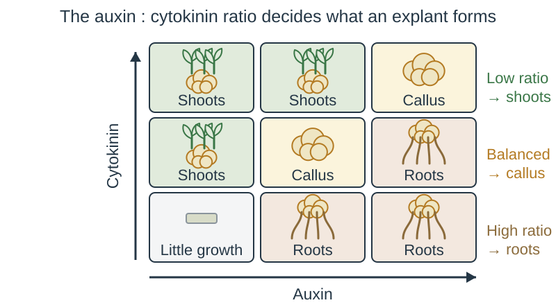{width="100%" height="360" fig-alt="Grid of auxin and cytokinin levels: high auxin gives roots, high cytokinin gives shoots, balanced gives callus."}

:::
::::

::: notes
Exercise 4.6. Connect to the hormones from P4: auxin promotes root initiation (rooting powder), cytokinin promotes shoot meristems. The crown gall is a callus caused by the bacterium's own auxin and cytokinin genes. Transition: try it.
:::

## Try it: grow an explant

```{=html}
<link rel="stylesheet" href="../../demos/dist/demo.css">
<div data-demo="p5-tissueculture" data-auxin="0.3" data-cytokinin="0.3"></div>
<script src="../../demos/dist/p5-tissueculture.js"></script>
```

::: notes
Start at the balanced medium: the explant forms callus. Drag the point towards high cytokinin and shoots appear; towards high auxin and roots appear. Ask the room to predict before each move. Then tick "wild Agrobacterium" with no hormones in the medium: the explant still forms a tumour, because the T-DNA makes the cells produce their own auxin and cytokinin. This joins the crown-gall slide to the Skoog–Miller map. The model is a rule of thumb, not fitted to data.
:::

## Is the phenotype caused by the transgene?

:::: {.columns}
::: {.column width="40%"}
- The T-DNA inserts at a **random position**: it can **disrupt** or **activate**
  a native gene.
- Tissue culture itself causes mutations: **somaclonal variation**.
- So compare **several independent lines** and an **empty-vector** control.
- A phenotype seen in all independent lines, and absent from the controls,
  is attributed to the transgene.
:::
::: {.column width="60%"}

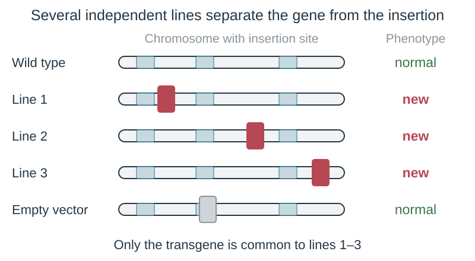{width="100%" height="360" fig-alt="Three independent lines with insertions at different sites share a new phenotype; wild type and empty vector are normal."}

:::
::::

::: notes
Exercise 4.7. Each independent line has the T-DNA in a different place and has been through its own culture, so position effects and somaclonal mutations differ between lines; only the transgene is common to all. The empty-vector control shows the effect of the transformation procedure itself. Expression level also varies between lines because of insertion position, which is another reason to analyse several. Transition: promoters.
:::

## Promoters: where and when

:::: {.columns}
::: {.column width="55%"}
| Promoter type | Expression |
| --- | --- |
| **Constitutive** (CaMV **35S**) | Nearly all tissues, all the time |
| **Tissue-specific** | Particular cell types, e.g. guard cells |
| **Inducible** | Only after a signal, e.g. drought or wounding |

- A **guard-cell promoter** driving a gene that closes stomata saves water.
  CO₂ uptake, leaf temperature and **yield** must be measured too.
:::
::: {.column width="45%"}

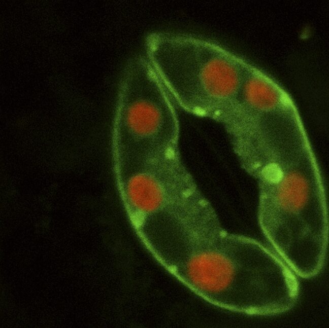{width="100%" height="360" fig-alt="Green fluorescence confined to the two guard cells of a stoma."}

[Image: Alex Costa, CC BY 2.5, Wikimedia Commons](https://commons.wikimedia.org/wiki/File:Plant_stoma_guard_cells.png){.credit}

:::
::::

**How do we see where a promoter is active?**

::: notes
Exercise 5.1. The image shows GFP expressed only in guard cells, exactly what a guard-cell promoter is for. The guard-cell example returns to the ABA slide and the stomata demo: closing stomata has a carbon and temperature cost. Transition: reporter genes.
:::

## Reporters: making expression visible

:::: {.columns}
::: {.column width="55%"}
| Reporter | Detected by |
| --- | --- |
| **GUS** (β-glucuronidase) | Blue product after staining with X-Gluc |
| **GFP** | Green fluorescence under blue light |
| **Luciferase** | Light emission when luciferin is supplied |

- Fuse a promoter to a reporter to see where and when it is active.
- A stress-induced promoter + reporter gives a plant that **signals when stressed**,
  but it must be tested for specificity.
:::
::: {.column width="45%"}

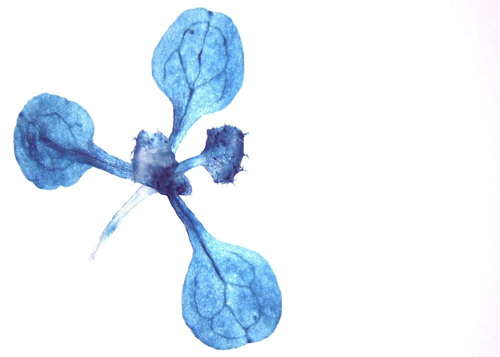{width="100%" height="360" fig-alt="Arabidopsis rosette stained blue by GUS reporter activity."}

[Photo: D. S. Rathore, CC BY 4.0, Wikimedia Commons](https://commons.wikimedia.org/wiki/File:The_Blue_Plant;_GUS_gene_expression_in_Arabidopsis_thaliana_transformed_via_Ensifer_adhaerens_OV14.jpg){.credit}

:::
::::

::: notes
Exercise 5.2. Reporters fused to a promoter show where and when that promoter is active; this was how the senescence promoter in P4 was characterised. Many stress promoters respond to several stresses, so a reporter plant used as a sensor needs controls. Transition: back to the maize field, with crops that are actually grown.
:::

## GM crops in the field

:::: {.columns}
::: {.column width="55%"}
| Trait | Gene or mechanism |
| --- | --- |
| **Insect resistance** (maize, cotton) | ***cry*** toxin gene from *Bacillus thuringiensis* (Bt) |
| **Herbicide tolerance** (soybean, maize) | Bacterial EPSP synthase insensitive to glyphosate |
| **Golden Rice** | Carotenoid synthesis genes in the endosperm → **β-carotene** |

Golden Rice targets vitamin A deficiency: β-carotene is provitamin A, and
normal rice endosperm makes none.
:::
::: {.column width="45%"}

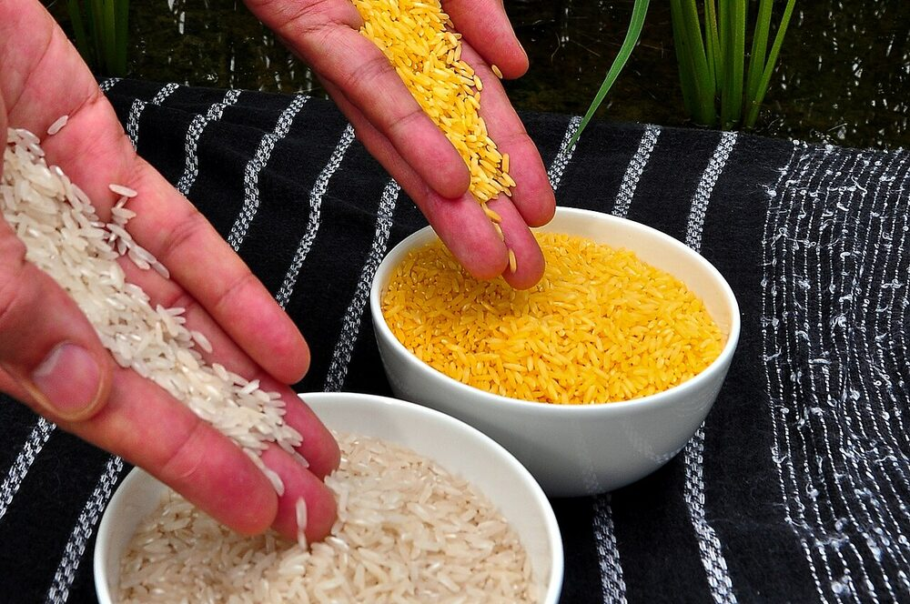{width="100%" height="360" fig-alt="Golden Rice grains, yellow from beta-carotene, next to white rice."}

[Photo: International Rice Research Institute, CC BY 2.0, Wikimedia Commons](https://commons.wikimedia.org/wiki/File:Golden_Rice.jpg){.credit}

:::
::::

**How does the Bt protein kill a caterpillar but not us?**

::: notes
Exercise 6.1. Glyphosate inhibits EPSP synthase in the shikimate pathway, which makes aromatic amino acids; the bacterial enzyme still works in its presence. Transition: the Bt mechanism.
:::

## How Bt toxin works

:::: {.columns}
::: {.column width="40%"}
1. The caterpillar eats the Cry **protoxin**.
2. In the **alkaline** larval gut, proteases activate it.
3. It binds **specific receptors** on gut epithelial cells and forms **pores**.
4. Gut cells lyse; the larva stops feeding and dies.

Safe for mammals: an **acidic** stomach and **no receptors** for the toxin.
:::
::: {.column width="60%"}

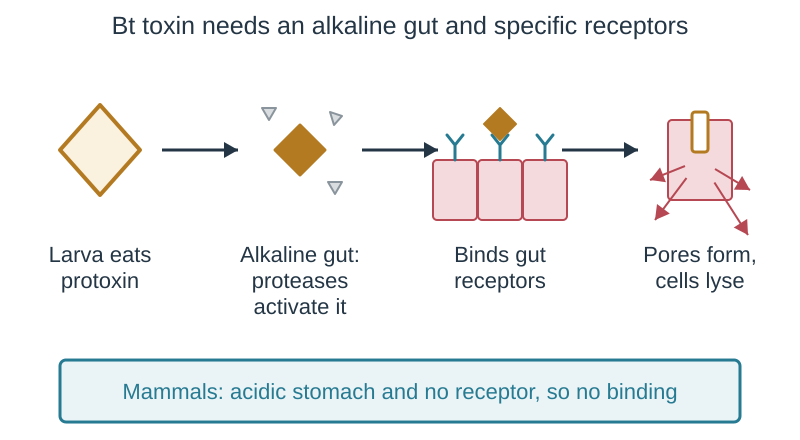{width="100%" height="360" fig-alt="Protoxin eaten, activated in the alkaline gut, binds gut receptors and forms pores so cells lyse."}

:::
::::

**If every plant in the field kills the pest, what does natural selection do?**

::: notes
Exercise 6.2. The mechanism explains the specificity: each Cry protein matches receptors in a particular insect group. Bt sprays have been used in organic farming for decades. Transition: resistance evolution.
:::

## The refuge strategy

:::: {.columns}
::: {.column width="40%"}
- Bt maize selects for **resistance alleles** in the pest, the European corn borer.
- A **refuge** of non-Bt plants is grown next to the Bt crop.
- Susceptible insects from the refuge mate with the rare resistant survivors.
- Resistance is usually **recessive**, so the heterozygous offspring still die
  on Bt maize, and resistance evolves **much more slowly**.
:::
::: {.column width="60%"}

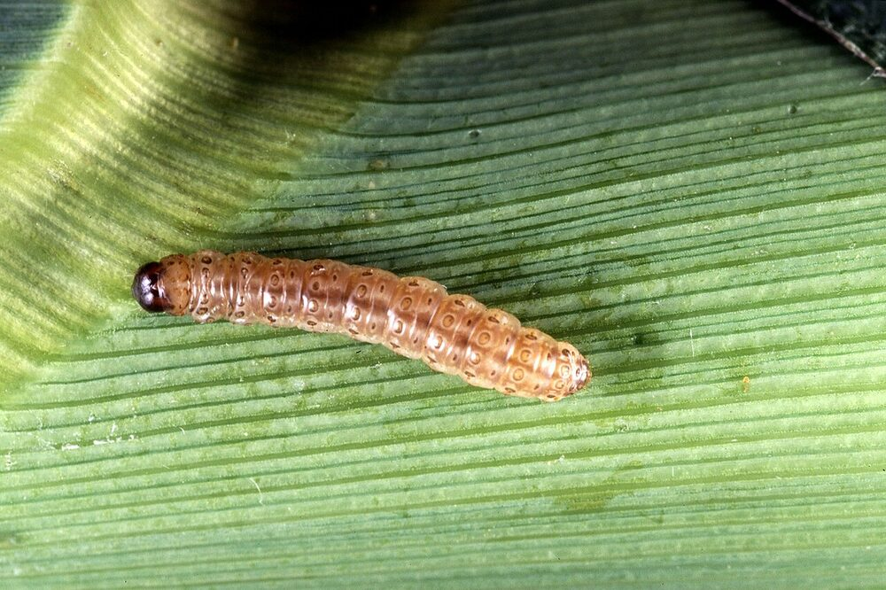{width="100%" height="360" fig-alt="European corn borer caterpillar inside a damaged maize stalk."}

[Photo: Keith Weller, USDA ARS, public domain, Wikimedia Commons](https://commons.wikimedia.org/wiki/File:Corn_borer.jpg){.credit}

:::
::::

**How much refuge is enough? Try it.**

::: notes
Exercise 6.3. The refuge is applied evolution: the same natural selection from A1, now in a pest population. Because resistant insects are rare, they almost always mate with susceptible insects from the refuge. Transition: the demo.
:::

## Try it: Bt resistance and the refuge

```{=html}
<link rel="stylesheet" href="../../demos/dist/demo.css">
<div data-demo="p5-refuge" data-refuge="0" data-h="0" data-p0="0.001"></div>
<script src="../../demos/dist/p5-refuge.js"></script>
```

::: notes
Start with no refuge: the resistance allele reaches 50% in about 15 generations. Set a 20% refuge with a recessive allele (h = 0): more than 150 generations. Then make the allele dominant (h = 1) with the same refuge: the refuge helps far less, because heterozygotes now survive on Bt maize. This is why refuges are combined with a high-dose Bt crop that kills heterozygotes. Tick the drift option to show that chance matters when the allele is very rare. Ask: what would farmers gain by planting no refuge, and who pays when resistance appears?
:::

## Genome editing versus transgenesis

:::: {.columns}
::: {.column width="50%"}
| | Transgenesis | CRISPR–Cas9 |
| --- | --- | --- |
| Change | Foreign DNA **inserted** | **Targeted cut** in a gene |
| Position | Random | Chosen by guide RNA |
| Final plant | Carries the transgene | Small mutation; Cas9 **crossed out** |

The final edited plant may carry only a small deletion that could also arise by mutation.
:::
::: {.column width="50%"}

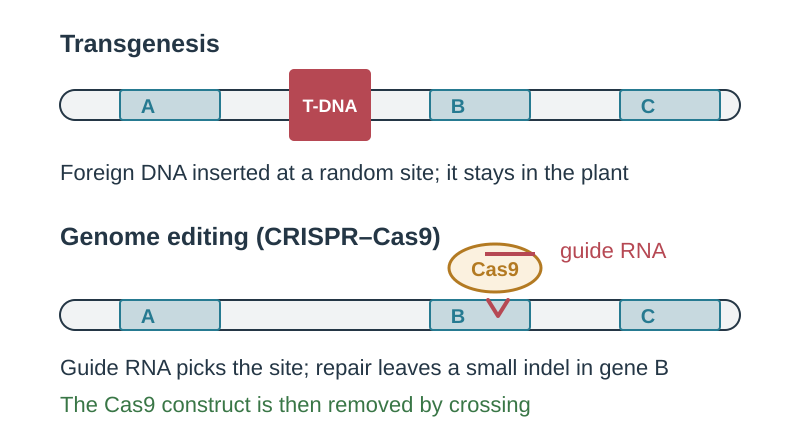{width="100%" height="360" fig-alt="Transgenesis inserts T-DNA at a random site; CRISPR-Cas9 cuts a chosen gene and leaves a small indel."}

:::
::::

**The science says what a crop does. Should it be grown? That is a different kind of question.**

::: notes
Exercise 6.4. Whether edited plants are regulated as GM differs between countries. Transition: empirical versus value questions.
:::

## Evidence and values

| Question | Type | How it is answered |
| --- | --- | --- |
| Does pollen from a GM crop reach a wild relative 100 m away? | **Empirical** | Measure gene flow in the field |
| Does a Bt crop reduce insecticide use in a region? | **Empirical** | Compare spraying records |
| How much uncertainty about environmental effects is acceptable? | **Value** | Weigh benefits and risks: a societal choice |
| Who should decide whether a GM crop is grown? | **Value** | Governance and law |

- Empirical questions are settled by **data**; value questions by **argument and decision**.
- Data inform value questions but do not answer them.
- Risks depend on the **trait and setting**, not on the label "GM": gene flow
  matters only where wild relatives grow.

::: notes
Exercise 6.5. The skill is classification: a question that a measurement could settle is empirical, even if the measurement is hard. Students should not be asked to take a side here; the point is to recognise which kind of question is being asked, so that a debate does not confuse the two. Example of the last bullet: Bt maize in Europe has no wild relatives to cross with, while in Mexico, the centre of maize diversity, gene flow into landraces is a real question. This closes the lecture and the plant half of the course.
:::

## Summary {.smaller}

| Concept | Key fact |
| --- | --- |
| Abiotic stress | drought: low ψ; salt: osmotic + Na⁺/Cl⁻ toxicity; heat: denaturation; freezing: extracellular ice |
| Drought response | ABA → stomata close; cost: less CO₂, warmer leaf |
| Tolerance | compatible solutes, Na⁺ exclusion and vacuolar storage, HSPs, LEA proteins, antioxidants |
| Defence | constitutive vs induced; HR starves biotrophs; SAR needs SA |
| SA vs JA | SA: biotrophs; JA (+ ethylene): necrotrophs and chewing insects; often antagonistic |
| Trade-off | constant defence costs growth; induced defence pays only under attack |
| Transformation | binary vector → *Agrobacterium* → selection → regeneration → confirmation |
| Tissue culture | high auxin : cytokinin → roots; low → shoots; intermediate → callus |
| GM crops | Bt kills via gut receptors; refuges delay resistance; CRISPR edits without inserting DNA |

**The plant half:** P1 built the plant; P2 supplied water and minerals; P3
fixed and moved carbon; P4 used signals to decide what to build and when; P5
used the same signals to survive. The animal half solved the same problems
differently: **feedback** (ABA closing stomata; ADH in the kidney), **hormones**
carried in transport fluids (phloem, blood), and **exchange surfaces**
(leaf and root, lung and gut).

[Revision questions](../../revision.qmd) · [Tutorial](index.qmd) · [Exercises](exercise.qmd) · [Quiz](quiz.qmd)

::: notes
Read the table in the order of the lecture: the field's physical stresses, its attackers, and the tools for changing the crop. Then step back to the whole course. Both halves start from the same physical problem set out in A1: getting resources to cells across exchange surfaces and keeping conditions stable. ABA and stomatal closure is a negative feedback loop just like ADH and water reabsorption in A4: a fall in water status triggers a hormone that reduces water loss. The revision page has integration questions that combine units from each half.
:::
