## About this lecture

The tallest living tree, a coast redwood, is 115 m high. Water climbs from
its roots to its top leaves every day, and there is no heart anywhere in the
tree. Yet a tomato plant standing in wet, salty soil can wilt as if the soil
were dry. **What moves water through a plant, and why does wet soil not
guarantee water?** In P1 we built the plant: walled cells with turgor,
apoplast and symplast, root hairs and endodermis, xylem and stomata. Today
we make water and minerals flow through it.

- **Water potential:** one quantity, Ψ, that predicts the direction of water
  movement, and how to calculate it.
- **Into the root:** three routes, the endodermis, and the energy cost of
  taking up ions.
- **Up the xylem:** cohesion–tension, driven by evaporation from the leaf.
- **Out of the leaf:** measuring transpiration, and how stomata regulate it.
- **Minerals:** which elements a plant needs, what they do, and partners in
  the soil.

::: notes
The running example is the path of one water molecule from the soil to the air: soil, root, xylem, leaf, stomatal pore, atmosphere. Every section of the lecture is one stage of that path, plus the minerals that travel with the water. The salty-soil question is answered with a water-potential calculation halfway through, and the redwood question with cohesion–tension.
:::

## The problem: water in, water out

:::: {.columns}
::: {.column width="40%"}
- A plant loses **~500 water molecules for every CO₂ molecule it fixes**.
  Of the water taken up, **~97 %** evaporates from the leaves.
- A maize plant transpires ~200 L over a growing season.
- Water travels up to **100 m** from soil to leaf, far beyond the reach of
  diffusion (A1: ~7 h for 1 cm).
- So, as in an animal, long distances need **bulk flow**. But the plant has
  no pump.
:::
::: {.column width="60%"}

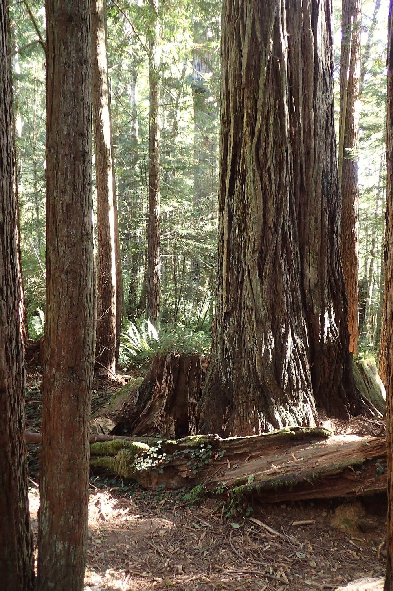{width="100%" height="360" fig-alt="Coast redwood trunks rising out of view in a forest."}

[Photo: Krzysztof Ziarnek, Kenraiz, CC BY-SA 4.0, Wikimedia Commons](https://commons.wikimedia.org/wiki/File:Sequoia_sempervirens_kz05.jpg){.credit}

:::
::::

**Before asking how water moves, we need a rule for which way it moves.**

::: notes
Start with the numbers so students see that water transport in a plant is a huge flux, not a trickle. The water loss is the price of opening stomata to let CO₂ in (P1, leaf slide). Link back to the A1 diffusion table: bulk flow is required. The puzzle is the energy source. The next slides give the rule for direction: water potential.
:::

## Water potential: which way water moves

:::: {.columns}
::: {.column width="50%"}
- **Water potential (Ψ):** the free energy of water per unit volume,
  relative to **pure water at atmospheric pressure**, which has **Ψ = 0**.
- Unit: **megapascal** (MPa). 1 MPa = 10 bar ≈ 10 atm.
- Water moves passively from **higher** to **lower** Ψ.
- In plants Ψ is almost always **negative**, so "higher" means **less
  negative**.
:::
::: {.column width="50%"}
Highest to lowest:

| Ψ (MPa) | |
| ---: | --- |
| 0 | pure water |
| −0.2 | wet soil |
| −0.8 | leaf cell |
| −1.5 | dry soil |

Water flows **down** this list.
:::
::::

**What makes Ψ negative, and what can make it rise?**

::: notes
Exercises 1.1 and 1.2. The sign convention trips students up: −0.2 is higher than −0.8. Use the analogy of water flowing downhill, where "downhill" means towards more negative Ψ. The table is a preview of the soil-to-leaf gradient that we build up across the lecture.
:::

## The components of Ψ

$$\Psi = \Psi_s + \Psi_p \quad (+\,\Psi_g)$$

:::: {.columns}
::: {.column width="40%"}
- $\Psi_s$, **solute (osmotic) potential**: always ≤ 0; solutes lower the
  free energy of water.
- $\Psi_p$, **pressure potential**: **+** in turgid cells (turgor, P1),
  **−** in transpiring xylem (tension).
- $\Psi_g$, **gravitational**: +0.01 MPa per metre. Negligible in a cell;
  lifting water 100 m costs 1 MPa.
- In dry soil, binding to surfaces (matric potential) also lowers Ψ.
:::
::: {.column width="60%"}

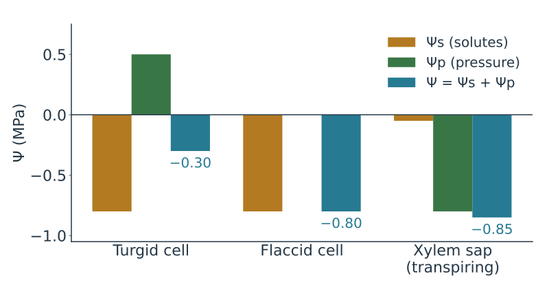{width="100%" height="360" fig-alt="Bar chart: a turgid cell has Ψs −0.8 and Ψp +0.5 MPa, so Ψ −0.3; a flaccid cell has Ψp 0 and Ψ −0.8; transpiring xylem sap has Ψs near 0 and Ψp −0.8, so Ψ −0.85 MPa."}

:::
::::

**How negative is Ψs for a real solution?**

::: notes
Two components do almost all the work in cells: solutes pull Ψ down, pressure pushes it up. Read the bars group by group: in a turgid cell a positive Ψp cancels part of Ψs; in a flaccid cell Ψp is zero and Ψ = Ψs; in the xylem of a transpiring plant the sap is almost pure water (Ψs near zero) but under tension, so Ψp itself is strongly negative. Turgor from P1 is now a number: Ψp. Point out that Ψp can be negative too, in the xylem of a transpiring plant, which is the key to cohesion–tension later. Gravity is introduced so students know when it can be dropped. Matric potential is mentioned only so students recognise the term.
:::

## Solute potential: Ψs = −cRT

$$\Psi_s = -cRT \qquad R = 0.008314\ \text{L MPa mol}^{-1}\,\text{K}^{-1}$$

$c$ is the **osmolar** concentration: count every dissolved particle.

| Solution (25 °C, 298 K) | $c$ (osmol L⁻¹) | $\Psi_s$ |
| --- | ---: | ---: |
| 0.1 M sucrose | 0.1 | −0.1 × 0.008314 × 298 = **−0.25 MPa** |
| 0.1 M NaCl (→ Na⁺ + Cl⁻) | 0.2 | **−0.50 MPa** |
| Sea water | ~1.1 | ~**−2.7 MPa** |

- At 25 °C, $RT \approx 2.48$ L MPa mol⁻¹: each 0.1 osmol L⁻¹ lowers Ψs by
  ~0.25 MPa.
- A salt that splits into two ions has **twice** the effect of a sugar at the
  same molarity.

**Now we can predict what happens to a cell placed in a solution.**

::: notes
Exercise 1.4 is the first two rows. Carry the units through on the board: mol L⁻¹ × L MPa mol⁻¹ K⁻¹ × K = MPa. The rule of thumb (0.1 osmol per litre ≈ −0.25 MPa) helps students check answers. Sea water shows why most crop plants cannot use it: their cells would need a Ψ below −2.7 MPa just to take up water.
:::

## Two cells in the same solution

Both cells are placed in a solution with **Ψ = −0.4 MPa**.

| Cell | Ψs (MPa) | Ψp (MPa) | Ψ = Ψs + Ψp | Initial net water movement |
| --- | ---: | ---: | ---: | --- |
| A | −0.8 | +0.2 | **−0.6** | **into** the cell (−0.4 > −0.6) |
| B | −0.7 | +0.5 | **−0.2** | **out of** the cell (−0.2 > −0.4) |

- Cell B's Ψs (−0.7) is far below the solution's Ψ (−0.4), yet it **loses**
  water: its high turgor raises its total Ψ.
- **Total Ψ decides the direction**, not solute concentration alone.
- As water moves, Ψp and Ψs change until Ψ inside equals Ψ outside:
  equilibrium, no net flow.

**What happens to turgor as a cell gains or loses water?**

::: notes
Exercise 1.3. The trap is to compare only solute potentials. Cell B is the instructive case: plenty of solute, but the wall is already pushing hard, so water leaves. Emphasise that the numbers are initial values; they change as water moves. This sets up the next slide, where we follow one cell to equilibrium.
:::

## One cell, three solutions

A flaccid cell: **Ψs = −0.6 MPa, Ψp = 0**, so **Ψ = −0.6 MPa** (assume Ψs
stays constant).

| Placed in | Water moves | At equilibrium | State |
| --- | --- | --- | --- |
| Pure water, Ψ = 0 | **in** | Ψ = 0, so Ψp = 0 − (−0.6) = **+0.6 MPa** | turgid |
| Solution, Ψ = −0.6 MPa | no net flow | Ψp = 0 | flaccid |
| Solution, Ψ = −0.8 MPa | **out** | Ψp stays 0; protoplast shrinks from the wall | **plasmolysed** |

- Turgor (P1) is the pressure that builds up until the cell's Ψ matches its
  surroundings.
- Ψp cannot fall far below zero in a living cell: the wall cannot pull, so
  the protoplast pulls away instead.

**What does this look like if Ψs is allowed to change as the cell swells or
shrinks?**

::: notes
Exercise 1.5. In pure water the cell takes up water until turgor exactly cancels the solute potential. In a more concentrated solution the cell loses water, turgor falls to zero and the membrane separates from the wall: plasmolysis, visible in onion epidermis in the practical. Transition: the table assumed Ψs is fixed; the next slide drops that simplification.
:::

## Turgor and volume: the Höfler diagram

:::: {.columns}
::: {.column width="40%"}
The same cell (Ψs = −0.6 MPa when flaccid), plotted against its
protoplast volume:

- Below the flaccid volume, Ψp = 0 and **Ψ = Ψs**: the protoplast shrinks
  away from the wall.
- Above it, the stretched wall pushes back: Ψp rises steeply, and Ψs rises a
  little as the sap is diluted.
- In pure water the cell stops at **Ψ = 0**, only a few % larger than when
  flaccid.
:::
::: {.column width="60%"}

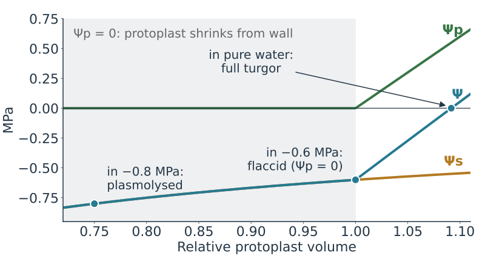{width="100%" height="360" fig-alt="Höfler diagram: Ψs, Ψp and Ψ against relative protoplast volume, with points for a plasmolysed cell in −0.8 MPa, a flaccid cell in −0.6 MPa and a fully turgid cell in pure water."}

:::
::::

**A root cell is exactly such a cell, sitting in the soil solution.**

::: notes
The Höfler diagram is the standard way to show how the components change together. The x-axis is protoplast volume relative to the volume at incipient plasmolysis. To the left, the protoplast has pulled away from the wall, Ψp is zero and Ψ equals Ψs, which becomes more negative as the cell loses water (Ψs = −0.6 / V). To the right, the wall is stretched elastically (here with a modulus of 6 MPa), so Ψp rises quickly. Full turgor in pure water is reached at Ψ = 0, where Ψp ≈ +0.55 MPa rather than the +0.6 of the previous slide: the cell swelled by about 9 % and diluted its sap a little. With a stiffer wall the difference shrinks, which is why the fixed-Ψs approximation works well. The three dots are the three rows of the previous table.
:::

## Try it: a cell in a solution

```{=html}
<link rel="stylesheet" href="../../demos/dist/demo.css">
<div data-demo="p2-waterpotential"></div>
<script src="../../demos/dist/p2-waterpotential.js"></script>
```

::: notes
The cell from the last two slides, placed in a beaker. The cell always starts flaccid (Ψp = 0); its sap Ψs is set at that volume. The bars show the cell's Ψs, Ψp and Ψ, and the red dashed line the solution's Ψ; the arrows show the direction of water flow. Click "Pure water": arrows point inwards, the cell swells, Ψp rises until the blue Ψ bar reaches the dashed line at zero, and the state reads turgid. Ask the room to predict before each click. "−0.6 MPa": no flow, the cell stays flaccid. "−0.8 MPa": water leaves, the protoplast shrinks away from the wall and Ψs falls to −0.8 (plasmolysis). "Saline soil" is the next slide: a root cell with Ψs −0.4 in a −0.6 MPa soil solution loses water. Then drag the wall-stiffness slider: a stiff wall (40 MPa) reaches full turgor with almost no swelling and Ψp ≈ +0.6 (the fixed-Ψs table), a soft wall (2 MPa) swells more and dilutes its sap. Finally drag the solution slider slowly and ask when plasmolysis starts: exactly when the solution Ψ drops below the cell sap Ψs. "Place a flaccid cell in the solution" replays the current case from the start.
:::

## Wet but salty soil: the opening problem

:::: {.columns}
::: {.column width="40%"}
A root cell has **Ψ = −0.4 MPa**.

| Soil solution | Ψ | Water moves |
| --- | ---: | --- |
| Moist | −0.1 | soil → **root** |
| Moist, saline | −0.6 | root → **soil** |

- Salt lowers the **Ψs** of soil water: the soil is wet, but its Ψ is below
  the root's.
- To take up water again the plant must **accumulate solutes** (osmotic
  adjustment). This costs energy, and Na⁺ and Cl⁻ are toxic inside cells.
:::
::: {.column width="60%"}

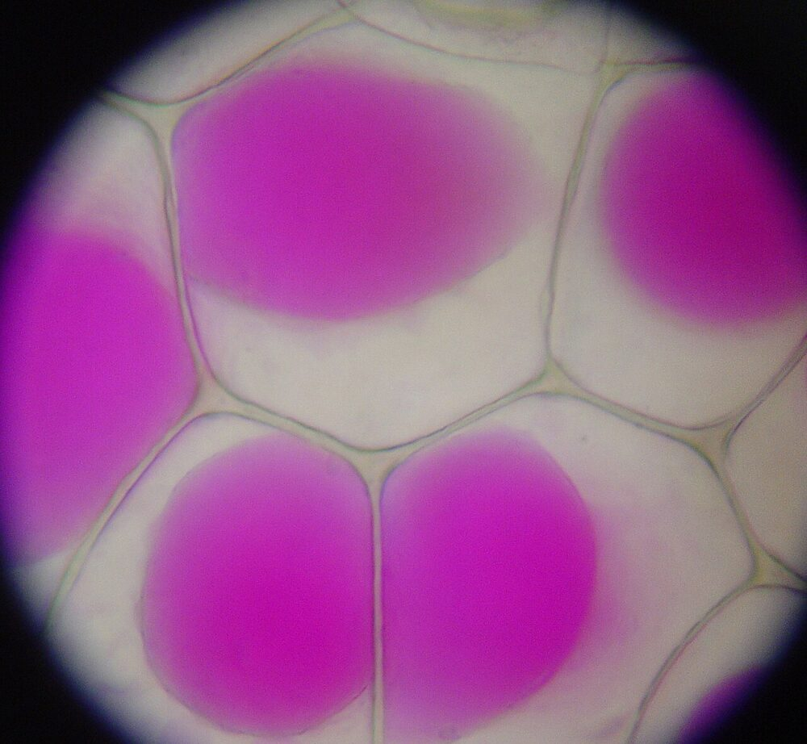{width="100%" height="360" fig-alt="Rhoeo epidermal cells in a concentrated solution: in each cell the pink vacuole and protoplast have shrunk into a rounded mass, pulled away from the angular cell wall."}

[Photo: Mnolf, CC BY-SA 3.0, Wikimedia Commons](https://commons.wikimedia.org/wiki/File:Rhoeo_Discolor_-_Plasmolysis.jpg){.credit}

:::
::::

**Water is available in the soil. How does it cross the root to reach the xylem?**

::: notes
Exercise 1.6, and the answer to the second question in the introduction: wet soil can behave like dry soil for the plant. Work the comparisons: −0.1 > −0.4, so water enters; −0.4 > −0.6, so water leaves. The photo shows the extreme case, the −0.8 MPa row two slides back: in a strong solution the coloured protoplasts have shrunk away from the walls. You will see the same in onion epidermis in the practical. About 20 % of irrigated land is affected by salinity, so this is a major crop problem; P5 returns to salt stress. Transition: follow water inward across the root tissues we met in P1.
:::

## Into the root: three routes and one barrier

:::: {.columns}
::: {.column width="40%"}
- **Apoplastic:** through cell walls and spaces; crosses **no membrane**.
- **Symplastic:** cytoplasm to cytoplasm through **plasmodesmata**.
- **Transmembrane:** across the plasma membrane (and tonoplast) of each
  successive cell.

At the **endodermis**, the **Casparian strip** (suberin, with lignin) in the
radial and transverse walls **blocks the apoplast**.
:::
::: {.column width="60%"}

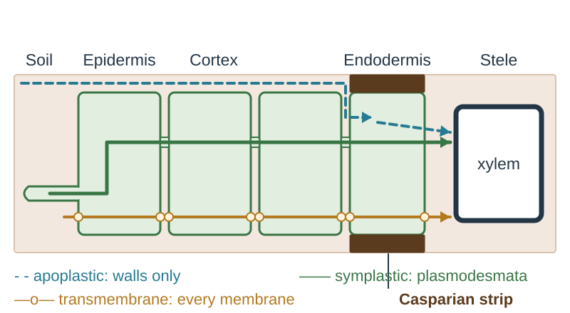{width="100%" height="360" fig-alt="A row of root cells from soil to xylem. The apoplastic route runs in the walls until the Casparian strip of the endodermis forces it into the cell; the symplastic route runs through plasmodesmata; the transmembrane route crosses every membrane."}

:::
::::

**Every water molecule and ion entering the xylem has passed a membrane at
least once. That membrane decides what gets in.**

::: notes
Exercises 2.1 and 2.2. These are the apoplast, symplast and endodermis from P1, now carrying water. The Casparian strip is the root's checkpoint: without it, soil solution including toxic ions could flow through the walls straight into the xylem. Water crosses membranes passively; ions need transport proteins, and some need energy, which is the next slide.
:::

## Crossing the membrane: water is passive, ions cost energy

:::: {.columns}
::: {.column width="50%"}
**Water**

- Moves through **aquaporins**: channels that raise membrane permeability.
- Always **passive**, down the Ψ gradient. No ATP pumps water.

**Ions**

- **Plasma-membrane H⁺-ATPase** uses ATP to pump H⁺ out: apoplast pH ~5.5,
  cytosol ~7.3, membrane potential −120 to −200 mV.
- **Channels** let ions move down this gradient (K⁺ in).
- **H⁺-coupled carriers** use H⁺ flowing back in to move ions **against**
  their own gradient (NO₃⁻, H₂PO₄⁻): **secondary active transport**.
:::
::: {.column width="50%"}
**Waterlogged roots: wet but starving**

1. Water fills the soil pores.
2. Little O₂ reaches the roots.
3. Aerobic respiration falls: less ATP.
4. H⁺-ATPase slows; the H⁺ gradient declines.
5. Less H⁺-coupled uptake of mineral ions.
:::
::::

**Now the water is in the xylem. What lifts it 100 m?**

::: notes
Exercises 2.3 and 2.4. Keep water and ions separate: aquaporins change how fast water moves, never the direction. The H⁺-ATPase is the plant's primary pump, playing the role that the Na⁺/K⁺-ATPase plays in animal cells (A4). The waterlogging chain shows that mineral uptake depends on root respiration, which links forward to P3 (respiration and fermentation in flooded roots).
:::

## Soil to air: a gradient of Ψ

:::: {.columns}
::: {.column width="40%"}
- Soil → root → xylem → leaf cells → evaporation from mesophyll walls →
  air through the stomata.
- Each step is **downhill in Ψ**: water moves passively the whole way.
- The biggest drop is from leaf to air: air at 50 % relative humidity has
  Ψ ≈ −95 MPa.
- The energy comes from **evaporation at the leaf**, ultimately from the
  sun. The plant spends no ATP moving water.
:::
::: {.column width="60%"}

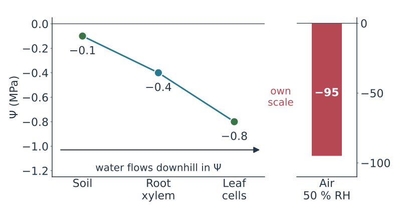{width="100%" height="360" fig-alt="Water potential falls from −0.1 MPa in the soil to −0.4 in the root xylem and −0.8 in leaf cells; air at 50 % humidity, on its own scale, is −95 MPa."}

:::
::::

**How does evaporation in a leaf pull on water in the roots?**

::: notes
Exercises 3.1 (order of steps) and 3.3 (order of Ψ values). This is the running example of the lecture in one picture. The air value comes from Ψ = (RT/V̄w) ln(RH): at 50 % humidity it is about −95 MPa, a hundred times more negative than the leaf, which is why evaporation is so powerful. The plant's job is to control the last step (stomata), not to drive the flow.
:::

## Cohesion–tension

:::: {.columns}
::: {.column width="40%"}
1. Water evaporates from mesophyll walls; the curved water surfaces in the
   wall pores pull on the water behind them.
2. This **tension** (−1 to −2 MPa in a tall tree) is transmitted down the
   continuous water column by **cohesion** (hydrogen bonds between water
   molecules) and **adhesion** to the conduit walls.
3. **Lignified wall thickenings** stop the conduits collapsing under
   tension (P1).
:::
::: {.column width="60%"}

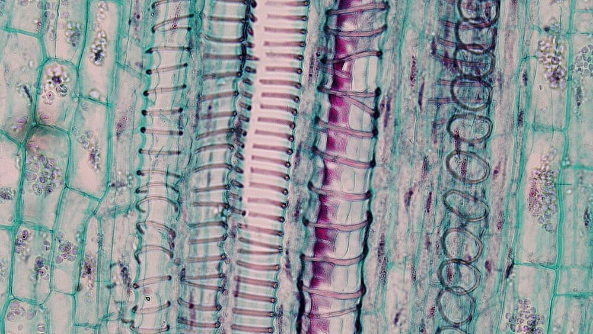{width="100%" height="360" fig-alt="Longitudinal section of a pumpkin stem showing xylem vessels with ring and spiral wall thickenings."}

[Photo: Berkshire Community College Bioscience Image Library, CC0, Wikimedia Commons](https://commons.wikimedia.org/wiki/File:Herbaceous_Dicot_Stem_Xylem_Vessels_Cucurbita_%2835463815631%29.jpg){.credit}

:::
::::

**The leaf pulls, cohesion transmits the pull, rigid walls resist it.**

::: notes
The mechanism needs no pump at any height: the leaf pulls, cohesion transmits, the rigid walls resist. The section shows the xylem vessels as P1 described them: dead, empty tubes whose walls are reinforced by rings and spirals of lignified secondary wall. These thickenings work like the wire in a vacuum-cleaner hose: they stop the tube collapsing when the water inside is under tension. Recall that a tension of −1 MPa is a negative pressure ten times larger in magnitude than atmospheric pressure.
:::

## When the column breaks; when the root pushes

:::: {.columns}
::: {.column width="40%"}
| Term | Meaning |
| --- | --- |
| **Cohesion** | water molecules attract each other |
| **Adhesion** | water attracts the conduit walls |
| **Tension** | negative pressure in the xylem water |
| **Cavitation** | the column breaks; a gas bubble forms |
| **Embolism** | the conduit is gas-filled and blocked |

- Pits between conduits limit the spread of embolism.
- **Root pressure** (≤ ~0.2 MPa) pushes sap up at night and causes
  **guttation**, but cannot lift water to the top of a tree.
:::
::: {.column width="60%"}

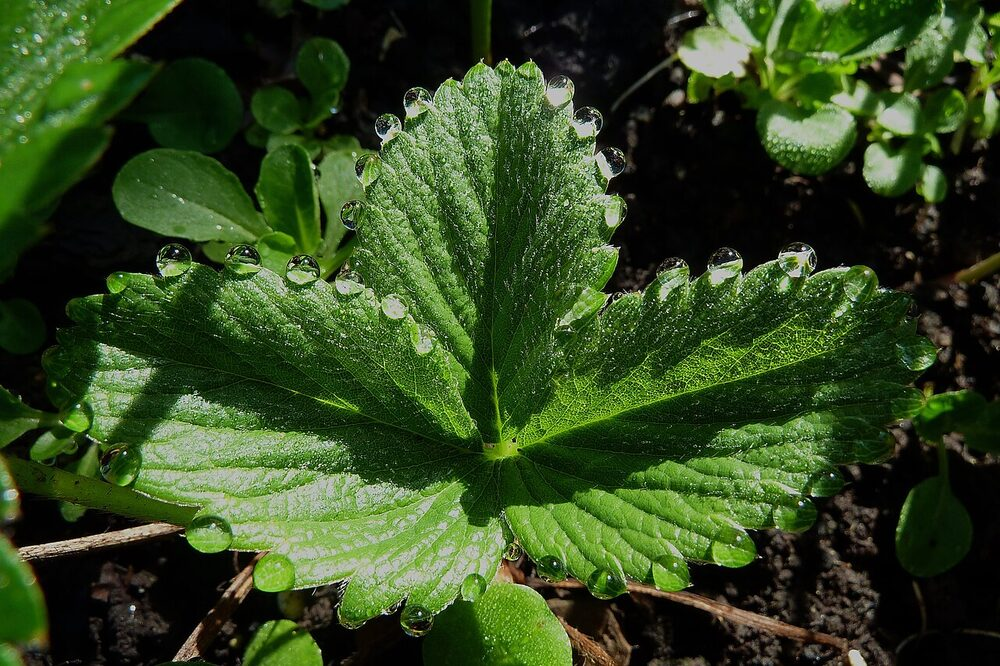{width="100%" height="360" fig-alt="Drops of water at the tips of the marginal teeth of a strawberry leaf, pushed out by root pressure."}

[Photo: Schnobby, CC BY-SA 3.0, Wikimedia Commons](https://commons.wikimedia.org/wiki/File:Guttation_on_a_strawberry_leaf.jpg){.credit}

:::
::::

**If evaporation drives the flow, what sets how fast a plant loses water?**

::: notes
Exercise 3.2 matches these terms. Cavitation is the cost of working under tension: drought increases tension and risks embolism, and an embolised vessel no longer conducts. The photo shows the other force: on humid nights, when transpiration stops, roots keep loading ions into the xylem, water follows osmotically and the positive pressure pushes drops out of hydathodes at the leaf margin. The drops are xylem sap, not dew. Root pressure is real but at most about 0.2 MPa, enough for about 20 m in theory and far less in practice, and it is absent in many trees, so it cannot explain transport in tall trees.
:::

## Measuring transpiration: rate and units

:::: {.columns}
::: {.column width="45%"}
Weigh potted plants over 4 h. Unplanted soil loses **4 g** (soil evaporation).

$$E = \frac{\text{mass loss} - 4\ \text{g}}{4\ \text{h} \times \text{leaf area}}$$

| Pot | Loss (g) | Area (m²) | E (g m⁻² h⁻¹) |
| ---: | ---: | ---: | ---: |
| 1 | 24 | 0.10 | 50.0 |
| 2 | 27 | 0.12 | 47.9 |
| 3 | 22 | 0.10 | 45.0 |
| 4 | 25 | 0.11 | 47.7 |

Mean: **47.7 g m⁻² h⁻¹**.
:::
::: {.column width="55%"}
Convert pot 1 to the standard unit, mmol H₂O m⁻² s⁻¹:

$$\frac{50\ \text{g m}^{-2}\,\text{h}^{-1}}{18\ \text{g mol}^{-1}} = 2.78\ \text{mol m}^{-2}\,\text{h}^{-1}$$

$$\frac{2.78}{3600\ \text{s h}^{-1}} = 7.7\times10^{-4}\ \text{mol m}^{-2}\,\text{s}^{-1} = 0.77\ \text{mmol m}^{-2}\,\text{s}^{-1}$$

- **Subtract** the soil control: otherwise soil evaporation is counted as
  transpiration.
- **Divide by leaf area** so plants of different size can be compared.
:::
::::

::: notes
Exercise 3.4. Work the conversion step by step: grams to moles, hours to seconds. Gas-exchange instruments report transpiration in mmol m⁻² s⁻¹ and photosynthesis in µmol m⁻² s⁻¹, which students meet again in P3. The two bullets are the experimental logic: a control for the non-plant water loss, and normalisation by the evaporating surface.
:::

## What sets the transpiration rate

Transpiration ≈ conductance × (vapour pressure in leaf − vapour pressure in
air)

:::: {.columns}
::: {.column width="40%"}
With stomatal conductance unchanged:

- **Lower air humidity → more**: larger vapour pressure difference.
- **Warmer leaf → more**: higher vapour pressure inside the leaf.
- **Stronger wind → more**: thinner boundary layer.
- **Smaller leaf area → less**: less evaporating surface.

Inside the leaf the air is saturated (~100 % humidity). The plant cannot
control the weather; it controls the **stomata**.
:::
::: {.column width="60%"}

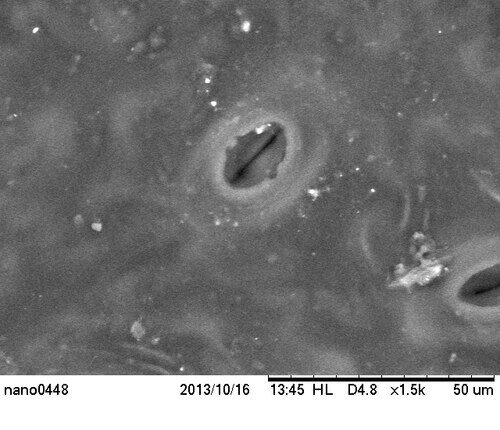{width="100%" height="360" fig-alt="Scanning electron micrograph of a leaf surface: a stoma, a slit-shaped pore between two guard cells, with part of a second stoma at the edge; scale bar 50 µm."}

[Photo: Arlo James Barnes, CC0, Wikimedia Commons](https://commons.wikimedia.org/wiki/File:Stoma.tif){.credit}

:::
::::

**So how do guard cells open and close the pore?**

::: notes
Exercise 3.5. The formula is Fick's law from A1 in another form: flux = conductance × concentration difference. Humidity and temperature change the driving difference, wind and stomata change the conductance. The plant's one fast control is the stomatal pore, which leads into the next slide.
:::

## Stomatal opening: ion transport makes turgor

:::: {.columns}
::: {.column width="40%"}
1. **Blue light** activates the guard-cell **H⁺-ATPase**.
2. H⁺ is pumped out; the membrane **hyperpolarises**.
3. **K⁺** enters through inward-rectifying channels; **Cl⁻** is taken up and
   **malate** made, balancing the charge.
4. Guard-cell **Ψs and Ψ fall**.
5. **Water enters** by osmosis.
6. **Turgor rises**; radial microfibrils make the guard cells bow apart and
   the **pore opens**.
:::
::: {.column width="60%"}

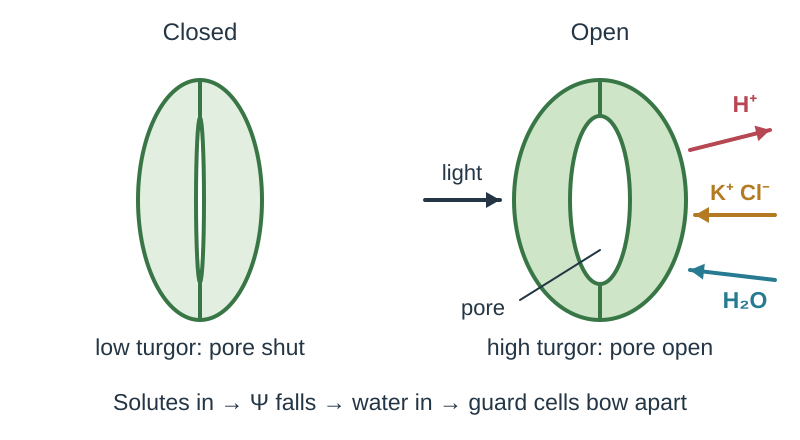{width="100%" height="360" fig-alt="Two guard cells: slack and pressed together when closed; after H+ is pumped out and K+ and Cl− and water enter, they swell and bow apart, opening the pore."}

:::
::::

Guard-cell K⁺ can rise from ~100 to ~400–800 mM during opening.

**Opening is the default in light. What makes stomata close?**

::: notes
Exercise 4.1 asks for this order. Each step uses an earlier idea: the H⁺-ATPase from the root slide, Ψs = −cRT (a few hundred millimolar of KCl lowers Ψs by about 1–2 MPa), turgor from P1, and microfibril orientation from the P1 wall slide controlling the direction of swelling. Stomata are hydraulic valves run by ion transport.
:::

## Signals that open and close stomata

:::: {.columns}
::: {.column width="45%"}
| Signal | Response |
| --- | --- |
| Blue light at dawn | **open** |
| Low intercellular CO₂ | **open** |
| High intercellular CO₂ | **close** |
| Increased ABA | **close** |
| Low leaf Ψ (drought) | **close** |
:::
::: {.column width="55%"}
**Abscisic acid (ABA)**, the drought hormone, made in roots and leaves:

1. ABA binds receptors in the guard cells.
2. **Anion channels** open; Cl⁻ and malate leave.
3. The membrane **depolarises**.
4. **K⁺ leaves** through outward-rectifying channels.
5. Guard-cell Ψs and Ψ **rise**; water leaves.
6. Turgor falls and the **pore closes**.
:::
::::

**ABA is a signal: it changes ion channels, it does not plug the pore.**
Closing saves water but stops CO₂ uptake.

::: notes
Exercises 4.2 and 4.3. The closing sequence is the opening sequence run in reverse, triggered by a hormone instead of light. The CO₂ responses make sense: if CO₂ inside the leaf is high, the pore need not be open. The last line is the trade-off of the whole plant: closing protects water status but halts photosynthesis, which P3 picks up (photorespiration and CAM). Before minerals, the next slide puts the whole water path together.
:::

## Try it: soil to air

```{=html}
<link rel="stylesheet" href="../../demos/dist/demo.css">
<div data-demo="p2-soilplantair"></div>
<script src="../../demos/dist/p2-soilplantair.js"></script>
```

::: notes
The whole water path in one steady-state model. Transpiration is set in the vapour phase, conductance × vapour pressure deficit (leaf and air at 25 °C), and the same flux has to flow through soil, root, stem and leaf, losing Ψ in each in proportion to its resistance. The curve on the right is the soil-to-air gradient slide, now live; the blue dashes in the stem move at a speed proportional to the flux. Start with "Lecture" (50 % humidity, wet soil): about 6 mmol m⁻² s⁻¹, root xylem −0.4 and leaf −0.8 MPa as on that slide. "Humid": the flux falls and the profile flattens towards the soil value; at 100 % nothing moves. Drag humidity down: the flux rises and the leaf Ψ falls, but the air (top right) is always tens of MPa below the leaf. "Dry soil" (−0.8 MPa) with stomata that do not respond: drying soil conducts poorly, so the leaf is dragged below −4 MPa and the xylem would cavitate. "Dry soil + ABA": stomata partly close, transpiration drops to about a fifth and the leaf stays near −1.8 MPa; the plant trades CO₂ uptake for water. "Redwood": 100 m of height costs about 1 MPa by gravity alone, before any flow. Ask which slider the plant itself controls: only stomatal opening. The resistances are illustrative, chosen to reproduce the lecture values.
:::

## Essential elements

:::: {.columns}
::: {.column width="64%"}
An element is **essential** if the plant cannot complete its life cycle
without it, or it is part of an essential molecule, and no other element can
replace it.

| Macronutrients | Typical % of dry mass | Micronutrients | Typical mg kg⁻¹ dry mass |
| --- | ---: | --- | ---: |
| N | 1.5 | Fe | 100 |
| K | 1.0 | Mn | 50 |
| Ca | 0.5 | Zn | 20 |
| Mg | 0.2 | B | 20 |
| P | 0.2 | Cu | 6 |
| S | 0.1 | Mo | 0.1 |
:::
::: {.column width="36%"}

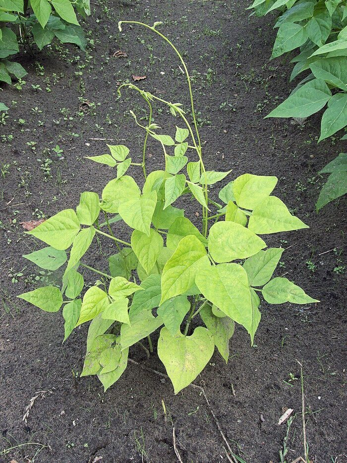{width="100%" height="400" fig-alt="A nitrogen-deficient bean plant in a garden bed: all its leaves are pale yellow-green, while the healthy bean plants at the edges of the photo are dark green."}

[Photo: Rasbak, CC BY-SA 3.0, Wikimedia Commons](https://commons.wikimedia.org/wiki/File:Phaseolus_vulgaris_nitrogen_deficiency.jpg){.credit}
:::
::::

- "Macro" and "micro" refer to the **amount needed**, not to importance:
  without 0.1 mg kg⁻¹ of Mo the plant dies just as surely.
- C, H and O come from CO₂ and water.

**What does each element do, and how do you recognise a deficiency?**

::: notes
Exercises 5.1 and 5.2. The concentrations are the standard values from Epstein, as quoted in Taiz & Zeiger: nitrogen is needed at about 10⁵ times the concentration of molybdenum. Students should be able to sort the twelve elements into the two groups. Essentiality is tested by growing plants in hydroponic solutions lacking one element. The photo shows what lack of the most-needed element looks like: a nitrogen-starved bean plant is pale yellow-green all over, compared with the dark green healthy plants at the edges. Nitrogen is in chlorophyll and in every protein, so the whole plant pales and grows slowly; the next two slides explain which leaves go first.
:::

## Roles of elements and where symptoms appear {.smaller}

| Element | Main role | Mobile in phloem? | First symptoms |
| --- | --- | --- | --- |
| **N** | amino acids, proteins, nucleotides, chlorophyll | yes | yellowing of **old** leaves |
| **P** | ATP, nucleic acids, phospholipids | yes | old leaves, dark or purple |
| **K** | main osmotic cation, e.g. in guard cells; enzyme activation | yes | old leaf margins |
| **Mg** | central atom of chlorophyll | yes | yellowing between veins, **old** leaves |
| **Fe** | cytochromes and Fe–S proteins in electron transport | **no** | yellowing of **young** leaves |
| **Ca** | cell walls (pectin), signalling | **no** | young leaves, tips |

**Where the symptoms appear tells you which group the missing element is in.**

::: notes
Exercises 5.3 (roles) and 5.4 (old versus young leaves). Read the table by columns: the role explains the symptom (N and Mg are in chlorophyll, so their lack yellows leaves), and the mobility column explains where it shows first, which is the next slide. Mobility is phloem mobility, so this links forward to P3, where the phloem moves sugar from sources to sinks.
:::

## Reading a deficiency: old or young leaves?

:::: {.columns}
::: {.column width="40%"}
- A **mobile** element (N, P, K, Mg) is withdrawn from old leaves to supply
  new growth, so **old** leaves show symptoms first.
- An **immobile** element (Fe, Ca) stays where it was deposited, so
  **young** leaves, which depend on current uptake, show symptoms first.
- The photo: **Mg** deficiency in maize. Yellow stripes **between the
  veins** of older leaves; the veins stay green longest.
:::
::: {.column width="60%"}

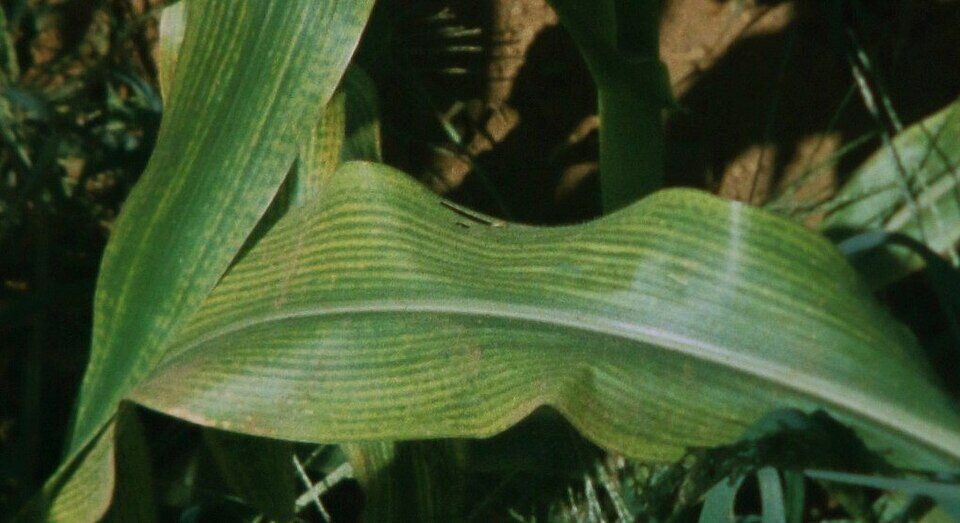{width="100%" height="360" fig-alt="Maize leaves with pale yellow stripes between green veins, a symptom of magnesium deficiency."}

[Photo: Alandmanson, CC BY 4.0, Wikimedia Commons](https://commons.wikimedia.org/wiki/File:Mg_deficiency_Vulindlela_1995-3-30_2018_01_23_2235.jpg){.credit}

:::
::::

**Roots do not take up all of this alone.**

::: notes
The mobility rule turns a symptom pattern into a diagnosis: where the yellowing appears tells you which group the missing element belongs to. Magnesium is the central atom of chlorophyll, so its lack shows as chlorosis; it is phloem-mobile, so the plant strips it from old leaves to supply young ones, and the old leaves go yellow first, between the veins. Iron deficiency also gives interveinal yellowing, but on the youngest leaves, because Fe is not remobilised. Ask: a tomato plant has yellowing confined to its top leaves; which group of elements do you suspect?
:::

## Mycorrhizas: fungi extend the root

:::: {.columns}
::: {.column width="40%"}
- Fungal hyphae enter the root cortex and form **arbuscules** inside cells:
  tree-like branches that give a huge exchange surface.
- Formed by **~70–80 %** of land plant species.
- Hyphae (~2–10 µm) reach far beyond the depletion zone around a root.
- **Plant gains:** mineral nutrients, especially **phosphate**, and water.
- **Fungus gains:** **carbon** (sugars and lipids), up to ~20 % of the
  plant's photosynthate.
:::
::: {.column width="60%"}

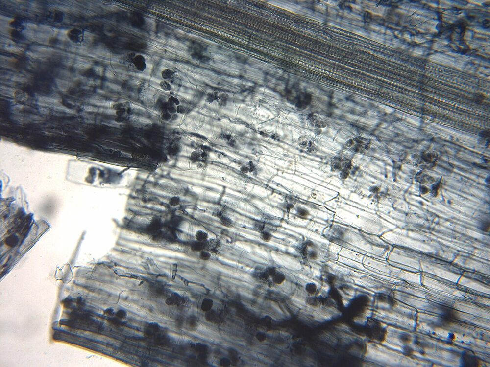{width="100%" height="360" fig-alt="Stained flax root cortex under the microscope: dark, finely branched fungal arbuscules fill several cortical cells."}

[Photo: Msturmel, public domain, Wikimedia Commons](https://commons.wikimedia.org/wiki/File:Arbuscular_mycorrhiza_microscope.jpg){.credit}

:::
::::

::: notes
Exercise 5.5. Phosphate diffuses very slowly in soil, so a zone around each root is quickly depleted; fine hyphae extend the absorbing surface far beyond it, the A1 surface-area solution again. In the photo the fungus is stained; each dark tuft is an arbuscule inside a living cortical cell, where the plant and fungus exchange phosphate for carbon across the plant plasma membrane, which folds around the arbuscule. The fungus never crosses that membrane.
:::

## Root nodules: bacteria fix nitrogen

:::: {.columns}
::: {.column width="40%"}
- **Rhizobia** live in root nodules of legumes (pea, bean, clover).
- They convert N₂ to NH₃ with nitrogenase, at a cost of ~16 ATP per N₂.
- The plant supplies sugars; the bacteria supply ammonium.

Both symbioses trade **carbon** from the leaves for **nutrients** from the
soil.
:::
::: {.column width="60%"}

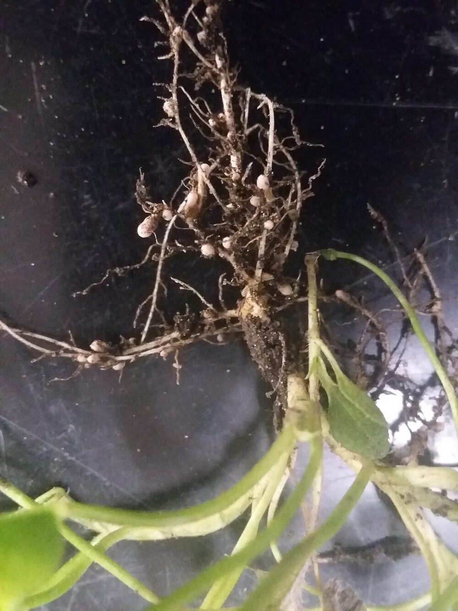{width="100%" height="360" fig-alt="Clover roots with many small round nodules containing nitrogen-fixing bacteria."}

[Photo: Bwiltz, CC BY-SA 4.0, Wikimedia Commons](https://commons.wikimedia.org/wiki/File:Clover_root_nodules.jpg){.credit}

:::
::::

**Carbon pays for water and mineral uptake. Where does that carbon come from?**

::: notes
Exercise 5.5. Nodules that are actively fixing are pink inside, from leghaemoglobin, which keeps O₂ low around the oxygen-sensitive nitrogenase while still supplying respiration. Both partnerships cost the plant carbon, as does all active ion uptake (respiration in roots). This sets up P3: how light becomes the carbon that pays for everything.
:::

## Summary {.smaller}

| Concept | Key fact |
| --- | --- |
| Water potential | Ψ = Ψs + Ψp; pure water = 0 MPa; water moves to lower (more negative) Ψ |
| Solute potential | Ψs = −cRT, c in osmol L⁻¹; 0.1 M NaCl → −0.50 MPa at 25 °C |
| Turgor and plasmolysis | water enters until Ψ inside = Ψ outside; Ψp ≥ 0 in living cells |
| Saline soil | low soil Ψ can draw water out of roots in wet soil |
| Root routes | apoplastic, symplastic, transmembrane; Casparian strip blocks the apoplast |
| Ion uptake | H⁺-ATPase builds the gradient; channels and H⁺-coupled carriers use it |
| Cohesion–tension | evaporation creates tension; cohesion transmits it; no pump |
| Transpiration | units mmol H₂O m⁻² s⁻¹; rises with low humidity, heat, wind |
| Stomata | light → H⁺-ATPase → K⁺ in → water in → open; ABA → ions out → close |
| Minerals | macro/micro by amount; mobile elements show symptoms in old leaves |

**Next (P3 — Light, carbon and the whole-plant budget):** the open stomata let CO₂ in. How does
the leaf use light to turn CO₂ into sugar, how do some plants fix carbon while
losing less water, and how does sugar reach the root?

[Tutorial](index.qmd) · [Exercises](exercise.qmd) · [Quiz](quiz.qmd)

::: notes
Read the table in the order of the water path: the rule for direction, the calculation, uptake at the root, the xylem, loss from the leaf and its control, and the minerals carried with the water. P3 picks up the other gas passing through the stomata: every water molecule lost buys a share of CO₂, and P3 follows that CO₂ into sugar and out to the roots.
:::
